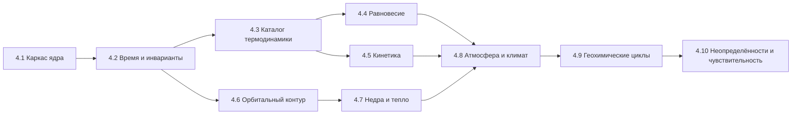

# IMPLEMENTATION_ROADMAP — Поэтапный план реализации

> Stage 4.0. Правила движения: (1) каждый этап заканчивается зелёным CI и
> сохранением всех тестов предыдущих уровней; (2) миграции сохранений —
> обязательная часть изменения схемы; (3) физика этапа не активируется в
> UI, пока не прошла валидацию; (4) неизвестное остаётся unknown.
> Ревизия Stage 4.0.1 (2026-10-30): критерии готовности согласованы с
> исправленной архитектурой (иерархия температур, интерфейс якобиана,
> JPL Evaluation No. 20, предел Роша, калибровка климата).
> Ревизия Stage 4.0.2 (2026-10-30): версия ATcT синхронизирована с
> DATA_PROVENANCE §2.3 — TN 1.228.
> Ревизия Stage 4.1 (2026-10-30): этап 4.1 исполнен как «Научное ядро»
> (контракты данных и инвариантов, `src/modules/Core/`, 171 тест, формат
> сохранений 1.2) — см. секцию 4.1 ниже и docs/science/
> CORE_SCIENTIFIC_ENGINE.md. Часть гигиенических позиций исходного плана
> 4.1 не выполнена и перенесена в 4.2 (перечислены явно).
> Ревизия Stage 4.1.1 (2026-10-30): в рамках этапа 4.1 исправлены 8
> дефектов научной целостности ядра, найденных независимым аудитом кода
> (детали: CURRENT_SYSTEM_AUDIT §1.16, контракты: CORE_SCIENTIFIC_ENGINE
> §2.4/2.5/2.9/2.10). Тесты: 517 (21 файл), ядро — 246; подсчёт CI #24 =
> 442 исправлен (в доках 4.1 ошибочно указывалось 438). Коммиты 4.1.1:
> f63c5be → af14dd8 → 25f813e (CI #27 зелёный).
> Ревизия Stage 4.1.1.2 (2026-10-30): корректирующая ревизия ядра —
> 4 остаточных дефекта полноты балансов и защиты хранилища (ISSUE A/B/C/D:
> неизвестный инвентарь ≠ ноль, пофазовый аудит всех резервуаров,
> untimed-исключения не маскируются как balanced, Storage не
> перезаписывает повреждённый корневой JSON) + обязательность
> properties в validateReservoirRecord. Тесты: 550 (21 файл), ядро —
> 279. Коммиты: 35e7b0e → bf3f677 (CI run #30 зелёный). Stage 4.2 НЕ
> начат — ядро зафиксировано на проверенном целостном состоянии.
> Ревизия Stage 4.1.1.3 (2026-10-30): корректирующая ревизия ядра —
> 2 остаточных дефекта (ISSUE A: явная неприменимость материи в
> пофазовом аудите — отсутствие material без materialApplicability
> 'not_applicable' есть неизвестный запас, маркер обязателен в обоих
> состояниях; ISSUE B: properties и material.entries — объекты-записи,
> массив не принимается за словарь). Тесты: 574 (21 файл), ядро —
> 303. Коммит: 00d9985 (CI run #32 зелёный). Stage 4.2 НЕ начат —
> ядро остаётся на проверенном целостном состоянии.

## Карта этапов

## 4.1 Научное ядро (контракты и инварианты) — Stage 4.1 исполнен

**Доставлено (HEAD 8c1a8e0, CI #23 зелёный; ревизия 4.1.1 — HEAD
25f813e, CI #27 зелёный)**:

- `src/modules/Core/` — 11 модулей: PhysicalQuantity (величины с
  размерностями, реестр ASCII-единиц, запрет NaN/±Inf), ScientificValue
  (6 статусов данных, uncertainty, provenance), ScientificSpecies (вид+фаза,
  элементный/зарядовый баланс), Reservoir (инвентарь с явным basis),
  FluxLedger (потоки с аудитами сохранения), SimulationClock
  (сегментированное время), CoreWorldState (каноническое состояние мира,
  гравитация ≠ излучение), SolverBackend (честный контракт решателей),
  migrations (1.0→1.1→1.2), adapters (мост из легаси), index.
- `GeneratedWorld.coreWorldState?` — опционально; отсутствие = «ядро
  не инициализировано», не нулевое состояние.
- Storage: формат 1.2, миграции делегированы ядру; секция «Научное ядро»
  в Markdown-экспорте. Легаси-семантика хранения и старые сохранения
  не ломаются (null не становится 0, значения не пересчитываются).
- 303 теста ядра (9 файлов core*.test.ts: 171 в 4.1 + 75 в 4.1.1 +
  33 в 4.1.1.2 + 24 в 4.1.1.3), всего 574 (CI #24 этапа 4.1 = 442 — в ранних
  доках ошибочно 438); PRNG-регрессия детерминизма добавлена в
  corePersistence.test.
- Документация: docs/science/CORE_SCIENTIFIC_ENGINE.md; аудит и дорожная
  карта обновлены.
- Легаси-модули (Generator, ChemicalEvolution, Units, WorldModel,
  пресеты, реакции) не изменены.
- Ревизия 4.1.1: исправлены 8 дефектов научной целостности ядра —
  convert-корректные массаↆколичество (1000 г H2O / 0.018 кг/моль =
  55.5556 моль), статусная семантика аудитов (balanced | imbalanced |
  approximate | not_verifiable), РЕАЛЬНЫЕ энергетические переносы в
  applyFlux/revertFlux, временная область аудитов (FluxAuditScope),
  строгие версии схем (MigrationError), raw-изоляция Storage +
  getStorageHealth, масштабирование процентов (50% → 0.5), provenance
  у unknown-значений. Легаси-модули не тронуты.

**НЕ доставлено из исходного списка 4.1 — перенесено в 4.2** (по правилу
этапа не трогать легаси-потребителей и не пересчитывать старые данные):

- перенос форматтеров PhysValue из App.tsx в ядро и отключение прямых
  импортов физических модулей в UI (аудит §1.15);
- удаление легаси-ветки характеристик тела (проблема 2.6) — контракты
  и адаптер готовы, переключение и миграция дозаполнением bodyPhysics —
  4.2;
- устранение дублей вспомогательных функций (проблема 2.7) — фабрики
  ядра готовы, дубли в легаси-модулях сохранены до перевода потребителей;
- ревизия текстов-обещаний (проблема 2.9);
- обновление ярлыка констант до CODATA 2022.

**Готовность (критерий этапа)**: все 574 теста зелёные (после
4.1.1.3, CI run #32: tsc 0 ошибок, oxlint, build успех; после
4.1.1.2 — 550, после 4.1.1 — 517, этап 4.1 заканчивался на 442 —
CI #24); контракты ядра покрыты 303 тестами; интерфейсы не выдаются за реализованные модели
(solver-бэкенд пуст и помечен not_implemented, planned ≠ available).
Исходные критерии «App.tsx без физических импортов» и «удалённая ветка
2.6» НЕ достигнуты в 4.1 и остаются критериями 4.2.

## 4.2 Политика времени и температуры (ядро симуляции)

- WorldClock, реестр процессов с τ, планировщик (Strang), аудитор инвариантов.
- Иерархия температурных величин (проблемы 2.2/2.3): РАЗДЕЛЬНЫЕ поля
  effectiveTemperature, equilibriumTemperature, surfaceTemperature,
  atmosphericTemperatureProfile, reservoirTemperature,
  localReactionTemperature (PHYSICS_ARCHITECTURE §5.1); правило
  совместимости «пресет vs T_eq».
- Химия переводится на расписание (поведение и числа шагов сохраняются).
- Перенесённые остатки 4.1: перевод UI на ядро (форматтеры, отключение
  прямых физических импортов в App.tsx), удаление легаси-ветки 2.6,
  устранение дублей 2.7, ревизия текстов 2.9, ярлык CODATA 2022.
- **Готовность**: golden-траектория (seed + 100 шагов химии) стабильна;
  тест запрета прямого изменения modelTime вне ядра; сценарии 3.1.2 зелёные.

## 4.3 Каталог веществ и термодинамики видов

- Схема `ProvenancedValue` (DATA_PROVENANCE §1); ≥20 видов с термодинамикой
  из NIST WebBook (SRD 69) / ATcT ver. TN 1.228 (синхронизировано с
  DATA_PROVENANCE §2.3; перекрёстная проверка, фиксация расхождений,
  per-record проверка покрытия); полиномы NASA-7 — параметризация поверх
  исходных табличных данных: математическая форма (Cp — полином 4-й
  степени; H°/S° — интегральные выражения с a5/T и a0·ln T; NASA-9 не
  смешивается с NASA-7 — CHEMISTRY §2), процедура аппроксимации,
  диапазоны, ошибка и ссылки на первоисточник фиксируются (CHEMISTRY §2);
  версии данных в сохранении.
- **Готовность**: тесты полиномов при 298/1000/3000 K против табличных
  значений; каждый вид имеет provenance-поля; неизвестные параметры — null.

## 4.4 Химическое равновесие

- Решатель минимизации G при ограничениях (элементы, заряд); нелинейный
  Ньютон; лог-переменные для неотрицательности.
- Скрининг фаз сохраняется и помечается; первый flash-уровень для
  двухфазных смесей (после валидации решателя).
- **Готовность**: известные K воспроизведены с допуском < 1% (сравнение по
  log10 K при фиксированном стандартном состоянии); элементы/заряд 1e-12;
  производительность: цели задаются при реализации с указанием
  оборудования, среды и состава сети (не универсальная цифра).

## 4.5 Химическая кинетика

- Движок скоростей (модиф. Аррениус, troe), данные из JPL Evaluation
  **No. 20 (JPL Publication 25-1, 2025, DOI 10.48577/jpl.KFQ0TZ**;
  per-record сверка с таблицами публикации) + KIDA для холодных сетей;
  ODE-решатель с интерфейсом якобиана (аналитический/разреженный/
  численный — выбор по механизму, диагональный не по умолчанию);
  политика «не рассчитано» при отсутствии данных.
- Стехиометрический игровой режим остаётся отдельным, помеченным.
- **Готовность**: Robertson-тест (устойчивость + сходимость при измельчении
  шага, сравнение с эталоном); k(T) на краях диапазонов JPL; реакция
  без данных → статус unknown (тест).

## 4.6 Орбитальный контур

- Сэмпл звезды из класса (проблема 2.1); сезонность (наклон, e) как данные
  тела; проверки Хилл/Рош/резонансы — предупреждения; Kepler-пропагатор;
  интерфейс Integrator + leapfrog; события затмений для спутников — после.
- **Готовность**: Луна 27.32 d ±0.5% (через массу родителя); энергия
  leapfrog < 1e-6 отн. на 1e4 периодов с проверкой сходимости по шагу
  (относительно периода); предел Роша — плотностная форма с тестом
  чувствительности к ρ_s (VALIDATION уровень 2); все орбиты каталога
  получают проверку устойчивости со статусом.

## 4.7 Недра и тепло

- Слоистая статика (гидростатика + EOS-таблицы с источниками);
  радиогенные мощности из изотопных данных (литература, provenance);
  приливный нагрев — только при k₂/Q из источников; уровни Geology —
  UI-проекция от Вт-значений (ADR-P8).
- **Готовность**: P центра Земли ±10% против PREM-порядка; без данных —
  unknown (тест); сохранение качественных выводов volcanism.

## 4.8 Атмосфера и климат

- Гидростатический профиль + масштабная высота; 1-D серый RCM с
  конвективной поправкой; связь с фотохимией (UV-потоки из спектральных
  таблиц); конденсация через фазовый решатель; утечка Джинса/
  energy-limited при наличии данных.
- **Готовность**: surfaceTemperature Земли 288±10 K; Венера: разрыв
  зафиксирован; Титан: S(CH₄) в допуске; парниковые эффекты не смешиваются
  с T_eq; калибровка RCM не по одной точке — независимая проверка профиля
  и потоков (VALIDATION уровень 3, ревизия 4.0.1).

## 4.9 Геохимические циклы

- Каркас потоков (моль/м²/год, ledger элементов); дегазация/выветривание/
  растворение как процессы с источниками или unknown; цикл C как первый;
  обобщение кислородного баланса (сохранение тестов 3.1.2).
- **Готовность**: замкнутый цикл C сохраняет элемент 1e-9 за 1000 шагов;
  каждый поток либо с источником, либо явно unknown.

## 4.10 Неопределённости и чувствительность

- Распространение неопределённостей (линейные — аналитика, нелинейные —
  Монте-Карло); форматтеры значащих цифр по неопределённости;
  тесты чувствительности (VALIDATION уровень 5).
- **Готовность**: отчёт чувствительности T_eq и K равновесий; golden-тесты
  с учётом версий данных.

## Порядок и правила приоритета

1. Сначала контракты и инварианты (4.1–4.2) — без них каждый следующий
   этап создаст новые скрытые связи.
2. Каталог данных (4.3) раньше решателей (4.4–4.5): решатель без данных —
   генератор unknown.
3. Физические контуры (4.6–4.8) после ядра, по возрастанию связности:
   орбиты → недра → атмосфера.
4. Циклы (4.9) и неопределённости (4.10) — последние, потому что зависят
   от всех предыдущих.

## Что НЕ делается (постоянные запреты)

- Не подменять unknown константами «для красоты».
- Не смешивать PRNG и физические решатели.
- Не подключать REBOUND/Cantera/PHREEQC/CoolProp-бэкенды к рантайму до
  лицензионного решения (DATA_PROVENANCE §2).
- Не обещать 3D GCM, N-body «по факту наличия орбит», surfaceTemperature до RCM.
- Не приписывать одну температурную величину другой (T_eq ≠ T_surface;
  пресет ≠ физика) и не сводить разные температуры к одному полю.
- Не менять генератор, пресеты и реакции каталога вне соответствующих
  этапов (Stage 4.0 — только документация).
