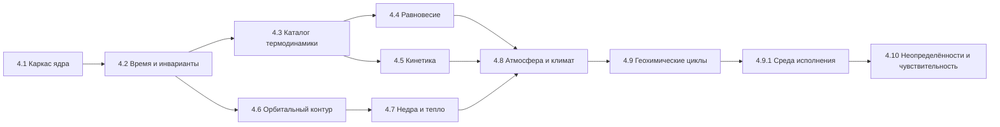

# IMPLEMENTATION_ROADMAP — Поэтапный план реализации

> Stage 4.0. Правила движения: (1) каждый этап заканчивается зелёным CI и
> сохранением всех тестов предыдущих уровней; (2) миграции сохранений —
> обязательная часть изменения схемы; (3) физика этапа не активируется в
> UI, пока не прошла валидацию; (4) неизвестное остаётся unknown.
> Ревизия Stage 4.0.1 (2026-10-30): критерии готовности согласованы с
> исправленной архитектурой (иерархия температур, интерфейс якобиана,
> JPL Evaluation No. 20, предел Роша, калибровка климата).
> Ревизия Stage 4.0.2 (2026-10-30): версия ATcT синхронизирована с
> DATA_PROVENANCE §2.3 — TN 1.228.
> Ревизия Stage 4.1 (2026-10-30): этап 4.1 исполнен как «Научное ядро»
> (контракты данных и инвариантов, `src/modules/Core/`, 171 тест, формат
> сохранений 1.2) — см. секцию 4.1 ниже и docs/science/
> CORE_SCIENTIFIC_ENGINE.md. Часть гигиенических позиций исходного плана
> 4.1 не выполнена и перенесена в 4.2 (перечислены явно).
> Ревизия Stage 4.1.1 (2026-10-30): в рамках этапа 4.1 исправлены 8
> дефектов научной целостности ядра, найденных независимым аудитом кода
> (детали: CURRENT_SYSTEM_AUDIT §1.16, контракты: CORE_SCIENTIFIC_ENGINE
> §2.4/2.5/2.9/2.10). Тесты: 517 (21 файл), ядро — 246; подсчёт CI #24 =
> 442 исправлен (в доках 4.1 ошибочно указывалось 438). Коммиты 4.1.1:
> f63c5be → af14dd8 → 25f813e (CI #27 зелёный).
> Ревизия Stage 4.1.1.2 (2026-10-30): корректирующая ревизия ядра —
> 4 остаточных дефекта полноты балансов и защиты хранилища (ISSUE A/B/C/D:
> неизвестный инвентарь ≠ ноль, пофазовый аудит всех резервуаров,
> untimed-исключения не маскируются как balanced, Storage не
> перезаписывает повреждённый корневой JSON) + обязательность
> properties в validateReservoirRecord. Тесты: 550 (21 файл), ядро —
> 279. Коммиты: 35e7b0e → bf3f677 (CI run #30 зелёный). Stage 4.2 НЕ
> начат — ядро зафиксировано на проверенном целостном состоянии.
> Ревизия Stage 4.1.1.3 (2026-10-30): корректирующая ревизия ядра —
> 2 остаточных дефекта (ISSUE A: явная неприменимость материи в
> пофазовом аудите — отсутствие material без materialApplicability
> 'not_applicable' есть неизвестный запас, маркер обязателен в обоих
> состояниях; ISSUE B: properties и material.entries — объекты-записи,
> массив не принимается за словарь). Тесты: 574 (21 файл), ядро —
> 303. Коммит: 00d9985 (CI run #32 зелёный). Stage 4.2 НЕ начат —
> ядро остаётся на проверенном целостном состоянии.
> Ревизия Stage 4.1.1.3.1 (2026-10-30): isPlainRecord строг к
> прототипам (Object.prototype/null; Map/Set/Date/RegExp/
> экземпляры классов — invalid, не «известная пустота»). Тесты:
> 597 (21 файл), ядро — 326. CI run #34 зелёный.
> Stage 4.2.1 (2026-10-30): подэтап «фундамент политики времени»
> выполнен — WorldClock поверх сегментированного SimulationClock
> (второго elapsed-поля нет; локальное время ≠ космологический
> возраст), реестр процессов с честными τ (unknown не превращается
> в число; dt ≤ τ/20 — только эвристика; легаси-процессы химии
> перенесены в честном disabled-состоянии), планировщик (Lie/
> Strang A(dt/2) → B(dt) → A(dt/2), sub-cycling, очередь событий),
> InvariantAuditor (9 секций, balanced только при полной границе),
> схема ядра 1.0.0 → 1.1.0, сохранения 1.2 → 1.3, golden baseline
> химии зафиксирован
> (877e17d346da3618ec5d15aced90c68da8a4bbb34ff18cb78023e756c1d85b20).
> Тесты: 672 (26 файлов), ядро — 401 (14
> файлов). Коммиты: 63375e9 → eba0a94 → 31f2298 → 8cb8ba3 →
> 2af6970 (CI runs #38–#42 зелёные). Stage 4.2 НЕ завершён:
> 4.2.2 (температурная иерархия), 4.2.3 (химия на Scheduler) и
> остальное 4.2 НЕ начаты.
> Stage 4.2.2 (2026-10-30): подэтап «температурная иерархия и
> provenance» выполнен — 6 раздельных температурных понятий в ядре
> (thermalState, resolver локальной температуры, адаптеры пресетов,
> схема CoreWorldState 1.2.0), WorldModel больше НЕ копирует пресетную
> температуру в surfaceTemperature. Тесты: 761 (27 файлов), ядро —
> 490. Статус 4.2.2 — см. §4.2 ниже.
> Stage 4.2.2.1 (2026-10-30): ревизия интеграции 4.2.2 по итогам
> независимого аудита — строгая валидация форм температур, orphan-
> защита resolver, provenance адаптеров, условная совместимость
> колыбели (отсутствие локальной температуры — не пройденная
> проверка, а предупреждение), диагностика пресет/T_eq подключена к
> генерации, location-aware фазовый скрининг. Golden-траектория
> стабильна. Тесты: 783 (27 файлов), ядро — 500. Статус — см. §4.2.
> Stage 4.2.2.2 (2026-10-31): семантика оценки и измерения — ошибка
> совместимости только для известного (known) значения локальной
> среды; оценочное расхождение с диапазоном колыбели — ЯВНОЕ
> предупреждение (новое правило cradle_temperature_estimate_outside_range),
> а не физическое противоречие; легаси surfaceTemperature без
> происхождения не считается измерением; presetSourceName — отдельное
> поле для реального источника (presetNotes — только пояснение);
> PhaseTemperatureBasis.location — структурированное место контекста.
> Golden-траектория стабильна. Тесты: 800 (27 файлов), ядро — 505.
> Stage 4.2.2.3 (2026-10-31): provenance gate — известное (known) без
> содержательного provenance — недоказанность
> (cradle_temperature_unproven), НЕ ошибка; раздельные источники
> surface/ocean (явная ссылка localReservoirId + resolver, без
> fallback на surface/T_eq/атмосферу/соседние резервуары);
> приоритет typed known над легаси-скаляром (легаси не
> перечитывается, предупреждение не дублируется). Golden-траектория
> стабильна. Тесты: 830 (27 файлов), ядро — 505. Статус — см. §4.2.
> Stage 4.2.2.4 (2026-10-31): корректирующая ревизия — проверка
> соответствия ReservoirRecord.kind локальной среде
> (несоответствие — недоказанность, не ошибка, без автоподбора
> другого резервуара); selectCradle экспортирован, принимает
> опциональный typed evidence и покрыт интеграционными тестами
> реального selector’а. Golden-траектория стабильна. Тесты: 848
> (27 файлов), ядро — 505. Статус — см. §4.2.
> Stage 4.2.2.5 (2026-10-31): корректирующая ревизия —
> candidate-specific локальные среды selector’а (карта
> cradleLocalEnvironmentsById по ID кандидата; без явной среды —
> per-candidate вычисление; перенос среды между кандидатами
> исключён); семантика видов: subsurface_reservoir — только kind
> ’crust’; runtime-неизвестный locationType — недоказанность без
> исключений. Golden-траектория стабильна. Тесты: 862
> (27 файлов), ядро — 505. Статус — см. §4.2.
> Stage 4.2.2.5.1 (2026-10-31): узкая корректирующая ревизия —
> защита kind-гейта от prototype pollution: список допустимых
> видов читается только по СОБСТВЕННОМУ ключу таблицы
> (hasOwnProperty); имена унаследованных свойств прототипа
> (’constructor’/’toString’/’hasOwnProperty’/’__proto__’) и
> произвольные строки — недоказанность без исключений и без
> автоподбора резервуара. Golden-траектория стабильна. Тесты: 863
> (27 файлов), ядро — 505. Статус — см. §4.2.
> Stage 4.2.3.1 (2026-10-31): подготовительный подэтап 4.2.3 —
> snapshot-изоляция macro-шага Scheduler: перед первым оператором
> создаётся глубокий рабочий снимок CoreWorldState (structuredClone;
> JSON-раунд-триппинг не используется); входной мир не мутируется
> при ошибке или отклонении шага; неклонируемое состояние —
> контролируемый отказ до операторов; контракты планировщика не
> изменены; перевод химии на расписание (4.2.3) НЕ начат;
> golden-траектория стабильна; итоговые количества тестов — по
> фактическому CI. Статус — см. §4.2.
> Stage 4.2.3.2 (2026-10-31): ReactionLedger — самостоятельный
> контракт реакционных транзакций и стехиометрический аудит
> (src/modules/Core/reactionLedger.ts, экспорт из Core/index.ts):
> журнал завершённых превращений, иммутабельная регистрация,
> элементный и зарядовый баланс с различимыми статусами balanced /
> imbalanced / not_verifiable / approximate; вымышленные ux:*
> компоненты с явным составом алгебраически проверяемы. ГРАНИЦЫ:
> ReactionLedger НЕ интегрирован — вне CoreWorldState, Scheduler и
> InvariantAuditor его не используют; FluxLedger не изменён; ни
> кинетика, ни solver, ни применение к инвентарям не реализованы.
> Следующий подэтап 4.2.3.3 — интеграция (CoreWorldState, версия
> схемы и сохранения, auditWorldTransition, Scheduler). Итоговые
> количества тестов — по фактическому CI. Статус — см. §4.2.
> Ревизия Stage 4.2.3.2.1 (2026-10-31): корректирующая ревизия
> ReactionLedger — 6 дефектов: обязательность time (undefined →
> invalid); прототип-безопасный учёт компонентов (Map +
> Object.fromEntries: 'constructor'/'toString'/'hasOwnProperty'/
> '__proto__' — данные, не прототип); строгая форма состава (только
> объектная запись; Map/Set/Date/RegExp/массив/класс →
> not_verifiable; численная пригодность — только known/estimated;
> пустой {} легитимен); NaN/Infinity в промежуточных итогах →
> not_verifiable (не balanced); tolerance — конечное неотрицательное
> (некорректное → invalid); note — непустая строка, пары участников
> кодируются однозначно (JSON.stringify). Границы прежние: интеграции
> нет (4.2.3.3 — следующий подэтап), защищённые контракты не
> изменены, golden не тронут. Статус — см. §4.2.

> Ревизия Stage 4.2.3.3 (2026-10-31): ReactionLedger интегрирован в
> CoreWorldState (опциональное поле, схема ядра 1.3.0, пустой журнал у
> новых миров), формат сохранений 1.3 → 1.4 (миграция создаёт пустой
> журнал у существующего ядра, существующий не перезаписывается; round-trip
> всех полей записи), секция 'reactions' в auditWorldTransition (отдельно
> от FluxLedger — без двойного счёта; пустой журнал balanced;
> not_verifiable ≠ balanced), Scheduler передаёт реакционные записи шага
> в аудит (правило отклонения прежнее — только imbalanced; шаг атомарен;
> записи не создаются автоматически). Кинетика, solver и применение
> реакций к инвентарям НЕ реализованы; перевод легаси-химии на
> расписание не начат; golden не тронут. Статус — см. §4.2.

> Ревизия Stage 4.2.3.3.1 (2026-10-31): корректирующая ревизия
> интеграции ReactionLedger — append-only контракт журнала в
> Scheduler (совпадающий id не доказывает неизменности: записи
> сравниваются по всему содержимому; изменение, удаление и
> перестановка старых записей, удаление журнала отклоняют шаг до
> аудита; новые записи требуют стехиометрического аудита до фиксации),
> проверка журнала при импорте/загрузке в Storage (некорректный
> журнал не возвращается как валидное состояние; повреждённая запись
> сохраняется как raw с причиной отказа), миграция 1.3 → 1.4 при
> неизвестной внутренней схеме ядра не модифицирует coreWorldState
> (незнание структуры не подменяется пустым журналом), семантика
> статусов аудита документирована (invalid — структурная
> некорректность; общий агрегатор по существующему правилу
> переводит invalid вместе с imbalanced в общий imbalanced; общий
> imbalanced сам по себе не доказывает физического нарушения).
> Добавлена долгосрочная дорожная карта за пределами генератора
> миров — часть II, этапы V–XI (план, не реализация). Статус — см.
> §4.2 и часть II.

> Ревизия Stage 4.2.3.3.2 (2026-10-31): корректирующая ревизия — три
> пограничных случая. (A1) при отсутствии прежнего журнала форма
> нового проверяется в полном объёме: records — обязательно массив;
> валидный пустой { records: [] } допустим; undefined после шага
> допустим только если журнала не было; явный null — контролируемое
> нарушение до или после шага (не исключение и не commit); некорректная форма нового журнала — reject Scheduler до аудита;
> контракт существующей истории не изменён. (A2) Storage и миграция
> различают отсутствие поля и явный null: null-журнал и null/
> не-объектное coreWorldState не маскируются под отсутствие,
> отклоняются с точной причиной, повреждённая raw-запись остаётся
> нетронутой, валидные соседние сохранения продолжают загружаться.
> (A3) deepJsonEqual различает сериализуемые виды объектов
> ({} и new Date(0) — разные данные) и защищает дополнительные поля
> записей от незаметного изменения; порядок ключей объектов не
> влияет, порядок массивов значим, undefined-ключ равносилен
> отсутствию (JSON-семантика сохранена); обнаружение изменений
> известных полей не ослаблено. Согласующая правка части II: КТ-2 —
> минимальная рабочая навигация галактика → лобби → игровая
> планета; полноценный пространственный UI/UX остаётся этапом X.
> Статус — см. §4.2 и часть II.

> Ревизия Stage 4.2.3.3.3 (2026-10-31): корректирующая ревизия —
> fail-closed сравнение и строгая валидация массивов ReactionLedger.
> (1) deepJsonEqual сравнивает каждый индекс массива явно: every и
> forEach пропускали отсутствующие индексы, из-за чего new Array(1)
> ошибочно считалась равной [new Date(0)], хотя JSON различает [null]
> и ISO-строку времени; порядок элементов значим, отсутствующий
> индекс равносилен явному undefined, сравнение симметрично; порядок
> ключей объектов не влияет, ключ со значением undefined равносилен
> отсутствующему, вложенные Date сравниваются по времени, прочие
> не-plain объекты остаются fail-closed. (2) обход обнаруживает
> циклы по активному рекурсивному пути: циклическое дополнительное
> поле записи даёт контролируемое нарушение append-only (fail-closed
> изменение), а не необработанный RangeError; повторное использование
> той же ссылки в независимых ветвях графа циклом не считается.
> (3) строгая форма: журнал, запись и участник — только настоящие
> plain records (прототип Object.prototype или null): массив и Date
> с дорисованными обязательными полями формой не проходят;
> допустимые дополнительные поля корректных записей не запрещаются
> (вложенная Date сравнивается по времени, как в 4.2.3.3.2).
> (4) дырки в records/reactants/products — структурная ошибка, а не
> отсутствие данных: каждый индекс обязан содержать существующую
> корректную запись/участника (forEach пропускал дырки, и undefined
> доходил до аудита с падением на обращении к speciesId); аудит
> таких входов — контролируемый invalid с диагностикой, а не
> исключение; правила стехиометрии, численные tolerance и статусы
> известных/неизвестных составов не менялись. (5) Scheduler: обычный
> macro-step при циклическом дополнительном поле существующей записи
> и при новой записи с разреженным массивом участников —
> контролируемый rejected (до аудита), исходный мир, журнал, часы и
> вложенные ссылки нетронуты. (6) регрессионный тест миграции старой
> внешней схемы 1.3 с coreWorldState: null: миграция не выбрасывает
> TypeError, null не превращается в отсутствие ядра или пустой
> объект, внешняя версия 1.4, Storage отклоняет некорректную форму с
> причиной, raw-запись нетронута, соседние корректные сохранения
> продолжают загружаться. Кинетика, solver и применение реакций к
> запасам НЕ реализованы и не заявляются; перевод химии на расписание
> (4.2.3 в целом) не завершён. Статус — см. §4.2 и часть II.

> Stage 4.2.3.4 (2026-10-31): согласование ReactionLedger с
> материальными инвентарями — аудит соответствия завершённых
> реакционных транзакций фактическому изменению запасов (НЕ кинетика).
> reactionInventoryDeltas: вклады ∓coefficient × extent по ключу
> (reservoirId, speciesId), агрегирование по участникам и реакциям,
> катализатор и вид на обеих сторонах — корректный нетто-вклад;
> переполнение — непредставимый вклад (NaN) и честная диагностика;
> смешение оснований по паре — несовместимость без пересчёта;
> extentBasis не расширен, arbitrary_units не преобразуется, площадь
> не выдумывается. Новая секция аудита 'reaction_inventory' (отдельно
> от 'reactions'): balanced / imbalanced (известное расхождение размера
> или знака) / not_verifiable (отсутствующий инвентарь — запас
> неизвестен, а не ноль; несовпадение основания записи и инвентаря —
> пересчёт между основаниями не выполняется; непредставимые вклады) /
> invalid (некорректная форма, ghost-резервуар); пустой журнал —
> balanced. Реакции не превращаются в потоки: вклады учитываются
> отдельным типизированным механизмом (reactionDeltas в
> auditSubstanceConservation / auditReservoirFluxes), FluxLedger не
> изменён; ожидаемое изменение = поток + реакция ровно один раз;
> глобальные элементный/зарядовый балансы проверяются независимо.
> Scheduler: только новые записи шага; commit при подтверждённом
> превращении, reject при известном несоответствии (атомарность),
> not_verifiable/approximate не переименовываются в balanced.
> Кинетика, solver, автоматические скорости и legacy Chemistry на
> Scheduler НЕ реализованы. Статус — см. §4.2 и часть II.

> Stage 4.2.3.4.1 (2026-10-31): корректирующая ревизия согласования —
> prototype-safe speciesId и численная устойчивость reaction inventory
> audit. speciesId — произвольная непустая строка: Map-аккумуляторы
> вкладов, null-prototype молярные счёты, чтение запаса только по
> СОБСТВЕННОМУ ключу (отсутствие собственного ключа — известный ноль,
> унаследованное свойство прототипа количеством не является);
> превращения видов '__proto__'/'constructor'/'toString' подтверждаются
> инвентарями (Object.prototype и null-прототип). Конечность КАЖДОЙ
> суммы (поток + реакция; before + netFlux + reactionDelta; до +
> ожидаемое Δ; в auditReservoirFluxes — после каждого сложения,
> Infinity непригоден как NaN): непредставимое — явное исключение →
> not_verifiable, а не imbalanced; конечный дисбаланс сверх tolerance —
> по-прежнему imbalanced. Полная валидация журнала в
> reactionInventoryDeltas (validateReactionLedger): дырки и
> унаследованные индексы records, дубликаты id — formIssues и ПУСТЫЕ
> вклады, частичный правдоподобный результат из некорректного журнала
> не создаётся. tolerance секции 'reaction_inventory' — единая
> политика с auditReactionLedger: NaN/±Infinity/отрицательный →
> invalid даже при пустом журнале. Границы этапа 4.2.3.4 сохранены
> (реакции ≠ потоки, ∓coefficient × extent, append-only, политика
> Scheduler); кинетика и solver НЕ реализованы. Статус — см. §4.2
> и часть II.

> Ревизия roadmap (2026-10-31): архитектура этапа V уточнена как
> map-first процедурная планетарная картография — сначала
> генерируются согласованные картографические слои (Geography,
> Elevation, Biomes), затем из них строится сферическое представление
> планеты: глобус — визуализация картографических данных, а не
> самостоятельная геометрия. LOD-уровни (спрайт в звёздной системе,
> обзорный глобус, карта поверхности, территории видов) — производные
> одной картографической основы. Этап X ссылается на ту же основу;
> КТ-1 уточнён (слои + плоская карта + сферическое представление,
> воспроизводимость по seed, согласованность географии); КТ-2 —
> упрощённый LOD планет из той же модели. Коммерциализация (XI)
> отложена и не входит в текущий план разработки. Обновлена только
> дорожная карта: реализация процедурной генерации карт и глобусов
> НЕ начата и не заявляется; научные этапы 4.x не перенумерованы.

> Ревизия roadmap (Stage 4.3.1, 2026-10-31): начат этап 4.3 «Каталог
> веществ и термодинамических данных» — подэтап 4.3.1 (фундамент
> термодинамического каталога) выполнен: типизированная модель данных
> термодинамических свойств вида+фазы в src/modules/Core/
> thermodynamics.ts (ΔfH° и ΔfG° в J/mol, S° в J/(mol·K), исходные
> табличные Cp-точки, параметризация NASA-7 как производная
> аппроксимация, reference state, per-value происхождение с
> типизированным origin) + структурная валидация; +37 тестов
> (coreThermodynamics.test), всего по CI 1141 тест (29 файлов);
  golden-траектория стабильна. НИ одно термодинамическое значение
  реального вещества в код не добавлено: импорт и перекрёстная
  проверка ≥20 видов — следующий подэтап 4.3.2; вычислитель NASA-7
  и процедура подбора коэффициентов НЕ реализованы и не заявляются.
  Статус — см. §4.3 ниже.

> Ревизия roadmap (Stage 4.3.1 hardening, 2026-10-31): корректирующая
> ревизия валидатора термодинамической модели выполнена — (1)
> reference state обязателен при любых числовых термодинамических
> данных (скаляры ΔfH°/ΔfG°/S° known/estimated, табличные Cp(T)
> known/estimated, NASA-7 known/estimated, одновременное наличие;
> фаза reference state сверяется с фазой записи и когда единственные
> числовые данные — Cp; T/P/стандартное состояние автоматически не
> назначаются); (2) безопасная runtime-валидация null/повреждённых
> JSON-подобных данных (диагностики вместо исключений, проверка
> независимых полей продолжается); (3) provenance отдельных Cp-точек —
> ThermoDataProvenance (та же проверка origin; при отсутствии —
> наследование provenance таблицы). +23 теста (coreThermodynamics.test),
> всего по CI 1164 теста (29 файлов); golden-траектория стабильна.
> Коммиты: 0e3edbd0 → 4745ad4c → 8d7bba5a. 4.3.1 считается завершённым
> только с этими hardened-проверками; 4.3 в целом остаётся открытым
> до покрытия ≥20 видов и завершения работы с NASA-7. Статус — §4.3.

> Ревизия roadmap (заключительная проверка валидатора 4.3.1,
> 2026-10-31): два краевых случая исправлены — checkQuantityShape
> объявляет величину с несовместимой размерностью непригодной для
> дальнейших проверок (число в чужой размерности не используется как
> температура/граница; авто-конверсия единиц не выполняется);
> bounded-неопределённость требует direction 'above'|'below'
> (отсутствие/null/постороннее значение — ошибка валидации и
> конструкторов значений). +11 тестов, всего по CI 1175 тестов
> (29 файлов); golden-траектория стабильна. Коммиты: e30a9d69 (код) →
> 2881d27f (тесты). 4.3.1 завершён только после успешной проверки этих
> исправлений; 4.3 в целом остаётся открытым; 4.3.2 (импорт ≥20 видов)
> не начат. Статус — §4.3.

> Ревизия roadmap (Stage 4.3.2, первая партия, 2026-10-31): импорт
> реальных термодинамических значений ВЫПОЛНЕН — 20 газовых веществ
> из NASA Glenn CEA Thermodynamic Database (data/thermo.inp,
> nasa/cea@2f79a647e85737742fb08a127da00d1ea1d069da, Apache-2.0;
> NASA TP-2002-211556): ΔfH°(298.15 K) known (поле записи), NASA-7
> published (дословные коэффициенты; форма CEA: 7 коэффициентов
> Cp°/R при T^-2..T^4 + интегральные константы a8/a9 в
> provenance.rawInput), S°/ΔfG° — unknown с пояснением (вычислитель
> NASA-7 не реализуется). Новый слой src/modules/Data/
> thermodynamicCatalog.ts (12 легаси-видов переиспользованы, 8 новых
> явно) + тесты dataThermodynamicCatalog.test (+14; по CI 30 файлов /
> 1189 тестов — базлайн 29/1175 + 14); golden-траектория изменениями
> этапа не затронута. NIST SRD 69 — только внешняя качественная
> сверка (числа не копируются); ATcT не импортируется. Вычислитель
> NASA-7, тесты полиномов против таблиц, расширение покрытия —
> следующие подэтапы; критерий 4.3 остаётся открытым. Коммиты:
> f80e7274 (C1: данные+лицензирование) → 4899f7bb (C2: тесты) → C3
> (документация). Статус — §4.3.

> Ревизия roadmap (Stage 4.3.2, корректирующая, 2026-11-01):
> типизированное разделение форм NASA-полиномов (form: nasa7_classic |
> nasa_cea; константы a8/a9 — integralConstants; исправлено ранее
> ошибочное «provenance.rawInput»), молярные массы всех 20 видов
> каталога — из записей NASA CEA с molarMassProvenance (gases.ts не
> изменён); сегменты 20 записей: 9 видов с тремя, 11 с двумя (49
> всего); тесты +16 (coreNasaPolynomialForm.test +12,
> dataThermodynamicCatalog.test +4; по CI 31 файл / 1205 тестов).
> План следующего подэтапа — 4.3.3 «Periodic Table: 118 Chemical
> Elements» добавлен в §4.3. Вычислитель NASA-7 и импорт
> дополнительных молекул в корректирующей ревизии НЕ выполнялись;
> этап 4.3 остаётся открытым.

> Ревизия roadmap (Stage 4.3.2, финальная научная корректировка
> перед 4.3.3, 2026-11-01): план 4.3.3 приведён в соответствие с
> таблицей CIAAW 2024 (ciaaw.org/atomic-weights.htm) — интервал
> водорода исправлен на [1.00784, 1.00811] (было [1.00784, 1.00894]
> — ошибка); наличие стандартного атомного веса определяется
> фактической записью элемента в таблице CIAAW, а НЕ стабильностью
> изотопов (Bi 208.98040(1), Th 232.0377(4), Pa 231.03588(1),
> U 238.02891(3) — имеют вес; Tc, Pm, Po — нет); для элементов без
> записи веса — отдельное поле representativeMassNumber с
> собственным источником и provenance, не подменяющее стандартный
> атомный вес; числовые значения атомных весов НЕ импортировались.
> Валидатор validateSpecies требует непустой recordId у
> molarMassProvenance (обратная совместимость сохранена); заголовок
> thermodynamics.ts актуализирован. Тесты +7 (coreSpecies.test
> 18 → 25; по CI 31 файл / 1212 тестов). План 4.3.3 готов к
> реализации.

> Ревизия roadmap (Stage 4.3.3, 2026-11-01): подэтап «Periodic Table:
> 118 Chemical Elements» исполнен — канонический каталог всех 118
> химических элементов как самостоятельная сущность ChemicalElement,
> не ScientificSpecies (Core/elements.ts — модель, валидатор, каталог,
> checkElementCountsReference — реестр символов для ElementCounts;
> Data/elements.ts — идентификация IUPAC PT 2022-05-04, стандартные
> атомные веса CIAAW 2024: 14 интервальных / 70 со скобочной
> неопределённостью / 34 not_assigned, изотопные распространённости
> CIAAW 2024: 84 known / 34 not_applicable / 289 записей;
> Data/elementIsotopeCandidates.ts — NUBASE2020:
> representativeIsotopeCandidates — СПИСОК равноправных кандидатов
> (не единое representativeMassNumber): 34 элемента / 44 нуклида /
> 4 изомера, все экспериментальные, полнота 14 complete /
> 20 incomplete; elementDataAttribution.md — источники, версии,
> лицензии). NIST Atomic Weights and Isotopic Compositions не
> используется (распространение чисел не подтверждено; электронные
> конфигурации, ионизация, сродство, электроотрицательность, радиусы,
> плавление/кипение, плотность, степени окисления — unknown).
> Тесты +86 (coreElements.test +37, dataElementCatalog.test +49; по
> CI 33 файла / 1298 тестов). Этап 4.3 остаётся открытым (вычислитель
> NASA-7, S°/ΔfG°, конденсированные фазы).

> Корректирующая ревизия после аудита (Stage 4.3.3, 2026-11-01):
> независимый аудит нашёл научные и контрактные ошибки; исправлено
> последовательными коммитами без force push и без переписывания
> подэтапа: (R1-C1) Md-258 — ОСНОВНОЕ состояние: строка NUBASE2020
> имеет идентификатор i=0 (основное), звёздочка Isom.Unc=* означает
> неопределённость порядка основного/изомерного состояний и НЕ
> превращает строку в изомерную; state ground, обозначение Md-258
> без суффикса m, recordId без m, T1/2 51.59(29) d сохранён; изомер
> 258Mdm 57.0(9) мин — отдельная строка i=1, не кандидат; счётчики:
> 44 записи-кандидата, 3 изомерных состояния (Hs-277m, Mt-276m,
> Lv-293m), 43 уникальные пары (Z,A); (R1-C2) валидатор
> NuclideCandidate усилен: atomicNumber = Z владельца (H с
> кандидатом Tc-98 — ошибка), A >= Z, согласованность nuclideNotation
> (символ владельца + массовое число + суффикс по состоянию: ground
> без m, isomeric с m), recordId = provenance.recordId, уникальность
> (A:state); (R1-C3) физические инварианты: единица T1/2 обязана
> иметь размерность времени (реестр размерностей, а не isKnownUnit:
> eV/kg/K — ошибки), значение конечно и строго положительно,
> статусы known/estimated, неопределённость — собственная проверка;
> атомные веса строго положительны, not_assigned без числовых полей,
> изотопы A >= Z с уникальными массовыми числами; (R1-C4) CIAAW
> applicability/limitations: normal materials — справочные земные
> значения, НЕ универсальный изотопный состав экзопланет, звёзд или
> межзвёздного вещества; (R1-C5) методика отбора: формулировка
> «статистически неразличимы» снята — опубликованные 1σ-интервалы
> перекрываются, по принятому консервативному правилу сохранены все
> пересекающиеся кандидаты, единственный не назначается (перекрытие
> не доказывает статистической эквивалентности); лицензия NUBASE2020
> уточнена (CC BY 3.0 — статья Chinese Physics C; отдельная лицензия
> файла AMDC не утверждается); elementDataAttribution.md: §5 —
> раздельные значения CIAAW/NUBASE2020, причина расхождений
> неустановленна (наблюдения 2006–2016 предшествуют обновлению
> страницы 2022-03-29), отсутствие изомерного суффикса на компактной
> странице; §7 — построчная таблица соответствия всех 44 записей и
> основа полноты complete (ранжирование всех наблюдавшихся строк,
> §7.1); (R1-C6) документация: фактическое распределение тестов
> 4.3.3 (coreElements +36, dataElementCatalog +50 — ранее ошибочно
> +37/+49), счётчики 44 записи / 3 изомера / 43 (Z,A), исправленные
> формулировки. Тесты 1298 → 1314 (33 файла; coreElements +14,
> dataElementCatalog +2), golden baseline
> 877e17d346da3618ec5d15aced90c68da8a4bbb34ff18cb78023e756c1d85b20
> не изменён; легаси/Storage/CoreWorldState/PRNG не тронуты.
> Этап 4.3 остаётся открытым (вычислитель NASA-7, S°/ΔfG°,
> конденсированные фазы).

> **Аудит R2 Stage 4.3.3 (2026-11-01)**: (R2-C1) год NUBASE2020 —
> тропический (1 y = 365.2422 сут = 31 556 926 с), а не юлианский:
> в реестре единиц времени зарегистрированы самостоятельные y, ky,
> My с официальным SI-фактором NUBASE2020; 12 записей каталога
> перенесены без пересчёта значений и неопределённостей; юлианские
> yr/ka/Ma остаются отдельными единицами, легаси Units.YEAR_S не
> изменён. (R2-C2) NuclideCandidate: stateIndex (i) / stateCode (s)
> NUBASE2020; интерпретация пары (i, s) — по шапке официального
> файла (i>=3 — НЕ уровень автоматически; i=3,4,5,6 и s=p,q,r,x
> могут быть дополнительными изомерами; контрольные примеры:
> 92Tc p — i=3, 205Po p — i=3, 57.4(9) ms, 205Po q — i=4,
> 115(10) ns). (R2-C3) повторное ранжирование всех
> экспериментально наблюдавшихся строк 14 элементов: состав
> кандидатов НЕ изменился (44 записи / 3 изомерных состояния /
> 43 уникальные пары (Z,A)); полнота — 8 complete (Z=43, 85, 87,
> 88, 93, 94, 95, 98) / 6 not_verifiable (Z=61, 84, 86, 89, 96,
> 97 — нижние пределы T1/2 без верхней границы, полнота не
> доказуема и не сохраняется complete по предположению) /
> 20 incomplete (Z=99–118). (R2-C4) валидатор: согласованность
> dataStatus ↔ halfLife.status, единый recordId строки NUBASE2020
> у кандидата и halfLife provenance. (R2-C5) документация
> (5 доков). Тесты 1314 → 1328 (+14: corePhysicalQuantity.test +4,
> coreElements.test +7, dataElementCatalog.test +3; 33 файла),
> golden baseline
> 877e17d346da3618ec5d15aced90c68da8a4bbb34ff18cb78023e756c1d85b20
> не изменён; легаси/Storage/CoreWorldState/PRNG не тронуты.
> Этап 4.3 остаётся открытым (вычислитель NASA-7, S°/ΔfG°,
> конденсированные фазы).
>
> **Аудит R3 Stage 4.3.3 (2026-11-01)**: (R3-C1) контекстная классификация
> состояний NUBASE2020 — цепное правило classifyNubaseState
> (Core/elements.ts), NuclideCandidate.classification/classificationBasis,
> +6 тестов coreElements.test. (R3-C2) правило фактора 2 для «~v»
> удалено; точечное правило — исключение только ниже нижней границы
> 1σ-интервала якоря, иначе not_verifiable (точечное правило удалено
> аудитом R4 — см. следующий блок). (R3-C3) воспроизводимая
> утилита аудита Data/nubaseAudit.ts + 22 теста dataNubaseAudit.test
> (+ фикс-коммит CI — ненулевые типы хелперов теста); уточнённые
> счётчики наблюдавшихся строк (Tc 67, Pm 62, Po 72, At 72, Rn 62,
> Fr 71, Ra 56, Ac 45, Np 32, Pu 32, Am 33, Cm 30, Bk 29, Cf 23;
> 21 наблюдавшийся дополнительный изомер у 8 элементов); состав
> кандидатов 44/3/43 и полнота 8/6/20 (статусы аудита R3,
> пересчитаны аудитом R4) не изменились; полный ASCII-файл
> NUBASE2020 в репозиторий не включается (лицензия AMDC не
> подтверждена). (R3-C4) документация — 5 доков. Тесты 1328 → 1334 →
> 1356 (34 файла), golden baseline
> 877e17d346da3618ec5d15aced90c68da8a4bbb34ff18cb78023e756c1d85b20
> не изменён; легаси/Storage/CoreWorldState/PRNG не тронуты; этап 4.3
> остаётся открытым (вычислитель NASA-7, S°/ΔfG°, конденсированные
> фазы); 4.3.3 не объявляется закрытым до независимой проверки.
>
> **Аудит R4 Stage 4.3.3 (2026-11-01)**: (R4-C1) точечное правило
> исключения значений без опубликованной σ УДАЛЕНО (Kondev et al.,
> NUBASE2020, §3.2, DOI 10.1088/1674-1137/abddae): отсутствие σ —
> отсутствие информации о неопределённости; приближения «~v»,
> измеренные значения без σ, оценки «v#» и наблюдавшиеся
> ground/isomer-состояния без собственного T1/2 не исключаются, а
> делают полноту НЕ ДОКАЗУЕМОЙ (not_verifiable: unresolved_approx /
> unresolved_no_sigma / unresolved_estimated / no_half_life_unresolved;
> отсутствие T1/2 не считается доказательством короткого времени
> жизни). (R4-C3) строгий fail-closed парсер Data/nubaseAudit.ts:
> 5 869 строк официального файла → 5 843 записи, 0 повреждённых,
> 0 дубликатов (Z, A, i, s); обрезанные/malformed строки не
> теряются молча (диагностика с номером строки и причиной); пустое
> поле массы не трактуется как измеренная; Isom.Inv «&» хранится
> отдельно и не используется. (R4-C4) SHA-256 1585a5ee…
> фактических байтов входа вычисляется при каждом запуске и сверяется
> с константой локально проверенной копии; библиография источника
> отделена от метаданных запуска (NubaseAuditRunMetadata:
> parserVersion, sourceVersion, inputSha256, sourceVerification
> verified/unverified, parsedRows, malformedRows,
> skippedNonDataLines, rankedElements); синтетические фрагменты —
> unverified/fixture. (R4-C5) classificationBasis усилена полной
> ссылкой NubaseStateRowRef на конкретную строку источника (Z, A,
> i, s, recordId — все обязательны; дубликаты sibling-строк и
> самоссылки отклоняются). (R4-C2) повторное ранжирование 14
> элементов по проверенному источнику: состав кандидатов не
> изменился (44/3/43); полнота ПЕРЕСЧИТАНА — 3 complete (Z=93,
> 94, 98) / 11 not_verifiable (Z=43, 61, 84, 85, 86, 87, 88, 89,
> 95, 96, 97) / 20 incomplete (Z=99–118); complete понижен у
> Z=43, 85, 87, 88, 95 — точечные исключения R3 были
> необоснованными. Тесты 1356 → 1381 (dataNubaseAudit.test +23,
> coreElements.test +2; 34 файла; фикс-коммиты CI 346724c0 и
> 8a6b5c2e), golden baseline
> 877e17d346da3618ec5d15aced90c68da8a4bbb34ff18cb78023e756c1d85b20
> не изменён; легаси/Storage/CoreWorldState/PRNG не тронуты; этап
> 4.3 остаётся открытым (вычислитель NASA-7, S°/ΔfG°,
> конденсированные фазы); 4.3.3 не объявляется закрытым до
> независимой проверки.
>
> План Stage 4.9.1 (2026-11-01): в Часть I добавлен раздел 4.9.1
> «Архитектура среды исполнения симуляции и производительности» —
> только план, не реализация: модель экземпляров и изоляция поверх
> контрактов 4.1–4.2 (SimulationClock, Scheduler, CoreWorldState,
> InvariantAuditor, SolverBackend — ссылками, без дублирования),
> бюджеты темпа и памяти, наблюдаемость под нагрузкой, воспроизводимые
> нагрузочные сценарии (1 и 5 лобби, до 20 игроков), связь
> 4.10 → 4.9.1; нумерация 4.9/4.10 не изменилась.
> Уточнение плана 4.9.1 (2026-11-01, отдельный документационный
> коммит): (1) критерий памяти различает ограниченный активный
> рабочий набор и долговременные истории/журналы/сохранения —
> «память не растёт с продолжительностью» относится к рабочему
> набору после применения явных retention/compaction policies,
> а не к любым сохраняемым данным без исключения; (2) требование
> единого планировщика относится к мутациям научного состояния
> мира — входные приказы, чаты и метаданные лобби образуют
> отдельный control/input plane и не помещаются в научный
> планировщик без архитектурного обоснования; (3) 4.9.1 остаётся
> только планом: Simulation Runtime, worker-процессы и оптимизации
> сейчас не реализуются. Нумерация 4.9/4.9.1/4.10 не изменилась.
> 
> **Stage 4.3.4 (2026-11-01/02): выполнен** — вычислитель NASA-7,
> src/modules/Core/thermoFunctions.ts: speciesStandardGibbsEnergy
> OverRT, speciesStandardCp/Enthalpy/Entropy (J_mol, J_mol_K) для
> форм nasa_cea и nasa7_classic, fail-closed диапазоны сегментов
> (temperature_out_of_range вне [Tmin, Tmax]), findNasaSegment,
> requireNasa7; конвенция p°=1 бар подтверждена кросс-чеком
> S°(298.15) против NIST-JANAF (Chase 1998); тесты против NIST
> (S° 298.15 — 12 видов, ΔfH°-поля, сегменты/диапазоны); коммиты
> 005823f2 → 7b98875c → c2a932fb; по CI 34 файла / 1387 тестов,
> golden baseline
> 877e17d346da3618ec5d15aced90c68da8a4bbb34ff18cb78023e756c1d85b20
> не изменён; легаси/Storage/CoreWorldState/PRNG не тронуты.
> 
> **Stage 4.4.1/4.4.2 (2026-11-02): выполнены** — решатель
> химического равновесия src/modules/Core/equilibrium.ts (однофазный
> идеальный газ: элементные потенциалы RAND, Ньютон с линейным
> поиском, fail-closed статусы invalid_input / infeasible /
> max_iterations / line_search_stalled / numerical_failure, редукция
> строк баланса, адаптер каталога buildEquilibriumProblemFromCatalog)
> + тесты coreEquilibrium.test.ts (33) и coreEquilibriumValidation.
> test.ts (K-валидация: NH₃ 700/900/1000 K, WGS 700/900/1100 K,
> P=p°=1 бар; против аналитики CEA |Δlog10 K|<1e-8, против
> NIST-JANAF Shomate (Chase 1998) <1%); экспорт Core/index.ts;
> коммиты 07bb8862 → 0b001ab4 → b656ee09 → 5addc8bf → 74d1f60c;
> golden baseline не изменён; flash двухфазных смесей — вне объёма
> (в каталоге нет конденсированных фаз).
>
## Карта этапов

## 4.1 Научное ядро (контракты и инварианты) — Stage 4.1 исполнен

**Доставлено (HEAD 8c1a8e0, CI #23 зелёный; ревизия 4.1.1 — HEAD
25f813e, CI #27 зелёный)**:

- `src/modules/Core/` — 11 модулей: PhysicalQuantity (величины с
  размерностями, реестр ASCII-единиц, запрет NaN/±Inf), ScientificValue
  (6 статусов данных, uncertainty, provenance), ScientificSpecies (вид+фаза,
  элементный/зарядовый баланс), Reservoir (инвентарь с явным basis),
  FluxLedger (потоки с аудитами сохранения), SimulationClock
  (сегментированное время), CoreWorldState (каноническое состояние мира,
  гравитация ≠ излучение), SolverBackend (честный контракт решателей),
  migrations (1.0→1.1→1.2), adapters (мост из легаси), index.
- `GeneratedWorld.coreWorldState?` — опционально; отсутствие = «ядро
  не инициализировано», не нулевое состояние.
- Storage: формат 1.2, миграции делегированы ядру; секция «Научное ядро»
  в Markdown-экспорте. Легаси-семантика хранения и старые сохранения
  не ломаются (null не становится 0, значения не пересчитываются).
- 401 тест ядра (14 файлов core*.test.ts: 171 в 4.1 + 75 в 4.1.1 +
  33 в 4.1.1.2 + 24 в 4.1.1.3 + 23 в 4.1.1.3.1 + 4 golden baseline +
  7 scheduling/миграционных + 64 в 4.2.1), всего 672 (CI #24 этапа 4.1 = 442 — в ранних
  доках ошибочно 438); PRNG-регрессия детерминизма добавлена в
  corePersistence.test.
- Документация: docs/science/CORE_SCIENTIFIC_ENGINE.md; аудит и дорожная
  карта обновлены.
- Легаси-модули (Generator, ChemicalEvolution, Units, WorldModel,
  пресеты, реакции) не изменены.
- Ревизия 4.1.1: исправлены 8 дефектов научной целостности ядра —
  convert-корректные массаↆколичество (1000 г H2O / 0.018 кг/моль =
  55.5556 моль), статусная семантика аудитов (balanced | imbalanced |
  approximate | not_verifiable), РЕАЛЬНЫЕ энергетические переносы в
  applyFlux/revertFlux, временная область аудитов (FluxAuditScope),
  строгие версии схем (MigrationError), raw-изоляция Storage +
  getStorageHealth, масштабирование процентов (50% → 0.5), provenance
  у unknown-значений. Легаси-модули не тронуты.

**НЕ доставлено из исходного списка 4.1 — перенесено в 4.2** (по правилу
этапа не трогать легаси-потребителей и не пересчитывать старые данные):

- перенос форматтеров PhysValue из App.tsx в ядро и отключение прямых
  импортов физических модулей в UI (аудит §1.15);
- удаление легаси-ветки характеристик тела (проблема 2.6) — контракты
  и адаптер готовы, переключение и миграция дозаполнением bodyPhysics —
  4.2;
- устранение дублей вспомогательных функций (проблема 2.7) — фабрики
  ядра готовы, дубли в легаси-модулях сохранены до перевода потребителей;
- ревизия текстов-обещаний (проблема 2.9);
- обновление ярлыка констант до CODATA 2022.

**Готовность (критерий этапа)**: все 672 теста зелёные (после
4.2.1, CI run #42: tsc 0 ошибок, oxlint, build успех; после golden
baseline — 601, после 4.1.1.3.1 — 597, после 4.1.1.3 — 574, после
4.1.1.2 — 550, после 4.1.1 — 517, этап 4.1 заканчивался на 442 —
CI #24); контракты ядра покрыты 401 тестом; интерфейсы не выдаются за реализованные модели
(solver-бэкенд пуст и помечен not_implemented, planned ≠ available).
Исходные критерии «App.tsx без физических импортов» и «удалённая ветка
2.6» НЕ достигнуты в 4.1 и остаются критериями 4.2.

## 4.2 Политика времени и температуры (ядро симуляции)

- WorldClock, реестр процессов с τ, планировщик (Strang), аудитор инвариантов.
- Иерархия температурных величин (проблемы 2.2/2.3): РАЗДЕЛЬНЫЕ поля
  effectiveTemperature, equilibriumTemperature, surfaceTemperature,
  atmosphericTemperatureProfile, reservoirTemperature,
  localReactionTemperature (PHYSICS_ARCHITECTURE §5.1); правило
  совместимости «пресет vs T_eq».
- Химия переводится на расписание (поведение и числа шагов сохраняются).
- Перенесённые остатки 4.1: перевод UI на ядро (форматтеры, отключение
  прямых физических импортов в App.tsx), удаление легаси-ветки 2.6,
  устранение дублей 2.7, ревизия текстов 2.9, ярлык CODATA 2022.
- **Готовность**: golden-траектория (seed + 100 шагов химии) стабильна;
  тест запрета прямого изменения modelTime вне ядра; сценарии 3.1.2 зелёные.
- **Статус (30.10.2026, Stage 4.2.1 выполнен)**: WorldClock, реестр
  процессов с честными τ, планировщик (Lie/Strang A(dt/2) → B(dt) →
  A(dt/2), sub-cycling), очередь событий, InvariantAuditor,
  миграции (CoreWorldState 1.1.0, сохранения 1.3) — готово;
  golden-траектория химии зафиксирована и воспроизводится
  (877e17d346da3618ec5d15aced90c68da8a4bbb34ff18cb78023e756c1d85b20;
  обязательная регрессия перед 4.2.3). НЕ начато: температурная
  иерархия (4.2.2), перевод химии на расписание (4.2.3), перевод UI
  на ядро, удаление легаси-ветки 2.6, устранение дублей 2.7,
