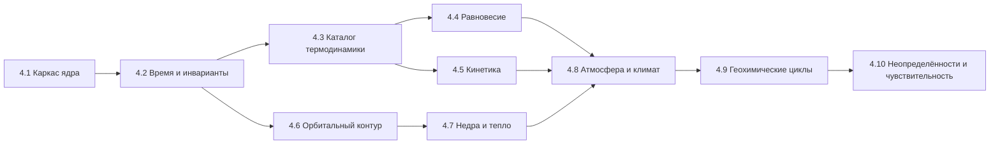

# IMPLEMENTATION_ROADMAP — Поэтапный план реализации

> Stage 4.0. Правила движения: (1) каждый этап заканчивается зелёным CI и
> сохранением всех тестов предыдущих уровней; (2) миграции сохранений —
> обязательная часть изменения схемы; (3) физика этапа не активируется в
> UI, пока не прошла валидацию; (4) неизвестное остаётся unknown.
> Ревизия Stage 4.0.1 (2026-10-30): критерии готовности согласованы с
> исправленной архитектурой (иерархия температур, интерфейс якобиана,
> JPL Evaluation No. 20, предел Роша, калибровка климата).
> Ревизия Stage 4.0.2 (2026-10-30): версия ATcT синхронизирована с
> DATA_PROVENANCE §2.3 — TN 1.228.
> Ревизия Stage 4.1 (2026-10-30): этап 4.1 исполнен как «Научное ядро»
> (контракты данных и инвариантов, `src/modules/Core/`, 171 тест, формат
> сохранений 1.2) — см. секцию 4.1 ниже и docs/science/
> CORE_SCIENTIFIC_ENGINE.md. Часть гигиенических позиций исходного плана
> 4.1 не выполнена и перенесена в 4.2 (перечислены явно).
> Ревизия Stage 4.1.1 (2026-10-30): в рамках этапа 4.1 исправлены 8
> дефектов научной целостности ядра, найденных независимым аудитом кода
> (детали: CURRENT_SYSTEM_AUDIT §1.16, контракты: CORE_SCIENTIFIC_ENGINE
> §2.4/2.5/2.9/2.10). Тесты: 517 (21 файл), ядро — 246; подсчёт CI #24 =
> 442 исправлен (в доках 4.1 ошибочно указывалось 438). Коммиты 4.1.1:
> f63c5be → af14dd8 → 25f813e (CI #27 зелёный).
> Ревизия Stage 4.1.1.2 (2026-10-30): корректирующая ревизия ядра —
> 4 остаточных дефекта полноты балансов и защиты хранилища (ISSUE A/B/C/D:
> неизвестный инвентарь ≠ ноль, пофазовый аудит всех резервуаров,
> untimed-исключения не маскируются как balanced, Storage не
> перезаписывает повреждённый корневой JSON) + обязательность
> properties в validateReservoirRecord. Тесты: 550 (21 файл), ядро —
> 279. Коммиты: 35e7b0e → bf3f677 (CI run #30 зелёный). Stage 4.2 НЕ
> начат — ядро зафиксировано на проверенном целостном состоянии.
> Ревизия Stage 4.1.1.3 (2026-10-30): корректирующая ревизия ядра —
> 2 остаточных дефекта (ISSUE A: явная неприменимость материи в
> пофазовом аудите — отсутствие material без materialApplicability
> 'not_applicable' есть неизвестный запас, маркер обязателен в обоих
> состояниях; ISSUE B: properties и material.entries — объекты-записи,
> массив не принимается за словарь). Тесты: 574 (21 файл), ядро —
> 303. Коммит: 00d9985 (CI run #32 зелёный). Stage 4.2 НЕ начат —
> ядро остаётся на проверенном целостном состоянии.
> Ревизия Stage 4.1.1.3.1 (2026-10-30): isPlainRecord строг к
> прототипам (Object.prototype/null; Map/Set/Date/RegExp/
> экземпляры классов — invalid, не «известная пустота»). Тесты:
> 597 (21 файл), ядро — 326. CI run #34 зелёный.
> Stage 4.2.1 (2026-10-30): подэтап «фундамент политики времени»
> выполнен — WorldClock поверх сегментированного SimulationClock
> (второго elapsed-поля нет; локальное время ≠ космологический
> возраст), реестр процессов с честными τ (unknown не превращается
> в число; dt ≤ τ/20 — только эвристика; легаси-процессы химии
> перенесены в честном disabled-состоянии), планировщик (Lie/
> Strang A(dt/2) → B(dt) → A(dt/2), sub-cycling, очередь событий),
> InvariantAuditor (9 секций, balanced только при полной границе),
> схема ядра 1.0.0 → 1.1.0, сохранения 1.2 → 1.3, golden baseline
> химии зафиксирован
> (877e17d346da3618ec5d15aced90c68da8a4bbb34ff18cb78023e756c1d85b20).
> Тесты: 672 (26 файлов), ядро — 401 (14
> файлов). Коммиты: 63375e9 → eba0a94 → 31f2298 → 8cb8ba3 →
> 2af6970 (CI runs #38–#42 зелёные). Stage 4.2 НЕ завершён:
> 4.2.2 (температурная иерархия), 4.2.3 (химия на Scheduler) и
> остальное 4.2 НЕ начаты.
> Stage 4.2.2 (2026-10-30): подэтап «температурная иерархия и
> provenance» выполнен — 6 раздельных температурных понятий в ядре
> (thermalState, resolver локальной температуры, адаптеры пресетов,
> схема CoreWorldState 1.2.0), WorldModel больше НЕ копирует пресетную
> температуру в surfaceTemperature. Тесты: 761 (27 файлов), ядро —
> 490. Статус 4.2.2 — см. §4.2 ниже.
> Stage 4.2.2.1 (2026-10-30): ревизия интеграции 4.2.2 по итогам
> независимого аудита — строгая валидация форм температур, orphan-
> защита resolver, provenance адаптеров, условная совместимость
> колыбели (отсутствие локальной температуры — не пройденная
> проверка, а предупреждение), диагностика пресет/T_eq подключена к
> генерации, location-aware фазовый скрининг. Golden-траектория
> стабильна. Тесты: 783 (27 файлов), ядро — 500. Статус — см. §4.2.
> Stage 4.2.2.2 (2026-10-31): семантика оценки и измерения — ошибка
> совместимости только для известного (known) значения локальной
> среды; оценочное расхождение с диапазоном колыбели — ЯВНОЕ
> предупреждение (новое правило cradle_temperature_estimate_outside_range),
> а не физическое противоречие; легаси surfaceTemperature без
> происхождения не считается измерением; presetSourceName — отдельное
> поле для реального источника (presetNotes — только пояснение);
> PhaseTemperatureBasis.location — структурированное место контекста.
> Golden-траектория стабильна. Тесты: 800 (27 файлов), ядро — 505.
> Stage 4.2.2.3 (2026-10-31): provenance gate — известное (known) без
> содержательного provenance — недоказанность
> (cradle_temperature_unproven), НЕ ошибка; раздельные источники
> surface/ocean (явная ссылка localReservoirId + resolver, без
> fallback на surface/T_eq/атмосферу/соседние резервуары);
> приоритет typed known над легаси-скаляром (легаси не
> перечитывается, предупреждение не дублируется). Golden-траектория
> стабильна. Тесты: 830 (27 файлов), ядро — 505. Статус — см. §4.2.
> Stage 4.2.2.4 (2026-10-31): корректирующая ревизия — проверка
> соответствия ReservoirRecord.kind локальной среде
> (несоответствие — недоказанность, не ошибка, без автоподбора
> другого резервуара); selectCradle экспортирован, принимает
> опциональный typed evidence и покрыт интеграционными тестами
> реального selector’а. Golden-траектория стабильна. Тесты: 848
> (27 файлов), ядро — 505. Статус — см. §4.2.
> Stage 4.2.2.5 (2026-10-31): корректирующая ревизия —
> candidate-specific локальные среды selector’а (карта
> cradleLocalEnvironmentsById по ID кандидата; без явной среды —
> per-candidate вычисление; перенос среды между кандидатами
> исключён); семантика видов: subsurface_reservoir — только kind
> ’crust’; runtime-неизвестный locationType — недоказанность без
> исключений. Golden-траектория стабильна. Тесты: 862
> (27 файлов), ядро — 505. Статус — см. §4.2.
> Stage 4.2.2.5.1 (2026-10-31): узкая корректирующая ревизия —
> защита kind-гейта от prototype pollution: список допустимых
> видов читается только по СОБСТВЕННОМУ ключу таблицы
> (hasOwnProperty); имена унаследованных свойств прототипа
> (’constructor’/’toString’/’hasOwnProperty’/’__proto__’) и
> произвольные строки — недоказанность без исключений и без
> автоподбора резервуара. Golden-траектория стабильна. Тесты: 863
> (27 файлов), ядро — 505. Статус — см. §4.2.
> Stage 4.2.3.1 (2026-10-31): подготовительный подэтап 4.2.3 —
> snapshot-изоляция macro-шага Scheduler: перед первым оператором
> создаётся глубокий рабочий снимок CoreWorldState (structuredClone;
> JSON-раунд-триппинг не используется); входной мир не мутируется
> при ошибке или отклонении шага; неклонируемое состояние —
> контролируемый отказ до операторов; контракты планировщика не
> изменены; перевод химии на расписание (4.2.3) НЕ начат;
> golden-траектория стабильна; итоговые количества тестов — по
> фактическому CI. Статус — см. §4.2.

## Карта этапов

## 4.1 Научное ядро (контракты и инварианты) — Stage 4.1 исполнен

**Доставлено (HEAD 8c1a8e0, CI #23 зелёный; ревизия 4.1.1 — HEAD
25f813e, CI #27 зелёный)**:

- `src/modules/Core/` — 11 модулей: PhysicalQuantity (величины с
  размерностями, реестр ASCII-единиц, запрет NaN/±Inf), ScientificValue
  (6 статусов данных, uncertainty, provenance), ScientificSpecies (вид+фаза,
  элементный/зарядовый баланс), Reservoir (инвентарь с явным basis),
  FluxLedger (потоки с аудитами сохранения), SimulationClock
  (сегментированное время), CoreWorldState (каноническое состояние мира,
  гравитация ≠ излучение), SolverBackend (честный контракт решателей),
  migrations (1.0→1.1→1.2), adapters (мост из легаси), index.
- `GeneratedWorld.coreWorldState?` — опционально; отсутствие = «ядро
  не инициализировано», не нулевое состояние.
- Storage: формат 1.2, миграции делегированы ядру; секция «Научное ядро»
  в Markdown-экспорте. Легаси-семантика хранения и старые сохранения
  не ломаются (null не становится 0, значения не пересчитываются).
- 401 тест ядра (14 файлов core*.test.ts: 171 в 4.1 + 75 в 4.1.1 +
  33 в 4.1.1.2 + 24 в 4.1.1.3 + 23 в 4.1.1.3.1 + 4 golden baseline +
  7 scheduling/миграционных + 64 в 4.2.1), всего 672 (CI #24 этапа 4.1 = 442 — в ранних
  доках ошибочно 438); PRNG-регрессия детерминизма добавлена в
  corePersistence.test.
- Документация: docs/science/CORE_SCIENTIFIC_ENGINE.md; аудит и дорожная
  карта обновлены.
- Легаси-модули (Generator, ChemicalEvolution, Units, WorldModel,
  пресеты, реакции) не изменены.
- Ревизия 4.1.1: исправлены 8 дефектов научной целостности ядра —
  convert-корректные массаↆколичество (1000 г H2O / 0.018 кг/моль =
  55.5556 моль), статусная семантика аудитов (balanced | imbalanced |
  approximate | not_verifiable), РЕАЛЬНЫЕ энергетические переносы в
  applyFlux/revertFlux, временная область аудитов (FluxAuditScope),
  строгие версии схем (MigrationError), raw-изоляция Storage +
  getStorageHealth, масштабирование процентов (50% → 0.5), provenance
  у unknown-значений. Легаси-модули не тронуты.

**НЕ доставлено из исходного списка 4.1 — перенесено в 4.2** (по правилу
этапа не трогать легаси-потребителей и не пересчитывать старые данные):

- перенос форматтеров PhysValue из App.tsx в ядро и отключение прямых
  импортов физических модулей в UI (аудит §1.15);
- удаление легаси-ветки характеристик тела (проблема 2.6) — контракты
  и адаптер готовы, переключение и миграция дозаполнением bodyPhysics —
  4.2;
- устранение дублей вспомогательных функций (проблема 2.7) — фабрики
  ядра готовы, дубли в легаси-модулях сохранены до перевода потребителей;
- ревизия текстов-обещаний (проблема 2.9);
- обновление ярлыка констант до CODATA 2022.

**Готовность (критерий этапа)**: все 672 теста зелёные (после
4.2.1, CI run #42: tsc 0 ошибок, oxlint, build успех; после golden
baseline — 601, после 4.1.1.3.1 — 597, после 4.1.1.3 — 574, после
4.1.1.2 — 550, после 4.1.1 — 517, этап 4.1 заканчивался на 442 —
CI #24); контракты ядра покрыты 401 тестом; интерфейсы не выдаются за реализованные модели
(solver-бэкенд пуст и помечен not_implemented, planned ≠ available).
Исходные критерии «App.tsx без физических импортов» и «удалённая ветка
2.6» НЕ достигнуты в 4.1 и остаются критериями 4.2.

## 4.2 Политика времени и температуры (ядро симуляции)

- WorldClock, реестр процессов с τ, планировщик (Strang), аудитор инвариантов.
- Иерархия температурных величин (проблемы 2.2/2.3): РАЗДЕЛЬНЫЕ поля
  effectiveTemperature, equilibriumTemperature, surfaceTemperature,
  atmosphericTemperatureProfile, reservoirTemperature,
  localReactionTemperature (PHYSICS_ARCHITECTURE §5.1); правило
  совместимости «пресет vs T_eq».
- Химия переводится на расписание (поведение и числа шагов сохраняются).
- Перенесённые остатки 4.1: перевод UI на ядро (форматтеры, отключение
  прямых физических импортов в App.tsx), удаление легаси-ветки 2.6,
  устранение дублей 2.7, ревизия текстов 2.9, ярлык CODATA 2022.
- **Готовность**: golden-траектория (seed + 100 шагов химии) стабильна;
  тест запрета прямого изменения modelTime вне ядра; сценарии 3.1.2 зелёные.
- **Статус (30.10.2026, Stage 4.2.1 выполнен)**: WorldClock, реестр
  процессов с честными τ, планировщик (Lie/Strang A(dt/2) → B(dt) →
  A(dt/2), sub-cycling), очередь событий, InvariantAuditor,
  миграции (CoreWorldState 1.1.0, сохранения 1.3) — готово;
  golden-траектория химии зафиксирована и воспроизводится
  (877e17d346da3618ec5d15aced90c68da8a4bbb34ff18cb78023e756c1d85b20;
  обязательная регрессия перед 4.2.3). НЕ начато: температурная
  иерархия (4.2.2), перевод химии на расписание (4.2.3), перевод UI
  на ядро, удаление легаси-ветки 2.6, устранение дублей 2.7,
  ревизия текстов 2.9, ярлык CODATA 2022. НИ один процесс не
  получил выдуманное τ, скорость или решателя.
- **Статус (30.10.2026, Stage 4.2.2 выполнен)**: температурная иерархия
  реализована в ядре типизированно — `Core/thermalState.ts` (6 раздельных
  понятий §5.1: T_eff источника, T_eq, surfaceTemperature, профиль
  атмосферы, reservoirTemperature, локальная температура реакции),
  `WorldBody.thermalState` (схема CoreWorldState 1.2.0, миграция
  сохранений 1.3), `ReservoirRecord.reservoirTemperature` c provenance,
  `resolveLocalReactionTemperature` (только явно указанная область;
  T_eq/surfaceTemperature/соседние области — НЕ fallback),
  адаптеры пресетных температур с честным происхождением
  (historical_game → estimated «игровое допущение»,
  observational_reference → «справочное, НЕ измерение этого мира»),
  `diagnosePresetEquilibriumDivergence`, типизированный фазовый скрининг
  в генераторе (`analyzeAtmospherePhasesWithProvenance`), WorldModel
  больше НЕ копирует пресетную температуру в surfaceTemperature
  (проблема 2.3 закрыта в типизированной части). Тесты: 761 (27 файлов),
  ядро — 490 (76 новых); CI зелёный, golden-траектория химии
  стабильна (877e17d346da3618ec5d15aced90c68da8a4bbb34ff18cb78023e756c1d85b20).
  НЕ начато: перевод химии на расписание (4.2.3), перевод UI на ядро,
  удаление легаси-ветки 2.6, устранение дублей 2.7, ревизия текстов 2.9,
  ярлык CODATA 2022; RCM/вертикальный профиль — этап 4.8.
- **Статус (30.10.2026, Stage 4.2.2.1 выполнен)**: ревизия интеграции 4.2.2
  по итогам независимого аудита — без переписывания температурной модели:
  строгая валидация (estimated без метода непригоден; NaN/Infinity/
  отрицательные/неизвестная единица не проходят; temperatureValueOrNull
  наследует строгую проверку), resolver отклоняет пустые идентификаторы
  области, orphan-резервуары и слои unknown-профиля; provenance адаптеров
  исправлено (presetNotes → note, sourceName только для наблюдательного
  источника; teff-диапазон класса сохраняется в provenance и не
  схлопывается в среднее; T_eq с confidence estimated остаётся
  estimated и не повышается до known); Compatibility: известное число
  вне диапазона — по-прежнему ошибка, отсутствие локальной температуры —
  явное предупреждание conditionally_compatible (правило
  cradle_temperature_unproven), оценка не считается измерением, выбор
  колыбели не блокируется; диагностика пресет/T_eq подключена к
  реальной генерации (информационная запись, verdict noted/
  not_comparable, temperatures не изменяются); фазовый скрининг
  привязан к слою surface_boundary (общий типизированный контракт,
  без второй системы значений; численные корреляции не изменены).
  Golden-траектория химии стабильна
  (877e17d346da3618ec5d15aced90c68da8a4bbb34ff18cb78023e756c1d85b20).
  Тесты: 783 (27 файлов; +22 к 4.2.2: 8 compatibility.test,
  10 coreThermalState.test, 4 generator.test), ядро — 500.
  Фактические итоги Vitest «Test Files 27 passed (27) / Tests 783
  passed (783)» из CI; tsc, oxlint, build зелёные. НЕ начато:
  перевод химии на расписание
  (4.2.3), перевод UI на ядро, удаление легаси-ветки 2.6, устранение
  дублей 2.7, ревизия текстов 2.9, ярлык CODATA 2022; RCM/вертикальный
  профиль — этап 4.8.
- **Статус (31.10.2026, Stage 4.2.2.2 выполнен)**: семантика «оценка
  не является доказанным противоречием» — cradle_temperature_
  compatibility: ошибка (incompatible/error) только для известного
  (known) значения локальной среды вне диапазона (типизированная
  поверхность — из coreWorldState со статусом и provenance;
  адаптер пресета known не выдаёт); новое правило
  cradle_temperature_estimate_outside_range (conditionally_compatible,
  warning): оценочная температура (пресет или легаси-число без
  происхождения) вне диапазона — предупреждение об оценочном
  сценарии, НЕ физическая ошибка; selectCradle не отбрасывает такую
  колыбель (фильтр — только severity error); cradle_temperature_
  unproven: proof для поверхности/океана — только типизированная
  known-температура (легаси-скаляр surfaceTemperature без
  происхождения измерением не считается; миграция число сохраняет,
  provenance не выдумывает); provenance адаптеров: presetNotes —
  всегда пояснение в note, sourceName — только из нового поля
  AtmosphereState.presetSourceName при действительно известном
  источнике; PhaseTemperatureBasis.location — структурированное
  место контекста ({kind: 'atmosphere_layer', layerId}); измеренное
  системное следствие: КАЖДЫЙ мир реалистичного режима несёт
  cradle_temperature_unproven → physically_plausible недостижим,
  обычные миры — hypothetical (статус смешивает правдоподобность
  объектов и полноту знания о локальной среде; предупреждение не
  ослаблено; семантика scientificStatus не менялась). Golden-
  траектория химии стабильна
  (877e17d346da3618ec5d15aced90c68da8a4bbb34ff18cb78023e756c1d85b20).
  Тесты: 800 (27 файлов; +17 к 4.2.2.1: 10 compatibility.test,
  5 coreThermalState.test, 2 generator.test), ядро — 505.
  Фактические итоги Vitest «Test Files 27 passed (27) / Tests 800
  passed (800)» из CI (run 41172263279); tsc, oxlint, build зелёные.
  НЕ начато: перевод химии на расписание (4.2.3), перевод UI на
  ядро, удаление легаси-ветки 2.6, устранение дублей 2.7, ревизия
  текстов 2.9, ярлык CODATA 2022; RCM/вертикальный профиль — этап 4.8.
- **Статус (31.10.2026, Stage 4.2.2.3 выполнен)**: provenance gate и
  location-specific evidence — известная (known) температура
  подтверждает/опровергает совместимость ТОЛЬКО при содержательном
  provenance (непустое одно из sourceName/sourceId/datasetId/
  recordId/reference/method/modelVersion ИЛИ непустой rawInput;
  note/applicability/limitations/conditions/license/retrievedAt и
  пустой {} — НЕ происхождение; проверяемый расчёт (method/rawInput)
  библиографией не обременяется): known без происхождения —
  cradle_temperature_unproven (warning), НЕ incompatible/error;
  непригодные формы (invalid, не та единица, NaN, отрицательные)
  физическим доказательством не становятся; estimated до known не
  повышается; gate ограничен использованием known как доказательства
  совместимости колыбели (глобальная семантика ScientificValue не
  менялась). Поверхность ≠ океан: typedLocalTemperatureOfWorld —
  surface: типизированная surfaceTemperature тела 'planet'; ocean/
  subsurface_reservoir/deep_planetary_layers: резервуар по явной
  ссылке CradleLocalEnvironment.localReservoirId через
  resolveLocalReactionTemperature (пара id + bodyId 'planet'); без
  однозначного reservoir или пригодной температуры резервуара —
  недоказанность (warning, не физическая ошибка); произвольный
  резервуар по kind, чужие тела и несуществующие id не выбираются;
  surfaceTemperature/T_eq/атмосфера/соседние резервуары — НЕ
  fallback. Правило 6b: при пригодном typed known легаси-скаляр не
  читается (доказанное вне диапазона — ОДНА ошибка без
  дублирующего оценочного предупреждения; доказанное в диапазоне —
  без error/warning/unproven); легаси-скаляр — оценочный сценарий
  только поверхности и только без typed evidence (никогда error; для
  океана не используется даже как оценка).
  CradleLocalEnvironment.localReservoirId — необязательное поле;
  старые сохранения без миграций, автозаполнение запрещено,
  легаси-числа не становятся ScientificValue.
  isCradleSupportedOnWorld: контекст расширен опциональными
  coreWorldState/cradleLocalEnvironment (тесты реального пути
  автоматического выбора: доказанное known-нарушение исключает
  колыбель; оценка/unknown — нет; генерация не меняется — ядро
  строится после выбора колыбели). Golden-траектория стабильна
  (877e17d346da3618ec5d15aced90c68da8a4bbb34ff18cb78023e756c1d85b20). Тесты: 830 (27 файлов; +30 к 4.2.2.2: 26
  compatibility.test, 4 generator.test), ядро — 505. Фактические
  итоги Vitest «Test Files 27 passed (27) / Tests 830 passed (830)»
  из CI (run 41174155913); tsc, oxlint, build зелёные. НЕ начато:
  перевод химии на расписание (4.2.3), перевод UI на ядро,
  удаление легаси-ветки 2.6, устранение дублей 2.7, ревизия
  текстов 2.9, ярлык CODATA 2022; RCM/вертикальный профиль — этап 4.8.
- **Статус (31.10.2026, Stage 4.2.2.4 выполнен)**: корректирующая
  ревизия по итогам независимого аудита 4.2.2.3 — соответствие
  CradleLocationType ↔ ReservoirRecord.kind задано явной
  экспортированной таблицей LOCATION_TYPE_RESERVOIR_KINDS (ocean →
  ’ocean’; subsurface_reservoir → ’ocean’ | ’crust’;
  deep_planetary_layers → ’mantle’ | ’core’; surface/atmosphere/
  other → null; таксономия — только задокументированные значения
  ReservoirRecord.kind, без новых типов и переименований).
  typedLocalTemperatureOfWorld проверяет kind записи ДО признания
  known доказательством: несоответствие (kind ’atmosphere’/’ice’
  при locationType ’ocean’; kind ’ocean’ при
  deep_planetary_layers и т.п.) — температура не используется как
  доказательство, НЕ incompatible/error, а
  cradle_temperature_unproven (fail-closed); другой резервуар
  автоматически не выбирается; ’other’ и недокументируемые
  соответствия — недоказанность (природа резервуара из одного ID
  не выводится). selectCradle: экспортирован, принимает
  опциональные coreWorldState/cradleLocalEnvironment и передаёт их
  в isCradleSupportedOnWorld → checkCompatibility; без typed
  evidence селектор не выдумывает его и не исключает кандидата по
  температуре; фиктивное ядро ради выбора не создаётся.
  Границы реального контура: generateWorld evidence в selectCradle
  НЕ передаёт (ядро строится после выбора колыбели; переданная в
  тестах среда применяется ко всем кандидатам без пересчёта) —
  генерационный pipeline остаётся условным по температуре, ложных
  ошибок не создаёт. Тесты: интеграционные тесты САМОГО
  selectCradle (не только predicate): known в диапазоне —
  кандидат доступен; known-нарушение исключает кандидата при
  допустимой альтернативе; estimated вне диапазона — условный
  кандидат; unknown — не hard error; без typed evidence не
  выдумывается; fixedCategories.cradle — прежняя семантика
  (выбранная вручную колыбель остаётся, несовместимость —
  предупреждения/ошибки без автоматической подмены);
  детерминизм — фиксированная фикстура, нулевые веса, единственная
  допустимая альтернатива. Golden-траектория стабильна
  (877e17d346da3618ec5d15aced90c68da8a4bbb34ff18cb78023e756c1d85b20).
  Тесты: 848 (27 файлов; +18 к 4.2.2.3: 11 compatibility.test,
  7 generator.test), ядро — 505. Фактические итоги Vitest
  «Test Files 27 passed (27) / Tests 848 passed (848)» из CI
  (run 41189806931); tsc, oxlint, build зелёные. НЕ начато:
  перевод химии на расписание (4.2.3), перевод UI на ядро,
  удаление легаси-ветки 2.6, устранение дублей 2.7, ревизия
  текстов 2.9, ярлык CODATA 2022; RCM/вертикальный профиль —
  этап 4.8.
- **Статус (31.10.2026, Stage 4.2.2.5 выполнен)**: корректирующая
  ревизия по итогам независимой проверки 4.2.2.4 — локальные
  среды selector’а стали candidate-specific: singular-поле
  cradleLocalEnvironment контекста selectCradle заменено картой
  cradleLocalEnvironmentsById (ID кандидата → его среда);
  кандидат без явной среды проверяется по per-candidate
  вычислению determineCradleLocalEnvironment (тот же путь, что
  и в реальном контуре); coreWorldState общий; перенос
  locationType/состава/localReservoirId между кандидатами
  исключён; температура одной области не выводится из другой;
  fixedCategories.cradle — прежняя семантика. Семантика видов:
  kind ’ocean’ убран из subsurface_reservoir (схема
  ReservoirRecord не различает поверхностный/подземный океан,
  описание CRADLE_LOCATION_MAP не доказывает представительство,
  тестовая фикстура не обоснование; доказывается только kind
  ’crust’; новые виды не введены). Runtime-безопасность:
  неизвестный locationType (внешние данные) — lookup даёт
  undefined → недоказанность cradle_temperature_unproven, без
  исключения и без выбора другого резервуара (fail-closed).
  Интеграционные тесты selector’а: четыре локации в одном
  selector-вызове (ocean/atmosphere/subsurface_reservoir/
  deep_planetary_layers) с собственными средами;
  known-нарушение исключает только своего кандидата при
  допустимой альтернативе; атмосферная колыбель требует H₂/He;
  давление и matter_state — по расположению текущего
  кандидата; estimated/unknown — условные; без reservoir ID
  температура не подставляется; fallback, нулевые веса и
  ручная фиксация — прежние; детерминизм — фиксированная
  фикстура и повторный вызов. Границы production pipeline:
  generateWorld evidence в selectCradle НЕ передаёт (ядро
  строится после выбора колыбели) — selector-интеграционные
  тесты НЕ являются заявлением, что генератор использует typed
  evidence. Golden-траектория стабильна
  (877e17d346da3618ec5d15aced90c68da8a4bbb34ff18cb78023e756c1d85b20).
  Тесты: 862 (27 файлов; +14 к 4.2.2.4: 12 generator.test,
  2 compatibility.test), ядро — 505. Фактические итоги Vitest
  «Test Files 27 passed (27) / Tests 862 passed (862)» из CI
  (run 41192420708); tsc, oxlint, build зелёные. НЕ начато:
  перевод химии на расписание (4.2.3), перевод UI на ядро,
  удаление легаси-ветки 2.6, устранение дублей 2.7, ревизия
  текстов 2.9, ярлык CODATA 2022; RCM/вертикальный профиль —
  этап 4.8.
- **Статус (31.10.2026, Stage 4.2.2.5.1 выполнен)**: защита
  kind-гейта от prototype pollution — runtime lookup
  LOCATION_TYPE_RESERVOIR_KINDS[env.locationType] выполняется
  только по СОБСТВЕННОМУ ключу таблицы
  (Object.prototype.hasOwnProperty.call): имена унаследованных
  свойств прототипа (’constructor’, ’toString’, ’hasOwnProperty’,
  ’__proto__’) и произвольные строки (’hydrothermal_sinter’) —
  недоказанность cradle_temperature_unproven без исключения,
  без TypeError и без выбора другого резервуара (fail-closed);
  поведение корректных CradleLocationType и все контракты
  4.2.2.5 (candidate-specific среды, per-candidate вычисление,
  subsurface_reservoir = [’crust’], evidence gate 4.2.2.3,
  запрет fallback’ов) сохранены. Комментарий таксономии перед
  таблицей приведён к действующему контракту (kind —
  документированные семантические категории; таблица
  консервативна; subsurface_reservoir — только ’crust’;
  тесты/фикстуры таксономию не устанавливают; новые виды не
  вводятся). Регрессионные тесты — через реальный путь
  checkCompatibility с декой-резервуаром (доказанная
  неприемлемая 288 K) как наблюдаемым доказательством
  отсутствия автоподбора. Golden-траектория стабильна
  (877e17d346da3618ec5d15aced90c68da8a4bbb34ff18cb78023e756c1d85b20).
  Тесты: 863 (27 файлов; +1 к 4.2.2.5: compatibility.test),
  ядро — 505. Фактические итоги Vitest «Test Files 27 passed
  (27) / Tests 863 passed (863)» из CI (run 41207933807); tsc,
  oxlint, build зелёные.
- **Статус (31.10.2026, Stage 4.2.3.1 выполнен)**: подготовительный
  подэтап перевода химии на расписание — snapshot-изоляция
  macro-шага Scheduler (src/modules/Core/scheduler.ts): перед
  первым оператором создаётся глубокий рабочий снимок полного
  CoreWorldState через structuredClone (JSON-раунд-триппинг не
  используется); операторы работают с рабочим состоянием —
  ошибка оператора после на-место-мутаций вложенных объектов,
  самовольное продвижение часов, некорректное возвращённое
  состояние или отклонение аудита (imbalanced) → шаг rejected,
  входной мир остаётся без частичных изменений; при успехе
  фиксируется итоговое рабочее состояние; невозможность
  клонирования — контролируемый отказ ДО вызова операторов;
  WorldClock продвигается ровно один раз после успешных
  операторов и аудита. Контракты ProcessRegistry,
  ProcessOperator, Lie/Strang/sub-cycling, WorldClock, аудиты,
  Storage и схема CoreWorldState 1.2.0 НЕ изменены;
  ChemicalEvolution и его legacy API не тронуты. Перевод химии
  на расписание (4.2.3) НЕ начат. Golden-траектория стабильна
  (877e17d346da3618ec5d15aced90c68da8a4bbb34ff18cb78023e756c1d85b20).
  Регрессионные тесты snapshot-изоляции добавлены в
  coreScheduler.test.ts (мутация+исключение; частичный успех
  двух операторов; успешная фиксация; незаконное движение
  часов; отклонение аудита; повторяемость; отказ при
  неклонируемом состоянии); итоговые количества тестов — по
  фактическому CI.

## 4.3 Каталог веществ и термодинамики видов

- Схема `ProvenancedValue` (DATA_PROVENANCE §1); ≥20 видов с термодинамикой
  из NIST WebBook (SRD 69) / ATcT ver. TN 1.228 (синхронизировано с
  DATA_PROVENANCE §2.3; перекрёстная проверка, фиксация расхождений,
  per-record проверка покрытия); полиномы NASA-7 — параметризация поверх
  исходных табличных данных: математическая форма (Cp — полином 4-й
  степени; H°/S° — интегральные выражения с a5/T и a0·ln T; NASA-9 не
  смешивается с NASA-7 — CHEMISTRY §2), процедура аппроксимации,
  диапазоны, ошибка и ссылки на первоисточник фиксируются (CHEMISTRY §2);
  версии данных в сохранении.
- **Готовность**: тесты полиномов при 298/1000/3000 K против табличных
  значений; каждый вид имеет provenance-поля; неизвестные параметры — null.

## 4.4 Химическое равновесие

- Решатель минимизации G при ограничениях (элементы, заряд); нелинейный
  Ньютон; лог-переменные для неотрицательности.
- Скрининг фаз сохраняется и помечается; первый flash-уровень для
  двухфазных смесей (после валидации решателя).
- **Готовность**: известные K воспроизведены с допуском < 1% (сравнение по
  log10 K при фиксированном стандартном состоянии); элементы/заряд 1e-12;
  производительность: цели задаются при реализации с указанием
  оборудования, среды и состава сети (не универсальная цифра).

## 4.5 Химическая кинетика

- Движок скоростей (модиф. Аррениус, troe), данные из JPL Evaluation
  **No. 20 (JPL Publication 25-1, 2025, DOI 10.48577/jpl.KFQ0TZ**;
  per-record сверка с таблицами публикации) + KIDA для холодных сетей;
  ODE-решатель с интерфейсом якобиана (аналитический/разреженный/
  численный — выбор по механизму, диагональный не по умолчанию);
  политика «не рассчитано» при отсутствии данных.
- Стехиометрический игровой режим остаётся отдельным, помеченным.
- **Готовность**: Robertson-тест (устойчивость + сходимость при измельчении
  шага, сравнение с эталоном); k(T) на краях диапазонов JPL; реакция
  без данных → статус unknown (тест).

## 4.6 Орбитальный контур

- Сэмпл звезды из класса (проблема 2.1); сезонность (наклон, e) как данные
  тела; проверки Хилл/Рош/резонансы — предупреждения; Kepler-пропагатор;
  интерфейс Integrator + leapfrog; события затмений для спутников — после.
- **Готовность**: Луна 27.32 d ±0.5% (через массу родителя); энергия
  leapfrog < 1e-6 отн. на 1e4 периодов с проверкой сходимости по шагу
  (относительно периода); предел Роша — плотностная форма с тестом
  чувствительности к ρ_s (VALIDATION уровень 2); все орбиты каталога
  получают проверку устойчивости со статусом.

## 4.7 Недра и тепло

- Слоистая статика (гидростатика + EOS-таблицы с источниками);
  радиогенные мощности из изотопных данных (литература, provenance);
  приливный нагрев — только при k₂/Q из источников; уровни Geology —
  UI-проекция от Вт-значений (ADR-P8).
- **Готовность**: P центра Земли ±10% против PREM-порядка; без данных —
  unknown (тест); сохранение качественных выводов volcanism.

## 4.8 Атмосфера и климат

- Гидростатический профиль + масштабная высота; 1-D серый RCM с
  конвективной поправкой; связь с фотохимией (UV-потоки из спектральных
  таблиц); конденсация через фазовый решатель; утечка Джинса/
  energy-limited при наличии данных.
- **Готовность**: surfaceTemperature Земли 288±10 K; Венера: разрыв
  зафиксирован; Титан: S(CH₄) в допуске; парниковые эффекты не смешиваются
  с T_eq; калибровка RCM не по одной точке — независимая проверка профиля
  и потоков (VALIDATION уровень 3, ревизия 4.0.1).

## 4.9 Геохимические циклы

- Каркас потоков (моль/м²/год, ledger элементов); дегазация/выветривание/
  растворение как процессы с источниками или unknown; цикл C как первый;
  обобщение кислородного баланса (сохранение тестов 3.1.2).
- **Готовность**: замкнутый цикл C сохраняет элемент 1e-9 за 1000 шагов;
  каждый поток либо с источником, либо явно unknown.

## 4.10 Неопределённости и чувствительность

- Распространение неопределённостей (линейные — аналитика, нелинейные —
  Монте-Карло); форматтеры значащих цифр по неопределённости;
  тесты чувствительности (VALIDATION уровень 5).
- **Готовность**: отчёт чувствительности T_eq и K равновесий; golden-тесты
  с учётом версий данных.

## Порядок и правила приоритета

1. Сначала контракты и инварианты (4.1–4.2) — без них каждый следующий
   этап создаст новые скрытые связи.
2. Каталог данных (4.3) раньше решателей (4.4–4.5): решатель без данных —
   генератор unknown.
3. Физические контуры (4.6–4.8) после ядра, по возрастанию связности:
   орбиты → недра → атмосфера.
4. Циклы (4.9) и неопределённости (4.10) — последние, потому что зависят
   от всех предыдущих.

## Что НЕ делается (постоянные запреты)

- Не подменять unknown константами «для красоты».
- Не смешивать PRNG и физические решатели.
- Не подключать REBOUND/Cantera/PHREEQC/CoolProp-бэкенды к рантайму до
  лицензионного решения (DATA_PROVENANCE §2).
- Не обещать 3D GCM, N-body «по факту наличия орбит», surfaceTemperature до RCM.
- Не приписывать одну температурную величину другой (T_eq ≠ T_surface;
  пресет ≠ физика) и не сводить разные температуры к одному полю.
- Не менять генератор, пресеты и реакции каталога вне соответствующих
  этапов (Stage 4.0 — только документация).
