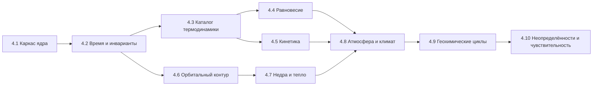

# IMPLEMENTATION_ROADMAP — Поэтапный план реализации

> Stage 4.0. Правила движения: (1) каждый этап заканчивается зелёным CI и
> сохранением всех тестов предыдущих уровней; (2) миграции сохранений —
> обязательная часть изменения схемы; (3) физика этапа не активируется в
> UI, пока не прошла валидацию; (4) неизвестное остаётся unknown.
> Ревизия Stage 4.0.1 (2026-10-30): критерии готовности согласованы с
> исправленной архитектурой (иерархия температур, интерфейс якобиана,
> JPL Evaluation No. 20, предел Роша, калибровка климата).

## Карта этапов

## 4.1 Каркас ядра и гигиена кода (низкий риск)

- Разделение: `src/core/` (sim, values) без изменений поведения; общие
  фабрики PhysValue (устранение дублей — проблема 2.7); форматтеры PhysValue
  переезжают из App.tsx в ядро; ревизия текстов-обещаний (проблема 2.9).
- Удаление легаси-ветки характеристик тела (проблема 2.6) с миграцией
  сохранений (заполнение bodyPhysics при загрузке).
- Обновление ярлыка констант до CODATA 2022.
- **Готовность**: все 267+ тестов зелёные; App.tsx не импортирует
  физические модули напрямую; хэши golden-worlds обновлены осознанно.

## 4.2 Политика времени и температуры (ядро симуляции)

- WorldClock, реестр процессов с τ, планировщик (Strang), аудитор инвариантов.
- Иерархия температурных величин (проблемы 2.2/2.3): РАЗДЕЛЬНЫЕ поля
  effectiveTemperature, equilibriumTemperature, surfaceTemperature,
  atmosphericTemperatureProfile, reservoirTemperature,
  localReactionTemperature (PHYSICS_ARCHITECTURE §5.1); правило
  совместимости «пресет vs T_eq».
- Химия переводится на расписание (поведение и числа шагов сохраняются).
- **Готовность**: golden-траектория (seed + 100 шагов химии) стабильна;
  тест запрета прямого изменения modelTime вне ядра; сценарии 3.1.2 зелёные.

## 4.3 Каталог веществ и термодинамики видов

- Схема `ProvenancedValue` (DATA_PROVENANCE §1); ≥20 видов с термодинамикой
  из NIST WebBook (SRD 69) / ATcT ver. 1.122 (перекрёстная проверка, фиксация
  расхождений, per-record проверка покрытия); полиномы NASA-7 —
  параметризация поверх исходных табличных данных: процедура аппроксимации,
  диапазоны, ошибка и ссылки на первоисточник фиксируются (CHEMISTRY §2);
  версии данных в сохранении.
- **Готовность**: тесты полиномов при 298/1000/3000 K против табличных
  значений; каждый вид имеет provenance-поля; неизвестные параметры — null.

## 4.4 Химическое равновесие

- Решатель минимизации G при ограничениях (элементы, заряд); нелинейный
  Ньютон; лог-переменные для неотрицательности.
- Скрининг фаз сохраняется и помечается; первый flash-уровень для
  двухфазных смесей (после валидации решателя).
- **Готовность**: известные K воспроизведены с допуском < 1% (сравнение по
  log10 K при фиксированном стандартном состоянии); элементы/заряд 1e-12;
  производительность: цели задаются при реализации с указанием
  оборудования, среды и состава сети (не универсальная цифра).

## 4.5 Химическая кинетика

- Движок скоростей (модиф. Аррениус, troe), данные из JPL Evaluation
  **No. 20 (JPL Publication 25-1, 2025, DOI 10.48577/jpl.KFQ0TZ**;
  per-record сверка с таблицами публикации) + KIDA для холодных сетей;
  ODE-решатель с интерфейсом якобиана (аналитический/разреженный/
  численный — выбор по механизму, диагональный не по умолчанию);
  политика «не рассчитано» при отсутствии данных.
- Стехиометрический игровой режим остаётся отдельным, помеченным.
- **Готовность**: Robertson-тест (устойчивость + сходимость при измельчении
  шага, сравнение с эталоном); k(T) на краях диапазонов JPL; реакция
  без данных → статус unknown (тест).

## 4.6 Орбитальный контур

- Сэмпл звезды из класса (проблема 2.1); сезонность (наклон, e) как данные
  тела; проверки Хилл/Рош/резонансы — предупреждения; Kepler-пропагатор;
  интерфейс Integrator + leapfrog; события затмений для спутников — после.
- **Готовность**: Луна 27.32 d ±0.5% (через массу родителя); энергия
  leapfrog < 1e-6 отн. на 1e4 периодов с проверкой сходимости по шагу
  (относительно периода); предел Роша — плотностная форма с тестом
  чувствительности к ρ_s (VALIDATION уровень 2); все орбиты каталога
  получают проверку устойчивости со статусом.

## 4.7 Недра и тепло

- Слоистая статика (гидростатика + EOS-таблицы с источниками);
  радиогенные мощности из изотопных данных (литература, provenance);
  приливный нагрев — только при k₂/Q из источников; уровни Geology —
  UI-проекция от Вт-значений (ADR-P8).
- **Готовность**: P центра Земли ±10% против PREM-порядка; без данных —
  unknown (тест); сохранение качественных выводов volcanism.

## 4.8 Атмосфера и климат

- Гидростатический профиль + масштабная высота; 1-D серый RCM с
  конвективной поправкой; связь с фотохимией (UV-потоки из спектральных
  таблиц); конденсация через фазовый решатель; утечка Джинса/
  energy-limited при наличии данных.
- **Готовность**: surfaceTemperature Земли 288±10 K; Венера: разрыв
  зафиксирован; Титан: S(CH₄) в допуске; парниковые эффекты не смешиваются
  с T_eq; калибровка RCM не по одной точке — независимая проверка профиля
  и потоков (VALIDATION уровень 3, ревизия 4.0.1).

## 4.9 Геохимические циклы

- Каркас потоков (моль/м²/год, ledger элементов); дегазация/выветривание/
  растворение как процессы с источниками или unknown; цикл C как первый;
  обобщение кислородного баланса (сохранение тестов 3.1.2).
- **Готовность**: замкнутый цикл C сохраняет элемент 1e-9 за 1000 шагов;
  каждый поток либо с источником, либо явно unknown.

## 4.10 Неопределённости и чувствительность

- Распространение неопределённостей (линейные — аналитика, нелинейные —
  Монте-Карло); форматтеры значащих цифр по неопределённости;
  тесты чувствительности (VALIDATION уровень 5).
- **Готовность**: отчёт чувствительности T_eq и K равновесий; golden-тесты
  с учётом версий данных.

## Порядок и правила приоритета

1. Сначала контракты и инварианты (4.1–4.2) — без них каждый следующий
   этап создаст новые скрытые связи.
2. Каталог данных (4.3) раньше решателей (4.4–4.5): решатель без данных —
   генератор unknown.
3. Физические контуры (4.6–4.8) после ядра, по возрастанию связности:
   орбиты → недра → атмосфера.
4. Циклы (4.9) и неопределённости (4.10) — последние, потому что зависят
   от всех предыдущих.

## Что НЕ делается (постоянные запреты)

- Не подменять unknown константами «для красоты».
- Не смешивать PRNG и физические решатели.
- Не подключать REBOUND/Cantera/PHREEQC/CoolProp-бэкенды к рантайму до
  лицензионного решения (DATA_PROVENANCE §2).
- Не обещать 3D GCM, N-body «по факту наличия орбит», surfaceTemperature до RCM.
- Не приписывать одну температурную величину другой (T_eq ≠ T_surface;
  пресет ≠ физика) и не сводить разные температуры к одному полю.
- Не менять генератор, пресеты и реакции каталога вне соответствующих
  этапов (Stage 4.0 — только документация).
