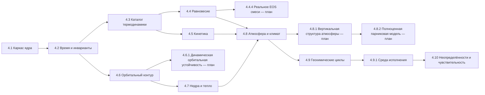
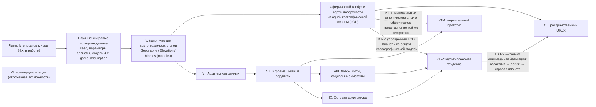

# IMPLEMENTATION_ROADMAP — Поэтапный план реализации

> Stage 4.0. Правила движения: (1) каждый этап заканчивается зелёным CI и
> сохранением всех тестов предыдущих уровней; (2) миграции сохранений —
> обязательная часть изменения схемы; (3) физика этапа не активируется в
> UI, пока не прошла валидацию; (4) неизвестное остаётся unknown.
> Ревизия Stage 4.0.1 (2026-10-30): критерии готовности согласованы с
> исправленной архитектурой (иерархия температур, интерфейс якобиана,
> JPL Evaluation No. 20, предел Роша, калибровка климата).
> Ревизия Stage 4.0.2 (2026-10-30): версия ATcT синхронизирована с
> DATA_PROVENANCE §2.3 — TN 1.228.
> Ревизия Stage 4.1 (2026-10-30): этап 4.1 исполнен как «Научное ядро»
> (контракты данных и инвариантов, `src/modules/Core/`, 171 тест, формат
> сохранений 1.2) — см. секцию 4.1 ниже и docs/science/
> CORE_SCIENTIFIC_ENGINE.md. Часть гигиенических позиций исходного плана
> 4.1 не выполнена и перенесена в 4.2 (перечислены явно).
> Ревизия Stage 4.1.1 (2026-10-30): в рамках этапа 4.1 исправлены 8
> дефектов научной целостности ядра, найденных независимым аудитом кода
> (детали: CURRENT_SYSTEM_AUDIT §1.16, контракты: CORE_SCIENTIFIC_ENGINE
> §2.4/2.5/2.9/2.10). Тесты: 517 (21 файл), ядро — 246; подсчёт CI #24 =
> 442 исправлен (в доках 4.1 ошибочно указывалось 438). Коммиты 4.1.1:
> f63c5be → af14dd8 → 25f813e (CI #27 зелёный).
> Ревизия Stage 4.1.1.2 (2026-10-30): корректирующая ревизия ядра —
> 4 остаточных дефекта полноты балансов и защиты хранилища (ISSUE A/B/C/D:
> неизвестный инвентарь ≠ ноль, пофазовый аудит всех резервуаров,
> untimed-исключения не маскируются как balanced, Storage не
> перезаписывает повреждённый корневой JSON) + обязательность
> properties в validateReservoirRecord. Тесты: 550 (21 файл), ядро —
> 279. Коммиты: 35e7b0e → bf3f677 (CI run #30 зелёный). Stage 4.2 НЕ
> начат — ядро зафиксировано на проверенном целостном состоянии.
> Ревизия Stage 4.1.1.3 (2026-10-30): корректирующая ревизия ядра —
> 2 остаточных дефекта (ISSUE A: явная неприменимость материи в
> пофазовом аудите — отсутствие material без materialApplicability
> 'not_applicable' есть неизвестный запас, маркер обязателен в обоих
> состояниях; ISSUE B: properties и material.entries — объекты-записи,
> массив не принимается за словарь). Тесты: 574 (21 файл), ядро —
> 303. Коммит: 00d9985 (CI run #32 зелёный). Stage 4.2 НЕ начат —
> ядро остаётся на проверенном целостном состоянии.
> Ревизия Stage 4.1.1.3.1 (2026-10-30): isPlainRecord строг к
> прототипам (Object.prototype/null; Map/Set/Date/RegExp/
> экземпляры классов — invalid, не «известная пустота»). Тесты:
> 597 (21 файл), ядро — 326. CI run #34 зелёный.
> Stage 4.2.1 (2026-10-30): подэтап «фундамент политики времени»
> выполнен — WorldClock поверх сегментированного SimulationClock
> (второго elapsed-поля нет; локальное время ≠ космологический
> возраст), реестр процессов с честными τ (unknown не превращается
> в число; dt ≤ τ/20 — только эвристика; легаси-процессы химии
> перенесены в честном disabled-состоянии), планировщик (Lie/
> Strang A(dt/2) → B(dt) → A(dt/2), sub-cycling, очередь событий),
> InvariantAuditor (9 секций, balanced только при полной границе),
> схема ядра 1.0.0 → 1.1.0, сохранения 1.2 → 1.3, golden baseline
> химии зафиксирован
> (877e17d346da3618ec5d15aced90c68da8a4bbb34ff18cb78023e756c1d85b20).
> Тесты: 672 (26 файлов), ядро — 401 (14
> файлов). Коммиты: 63375e9 → eba0a94 → 31f2298 → 8cb8ba3 →
> 2af6970 (CI runs #38–#42 зелёные). Stage 4.2 НЕ завершён:
> 4.2.2 (температурная иерархия), 4.2.3 (химия на Scheduler) и
> остальное 4.2 НЕ начаты.
> Stage 4.2.2 (2026-10-30): подэтап «температурная иерархия и
> provenance» выполнен — 6 раздельных температурных понятий в ядре
> (thermalState, resolver локальной температуры, адаптеры пресетов,
> схема CoreWorldState 1.2.0), WorldModel больше НЕ копирует пресетную
> температуру в surfaceTemperature. Тесты: 761 (27 файлов), ядро —
> 490. Статус 4.2.2 — см. §4.2 ниже.
> Stage 4.2.2.1 (2026-10-30): ревизия интеграции 4.2.2 по итогам
> независимого аудита — строгая валидация форм температур, orphan-
> защита resolver, provenance адаптеров, условная совместимость
> колыбели (отсутствие локальной температуры — не пройденная
> проверка, а предупреждение), диагностика пресет/T_eq подключена к
> генерации, location-aware фазовый скрининг. Golden-траектория
> стабильна. Тесты: 783 (27 файлов), ядро — 500. Статус — см. §4.2.
> Stage 4.2.2.2 (2026-10-31): семантика оценки и измерения — ошибка
> совместимости только для известного (known) значения локальной
> среды; оценочное расхождение с диапазоном колыбели — ЯВНОЕ
> предупреждение (новое правило cradle_temperature_estimate_outside_range),
> а не физическое противоречие; легаси surfaceTemperature без
> происхождения не считается измерением; presetSourceName — отдельное
> поле для реального источника (presetNotes — только пояснение);
> PhaseTemperatureBasis.location — структурированное место контекста.
> Golden-траектория стабильна. Тесты: 800 (27 файлов), ядро — 505.
> Stage 4.2.2.3 (2026-10-31): provenance gate — известное (known) без
> содержательного provenance — недоказанность
> (cradle_temperature_unproven), НЕ ошибка; раздельные источники
> surface/ocean (явная ссылка localReservoirId + resolver, без
> fallback на surface/T_eq/атмосферу/соседние резервуары);
> приоритет typed known над легаси-скаляром (легаси не
> перечитывается, предупреждение не дублируется). Golden-траектория
> стабильна. Тесты: 830 (27 файлов), ядро — 505. Статус — см. §4.2.
> Stage 4.2.2.4 (2026-10-31): корректирующая ревизия — проверка
> соответствия ReservoirRecord.kind локальной среде
> (несоответствие — недоказанность, не ошибка, без автоподбора
> другого резервуара); selectCradle экспортирован, принимает
> опциональный typed evidence и покрыт интеграционными тестами
> реального selector’а. Golden-траектория стабильна. Тесты: 848
> (27 файлов), ядро — 505. Статус — см. §4.2.
> Stage 4.2.2.5 (2026-10-31): корректирующая ревизия —
> candidate-specific локальные среды selector’а (карта
> cradleLocalEnvironmentsById по ID кандидата; без явной среды —
> per-candidate вычисление; перенос среды между кандидатами
> исключён); семантика видов: subsurface_reservoir — только kind
> ’crust’; runtime-неизвестный locationType — недоказанность без
> исключений. Golden-траектория стабильна. Тесты: 862
> (27 файлов), ядро — 505. Статус — см. §4.2.
> Stage 4.2.2.5.1 (2026-10-31): узкая корректирующая ревизия —
> защита kind-гейта от prototype pollution: список допустимых
> видов читается только по СОБСТВЕННОМУ ключу таблицы
> (hasOwnProperty); имена унаследованных свойств прототипа
> (’constructor’/’toString’/’hasOwnProperty’/’__proto__’) и
> произвольные строки — недоказанность без исключений и без
> автоподбора резервуара. Golden-траектория стабильна. Тесты: 863
> (27 файлов), ядро — 505. Статус — см. §4.2.
> Stage 4.2.3.1 (2026-10-31): подготовительный подэтап 4.2.3 —
> snapshot-изоляция macro-шага Scheduler: перед первым оператором
> создаётся глубокий рабочий снимок CoreWorldState (structuredClone;
> JSON-раунд-триппинг не используется); входной мир не мутируется
> при ошибке или отклонении шага; неклонируемое состояние —
> контролируемый отказ до операторов; контракты планировщика не
> изменены; перевод химии на расписание (4.2.3) НЕ начат;
> golden-траектория стабильна; итоговые количества тестов — по
> фактическому CI. Статус — см. §4.2.
> Stage 4.2.3.2 (2026-10-31): ReactionLedger — самостоятельный
> контракт реакционных транзакций и стехиометрический аудит
> (src/modules/Core/reactionLedger.ts, экспорт из Core/index.ts):
> журнал завершённых превращений, иммутабельная регистрация,
> элементный и зарядовый баланс с различимыми статусами balanced /
> imbalanced / not_verifiable / approximate; вымышленные ux:*
> компоненты с явным составом алгебраически проверяемы. ГРАНИЦЫ:
> ReactionLedger НЕ интегрирован — вне CoreWorldState, Scheduler и
> InvariantAuditor его не используют; FluxLedger не изменён; ни
> кинетика, ни solver, ни применение к инвентарям не реализованы.
> Следующий подэтап 4.2.3.3 — интеграция (CoreWorldState, версия
> схемы и сохранения, auditWorldTransition, Scheduler). Итоговые
> количества тестов — по фактическому CI. Статус — см. §4.2.
> Ревизия Stage 4.2.3.2.1 (2026-10-31): корректирующая ревизия
> ReactionLedger — 6 дефектов: обязательность time (undefined →
> invalid); прототип-безопасный учёт компонентов (Map +
> Object.fromEntries: 'constructor'/'toString'/'hasOwnProperty'/
> '__proto__' — данные, не прототип); строгая форма состава (только
> объектная запись; Map/Set/Date/RegExp/массив/класс →
> not_verifiable; численная пригодность — только known/estimated;
> пустой {} легитимен); NaN/Infinity в промежуточных итогах →
> not_verifiable (не balanced); tolerance — конечное неотрицательное
> (некорректное → invalid); note — непустая строка, пары участников
> кодируются однозначно (JSON.stringify). Границы прежние: интеграции
> нет (4.2.3.3 — следующий подэтап), защищённые контракты не
> изменены, golden не тронут. Статус — см. §4.2.

> Ревизия Stage 4.2.3.3 (2026-10-31): ReactionLedger интегрирован в
> CoreWorldState (опциональное поле, схема ядра 1.3.0, пустой журнал у
> новых миров), формат сохранений 1.3 → 1.4 (миграция создаёт пустой
> журнал у существующего ядра, существующий не перезаписывается; round-trip
> всех полей записи), секция 'reactions' в auditWorldTransition (отдельно
> от FluxLedger — без двойного счёта; пустой журнал balanced;
> not_verifiable ≠ balanced), Scheduler передаёт реакционные записи шага
> в аудит (правило отклонения прежнее — только imbalanced; шаг атомарен;
> записи не создаются автоматически). Кинетика, solver и применение
> реакций к инвентарям НЕ реализованы; перевод легаси-химии на
> расписание не начат; golden не тронут. Статус — см. §4.2.

> Ревизия Stage 4.2.3.3.1 (2026-10-31): корректирующая ревизия
> интеграции ReactionLedger — append-only контракт журнала в
> Scheduler (совпадающий id не доказывает неизменности: записи
> сравниваются по всему содержимому; изменение, удаление и
> перестановка старых записей, удаление журнала отклоняют шаг до
> аудита; новые записи требуют стехиометрического аудита до фиксации),
> проверка журнала при импорте/загрузке в Storage (некорректный
> журнал не возвращается как валидное состояние; повреждённая запись
> сохраняется как raw с причиной отказа), миграция 1.3 → 1.4 при
> неизвестной внутренней схеме ядра не модифицирует coreWorldState
> (незнание структуры не подменяется пустым журналом), семантика
> статусов аудита документирована (invalid — структурная
> некорректность; общий агрегатор по существующему правилу
> переводит invalid вместе с imbalanced в общий imbalanced; общий
> imbalanced сам по себе не доказывает физического нарушения).
> Добавлена долгосрочная дорожная карта за пределами генератора
> миров — часть II, этапы V–XI (план, не реализация). Статус — см.
> §4.2 и часть II.

> Ревизия Stage 4.2.3.3.2 (2026-10-31): корректирующая ревизия — три
> пограничных случая. (A1) при отсутствии прежнего журнала форма
> нового проверяется в полном объёме: records — обязательно массив;
> валидный пустой { records: [] } допустим; undefined после шага
> допустим только если журнала не было; явный null — контролируемое
> нарушение до или после шага (не исключение и не commit); некорректная форма нового журнала — reject Scheduler до аудита;
> контракт существующей истории не изменён. (A2) Storage и миграция
> различают отсутствие поля и явный null: null-журнал и null/
> не-объектное coreWorldState не маскируются под отсутствие,
> отклоняются с точной причиной, повреждённая raw-запись остаётся
> нетронутой, валидные соседние сохранения продолжают загружаться.
> (A3) deepJsonEqual различает сериализуемые виды объектов
> ({} и new Date(0) — разные данные) и защищает дополнительные поля
> записей от незаметного изменения; порядок ключей объектов не
> влияет, порядок массивов значим, undefined-ключ равносилен
> отсутствию (JSON-семантика сохранена); обнаружение изменений
> известных полей не ослаблено. Согласующая правка части II: КТ-2 —
> минимальная рабочая навигация галактика → лобби → игровая
> планета; полноценный пространственный UI/UX остаётся этапом X.
> Статус — см. §4.2 и часть II.

> Ревизия Stage 4.2.3.3.3 (2026-10-31): корректирующая ревизия —
> fail-closed сравнение и строгая валидация массивов ReactionLedger.
> (1) deepJsonEqual сравнивает каждый индекс массива явно: every и
> forEach пропускали отсутствующие индексы, из-за чего new Array(1)
> ошибочно считалась равной [new Date(0)], хотя JSON различает [null]
> и ISO-строку времени; порядок элементов значим, отсутствующий
> индекс равносилен явному undefined, сравнение симметрично; порядок
> ключей объектов не влияет, ключ со значением undefined равносилен
> отсутствующему, вложенные Date сравниваются по времени, прочие
> не-plain объекты остаются fail-closed. (2) обход обнаруживает
> циклы по активному рекурсивному пути: циклическое дополнительное
> поле записи даёт контролируемое нарушение append-only (fail-closed
> изменение), а не необработанный RangeError; повторное использование
> той же ссылки в независимых ветвях графа циклом не считается.
> (3) строгая форма: журнал, запись и участник — только настоящие
> plain records (прототип Object.prototype или null): массив и Date
> с дорисованными обязательными полями формой не проходят;
> допустимые дополнительные поля корректных записей не запрещаются
> (вложенная Date сравнивается по времени, как в 4.2.3.3.2).
> (4) дырки в records/reactants/products — структурная ошибка, а не
> отсутствие данных: каждый индекс обязан содержать существующую
> корректную запись/участника (forEach пропускал дырки, и undefined
> доходил до аудита с падением на обращении к speciesId); аудит
> таких входов — контролируемый invalid с диагностикой, а не
> исключение; правила стехиометрии, численные tolerance и статусы
> известных/неизвестных составов не менялись. (5) Scheduler: обычный
> macro-step при циклическом дополнительном поле существующей записи
> и при новой записи с разреженным массивом участников —
> контролируемый rejected (до аудита), исходный мир, журнал, часы и
> вложенные ссылки нетронуты. (6) регрессионный тест миграции старой
> внешней схемы 1.3 с coreWorldState: null: миграция не выбрасывает
> TypeError, null не превращается в отсутствие ядра или пустой
> объект, внешняя версия 1.4, Storage отклоняет некорректную форму с
> причиной, raw-запись нетронута, соседние корректные сохранения
> продолжают загружаться. Кинетика, solver и применение реакций к
> запасам НЕ реализованы и не заявляются; перевод химии на расписание
> (4.2.3 в целом) не завершён. Статус — см. §4.2 и часть II.

> Stage 4.2.3.4 (2026-10-31): согласование ReactionLedger с
> материальными инвентарями — аудит соответствия завершённых
> реакционных транзакций фактическому изменению запасов (НЕ кинетика).
> reactionInventoryDeltas: вклады ∓coefficient × extent по ключу
> (reservoirId, speciesId), агрегирование по участникам и реакциям,
> катализатор и вид на обеих сторонах — корректный нетто-вклад;
> переполнение — непредставимый вклад (NaN) и честная диагностика;
> смешение оснований по паре — несовместимость без пересчёта;
> extentBasis не расширен, arbitrary_units не преобразуется, площадь
> не выдумывается. Новая секция аудита 'reaction_inventory' (отдельно
> от 'reactions'): balanced / imbalanced (известное расхождение размера
> или знака) / not_verifiable (отсутствующий инвентарь — запас
> неизвестен, а не ноль; несовпадение основания записи и инвентаря —
> пересчёт между основаниями не выполняется; непредставимые вклады) /
> invalid (некорректная форма, ghost-резервуар); пустой журнал —
> balanced. Реакции не превращаются в потоки: вклады учитываются
> отдельным типизированным механизмом (reactionDeltas в
> auditSubstanceConservation / auditReservoirFluxes), FluxLedger не
> изменён; ожидаемое изменение = поток + реакция ровно один раз;
> глобальные элементный/зарядовый балансы проверяются независимо.
> Scheduler: только новые записи шага; commit при подтверждённом
> превращении, reject при известном несоответствии (атомарность),
> not_verifiable/approximate не переименовываются в balanced.
> Кинетика, solver, автоматические скорости и legacy Chemistry на
> Scheduler НЕ реализованы. Статус — см. §4.2 и часть II.

> Stage 4.2.3.4.1 (2026-10-31): корректирующая ревизия согласования —
> prototype-safe speciesId и численная устойчивость reaction inventory
> audit. speciesId — произвольная непустая строка: Map-аккумуляторы
> вкладов, null-prototype молярные счёты, чтение запаса только по
> СОБСТВЕННОМУ ключу (отсутствие собственного ключа — известный ноль,
> унаследованное свойство прототипа количеством не является);
> превращения видов '__proto__'/'constructor'/'toString' подтверждаются
> инвентарями (Object.prototype и null-прототип). Конечность КАЖДОЙ
> суммы (поток + реакция; before + netFlux + reactionDelta; до +
> ожидаемое Δ; в auditReservoirFluxes — после каждого сложения,
> Infinity непригоден как NaN): непредставимое — явное исключение →
> not_verifiable, а не imbalanced; конечный дисбаланс сверх tolerance —
> по-прежнему imbalanced. Полная валидация журнала в
> reactionInventoryDeltas (validateReactionLedger): дырки и
> унаследованные индексы records, дубликаты id — formIssues и ПУСТЫЕ
> вклады, частичный правдоподобный результат из некорректного журнала
> не создаётся. tolerance секции 'reaction_inventory' — единая
> политика с auditReactionLedger: NaN/±Infinity/отрицательный →
> invalid даже при пустом журнале. Границы этапа 4.2.3.4 сохранены
> (реакции ≠ потоки, ∓coefficient × extent, append-only, политика
> Scheduler); кинетика и solver НЕ реализованы. Статус — см. §4.2
> и часть II.

> Ревизия roadmap (2026-10-31): архитектура этапа V уточнена как
> map-first процедурная планетарная картография — сначала
> генерируются согласованные картографические слои (Geography,
> Elevation, Biomes), затем из них строится сферическое представление
> планеты: глобус — визуализация картографических данных, а не
> самостоятельная геометрия. LOD-уровни (спрайт в звёздной системе,
> обзорный глобус, карта поверхности, территории видов) — производные
> одной картографической основы. Этап X ссылается на ту же основу;
> КТ-1 уточнён (слои + плоская карта + сферическое представление,
> воспроизводимость по seed, согласованность географии); КТ-2 —
> упрощённый LOD планет из той же модели. Коммерциализация (XI)
> отложена и не входит в текущий план разработки. Обновлена только
> дорожная карта: реализация процедурной генерации карт и глобусов
> НЕ начата и не заявляется; научные этапы 4.x не перенумерованы.

> Ревизия roadmap (Stage 4.3.1, 2026-10-31): начат этап 4.3 «Каталог
> веществ и термодинамических данных» — подэтап 4.3.1 (фундамент
> термодинамического каталога) выполнен: типизированная модель данных
> термодинамических свойств вида+фазы в src/modules/Core/
> thermodynamics.ts (ΔfH° и ΔfG° в J/mol, S° в J/(mol·K), исходные
> табличные Cp-точки, параметризация NASA-7 как производная
> аппроксимация, reference state, per-value происхождение с
> типизированным origin) + структурная валидация; +37 тестов
> (coreThermodynamics.test), всего по CI 1141 тест (29 файлов);
  golden-траектория стабильна. НИ одно термодинамическое значение
  реального вещества в код не добавлено: импорт и перекрёстная
  проверка ≥20 видов — следующий подэтап 4.3.2; вычислитель NASA-7
  и процедура подбора коэффициентов НЕ реализованы и не заявляются.
  Статус — см. §4.3 ниже.

> Ревизия roadmap (Stage 4.3.1 hardening, 2026-10-31): корректирующая
> ревизия валидатора термодинамической модели выполнена — (1)
> reference state обязателен при любых числовых термодинамических
> данных (скаляры ΔfH°/ΔfG°/S° known/estimated, табличные Cp(T)
> known/estimated, NASA-7 known/estimated, одновременное наличие;
> фаза reference state сверяется с фазой записи и когда единственные
> числовые данные — Cp; T/P/стандартное состояние автоматически не
> назначаются); (2) безопасная runtime-валидация null/повреждённых
> JSON-подобных данных (диагностики вместо исключений, проверка
> независимых полей продолжается); (3) provenance отдельных Cp-точек —
> ThermoDataProvenance (та же проверка origin; при отсутствии —
> наследование provenance таблицы). +23 теста (coreThermodynamics.test),
> всего по CI 1164 теста (29 файлов); golden-траектория стабильна.
> Коммиты: 0e3edbd0 → 4745ad4c → 8d7bba5a. 4.3.1 считается завершённым
> только с этими hardened-проверками; 4.3 в целом остаётся открытым
> до покрытия ≥20 видов и завершения работы с NASA-7. Статус — §4.3.

> Ревизия roadmap (заключительная проверка валидатора 4.3.1,
> 2026-10-31): два краевых случая исправлены — checkQuantityShape
> объявляет величину с несовместимой размерностью непригодной для
> дальнейших проверок (число в чужой размерности не используется как
> температура/граница; авто-конверсия единиц не выполняется);
> bounded-неопределённость требует direction 'above'|'below'
> (отсутствие/null/постороннее значение — ошибка валидации и
> конструкторов значений). +11 тестов, всего по CI 1175 тестов
> (29 файлов); golden-траектория стабильна. Коммиты: e30a9d69 (код) →
> 2881d27f (тесты). 4.3.1 завершён только после успешной проверки этих
> исправлений; 4.3 в целом остаётся открытым; 4.3.2 (импорт ≥20 видов)
> не начат. Статус — §4.3.

> Ревизия roadmap (Stage 4.3.2, первая партия, 2026-10-31): импорт
> реальных термодинамических значений ВЫПОЛНЕН — 20 газовых веществ
> из NASA Glenn CEA Thermodynamic Database (data/thermo.inp,
> nasa/cea@2f79a647e85737742fb08a127da00d1ea1d069da, Apache-2.0;
> NASA TP-2002-211556): ΔfH°(298.15 K) known (поле записи), NASA-7
> published (дословные коэффициенты; форма CEA: 7 коэффициентов
> Cp°/R при T^-2..T^4 + интегральные константы a8/a9 в
> provenance.rawInput), S°/ΔfG° — unknown с пояснением (вычислитель
> NASA-7 не реализуется). Новый слой src/modules/Data/
> thermodynamicCatalog.ts (12 легаси-видов переиспользованы, 8 новых
> явно) + тесты dataThermodynamicCatalog.test (+14; по CI 30 файлов /
> 1189 тестов — базлайн 29/1175 + 14); golden-траектория изменениями
> этапа не затронута. NIST SRD 69 — только внешняя качественная
> сверка (числа не копируются); ATcT не импортируется. Вычислитель
> NASA-7, тесты полиномов против таблиц, расширение покрытия —
> следующие подэтапы; критерий 4.3 остаётся открытым. Коммиты:
> f80e7274 (C1: данные+лицензирование) → 4899f7bb (C2: тесты) → C3
> (документация). Статус — §4.3.

> Ревизия roadmap (Stage 4.3.2, корректирующая, 2026-11-01):
> типизированное разделение форм NASA-полиномов (form: nasa7_classic |
> nasa_cea; константы a8/a9 — integralConstants; исправлено ранее
> ошибочное «provenance.rawInput»), молярные массы всех 20 видов
> каталога — из записей NASA CEA с molarMassProvenance (gases.ts не
> изменён); сегменты 20 записей: 9 видов с тремя, 11 с двумя (49
> всего); тесты +16 (coreNasaPolynomialForm.test +12,
> dataThermodynamicCatalog.test +4; по CI 31 файл / 1205 тестов).
> План следующего подэтапа — 4.3.3 «Periodic Table: 118 Chemical
> Elements» добавлен в §4.3. Вычислитель NASA-7 и импорт
> дополнительных молекул в корректирующей ревизии НЕ выполнялись;
> этап 4.3 остаётся открытым.

> Ревизия roadmap (Stage 4.3.2, финальная научная корректировка
> перед 4.3.3, 2026-11-01): план 4.3.3 приведён в соответствие с
> таблицей CIAAW 2024 (ciaaw.org/atomic-weights.htm) — интервал
> водорода исправлен на [1.00784, 1.00811] (было [1.00784, 1.00894]
> — ошибка); наличие стандартного атомного веса определяется
> фактической записью элемента в таблице CIAAW, а НЕ стабильностью
> изотопов (Bi 208.98040(1), Th 232.0377(4), Pa 231.03588(1),
> U 238.02891(3) — имеют вес; Tc, Pm, Po — нет); для элементов без
> записи веса — отдельное поле representativeMassNumber с
> собственным источником и provenance, не подменяющее стандартный
> атомный вес; числовые значения атомных весов НЕ импортировались.
> Валидатор validateSpecies требует непустой recordId у
> molarMassProvenance (обратная совместимость сохранена); заголовок
> thermodynamics.ts актуализирован. Тесты +7 (coreSpecies.test
> 18 → 25; по CI 31 файл / 1212 тестов). План 4.3.3 готов к
> реализации.

> Ревизия roadmap (Stage 4.3.3, 2026-11-01): подэтап «Periodic Table:
> 118 Chemical Elements» исполнен — канонический каталог всех 118
> химических элементов как самостоятельная сущность ChemicalElement,
> не ScientificSpecies (Core/elements.ts — модель, валидатор, каталог,
> checkElementCountsReference — реестр символов для ElementCounts;
> Data/elements.ts — идентификация IUPAC PT 2022-05-04, стандартные
> атомные веса CIAAW 2024: 14 интервальных / 70 со скобочной
> неопределённостью / 34 not_assigned, изотопные распространённости
> CIAAW 2024: 84 known / 34 not_applicable / 289 записей;
> Data/elementIsotopeCandidates.ts — NUBASE2020:
> representativeIsotopeCandidates — СПИСОК равноправных кандидатов
> (не единое representativeMassNumber): 34 элемента / 44 нуклида /
> 4 изомера, все экспериментальные, полнота 14 complete /
> 20 incomplete; elementDataAttribution.md — источники, версии,
> лицензии). NIST Atomic Weights and Isotopic Compositions не
> используется (распространение чисел не подтверждено; электронные
> конфигурации, ионизация, сродство, электроотрицательность, радиусы,
> плавление/кипение, плотность, степени окисления — unknown).
> Тесты +86 (coreElements.test +37, dataElementCatalog.test +49; по
> CI 33 файла / 1298 тестов). Этап 4.3 остаётся открытым (вычислитель
> NASA-7, S°/ΔfG°, конденсированные фазы).

> Корректирующая ревизия после аудита (Stage 4.3.3, 2026-11-01):
> независимый аудит нашёл научные и контрактные ошибки; исправлено
> последовательными коммитами без force push и без переписывания
> подэтапа: (R1-C1) Md-258 — ОСНОВНОЕ состояние: строка NUBASE2020
> имеет идентификатор i=0 (основное), звёздочка Isom.Unc=* означает
> неопределённость порядка основного/изомерного состояний и НЕ
> превращает строку в изомерную; state ground, обозначение Md-258
> без суффикса m, recordId без m, T1/2 51.59(29) d сохранён; изомер
> 258Mdm 57.0(9) мин — отдельная строка i=1, не кандидат; счётчики:
> 44 записи-кандидата, 3 изомерных состояния (Hs-277m, Mt-276m,
> Lv-293m), 43 уникальные пары (Z,A); (R1-C2) валидатор
> NuclideCandidate усилен: atomicNumber = Z владельца (H с
> кандидатом Tc-98 — ошибка), A >= Z, согласованность nuclideNotation
> (символ владельца + массовое число + суффикс по состоянию: ground
> без m, isomeric с m), recordId = provenance.recordId, уникальность
> (A:state); (R1-C3) физические инварианты: единица T1/2 обязана
> иметь размерность времени (реестр размерностей, а не isKnownUnit:
> eV/kg/K — ошибки), значение конечно и строго положительно,
> статусы known/estimated, неопределённость — собственная проверка;
> атомные веса строго положительны, not_assigned без числовых полей,
> изотопы A >= Z с уникальными массовыми числами; (R1-C4) CIAAW
> applicability/limitations: normal materials — справочные земные
> значения, НЕ универсальный изотопный состав экзопланет, звёзд или
> межзвёздного вещества; (R1-C5) методика отбора: формулировка
> «статистически неразличимы» снята — опубликованные 1σ-интервалы
> перекрываются, по принятому консервативному правилу сохранены все
> пересекающиеся кандидаты, единственный не назначается (перекрытие
> не доказывает статистической эквивалентности); лицензия NUBASE2020
> уточнена (CC BY 3.0 — статья Chinese Physics C; отдельная лицензия
> файла AMDC не утверждается); elementDataAttribution.md: §5 —
> раздельные значения CIAAW/NUBASE2020, причина расхождений
> неустановленна (наблюдения 2006–2016 предшествуют обновлению
> страницы 2022-03-29), отсутствие изомерного суффикса на компактной
> странице; §7 — построчная таблица соответствия всех 44 записей и
> основа полноты complete (ранжирование всех наблюдавшихся строк,
> §7.1); (R1-C6) документация: фактическое распределение тестов
> 4.3.3 (coreElements +36, dataElementCatalog +50 — ранее ошибочно
> +37/+49), счётчики 44 записи / 3 изомера / 43 (Z,A), исправленные
> формулировки. Тесты 1298 → 1314 (33 файла; coreElements +14,
> dataElementCatalog +2), golden baseline
> 877e17d346da3618ec5d15aced90c68da8a4bbb34ff18cb78023e756c1d85b20
> не изменён; легаси/Storage/CoreWorldState/PRNG не тронуты.
> Этап 4.3 остаётся открытым (вычислитель NASA-7, S°/ΔfG°,
> конденсированные фазы).

> **Аудит R2 Stage 4.3.3 (2026-11-01)**: (R2-C1) год NUBASE2020 —
> тропический (1 y = 365.2422 сут = 31 556 926 с), а не юлианский:
> в реестре единиц времени зарегистрированы самостоятельные y, ky,
> My с официальным SI-фактором NUBASE2020; 12 записей каталога
> перенесены без пересчёта значений и неопределённостей; юлианские
> yr/ka/Ma остаются отдельными единицами, легаси Units.YEAR_S не
> изменён. (R2-C2) NuclideCandidate: stateIndex (i) / stateCode (s)
> NUBASE2020; интерпретация пары (i, s) — по шапке официального
> файла (i>=3 — НЕ уровень автоматически; i=3,4,5,6 и s=p,q,r,x
> могут быть дополнительными изомерами; контрольные примеры:
> 92Tc p — i=3, 205Po p — i=3, 57.4(9) ms, 205Po q — i=4,
> 115(10) ns). (R2-C3) повторное ранжирование всех
> экспериментально наблюдавшихся строк 14 элементов: состав
> кандидатов НЕ изменился (44 записи / 3 изомерных состояния /
> 43 уникальные пары (Z,A)); полнота — 8 complete (Z=43, 85, 87,
> 88, 93, 94, 95, 98) / 6 not_verifiable (Z=61, 84, 86, 89, 96,
> 97 — нижние пределы T1/2 без верхней границы, полнота не
> доказуема и не сохраняется complete по предположению) /
> 20 incomplete (Z=99–118). (R2-C4) валидатор: согласованность
> dataStatus ↔ halfLife.status, единый recordId строки NUBASE2020
> у кандидата и halfLife provenance. (R2-C5) документация
> (5 доков). Тесты 1314 → 1328 (+14: corePhysicalQuantity.test +4,
> coreElements.test +7, dataElementCatalog.test +3; 33 файла),
> golden baseline
> 877e17d346da3618ec5d15aced90c68da8a4bbb34ff18cb78023e756c1d85b20
> не изменён; легаси/Storage/CoreWorldState/PRNG не тронуты.
> Этап 4.3 остаётся открытым (вычислитель NASA-7, S°/ΔfG°,
> конденсированные фазы).
>
> **Аудит R3 Stage 4.3.3 (2026-11-01)**: (R3-C1) контекстная классификация
> состояний NUBASE2020 — цепное правило classifyNubaseState
> (Core/elements.ts), NuclideCandidate.classification/classificationBasis,
> +6 тестов coreElements.test. (R3-C2) правило фактора 2 для «~v»
> удалено; точечное правило — исключение только ниже нижней границы
> 1σ-интервала якоря, иначе not_verifiable (точечное правило удалено
> аудитом R4 — см. следующий блок). (R3-C3) воспроизводимая
> утилита аудита Data/nubaseAudit.ts + 22 теста dataNubaseAudit.test
> (+ фикс-коммит CI — ненулевые типы хелперов теста); уточнённые
> счётчики наблюдавшихся строк (Tc 67, Pm 62, Po 72, At 72, Rn 62,
> Fr 71, Ra 56, Ac 45, Np 32, Pu 32, Am 33, Cm 30, Bk 29, Cf 23;
> 21 наблюдавшийся дополнительный изомер у 8 элементов); состав
> кандидатов 44/3/43 и полнота 8/6/20 (статусы аудита R3,
> пересчитаны аудитом R4) не изменились; полный ASCII-файл
> NUBASE2020 в репозиторий не включается (лицензия AMDC не
> подтверждена). (R3-C4) документация — 5 доков. Тесты 1328 → 1334 →
> 1356 (34 файла), golden baseline
> 877e17d346da3618ec5d15aced90c68da8a4bbb34ff18cb78023e756c1d85b20
> не изменён; легаси/Storage/CoreWorldState/PRNG не тронуты; этап 4.3
> остаётся открытым (вычислитель NASA-7, S°/ΔfG°, конденсированные
> фазы); 4.3.3 не объявляется закрытым до независимой проверки.
>
> **Аудит R4 Stage 4.3.3 (2026-11-01)**: (R4-C1) точечное правило
> исключения значений без опубликованной σ УДАЛЕНО (Kondev et al.,
> NUBASE2020, §3.2, DOI 10.1088/1674-1137/abddae): отсутствие σ —
> отсутствие информации о неопределённости; приближения «~v»,
> измеренные значения без σ, оценки «v#» и наблюдавшиеся
> ground/isomer-состояния без собственного T1/2 не исключаются, а
> делают полноту НЕ ДОКАЗУЕМОЙ (not_verifiable: unresolved_approx /
> unresolved_no_sigma / unresolved_estimated / no_half_life_unresolved;
> отсутствие T1/2 не считается доказательством короткого времени
> жизни). (R4-C3) строгий fail-closed парсер Data/nubaseAudit.ts:
> 5 869 строк официального файла → 5 843 записи, 0 повреждённых,
> 0 дубликатов (Z, A, i, s); обрезанные/malformed строки не
> теряются молча (диагностика с номером строки и причиной); пустое
> поле массы не трактуется как измеренная; Isom.Inv «&» хранится
> отдельно и не используется. (R4-C4) SHA-256 1585a5ee…
> фактических байтов входа вычисляется при каждом запуске и сверяется
> с константой локально проверенной копии; библиография источника
> отделена от метаданных запуска (NubaseAuditRunMetadata:
> parserVersion, sourceVersion, inputSha256, sourceVerification
> verified/unverified, parsedRows, malformedRows,
> skippedNonDataLines, rankedElements); синтетические фрагменты —
> unverified/fixture. (R4-C5) classificationBasis усилена полной
> ссылкой NubaseStateRowRef на конкретную строку источника (Z, A,
> i, s, recordId — все обязательны; дубликаты sibling-строк и
> самоссылки отклоняются). (R4-C2) повторное ранжирование 14
> элементов по проверенному источнику: состав кандидатов не
> изменился (44/3/43); полнота ПЕРЕСЧИТАНА — 3 complete (Z=93,
> 94, 98) / 11 not_verifiable (Z=43, 61, 84, 85, 86, 87, 88, 89,
> 95, 96, 97) / 20 incomplete (Z=99–118); complete понижен у
> Z=43, 85, 87, 88, 95 — точечные исключения R3 были
> необоснованными. Тесты 1356 → 1381 (dataNubaseAudit.test +23,
> coreElements.test +2; 34 файла; фикс-коммиты CI 346724c0 и
> 8a6b5c2e), golden baseline
> 877e17d346da3618ec5d15aced90c68da8a4bbb34ff18cb78023e756c1d85b20
> не изменён; легаси/Storage/CoreWorldState/PRNG не тронуты; этап
> 4.3 остаётся открытым (вычислитель NASA-7, S°/ΔfG°,
> конденсированные фазы); 4.3.3 не объявляется закрытым до
> независимой проверки.
>
> План Stage 4.9.1 (2026-11-01): в Часть I добавлен раздел 4.9.1
> «Архитектура среды исполнения симуляции и производительности» —
> только план, не реализация: модель экземпляров и изоляция поверх
> контрактов 4.1–4.2 (SimulationClock, Scheduler, CoreWorldState,
> InvariantAuditor, SolverBackend — ссылками, без дублирования),
> бюджеты темпа и памяти, наблюдаемость под нагрузкой, воспроизводимые
> нагрузочные сценарии (1 и 5 лобби, до 20 игроков), связь
> 4.10 → 4.9.1; нумерация 4.9/4.10 не изменилась.
> Уточнение плана 4.9.1 (2026-11-01, отдельный документационный
> коммит): (1) критерий памяти различает ограниченный активный
> рабочий набор и долговременные истории/журналы/сохранения —
> «память не растёт с продолжительностью» относится к рабочему
> набору после применения явных retention/compaction policies,
> а не к любым сохраняемым данным без исключения; (2) требование
> единого планировщика относится к мутациям научного состояния
> мира — входные приказы, чаты и метаданные лобби образуют
> отдельный control/input plane и не помещаются в научный
> планировщик без архитектурного обоснования; (3) 4.9.1 остаётся
> только планом: Simulation Runtime, worker-процессы и оптимизации
> сейчас не реализуются. Нумерация 4.9/4.9.1/4.10 не изменилась.
> 
> **Stage 4.3.4 (2026-11-01/02): выполнен** — вычислитель NASA-7,
> src/modules/Core/thermoFunctions.ts: speciesStandardGibbsEnergy
> OverRT, speciesStandardCp/Enthalpy/Entropy (J_mol, J_mol_K) для
> форм nasa_cea и nasa7_classic, fail-closed диапазоны сегментов
> (temperature_out_of_range вне [Tmin, Tmax]), findNasaSegment,
> requireNasa7; конвенция p°=1 бар подтверждена кросс-чеком
> S°(298.15) против NIST-JANAF (Chase 1998); тесты против NIST
> (S° 298.15 — 12 видов, ΔfH°-поля, сегменты/диапазоны); коммиты
> 005823f2 → 7b98875c → c2a932fb; по CI 34 файла / 1387 тестов,
> golden baseline
> 877e17d346da3618ec5d15aced90c68da8a4bbb34ff18cb78023e756c1d85b20
> не изменён; легаси/Storage/CoreWorldState/PRNG не тронуты.
> 
> **Stage 4.4.1/4.4.2 (2026-11-02): выполнены** — решатель
> химического равновесия src/modules/Core/equilibrium.ts (однофазный
> идеальный газ: элементные потенциалы RAND, Ньютон с линейным
> поиском, fail-closed статусы invalid_input / infeasible /
> max_iterations / line_search_stalled / numerical_failure, редукция
> строк баланса, адаптер каталога buildEquilibriumProblemFromCatalog)
> + тесты coreEquilibrium.test.ts (33) и coreEquilibriumValidation.
> test.ts (K-валидация: NH₃ 700/900/1000 K, WGS 700/900/1100 K,
> P=p°=1 бар; против аналитики CEA |Δlog10 K|<1e-8, против
> NIST-JANAF Shomate (Chase 1998) <1%); экспорт Core/index.ts;
> коммиты 07bb8862 → 0b001ab4 → b656ee09 → 5addc8bf → 74d1f60c;
> golden baseline не изменён; flash двухфазных смесей — вне объёма
> (в каталоге нет конденсированных фаз).
>
> **Ревизия Stage 4.4.3 (2026-11-02): корректирующая, по независимому
> аудиту финального HEAD** — 4 дефекта Stage 4.4 закрыты: (C1) полнота
> элементных ограничений: контролируемое множество элементов —
> объединение итогов elementTotals и составов всех выбранных видов
> (элемент вида без явного итога — invalid_input, а не «не
> контролируем»; явный нулевой итог — исключение содержащих видов из
> активной задачи, в результате ровно ноль); (C2) критерий
> совместности зависимых строк балансов согласован с tolerance
> решателя, перед converged пересчитываются ВСЕ исходные строки
> элементов и заряда (включая исключённые при редукции); (C3)
> сегменты NIST Shomate с явными диапазонами: H₂ при 1100 K —
> сегмент 1000–2500 K, экстраполяция коэффициентов запрещена; (C4)
> конвенция стандартного состояния набора данных NASA CEA
> (TP-2002-211556: идеальный газ при p° = 1 бар) зафиксирована в
> referenceState.standardStatePressure каталога, адаптер решателя
> отвергает несовместимое p° задачи (1 atm = 101325 Па не
> принимается) и данные без заявленной конвенции. Коммиты:
> 1a38c88d → c72ccc3c → 84d0278a → a896a00d → 98d8d1b3 → c7d3a37e
> → ea48356c → 5c2681c0 → 7407c865 → ac24b1fc (промежуточный
> красный прогон c72ccc3c закрыт фиксом -0 в 84d0278a; финальные
> CI зелёные). Stage 4.4 не объявляется завершённым до независимых
> проверок корректирующей ревизии.
>
> **Ревизия Stage 4.5.1–4.5.2 (02.11.2026): независимый аудит и
> корректировка дорожной карты.** Фактический статус: HEAD ветки
> stage-3-planetary-physics 095d38f8; CI run #204 — success
> (TypeScript, 38 файлов / 1539 тестов, lint, production build).
> 4.5.2 (вычислитель k(T)) реализован — синтетические тесты на
> заявленных формулах; 4.5.1 (контракты и валидация) по аудиту
> требовал закрытия: строгая runtime-валидация provenance
> (архитектурный образец — термодинамика: идентификация источника
> непустым sourceName/sourceId/datasetId/reference, типы
> необязательных полей, rawInput — объект разрешённых скаляров,
> не массив, пустые строки идентификации не принимаются) +
> негативные регрессионные тесты + публичный экспорт Core/index.ts
> (конфликтов имён нет — проверено по всем модулям ядра) — закрыто
> в этой ревизии. 4.5.3 (ODE-решатель), 4.5.4 (каталог JPL/KIDA),
> 4.5.5 (интеграция механизма) — НЕ реализованы (план). §4.5
> разбит на подэтапы 4.5.1–4.5.5 с явными границами; добавлены
> отсутствующие физические направления: 4.4.4 (реальное EOS
> многокомпонентной смеси, первым — Peng–Robinson), 4.6.1
> (динамическая орбитальная устойчивость), 4.8.1 (вертикальная
> структура атмосферы), 4.8.2 (полноценная парниковая модель) — все
> ПЛАН/НЕ РЕАЛИЗОВАНО; карта этапов обновлена. Stage 4.5 в целом НЕ
> объявляется завершённым.
>
> **Ревизия Stage 4.5.1, финальная коррекция (02.11.2026): закрыта —
> nullable-семантика кинетических контрактов.** Коммит 72732f20 (HEAD
> ветки stage-3-planetary-physics); CI run #206 — success (TypeScript,
> 38 файлов / 1552 теста, lint, production build). Прежняя запись об
> аудите 4.5.1–4.5.2 выше сохранена как история.
>
> **Ревизия Stage 4.5.3 (02.11.2026): ODE-решатель реализован — базовый
> плотный Radau IIA.** `src/modules/Core/odeSolver.ts`: Radau IIA (3
> стадии, порядок 5, L-stable, stiffly accurate); адаптивный шаг
> (step-doubling: шаг h против двух полушагов h/2, делитель 31 = 2^5 −
> 1); Ньютон с ограничением итераций; плотное LU-разложение с частичным
> выбором ведущего элемента (порог сингулярности относителен столбцу);
> аналитический или численный якобиан; atol — скаляр или массив;
> контрольные времена tEval (t присваивается ровно заданному времени);
> неотрицательность без молчаливого clipping (минус в пределах допуска
> — сохранён с диагностикой minorNegativeCount, существенный —
> nonneg_violation); линейные инварианты без коррекции вектора.
> Специализированный контракт OdeSolverBackend.solveOde в solverBackend.ts
> (обратно совместимо; «solved без решения» невозможен) + реальная
> проверка ODE в validateBackendContract. Эталон Robertson [0, 1e11]
> (rtol=1e-8, atol=[1e-14, 1e-22, 1e-14], аналитический якобиан): 6
> контрольных времён через tEval — rel.err x, z ≤ 2e-6, y ≤ 5e-4;
> |x+y+z−1| ≤ 1e-8; без отрицательных. Тесты:
> src/modules/Tests/coreOdeSolver.test.ts (18 групп / 53 теста).
> Границы: плотный якобиан, размерность состояния ≤ 64
> (sparseJacobian=false); BDF/разреженные/DAE-решатели НЕ реализованы и
> НЕ заявляются; JPL/KIDA не импортирован (4.5.4); механизм не
> интегрирован (4.5.5). Stage 4.5 в целом НЕ завершён.
> Корректирующая ревизия Stage 4.5.3 (02.11.2026, по независимому
> аудиту): закрыто 6 дефектов ODE-решателя — начальный шаг
> (Hairer/SciPy select_initial_step), защита NaN/Infinity (новый
> код numerical_failure; всего кодов — 14), строгие лимиты
> maxSteps/maxNewtonIterations, неотрицательность y0,
> покомпонентный допуск линейных инвариантов
> (absTolerance/relTolerance), честная статистика шагов
> (attempted = accepted + rejected). Метод не менялся: Radau IIA.
> Тесты: 24 группы / 72 теста.
> Этап 2 ревизии (03.11.2026, коммит e6f2360): пробный шаг h0
> ограничен интервалом ДО вызова rhs (rhs не вызывается вне
> [t0, tEnd]); d2 = norm(f1 − f0)/h0 (как в SciPy, а не norm(f1));
> контракт minorNegativeCount — только y0 и принятые состояния.
> Тесты: 25 групп / 78; общий Vitest: 1630.
> Этап 3 ревизии (03.11.2026): условие выбора h0 дословно SciPy
> select_initial_step (d0 < 1e-5 || d1 < 1e-5 → h0 = 1e-6, иначе
> 0.01·d0/d1; отношение-эвристика и fallback 1e-6·span удалены);
> начальный шаг и вырожденный случай проверяются по эталонным
> формулам через spy rhs (различают новый d2 и старое norm(f1),
> условие SciPy и старое отношение-условие); регрессия
> minorNegativeCount: кандидат с малым минусом, отклонённый
> линейным инвариантом (не Ньютоном), в счётчик не попадает.
> Тесты: 26 групп / 81; общий Vitest: 1633.
>
> Этап 4.5.4 (03.11.2026): реализован каталог кинетических записей
> JPL/KIDA (Data/kineticsCatalog.ts) — типизированные записи,
> совместимые с контрактом 4.5.1 и вычислителем k(T) 4.5.2; строгая
> сборка (валидатор 4.5.1 + дубли ID → KineticsCatalogError),
> fail-closed интеграция (unknown-константа → no_kinetic_data),
> атрибуция per-record (источник, версия, дата обращения, лицензия,
> rawInput). Добавлены 5 реакционных идентичностей трёхтелесных
> реакций из дословного экспорта KIDA kida_reac_tb_2015-03-19_1.csv
> (копия PATMO@d78ec8e2, 2026-11-03; §2.28 DATA_PROVENANCE): №1
> H+H+N2→H2+N2, №70 O+H+N2→OH+N2, №72 OH+H+N2→H2O+N2, №89
> O+NO+N2→NO2+N2, №106 H+O2+N2→O2H+N2
> (коллайдер N2). Параметры закона НЕ промоутированы — константы
> status='unknown', дословные блоки k0/k∞/Fc сохранены в
> provenance.rawInput (включая rawLine): блокировки — семантика
> Fc/уширения KIDA неверифицируема, JPL Evaluation No. 20 недоступен
> автоматическому доступу, лицензия KIDA unverified (блокирующие
> вопросы — KINETIC_CATALOG_BLOCKING_QUESTIONS). Решатель 4.5.3,
> NASA CEA, golden baseline, gameSpeedCoefficient не менялись.
> Тесты: +31 (4 группы, dataKineticsCatalog.test; 1638 + 31 = 1669
> ожидается в CI коммита).
>
> Корректирующая ревизия Stage 4.5.4.1 (03.11.2026, независимый аудит официальных источников):
> (1) формула KIDA fall-off существует и опубликована (kida.astrochem-tools.org/help: текстом
> подтверждены c = −0.4 − 0.67·log10(Fc), N = 0.75 − 1.27·log10(Fc), d = 0.14, Pr = k0·[M]/k∞;
> сами формулы k(T)/F/Fc(T) — изображениями); полная форма НЕ представима точно в контракте
> 4.5.2 — предложено минимальное расширение контракта: модель уширения как discriminated union
> ('troe_simplified' — константные Fc/N | 'troe_kida' — полная форма KIDA с Fc(T)), с обратной
> совместимостью 4.5.1–4.5.3; НЕ реализовано. Fc-блок записей не «не задан» целиком: у отдельных
> записей параметры Fc отличны от сентинелов формата (значения удалены ревизией 4.5.4.2 и НЕ
> воспроизводятся); у части записей буквальное чтение их Fc-параметров противоречит политике
> KIDA Fc = 0.64 —
> неоднозначность. (2) размерности k0/k∞ противоречивы в справке KIDA (обе cm6·molecule-2·s-1
> при безразмерном Pr = k0·[M]/k∞; PATMO — Pr = k0/k∞ без [M]) — блокер: единицы исходных
> параметров неинтерпретированы. (3) лицензия KIDA (Legal Notices) не подтверждает право
> распространения дословных строк; PATMO@d78ec8e2 без LICENSE → дословные числовые параметры
> и исходные строки CSV УДАЛЕНЫ из каталога (сохранены идентичности, метаданные курирования,
> библиография). (4) JPL Evaluation No. 20 (Pub 25-1, 2025, DOI 10.48577/jpl.KFQ0TZ): PDF не
> извлечён автоматическим клиентом (страница — клиентский JavaScript, dataverse «Access
> Denied», jpldataeval.jpl.nasa.gov блокирует) — записи JPL не импортированы, не заменены
> предположениями. Параметры всех записей остаются unknown (fail-closed не ослаблен);
> решатель 4.5.3, NASA CEA, golden baseline, gameSpeedCoefficient не менялись. Тесты каталога:
> 5 групп / 32 (было 4/31; добавлена группа лицензионной безопасности); общий итог — по
> фактическим результатам CI.
>
> Ревизия Stage 4.5.4.2 (03.11.2026, завершение корректирующей ревизии — независимый аудит
> лицензионной очистки): (1) тест лицензионной безопасности больше НЕ воспроизводит дословные
> числовые фрагменты экспорта KIDA (все литералы удалены) — проверяются структура и разрешённые
> поля: разрешённые ключи rawInput, допустимые числовые значения сериализации (только
> целочисленные номера реакций KIDA), запрет ключей параметров закона скорости и метаданных
> курирования. (2) per-record числовые параметры (Fc-параметры записей, T-диапазоны, сентинелы
> формата, неопределённости) удалены из документации и KINETIC_CATALOG_BLOCKING_QUESTIONS —
> значения нигде в репозитории не воспроизводятся; общие математические формулы KIDA сохранены
> с точными ссылками на официальную справку и отделены от числовых данных конкретных реакций.
> (3) networkMultiplicity и recommendation ВРЕМЕННО ИСКЛЮЧЕНЫ из публичного каталога:
> метаданные курирования KIDA, право воспроизведения не подтверждено; решение задокументировано
> и НЕ объявляет поля автоматически лицензионно очищенными (возврат — после ответа кураторов);
> оставлены номера реакций KIDA (идентификаторы записей источника) и состав видов (физический
> факт; уточнение 4.5.4.3: идентичности перенесены из KIDA-экспорта и потенциально проверяемы
> по JPL/IUPAC — задокументированной независимой проверки в проекте нет). (4) статус JPL
> Evaluation No. 20 уточнён:
> публикация существует и публично предлагается (официальная страница проекта публикует ссылку
> на PDF ~20 МБ, DOI 10.48577/jpl.KFQ0TZ); использованный автоматизированный способ извлечения
> не смог обработать PDF установленного размера — per-record импорт не выполнен, записи JPL не
> импортированы, неподтверждённые коэффициенты не добавляются. (5) fail-closed сохранён (все
> константы unknown), контракты 4.5.1–4.5.3, решатель Radau IIA, NASA CEA, golden baseline,
> gameSpeedCoefficient не менялись. Тесты каталога: 5 групп / 32. Этап 4.5.4 не объявляется
> закрытым до независимой проверки.
>
> Ревизия Stage 4.5.4.3 (03.11.2026, provenance- и библиографическая корректировка):
> (1) библиография JPL Evaluation No. 20 приведена к официальной записи — порядок
> авторов: J.B. Burkholder, R.L. Caravan, R.E. Huie, V.L. Orkin, C.J. Percival,
> R. Sander, S.P. Sander, D.M. Wilmouth (JPL Publication 25-1, Evaluation 20, 2025,
> DOI 10.48577/jpl.KFQ0TZ); неподтверждённые реквизиты (страницы, номера таблиц) не
> добавляются; наличие опубликованного PDF НЕ означает извлечения, проверки и импорта
> per-record параметров — импорт НЕ выполнен (без изменений). (2) формулировки о
> «независимо проверяемом» составе видов уточнены: идентичности перенесены из
> KIDA-экспорта и потенциально проверяемы по JPL/IUPAC, независимая проверка в
> проекте НЕ задокументирована. (3) зафиксирован риск Git-истории: исторический
> коммит a5c98767f095837e68e68d4607f8c1d2c9baf836 (предок HEAD) всё ещё содержит
> прежние строки экспорта KIDA и индивидуальные параметры; очистка истории требует
> отдельного решения и явного разрешения владельца репозитория и НЕ выполнялась
> (предупреждение — DATA_PROVENANCE.md §2.28). Тесты каталога: 5 групп / 32 (без
> изменений); контракты 4.5.1–4.5.3, Radau IIA, NASA CEA, golden baseline,
> gameSpeedCoefficient не менялись. Этап 4.5.4 не объявляется закрытым до
> независимой проверки.
>
> Ревизия Stage 4.5.4.4 (04.11.2026, KIDA provenance gate — документальный аудит
> допустимости данных, БЕЗ импорта): подтверждено по официальным страницам KIDA
> (обращение 2026-11-04) — условия сайта: элементы являются исключительной
> собственностью LAB/OASU, «Copyright © 2009–2026. All rights reserved»,
> несанкционированное воспроизведение запрещено; опубликованной лицензии на
> скачиваемые наборы данных НЕТ (legal/help/networks); readme tb-экспорта
> 2015-03-19 — только формат (36 колонок, рекомендация 0–3, предупреждение о
> 5 реакциях с неоднозначными рекомендациями), условий использования в файле НЕТ;
> LICENSE в зеркале PATMO@d78ec8e2 нет; per-record ссылки есть в веб-интерфейсе
> KIDA, в tb-экспорте их НЕТ; единицы k0/k∞ противоречивы по самой справке
> (Units: «cm6s-1» против 3-body: «cm6.molecules-2.s-1» обеих при безразмерном
> Pr = k0·[M]/k∞). В DATA_PROVENANCE.md §2.28 добавлены: таблица решений по
> категориям данных (идентификаторы / идентичности / коэффициенты / broadening /
> общие формулы) и минимальный пакет разблокировки импорта (8 обязательных
> условий — письменное разрешение LAB/OASU либо применимая лицензия, версия
> источника, атрибуция Wakelam et al. 2012, per-record прослеживаемость,
> валидация единиц и формата, спецификация broadening, эталонные тесты,
> fail-closed; ни одно не выполнено). Правовые вопросы UNRESOLVED; кураторам
> KIDA от имени владельца НЕ писали. Код и тесты не менялись; Stage 4.5.4
> остаётся ЧАСТИЧНО РЕАЛИЗОВАННЫМ, 4.5.5 НЕ начат.
>
> Ревизия Stage 4.5.4.4.1 (04.11.2026, KIDA provenance consistency correction):
> устранены две несогласованности, выявленные независимым аудитом ревизии
> 4.5.4.4. (1) Таблица решений DATA_PROVENANCE.md §2.28: «включены временно»
> для идентификаторов реакций KIDA и стехиометрических идентичностей заменено
> точным статусом — записи фактически присутствуют в текущем публичном
> репозитории; лицензионная очистка НЕ подтверждена; воспроизведение НЕ
> объявляется разрешённым; отсутствие разрешения НЕ доказывает запрет;
> статус — UNRESOLVED; подтверждение независимой проверки химического состава
> НЕ решает автоматически вопрос права на воспроизведение идентификаторов
> KIDA и данных экспорта. (2) Библиография базы и цитата конкретного экспорта
> разделены (src/modules/Data/kineticsCatalog.ts): KIDA_DATABASE_SOURCE.citation
> — Wakelam et al. 2012, ApJS 199, 21 ТОЛЬКО как общее библиографическое
> описание базы KIDA (НЕ подтверждена как рекомендуемая цитата tb-экспорта
> 2015 года); KIDA_TB_EXPORT_SOURCE.citation — явный UNRESOLVED (рекомендуемая
> библиографическая ссылка для конкретного tb-экспорта не установлена;
> требуется подтверждение KIDA); описание формата (readme) перенесено в note
> и НЕ смешивается с библиографией; Wakelam et al. 2012 НЕ заявляется первичным
> источником реакций tb-экспорта. Кинетические данные НЕ добавлялись: каталог —
> те же 5 записей, все константы status='unknown' (no_kinetic_data); контракты
> 4.5.1–4.5.3, Radau IIA, NASA CEA, golden baseline, gameSpeedCoefficient
> не менялись; история Git не переписывалась. Stage 4.5.4 остаётся ЧАСТИЧНО
> РЕАЛИЗОВАННЫМ, 4.5.5 НЕ начат.
>
> Ревизия Stage 4.4.4.2 (04.11.2026, чистокомпонентный Peng–Robinson):
> реализован вычислитель Z, φ и фугитивности PR для чистых компонентов
> (`src/modules/Core/pengRobinson.ts`, экспорт `Core/index.ts`, тесты
> `Tests/pengRobinson.test.ts`); каталог 4.4.4.1 укреплён без изменения
> значений: deep-readonly типы + runtime deepFreeze каталога, реестров
> и EOS_PURE_COMPONENT_IDS (`Data/eosParameters.ts`, негативные
> runtime-immutability тесты). Явная политика научной доказанности
> (verified_only | allow_partial | allow_unresolved_cross_check;
> UNRESOLVED запрещён всегда, молчаливой подстановки нет): verified_only
> отказывает всем 5 (ω не VERIFIED), allow_partial разрешает co2/n2/h2o/ar
> с предупреждением, CH₄ — только allow_unresolved_cross_check с явной
> диагностикой конфликта ω (0.01142 против ≈ 0.00661). Численная
> устойчивость: тригонометрический/ГИПЕРБОЛИЧЕСКИЙ методы решения
> кубики (Cardano у кратных корней катастрофически теряет точность),
> масштабированный дискриминант, log1p-формы ln φ, дедупликация кратных
> корней, контроль невязки; физически допустимы только корни Z > B;
> vapor = наибольший корень, liquid = наименьший; выбор ветви —
> математический выбор, НЕ доказательство фазовой устойчивости и НЕ
> flash (дисклеймер в каждом результате). H₂O — всегда с предупреждением
> о полярности/ассоциации. **Независимый программный benchmark CoolProp
> (backend 'PR') НЕ выполнен** — блокер среды (нет доступа к CoolProp),
> зафиксирован в DATA_PROVENANCE.md §2.30; выполнены аналитические
> независимые проверки (идеальный предел, тройной корень Zc = 0.307
> точных констант, интегральное тождество ln φ = ∫(Z−1)/P dP, равенство
> фугитивностей ветвей на PR-изобаре насыщения); по benchmark-критерию
> этап честно ЧАСТИЧНЫЙ. НЕ реализовано (границы): смеси, kij, смешение,
> PPR78 (4.4.4.3), flash/VLE/LLE, фазовая устойчивость, конденсированные
> фазы, интеграция с solveEquilibrium (result.model = 'ideal_gas' НЕ
> меняется). Phase 4.4.4 НЕ завершена.

> Ревизия Stage 4.4.4.2.1 (2026-11-05, корректирующая — независимый
> CoolProp benchmark ВЫПОЛНЕН и ПРОЙДЕН): исправлена классификация
> кратных корней кубики PR (дискриминант: > +discErr — один корень,
> < −discErr — три корня, полоса |disc| ≤ discErr — явные критические
> точки полинома, два корня); добавлен фасад
> src/modules/Data/pengRobinsonFacade.ts (computePengRobinsonPure,
> fail-closed lookup по gasId с замороженным provenance-деревом;
> экспорт Data/index.ts, переэкспорт Core) — устранён цикл импортов
> Core→Data→Core; независимый программный benchmark CoolProp
> (backend 'PR', CoolProp==8.0.0, custom-fluids EVW-* через
> add_fluids_as_JSON; второй оракул mpmath==1.3.0, 50 dps) выполнен
> через GitHub Actions (scripts/benchmarks/peng_robinson_coolprop.py,
> workflow .github/workflows/peng-robinson-benchmark.yml): все
> 7 контрольных точек ok (rtol 1e-3), mpmath ok (rtol 5e-13),
> граничные случаи кратных корней ok; N₂ 400 K / 5 МПа — фаза навязана
> CoolProp-оракулу после отказа update(PT)
> (phase_imposed_after_refusal в отчёте). Значения каталога и golden
> baseline не менялись; история Git не переписывалась. Phase 4.4.4 НЕ
> завершена; 4.4.4.3 НЕ начат. Детали — DATA_PROVENANCE.md §2.30;
> статус — §4.4.4.

> Ревизия Stage 4.4.4.2.2 (2026-11-05, корректирующая — строгая
> классификация корней кубики PR у нулевого дискриминанта; строгий
> граничный oracle): обработка полосы |disc| ≤ discErr из 4.4.4.2.1
> возвращала критические точки ПРОИЗВОДНОЙ полинома как «два
> действительных корня» — критическая точка производной НЕ обязана
> быть корнем самого полинома. Регрессионный вход A0 =
> 0.13130582290421344, B = 0.01980480623881198 (точный дискриминант
> ПОЛОЖИТЕЛЕН, D/масштаб ~ +2.7e-16; математически ОДИН корень
> 0.880195193761188) получал ложный второй «корень» ~0.05 > B — риск
> фиктивной liquid-ветви. Исправлено: знак дискриминанта
> классифицируется double-double арифметикой (~106 бит) из ТОЧНЫХ
> binary64-входов A/B (точные DD-деления на 2/3/27; порог
> 2⁻⁸⁴·масштаба): D > 0 — один корень, D < 0 — три, точно D = 0 —
> кратный корень закрытой формой с DD-верификацией невязки
> (2⁻⁹⁰·масштаб·max(1,|Z|)³; неподтверждение — отказ),
> неопределимая полоса — структурный отказ cubic_solver_failure
> (fail-closed; приблизительные корни из производной НЕ выдаются).
> Граничный oracle ужесточён: исключение «полосы» (mp один корень
> против TS два — успех) УДАЛЕНО, расхождение числа действительных
> корней — провал точки; mpmath получает точные binary64-значения
> через float.as_integer_ratio() (не mpf(str(x))); добавлен точный
> double-root fixture A = 49/128, B = 1/16 (факторизация
> (16Z−9)(16Z−3)²/4096; корни 0.5625 и 0.1875, оба > B);
> сетка регрессии A0 ± δ (δ = 1e-13, 1e-12, 1e-11, 1e-6, 0);
> допуск CoolProp 1e-3 → 2e-4 (максимум наблюдённых ~9.8e-5); версия
> CoolProp — через importlib.metadata ('8.0.0'; gitrevision — явный
> null: не экспортируется), версия mpmath — явно. Повторные run CI —
> coolprop-benchmark ✓ SUCCESS (7 точек ok, mpmath ok, boundary ok),
> verify ✓. Значения каталога, golden baseline и границы не менялись;
> история Git не переписывалась. Phase 4.4.4 НЕ завершена; 4.4.4.3
> НЕ начат. Детали — DATA_PROVENANCE.md §2.30; статус — §4.4.4.

> Ревизия Stage 4.4.4.2.2 (closeout, 2026-11-05 — DD-деление,
> ТОЧНЫЙ знак дискриминанта в полосе порога, отказ при схлопывании
> корней): (1) ddDiv — прежний остаток учитывал только старшую часть
> знаменателя (терял q1·b.lo, ошибка частного до ~double); исправлен
> полный DD-алгоритм (остаток DD-умножением q1·b, шаги q1 → q2 → q3)
> во внутреннем модуле Core/prDoubleDouble.ts (не в публичном
> Core/index.ts), изолированные тесты с независимым dyadic-BigInt-
> оракулом (точность частного 2⁻¹⁰⁰); (2) знак D в полосе порога
> 2⁻⁸⁴·масштаба вычисляет ТОЧНЫЙ dyadic-BigInt fallback из binary64
> A/B (DataView/getBigUint64, точные диадические коэффициенты, знак
> Δ = c2²c1² − 4c1³ − 4c2³c0 − 27c0² + 18c2c1c0 в BigInt,
> D = −Δ/108): невязка НЕ доказывает D = 0, неопределимых конечных
> входов не остаётся; (3) доказанные точным знаком, но неразличимые
> в double корни (расщепление пары ниже 1e-8·max(1,|z|,B)) —
> структурный отказ cubic_solver_failure, не молчаливое схлопывание;
> (4) near-threshold регрессии в полосе: A+ = 0.0000011173004678283645
> (D/масштаб ~ +2.35e-27, один корень 0.9999998363768624) и A− =
> 0.0000011173004678283643 (D/масштаб ~ −1.50e-27, три корня, пара
> ~2e-14 — обоснованный отказ) при B = 2⁻²⁰; подобраны независимым
> exact-оракулом; (5) oracle: строки дампа solverFailure проверяет
> сам (mpmath: D < 0, три корня, расщепление < зеркала дедупликации),
> статус solver_failure явный, не молчаливый PASS; число
> обоснованных отказов — в аннотации workflow. Итог: verify ✓
> SUCCESS, coolprop-benchmark ✓ SUCCESS (7 точек ok, mpmath ok,
> boundary ok, solver_failures_justified = 1; CoolProp 8.0.0,
> gitrevision null). Каталог, golden baseline, границы — не
> менялись; история Git не переписывалась. Phase 4.4.4 НЕ завершена;
> 4.4.4.3 НЕ начат. Детали — DATA_PROVENANCE.md §2.30; статус —
> §4.4.4.

> Ревизия Stage 4.4.4.3 (2026-11-05 — Peng–Robinson для многокомпонентных
> смесей): каталог kij 10 пар с per-pair provenance (5 available
> PARTIALLY_VERIFIED: Okoro et al. 2024 doi:10.1002/ghg.2300 —
> ch4|co2 0.09897, ar|co2 0.129219, co2|n2 −0.017 (применимость
> 228.15–273.15 K); Köster, Thol & Vrabec 2018
> doi:10.1021/acs.jced.7b00706 — ar|n2 −0.0037, h2o|n2 −0.0501;
> 5 пар unresolved — ЯВНЫЙ отказ, kij = 0 НЕ нейтрален,
> CoolProp-дефолты НЕ импортированы); Core/pengRobinsonMixture.ts —
> правила смешения a_ij = (1−kij)√(a_i a_j), a_mix, b_mix, A_mix,
> B_mix, та же кубика решателем 4.4.4.2.2 (фильтр Z > B_mix), S_i,
> ln φ_i, φ_i, f_i = x_i·φ_i·P; фасад Data/pengRobinsonMixtureFacade.ts
> (fail-closed lookup, provenance-дерево, валидация состава БЕЗ
> нормализации); Core НЕ импортирует Data; однокомпонентный предел
> = чистый PR; тесты (однокомпонентный предел; идеальный предел
> P → 0: Z → 1, φ_i → 1; a_mix/b_mix/A_mix/B_mix; компонентные
> ln φ_i/φ_i/f_i; симметрия при перестановке компонентов; отказы:
> нет kij, невалидный состав, асимметрия, вне применимости; запрет
> молчаливого kij = 0; неизменность чистых результатов 4.4.4.2.2)
> и независимый benchmark: CoolProp 8.0.0 PR (EVW-флюиды, те же
> kij, фаза по математической ветви TS) + mpmath 50 знаков —
> валидация РЕАЛИЗАЦИИ, НЕ значений kij; итог: verify ✓ SUCCESS,
> coolprop-benchmark ✓ SUCCESS (5 смесей ok + 7 чистых точек ok,
> mpmath ok, boundary ok, solver_failures_justified = 1).
> Flash/VLE/LLE, PPR78, устойчивость фаз — НЕ реализованы; каталог,
> golden baseline, solveEquilibrium, NASA CEA, кинетика, Radau IIA
> не менялись. Phase 4.4.4 НЕ завершена; следующий подэтап НЕ
> начат. Детали — DATA_PROVENANCE.md §2.31; статус — §4.4.4.
>
> Ревизия Stage 4.4.4.3.1 (2026-11-05 — численное закрытие PR-смесей):
> точный нулевой предел a_mix в Core/pengRobinsonMixture.ts
> (воспроизводимый случай N2, T = 1388.2195230363366 K: alpha(T)
> вычисляется в binary64 РОВНО в 0, a_i = a_mix = S_i = A_mix = 0
> при b_mix > 0; при a_mix = 0 и ВСЕХ нулевых a_i ln φ_i — ТОЧНОЙ
> предельной формой (b_i/b_mix)·(Z−1) − ln(Z−B_mix), побитово
> совпадающей с чистым PR; при ненулевых a_i — отказ
> degenerate_attraction_limit; ранее прямая подстановка давала
> 0/0 = NaN и ошибочный отказ logarithm_domain_error; epsilon-порог
> НЕ введён — соседнее binary64-значение T, alpha =
> 1.232595164407831e-32, идёт общим путём); оговорка Supplementary
> Section 4 (Köster 2018) для h2o|n2: постоянный BIP PR/PC-SAFT
> качественно НЕ воспроизводит константы Генри H2, N2, O2, Ar в
> воде — растворимость N2 в воде не предсказывается (kij −0.0501 и
> статус PARTIALLY_VERIFIED не менялись); регрессионные тесты
> (нулевой предел, ulp-сосед, вырожденный отказ, предупреждение
> Генри; тесты каталога kij — оговорка только у h2o|n2) + zero-limit
> секция независимого benchmark (главный оракул предела — mpmath
> 50 знаков с точными binary64-входами, rtol 5e-13, a_mix —
> АБСОЛЮТНАЯ сверка ≤ 1e-30; CoolProp — та же ветвь gas, отказ
> фиксируется с причиной, без подмены собственного расчёта).
> Phase 4.4.4 НЕ завершена; следующий подэтап НЕ начат.
> Детали — DATA_PROVENANCE.md §2.31; статус — §4.4.4.
>
> Ревизия Stage 4.4.4.3.1 (2026-11-05 — корректировка benchmark
> integrity): исправлен дефект учёта результатов CoolProp в
> scripts/benchmarks/peng_robinson_coolprop.py (run 42116866598,
> точка n2-near-zero-alpha: CoolProp вернул конечный Z, но NaN для
> phi и fugacity без исключения; сравнение NaN > допуск ложно →
> точка ошибочно объявлялась ok для CoolProp). Конечность каждого
> значения проверяется ДО вычисления ошибок; статусная
> классификация available_pass / available_fail /
> unavailable_nonfinite / unavailable_error; non-finite CoolProp —
> зарегистрированная НЕДОСТУПНОСТЬ сравнения, НЕ PASS и НЕ провал;
> частичный конечный Z сохраняет собственный PASS; в аннотации
> PASS mpmath и статус CoolProp раздельны по каждой zero-limit
> точке; строгий JSON (allow_nan=False, NaN/Infinity → null);
> Python unit-тесты классификации — шаг benchmark workflow.
> mpmath — ГЛАВНЫЙ оракул предельного случая; PR-математика,
> формулы смешения, zero-limit fixture, golden baseline НЕ
> менялись. Phase 4.4.4 НЕ завершена; следующий подэтап НЕ начат.
> Детали — DATA_PROVENANCE.md §2.31; статус — §4.4.4.
>
> Ревизия Stage 4.4.4.4.1 (06.11.2026, Core TPD evaluator и
> корректировка provenance CO2–N2): реализован подэтап 4.4.4.4.1 —
> скалярный tangent-plane distance (Michelsen TPD, dG/RT) для двух
> уже вычисленных состояний PR-смеси: Core/prTangentPlaneDistance.ts
> + Tests/prTangentPlaneDistance.test.ts + экспорт Core/index.ts.
> Только значение и вклады: поиск минимумов, фазовые verdicts и
> доказательство глобальной устойчивости НЕ реализованы (границы
> подэтапа). Корректировка интерпретации Okoro 2024 по независимому
> аудиту DOI 10.1002/ghg.2300 (только текст metadata; значения,
> статусы, диапазоны и runtime НЕ менялись): original BIP подогнаны
> к литературным данным; adjusted (CO2–N2: Adjusted/New BIP −0.01322
> по Table 1; adjusted BIPs описаны статьёй как квадратично зависящие
> от температуры, точная температурная атрибуция скаляра одной
> Table 1 не устанавливается) НЕ импортируются; по Table A4 original
> PR/vdW отклоняется на
> 35.14%/21.31% — kij = −0.017 НЕ количественно подтверждён,
> точки Table A4 — контекст, НЕ TPD-оракул; ~30 МПа — общая
> применимость модели, НЕ покрытие измерений CO2–N2 (до ~5.92 МПа).
> Phase 4.4.4 и 4.4.4.4 НЕ завершены; подэтап 4.4.4.4.2 на момент
> этой ревизии НЕ начат (реализован 2026-11-07: коммиты a1726ef →
> 4b598b7 → 4d1167f — см. корректирующую ревизию 2026-11-08 ниже).
> Детали — DATA_PROVENANCE.md §2.31/§2.32; статус — §4.4.4.
> Ревизия Stage 4.4.4.4.1 (closeout, 06.11.2026 — численная
> устойчивость TPD, семантика знака TPD, атрибуция adjusted BIP
> Okoro): (1) ln(w/z) считается устойчиво (w === z — ровно +0;
> близкие значения — Math.log1p относительной разности; заметно
> различные — безопасная разность логарифмов), итоговая сумма —
> компенсированная Neumaier ([1e16, 1, −1e16, +0] → итог ровно 1;
> TPD(z; z) = ровно +0 сохранён; неконечный вклад/итог — явный
> numerical_failure); (2) исправлена семантика знака: надёжно
> вычисленное TPD(w; z) < 0 для допустимой пробной точки — ДОСТАТОЧНОЕ
> свидетельство неустойчивости feed-фазы в рамках PR-модели;
> неотрицательный TPD (включая w = z) глобальной устойчивости НЕ
> доказывает; порог отличия отрицательности от численной погрешности —
> часть search-stage (4.4.4.4.2; на момент ревизии — будущего,
> реализован 2026-11-07); (3) уточнена атрибуция
> adjusted BIP Okoro 2024: Table 1 приводит Adjusted/New BIP −0.01322
> для CO2–N2, adjusted BIPs описаны как квадратично зависящие от
> температуры; точная температурная атрибуция скаляра одной Table 1
> НЕ устанавливается (формулировка «−0.01322 при 253.1 K» удалена как
> недостаточно доказательная); adjusted параметризация НЕ
> импортируется. Контракт не менялся: только скаляр и вклады, БЕЗ
> verdict; поиск минимумов НЕ реализовывался; числа/статусы каталога
> и golden baseline НЕ менялись.
> Ревизия Stage 4.4.4.4.1 (микрокоррекция скобки вклада, 2026-11-06,
> коммит 2c3e586f): порядок вычисления компонентного вклада
> исправлен — сначала lnPhiDifference = lnPhiTrial − lnPhiFeed,
> затем bracket = lnRatio + lnPhiDifference, затем
> contribution = w·bracket; при одинаковых lnPhi разность точно
> равна нулю, и общий одинаковый сдвиг lnPhi НЕ поглощает малый
> lnRatio (регрессия: lnRatio ~3.3e-12 при lnPhi = 1e8 — старая
> лево-ассоциативная группировка (lnRatio + 1e8) − 1e8 округляла
> composition-член к нулю); комментарий порога stableLogRatio
> исправлен — переполнение (w−z)/z при subnormal z НЕ исключено,
> fallback разности логарифмов не строит промежуточного отношения
> w/z; неконечная разность/скобка/итог — явный numerical_failure.
> Ревизия Stage 4.4.4.4.1 (документационный closeout + дизайн-гейт
> 4.4.4.4.2, 2026-11-06): §4.4.4.4.1 и DATA_PROVENANCE §2.32
> синхронизированы с фактическим кодом на HEAD 2c3e586f (порядок
> скобки, subnormal-поведение stableLogRatio, регрессии lnPhi=1e8
> и z = Number.MIN_VALUE); создан docs/science/TPD_SEARCH_DESIGN.md —
> спецификация подэтапа 4.4.4.4.2 (создана до реализации;
> синхронизирована с фактом реализации в корректирующей
> ревизии 2026-11-08): математический
> контракт и носитель, Wilson light/heavy + детерминированный
> multi-start (один Wilson start недостаточен), successive
> substitution (исходная редакция упоминала safeguarded
> fallback; впоследствии fallback исключён из объёма 4.4.4.4.2 —
> TPD_SEARCH_DESIGN.md §2.5; финальный контракт и реализация
> 4.4.4.4.2 используют только successive substitution с
> фиксированным бюджетом; fallback, Jacobian, Newton, BFGS и
> line-search в текущую реализацию не входят), обе ветви PR-корня с
> дедупликацией single-root, архитектура Core/Data (Core не
> импортирует Data; пересчёт trial-состояний теми же принятыми
> параметрами), границы симплекса с честной маркировкой полноты
> перечисления граней, обоснованные из точности evaluator критерии
> сходимости (порог отрицательности −1e−10 выведен, а не скопирован
> из литературы), семантика unstable_detected /
> no_instability_found_within_search (НЕ доказательство глобальной
> устойчивости) / indeterminate, статуса stable НЕТ, API-контракты и
> полный тест-план, научные ограничения CO2–N2. Runtime-код на этом
> шаге НЕ менялся; на момент ревизии 4.4.4.4.2 НЕ был реализован
> (реализован 2026-11-07 — см. корректирующую ревизию 2026-11-08 ниже); числа/статусы
> каталога и golden baseline НЕ менялись.
> Ревизия Stage 4.5.4.5 (2026-11-08): per-record аудит
> ДОСТУПА к JPL Evaluation No. 20 (Burkholder et al. 2025, JPL Publication 25-1,
> DOI 10.48577/jpl.KFQ0TZ) без импорта параметров: зафиксирован в
> kineticsCatalog.ts (JPL_EVALUATION_20_ACCESS_AUDIT — 8 наблюдений доступа,
> 5 записей с coverage='not_established', parametersVerified=false,
> statusAfterAudit='unknown'), экспортирован через Data/index.ts, покрыт тестами
> dataKineticsCatalog.test.ts (6 групп / 37 тестов). Установлено: табличные
> значения публикации НЕ доступны проверяемым автоматизированным способом
> (JS-рендеринг официальной страницы, блокировка JPL Dataverse, отсутствие в
> NTRS и зеркалах, обрыв извлечения текста доступного 19-5 до таблиц
> коэффициентов); параметры НЕ верифицированы и НЕ импортированы, все записи
> остаются status='unknown' (no_kinetic_data); fail-closed НЕ ослаблен;
> блокирующие вопросы НЕ закрыты; Stage 4.5.5 НЕ начат; runtime-контракты
> 4.5.1–4.5.3, NASA CEA и golden baseline НЕ менялись.
> Корректирующая ревизия 2026-11-08: (1) исправлен
> дефект branch coverage multi-start TPD-поиска 4.4.4.4.2: single-root
> попытка, встретившая по траектории более одного физического корня,
> теперь снижает branchCoverageComplete = false (TPD_SEARCH_DESIGN
> §3 п. 7, §6.6, §7.3 п. 32–34); динамический fork НЕ создаётся,
> searchBranchCount = min(physicalRootCount, 2) НЕ меняется; без
> C1-точки такой поиск возвращает indeterminate с причиной
> branch_coverage_incomplete и НЕ может вернуть
> no_instability_found_within_search; приоритет C1 сохранён
> (unstable_detected / c1_visited_point даже при неполном покрытии);
> агрегация verdict вынесена в чистую экспортируемую функцию
> aggregatePrTpdSearchVerdict (production-путь; регрессионные тесты
> п. 32–34 через seam — бинарные фикстуры бифуркацию не
> воспроизводят); JSDoc evaluatePrTpdAuditDomain синхронизирован с
> runtime и §4.1 (count=1, D<0 — консистентно; near-merge определён
> по физическим корням; поведение предиката НЕ менялось); тесты
> prTangentPlaneDistanceSearch.test.ts — 47 тестов (11 групп).
> (2) Синхронизация документации с фактом реализации 4.4.4.4.2
> (коммиты a1726ef → 4b598b7 → 4d1167f): устранены устаревшие
> заявления «НЕ начат», «НЕ реализован», «спецификация без
> реализации» в шапке, заголовке и теле §4.4.4; зафиксировано:
> реализован как multi-start TPD search (только successive
> substitution, фиксированный бюджет, заданные старты, ветви и
> грани); без применимого validated error bound verdict остаётся
> indeterminate; C1–C4 только с validated bound в собственном
> audit-domain; конечный multi-start НЕ доказывает глобальную
> устойчивость; Stage 4.4.4 остаётся ЧАСТИЧНО РЕАЛИЗОВАННЫМ;
> stable, flash/VLE/LLE, PPR78, конденсированные фазы, фазовая
> устойчивость как общая возможность и интеграция с
> solveEquilibrium НЕ заявляются. Числа/статусы каталога, BIP,
> 4.5.4.5 (аудит доступа JPL без импорта параметров),
> NASA CEA, Radau IIA, golden baseline и main НЕ менялись; Stage
> 4.5.5 НЕ начат.

## Карта этапов



## 4.1 Научное ядро (контракты и инварианты) — Stage 4.1 исполнен

**Доставлено (HEAD 8c1a8e0, CI #23 зелёный; ревизия 4.1.1 — HEAD
25f813e, CI #27 зелёный)**:

- `src/modules/Core/` — 11 модулей: PhysicalQuantity (величины с
  размерностями, реестр ASCII-единиц, запрет NaN/±Inf), ScientificValue
  (6 статусов данных, uncertainty, provenance), ScientificSpecies (вид+фаза,
  элементный/зарядовый баланс), Reservoir (инвентарь с явным basis),
  FluxLedger (потоки с аудитами сохранения), SimulationClock
  (сегментированное время), CoreWorldState (каноническое состояние мира,
  гравитация ≠ излучение), SolverBackend (честный контракт решателей),
  migrations (1.0→1.1→1.2), adapters (мост из легаси), index.
- `GeneratedWorld.coreWorldState?` — опционально; отсутствие = «ядро
  не инициализировано», не нулевое состояние.
- Storage: формат 1.2, миграции делегированы ядру; секция «Научное ядро»
  в Markdown-экспорте. Легаси-семантика хранения и старые сохранения
  не ломаются (null не становится 0, значения не пересчитываются).
- 401 тест ядра (14 файлов core*.test.ts: 171 в 4.1 + 75 в 4.1.1 +
  33 в 4.1.1.2 + 24 в 4.1.1.3 + 23 в 4.1.1.3.1 + 4 golden baseline +
  7 scheduling/миграционных + 64 в 4.2.1), всего 672 (CI #24 этапа 4.1 = 442 — в ранних
  доках ошибочно 438); PRNG-регрессия детерминизма добавлена в
  corePersistence.test.
- Документация: docs/science/CORE_SCIENTIFIC_ENGINE.md; аудит и дорожная
  карта обновлены.
- Легаси-модули (Generator, ChemicalEvolution, Units, WorldModel,
  пресеты, реакции) не изменены.
- Ревизия 4.1.1: исправлены 8 дефектов научной целостности ядра —
  convert-корректные массаↆколичество (1000 г H2O / 0.018 кг/моль =
  55.5556 моль), статусная семантика аудитов (balanced | imbalanced |
  approximate | not_verifiable), РЕАЛЬНЫЕ энергетические переносы в
  applyFlux/revertFlux, временная область аудитов (FluxAuditScope),
  строгие версии схем (MigrationError), raw-изоляция Storage +
  getStorageHealth, масштабирование процентов (50% → 0.5), provenance
  у unknown-значений. Легаси-модули не тронуты.

**НЕ доставлено из исходного списка 4.1 — перенесено в 4.2** (по правилу
этапа не трогать легаси-потребителей и не пересчитывать старые данные):

- перенос форматтеров PhysValue из App.tsx в ядро и отключение прямых
  импортов физических модулей в UI (аудит §1.15);
- удаление легаси-ветки характеристик тела (проблема 2.6) — контракты
  и адаптер готовы, переключение и миграция дозаполнением bodyPhysics —
  4.2;
- устранение дублей вспомогательных функций (проблема 2.7) — фабрики
  ядра готовы, дубли в легаси-модулях сохранены до перевода потребителей;
- ревизия текстов-обещаний (проблема 2.9);
- обновление ярлыка констант до CODATA 2022.

**Готовность (критерий этапа)**: все 672 теста зелёные (после
4.2.1, CI run #42: tsc 0 ошибок, oxlint, build успех; после golden
baseline — 601, после 4.1.1.3.1 — 597, после 4.1.1.3 — 574, после
4.1.1.2 — 550, после 4.1.1 — 517, этап 4.1 заканчивался на 442 —
CI #24); контракты ядра покрыты 401 тестом; интерфейсы не выдаются за реализованные модели
(solver-бэкенд пуст и помечен not_implemented, planned ≠ available).
Исходные критерии «App.tsx без физических импортов» и «удалённая ветка
2.6» НЕ достигнуты в 4.1 и остаются критериями 4.2.

## 4.2 Политика времени и температуры (ядро симуляции)

- WorldClock, реестр процессов с τ, планировщик (Strang), аудитор инвариантов.
- Иерархия температурных величин (проблемы 2.2/2.3): РАЗДЕЛЬНЫЕ поля
  effectiveTemperature, equilibriumTemperature, surfaceTemperature,
  atmosphericTemperatureProfile, reservoirTemperature,
  localReactionTemperature (PHYSICS_ARCHITECTURE §5.1); правило
  совместимости «пресет vs T_eq».
- Химия переводится на расписание (поведение и числа шагов сохраняются).
- Перенесённые остатки 4.1: перевод UI на ядро (форматтеры, отключение
  прямых физических импортов в App.tsx), удаление легаси-ветки 2.6,
  устранение дублей 2.7, ревизия текстов 2.9, ярлык CODATA 2022.
- **Готовность**: golden-траектория (seed + 100 шагов химии) стабильна;
  тест запрета прямого изменения modelTime вне ядра; сценарии 3.1.2 зелёные.
- **Статус (30.10.2026, Stage 4.2.1 выполнен)**: WorldClock, реестр
  процессов с честными τ, планировщик (Lie/Strang A(dt/2) → B(dt) →
  A(dt/2), sub-cycling), очередь событий, InvariantAuditor,
  миграции (CoreWorldState 1.1.0, сохранения 1.3) — готово;
  golden-траектория химии зафиксирована и воспроизводится
  (877e17d346da3618ec5d15aced90c68da8a4bbb34ff18cb78023e756c1d85b20;
  обязательная регрессия перед 4.2.3). НЕ начато: температурная
  иерархия (4.2.2), перевод химии на расписание (4.2.3), перевод UI
  на ядро, удаление легаси-ветки 2.6, устранение дублей 2.7,
  ревизия текстов 2.9, ярлык CODATA 2022. НИ один процесс не
  получил выдуманное τ, скорость или решателя.
- **Статус (30.10.2026, Stage 4.2.2 выполнен)**: температурная иерархия
  реализована в ядре типизированно — `Core/thermalState.ts` (6 раздельных
  понятий §5.1: T_eff источника, T_eq, surfaceTemperature, профиль
  атмосферы, reservoirTemperature, локальная температура реакции),
  `WorldBody.thermalState` (схема CoreWorldState 1.2.0, миграция
  сохранений 1.3), `ReservoirRecord.reservoirTemperature` c provenance,
  `resolveLocalReactionTemperature` (только явно указанная область;
  T_eq/surfaceTemperature/соседние области — НЕ fallback),
  адаптеры пресетных температур с честным происхождением
  (historical_game → estimated «игровое допущение»,
  observational_reference → «справочное, НЕ измерение этого мира»),
  `diagnosePresetEquilibriumDivergence`, типизированный фазовый скрининг
  в генераторе (`analyzeAtmospherePhasesWithProvenance`), WorldModel
  больше НЕ копирует пресетную температуру в surfaceTemperature
  (проблема 2.3 закрыта в типизированной части). Тесты: 761 (27 файлов),
  ядро — 490 (76 новых); CI зелёный, golden-траектория химии
  стабильна (877e17d346da3618ec5d15aced90c68da8a4bbb34ff18cb78023e756c1d85b20).
  НЕ начато: перевод химии на расписание (4.2.3), перевод UI на ядро,
  удаление легаси-ветки 2.6, устранение дублей 2.7, ревизия текстов 2.9,
  ярлык CODATA 2022; RCM/вертикальный профиль — этап 4.8.
- **Статус (30.10.2026, Stage 4.2.2.1 выполнен)**: ревизия интеграции 4.2.2
  по итогам независимого аудита — без переписывания температурной модели:
  строгая валидация (estimated без метода непригоден; NaN/Infinity/
  отрицательные/неизвестная единица не проходят; temperatureValueOrNull
  наследует строгую проверку), resolver отклоняет пустые идентификаторы
  области, orphan-резервуары и слои unknown-профиля; provenance адаптеров
  исправлено (presetNotes → note, sourceName только для наблюдательного
  источника; teff-диапазон класса сохраняется в provenance и не
  схлопывается в среднее; T_eq с confidence estimated остаётся
  estimated и не повышается до known); Compatibility: известное число
  вне диапазона — по-прежнему ошибка, отсутствие локальной температуры —
  явное предупреждание conditionally_compatible (правило
  cradle_temperature_unproven), оценка не считается измерением, выбор
  колыбели не блокируется; диагностика пресет/T_eq подключена к
  реальной генерации (информационная запись, verdict noted/
  not_comparable, temperatures не изменяются); фазовый скрининг
  привязан к слою surface_boundary (общий типизированный контракт,
  без второй системы значений; численные корреляции не изменены).
  Golden-траектория химии стабильна
  (877e17d346da3618ec5d15aced90c68da8a4bbb34ff18cb78023e756c1d85b20).
  Тесты: 783 (27 файлов; +22 к 4.2.2: 8 compatibility.test,
  10 coreThermalState.test, 4 generator.test), ядро — 500.
  Фактические итоги Vitest «Test Files 27 passed (27) / Tests 783
  passed (783)» из CI; tsc, oxlint, build зелёные. НЕ начато:
  перевод химии на расписание
  (4.2.3), перевод UI на ядро, удаление легаси-ветки 2.6, устранение
  дублей 2.7, ревизия текстов 2.9, ярлык CODATA 2022; RCM/вертикальный
  профиль — этап 4.8.
- **Статус (31.10.2026, Stage 4.2.2.2 выполнен)**: семантика «оценка
  не является доказанным противоречием» — cradle_temperature_
  compatibility: ошибка (incompatible/error) только для известного
  (known) значения локальной среды вне диапазона (типизированная
  поверхность — из coreWorldState со статусом и provenance;
  адаптер пресета known не выдаёт); новое правило
  cradle_temperature_estimate_outside_range (conditionally_compatible,
  warning): оценочная температура (пресет или легаси-число без
  происхождения) вне диапазона — предупреждение об оценочном
  сценарии, НЕ физическая ошибка; selectCradle не отбрасывает такую
  колыбель (фильтр — только severity error); cradle_temperature_
  unproven: proof для поверхности/океана — только типизированная
  known-температура (легаси-скаляр surfaceTemperature без
  происхождения измерением не считается; миграция число сохраняет,
  provenance не выдумывает); provenance адаптеров: presetNotes —
  всегда пояснение в note, sourceName — только из нового поля
  AtmosphereState.presetSourceName при действительно известном
  источнике; PhaseTemperatureBasis.location — структурированное
  место контекста ({kind: 'atmosphere_layer', layerId}); измеренное
  системное следствие: КАЖДЫЙ мир реалистичного режима несёт
  cradle_temperature_unproven → physically_plausible недостижим,
  обычные миры — hypothetical (статус смешивает правдоподобность
  объектов и полноту знания о локальной среде; предупреждение не
  ослаблено; семантика scientificStatus не менялась). Golden-
  траектория химии стабильна
  (877e17d346da3618ec5d15aced90c68da8a4bbb34ff18cb78023e756c1d85b20).
  Тесты: 800 (27 файлов; +17 к 4.2.2.1: 10 compatibility.test,
  5 coreThermalState.test, 2 generator.test), ядро — 505.
  Фактические итоги Vitest «Test Files 27 passed (27) / Tests 800
  passed (800)» из CI (run 41172263279); tsc, oxlint, build зелёные.
  НЕ начато: перевод химии на расписание (4.2.3), перевод UI на
  ядро, удаление легаси-ветки 2.6, устранение дублей 2.7, ревизия
  текстов 2.9, ярлык CODATA 2022; RCM/вертикальный профиль — этап 4.8.
- **Статус (31.10.2026, Stage 4.2.2.3 выполнен)**: provenance gate и
  location-specific evidence — известная (known) температура
  подтверждает/опровергает совместимость ТОЛЬКО при содержательном
  provenance (непустое одно из sourceName/sourceId/datasetId/
  recordId/reference/method/modelVersion ИЛИ непустой rawInput;
  note/applicability/limitations/conditions/license/retrievedAt и
  пустой {} — НЕ происхождение; проверяемый расчёт (method/rawInput)
  библиографией не обременяется): known без происхождения —
  cradle_temperature_unproven (warning), НЕ incompatible/error;
  непригодные формы (invalid, не та единица, NaN, отрицательные)
  физическим доказательством не становятся; estimated до known не
  повышается; gate ограничен использованием known как доказательства
  совместимости колыбели (глобальная семантика ScientificValue не
  менялась). Поверхность ≠ океан: typedLocalTemperatureOfWorld —
  surface: типизированная surfaceTemperature тела 'planet'; ocean/
  subsurface_reservoir/deep_planetary_layers: резервуар по явной
  ссылке CradleLocalEnvironment.localReservoirId через
  resolveLocalReactionTemperature (пара id + bodyId 'planet'); без
  однозначного reservoir или пригодной температуры резервуара —
  недоказанность (warning, не физическая ошибка); произвольный
  резервуар по kind, чужие тела и несуществующие id не выбираются;
  surfaceTemperature/T_eq/атмосфера/соседние резервуары — НЕ
  fallback. Правило 6b: при пригодном typed known легаси-скаляр не
  читается (доказанное вне диапазона — ОДНА ошибка без
  дублирующего оценочного предупреждения; доказанное в диапазоне —
  без error/warning/unproven); легаси-скаляр — оценочный сценарий
  только поверхности и только без typed evidence (никогда error; для
  океана не используется даже как оценка).
  CradleLocalEnvironment.localReservoirId — необязательное поле;
  старые сохранения без миграций, автозаполнение запрещено,
  легаси-числа не становятся ScientificValue.
  isCradleSupportedOnWorld: контекст расширен опциональными
  coreWorldState/cradleLocalEnvironment (тесты реального пути
  автоматического выбора: доказанное known-нарушение исключает
  колыбель; оценка/unknown — нет; генерация не меняется — ядро
  строится после выбора колыбели). Golden-траектория стабильна
  (877e17d346da3618ec5d15aced90c68da8a4bbb34ff18cb78023e756c1d85b20). Тесты: 830 (27 файлов; +30 к 4.2.2.2: 26
  compatibility.test, 4 generator.test), ядро — 505. Фактические
  итоги Vitest «Test Files 27 passed (27) / Tests 830 passed (830)»
  из CI (run 41174155913); tsc, oxlint, build зелёные. НЕ начато:
  перевод химии на расписание (4.2.3), перевод UI на ядро,
  удаление легаси-ветки 2.6, устранение дублей 2.7, ревизия
  текстов 2.9, ярлык CODATA 2022; RCM/вертикальный профиль — этап 4.8.
- **Статус (31.10.2026, Stage 4.2.2.4 выполнен)**: корректирующая
  ревизия по итогам независимого аудита 4.2.2.3 — соответствие
  CradleLocationType ↔ ReservoirRecord.kind задано явной
  экспортированной таблицей LOCATION_TYPE_RESERVOIR_KINDS (ocean →
  ’ocean’; subsurface_reservoir → ’ocean’ | ’crust’;
  deep_planetary_layers → ’mantle’ | ’core’; surface/atmosphere/
  other → null; таксономия — только задокументированные значения
  ReservoirRecord.kind, без новых типов и переименований).
  typedLocalTemperatureOfWorld проверяет kind записи ДО признания
  known доказательством: несоответствие (kind ’atmosphere’/’ice’
  при locationType ’ocean’; kind ’ocean’ при
  deep_planetary_layers и т.п.) — температура не используется как
  доказательство, НЕ incompatible/error, а
  cradle_temperature_unproven (fail-closed); другой резервуар
  автоматически не выбирается; ’other’ и недокументируемые
  соответствия — недоказанность (природа резервуара из одного ID
  не выводится). selectCradle: экспортирован, принимает
  опциональные coreWorldState/cradleLocalEnvironment и передаёт их
  в isCradleSupportedOnWorld → checkCompatibility; без typed
  evidence селектор не выдумывает его и не исключает кандидата по
  температуре; фиктивное ядро ради выбора не создаётся.
  Границы реального контура: generateWorld evidence в selectCradle
  НЕ передаёт (ядро строится после выбора колыбели; переданная в
  тестах среда применяется ко всем кандидатам без пересчёта) —
  генерационный pipeline остаётся условным по температуре, ложных
  ошибок не создаёт. Тесты: интеграционные тесты САМОГО
  selectCradle (не только predicate): known в диапазоне —
  кандидат доступен; known-нарушение исключает кандидата при
  допустимой альтернативе; estimated вне диапазона — условный
  кандидат; unknown — не hard error; без typed evidence не
  выдумывается; fixedCategories.cradle — прежняя семантика
  (выбранная вручную колыбель остаётся, несовместимость —
  предупреждения/ошибки без автоматической подмены);
  детерминизм — фиксированная фикстура, нулевые веса, единственная
  допустимая альтернатива. Golden-траектория стабильна
  (877e17d346da3618ec5d15aced90c68da8a4bbb34ff18cb78023e756c1d85b20).
  Тесты: 848 (27 файлов; +18 к 4.2.2.3: 11 compatibility.test,
  7 generator.test), ядро — 505. Фактические итоги Vitest
  «Test Files 27 passed (27) / Tests 848 passed (848)» из CI
  (run 41189806931); tsc, oxlint, build зелёные. НЕ начато:
  перевод химии на расписание (4.2.3), перевод UI на ядро,
  удаление легаси-ветки 2.6, устранение дублей 2.7, ревизия
  текстов 2.9, ярлык CODATA 2022; RCM/вертикальный профиль —
  этап 4.8.
- **Статус (31.10.2026, Stage 4.2.2.5 выполнен)**: корректирующая
  ревизия по итогам независимой проверки 4.2.2.4 — локальные
  среды selector’а стали candidate-specific: singular-поле
  cradleLocalEnvironment контекста selectCradle заменено картой
  cradleLocalEnvironmentsById (ID кандидата → его среда);
  кандидат без явной среды проверяется по per-candidate
  вычислению determineCradleLocalEnvironment (тот же путь, что
  и в реальном контуре); coreWorldState общий; перенос
  locationType/состава/localReservoirId между кандидатами
  исключён; температура одной области не выводится из другой;
  fixedCategories.cradle — прежняя семантика. Семантика видов:
  kind ’ocean’ убран из subsurface_reservoir (схема
  ReservoirRecord не различает поверхностный/подземный океан,
  описание CRADLE_LOCATION_MAP не доказывает представительство,
  тестовая фикстура не обоснование; доказывается только kind
  ’crust’; новые виды не введены). Runtime-безопасность:
  неизвестный locationType (внешние данные) — lookup даёт
  undefined → недоказанность cradle_temperature_unproven, без
  исключения и без выбора другого резервуара (fail-closed).
  Интеграционные тесты selector’а: четыре локации в одном
  selector-вызове (ocean/atmosphere/subsurface_reservoir/
  deep_planetary_layers) с собственными средами;
  known-нарушение исключает только своего кандидата при
  допустимой альтернативе; атмосферная колыбель требует H₂/He;
  давление и matter_state — по расположению текущего
  кандидата; estimated/unknown — условные; без reservoir ID
  температура не подставляется; fallback, нулевые веса и
  ручная фиксация — прежние; детерминизм — фиксированная
  фикстура и повторный вызов. Границы production pipeline:
  generateWorld evidence в selectCradle НЕ передаёт (ядро
  строится после выбора колыбели) — selector-интеграционные
  тесты НЕ являются заявлением, что генератор использует typed
  evidence. Golden-траектория стабильна
  (877e17d346da3618ec5d15aced90c68da8a4bbb34ff18cb78023e756c1d85b20).
  Тесты: 862 (27 файлов; +14 к 4.2.2.4: 12 generator.test,
  2 compatibility.test), ядро — 505. Фактические итоги Vitest
  «Test Files 27 passed (27) / Tests 862 passed (862)» из CI
  (run 41192420708); tsc, oxlint, build зелёные. НЕ начато:
  перевод химии на расписание (4.2.3), перевод UI на ядро,
  удаление легаси-ветки 2.6, устранение дублей 2.7, ревизия
  текстов 2.9, ярлык CODATA 2022; RCM/вертикальный профиль —
  этап 4.8.
- **Статус (31.10.2026, Stage 4.2.2.5.1 выполнен)**: защита
  kind-гейта от prototype pollution — runtime lookup
  LOCATION_TYPE_RESERVOIR_KINDS[env.locationType] выполняется
  только по СОБСТВЕННОМУ ключу таблицы
  (Object.prototype.hasOwnProperty.call): имена унаследованных
  свойств прототипа (’constructor’, ’toString’, ’hasOwnProperty’,
  ’__proto__’) и произвольные строки (’hydrothermal_sinter’) —
  недоказанность cradle_temperature_unproven без исключения,
  без TypeError и без выбора другого резервуара (fail-closed);
  поведение корректных CradleLocationType и все контракты
  4.2.2.5 (candidate-specific среды, per-candidate вычисление,
  subsurface_reservoir = [’crust’], evidence gate 4.2.2.3,
  запрет fallback’ов) сохранены. Комментарий таксономии перед
  таблицей приведён к действующему контракту (kind —
  документированные семантические категории; таблица
  консервативна; subsurface_reservoir — только ’crust’;
  тесты/фикстуры таксономию не устанавливают; новые виды не
  вводятся). Регрессионные тесты — через реальный путь
  checkCompatibility с декой-резервуаром (доказанная
  неприемлемая 288 K) как наблюдаемым доказательством
  отсутствия автоподбора. Golden-траектория стабильна
  (877e17d346da3618ec5d15aced90c68da8a4bbb34ff18cb78023e756c1d85b20).
  Тесты: 863 (27 файлов; +1 к 4.2.2.5: compatibility.test),
  ядро — 505. Фактические итоги Vitest «Test Files 27 passed
  (27) / Tests 863 passed (863)» из CI (run 41207933807); tsc,
  oxlint, build зелёные.
- **Статус (31.10.2026, Stage 4.2.3.1 выполнен)**: подготовительный
  подэтап перевода химии на расписание — snapshot-изоляция
  macro-шага Scheduler (src/modules/Core/scheduler.ts): перед
  первым оператором создаётся глубокий рабочий снимок полного
  CoreWorldState через structuredClone (JSON-раунд-триппинг не
  используется); операторы работают с рабочим состоянием —
  ошибка оператора после на-место-мутаций вложенных объектов,
  самовольное продвижение часов, некорректное возвращённое
  состояние или отклонение аудита (imbalanced) → шаг rejected,
  входной мир остаётся без частичных изменений; при успехе
  фиксируется итоговое рабочее состояние; невозможность
  клонирования — контролируемый отказ ДО вызова операторов;
  WorldClock продвигается ровно один раз после успешных
  операторов и аудита. Контракты ProcessRegistry,
  ProcessOperator, Lie/Strang/sub-cycling, WorldClock, аудиты,
  Storage и схема CoreWorldState 1.2.0 НЕ изменены;
  ChemicalEvolution и его legacy API не тронуты. Перевод химии
  на расписание (4.2.3) НЕ начат. Golden-траектория стабильна
  (877e17d346da3618ec5d15aced90c68da8a4bbb34ff18cb78023e756c1d85b20).
  Регрессионные тесты snapshot-изоляции добавлены в
  coreScheduler.test.ts (мутация+исключение; частичный успех
  двух операторов; успешная фиксация; незаконное движение
  часов; отклонение аудита; повторяемость; отказ при
  неклонируемом состоянии); итоговые количества тестов — по
  фактическому CI.

- **Статус (31.10.2026, Stage 4.2.3.2 выполнен)**: ReactionLedger —
  типизированный журнал завершённых реакционных транзакций
  (src/modules/Core/reactionLedger.ts, экспорт из Core/index.ts):
  ReactionRecord { id, reactionId, reactants/products (явные
  резервуары + вид + положительный конечный коэффициент; дубль
  пары резервуар+вид на стороне отклоняется), extent > 0,
  extentBasis 'amount' | 'column_amount', time: FluxTime | null,
  processId? }; registerReaction иммутабельна (новый журнал);
  auditReactionStoichiometry / auditReactionLedger проверяют
  элементный и зарядовый баланс по числу частиц с различимыми
  статусами balanced / imbalanced / not_verifiable / approximate
  (+invalid формы): вид вне каталога или непроверяемый dataStatus →
  not_verifiable (пустые elements НЕ доказательство отсутствия
  атомов), estimated → approximate; вымышленные ux:*-компоненты с
  явно объявленным составом алгебраически проверяемы без молярной
  массы. Реакции НЕ применяются к инвентарям; ReactionLedger НЕ
  входит в CoreWorldState и пока не используется Scheduler и
  InvariantAuditor; FluxLedger, Storage, схема CoreWorldState и
  legacy-химия не изменены. Следующий подэтап 4.2.3.3 — включение
  ReactionLedger в CoreWorldState, корректное повышение версии
  схемы с обратной совместимостью сохранений, связь с
  auditWorldTransition и передача реакционных записей из
  Scheduler. Golden-траектория стабильна
  (877e17d346da3618ec5d15aced90c68da8a4bbb34ff18cb78023e756c1d85b20);
  итоговые количества тестов — по фактическому CI.

- **Статус (31.10.2026, Stage 4.2.3.2.1 выполнен)**: корректирующая
  ревизия ReactionLedger — 6 дефектов исправлены (коммит кода +
  коммит регрессионных тестов в coreReactionLedger.test.ts,
  существующие тесты не изменены): time обязательно (undefined →
  invalid), накопление состава прототип-безопасно (внутренний Map +
  Object.fromEntries; '__proto__', 'constructor', 'toString',
  'hasOwnProperty' — обычные данные, прототип отчёта не меняется,
  компонент не исчезает), строгая форма элементов (только объектная
  запись; Map/Set/Date/RegExp/массив/класс/null → not_verifiable;
  численная пригодность — только dataStatus known/estimated;
  пустой {} легитимен — электрон), NaN/Infinity в промежуточных
  итогах → not_verifiable с диагностикой (не balanced), tolerance —
  конечное неотрицательное (NaN/±Infinity/отрицательное → invalid;
  единая политика записи и журнала), note — непустая строка,
  пары резервуар+вид кодируются однозначно (JSON.stringify).
  Интеграционные границы прежние (4.2.3.3 — следующий подэтап):
  ReactionLedger НЕ входит в CoreWorldState, Scheduler и
  InvariantAuditor его не используют; ReactionRecord/extent/
  extentBasis, FluxLedger, SpeciesCatalog, CoreWorldState, Storage,
  InvariantAuditor, Scheduler, ChemicalEvolution, PRNG и UI не
  изменены; golden-траектория стабильна
  (877e17d346da3618ec5d15aced90c68da8a4bbb34ff18cb78023e756c1d85b20);
  итоговые количества тестов — по фактическому CI.

- **Статус (31.10.2026, Stage 4.2.3.3 выполнен)**: ReactionLedger
  интегрирован — опциональное поле в CoreWorldState (схема ядра 1.3.0,
  пустой журнал у новых миров, invalid_reaction_ledger для некорректных
  данных без молчаливой подмены), миграция сохранений 1.3 → 1.4 (пустой
  журнал у сохранённого ядра: распознанная схема поднимается до 1.3.0,
  нераспознанная не переписывается; существующий журнал не
  перезаписывается; round-trip всех полей ReactionRecord), секция
  'reactions' в auditWorldTransition (стехиометрия реакций отдельно от
  FluxLedger — двойной счёт исключён; записи не объясняют изменения
  инвентарей; пустой журнал balanced; неизвестный вид → not_verifiable,
  некорректная форма → invalid, оценочный состав → approximate;
  некорректный tolerance → invalid), Scheduler передаёт в аудит записи,
  добавленные шагом (reject-правило прежнее — только imbalanced; шаг
  атомарен: ошибка оператора или отклонение аудита оставляют мир и
  журнал на исходном снимке; записи не создаются автоматически;
  контракт ProcessOperator не менялся). Кинетика, solver и применение
  реакций к запасам НЕ реализованы; перевод химии на расписание (4.2.3 в
  целом) не завершён; FluxLedger, SpeciesCatalog, PRNG, planetary
  physics, legacy Chemistry и UI не изменены; golden-траектория стабильна
  (877e17d346da3618ec5d15aced90c68da8a4bbb34ff18cb78023e756c1d85b20);
  итоговые количества тестов — по фактическому CI.

- **Статус (31.10.2026, Stage 4.2.3.3.1 выполнен)**: корректирующая
  ревизия интеграции ReactionLedger. A1 — append-only контракт журнала
  в Scheduler: прежний и новый журналы шага сравниваются по всему
  содержимому записей (участники, коэффициенты, extent, extentBasis,
  time, processId, note — глубокое сравнение; одинаковый id не
  считается доказательством неизменности); изменение старой записи,
  её удаление, перестановка записей и удаление журнала отклоняют
  macro-step до аудита; разрешено только добавление новых записей в
  конец; новые записи проходят стехиометрический аудит до фиксации шага
  (шаг с новыми реакционными записями без запрошенного аудита
  инвариентов отклоняется); при отказе исходный мир, его журнал и часы
  остаются на исходном снимке. A2 — Storage: некорректный
  CoreWorldState.reactionLedger обнаруживается при импорте и загрузке;
  повреждённое сохранение не возвращается как валидный мир, причина
  попадает в диагностику, исходная запись сохраняется в хранилище как
  raw для диагностики и восстановления (не удаляется и не
  переписывается молча); остальные миры продолжают загружаться;
  getStorageHealth отличает такую запись от успешно загруженной. A3 —
  миграция 1.3 → 1.4: при неизвестной внутренней версии схемы ядра
  coreWorldState не модифицируется вообще (никакого пустого журнала
  «по умолчанию»: незнание структуры не подменяется утверждением об
  отсутствии транзакций); внешняя версия записи поднимается до 1.4 с
  диагностической пометкой о невозможности безопасной миграции ядра;
  известная схема без журнала получает пустой ReactionLedger;
  существующий валидный журнал не перезаписывается. A4 — семантика
  статусов аудита документирована без изменения правил: секция
  'reactions' может иметь статус invalid (структурная некорректность);
  общий агрегатор auditWorldTransition по существующему правилу
  переводит invalid вместе с imbalanced в общий imbalanced; общий
  imbalanced сам по себе не доказывает физического нарушения закона
  сохранения — конкретная причина определяется секциями и
  диагностикой; Scheduler сохраняет прежнюю политику отклонения
  шагов; not_verifiable и approximate не превращаются в balanced.
  Кинетика, solver и применение реакций к запасам по-прежнему НЕ
  реализованы; перевод химии на расписание (4.2.3 в целом) не
  завершён; golden-траектория стабильна
  (877e17d346da3618ec5d15aced90c68da8a4bbb34ff18cb78023e756c1d85b20);
  итоговые количества тестов — по фактическому CI.

- **Статус (31.10.2026, Stage 4.2.3.3.2 выполнен)**: корректирующая
  ревизия пограничных случаев append-only контракта. A1 — при
  отсутствии прежнего журнала форма нового проверяется полностью:
  records обязан быть массивом; валидный пустой { records: [] }
  допустим; undefined после шага допустим только если журнала не
  было; явный null — контролируемое нарушение до или после шага
  (не исключение, не commit); некорректная форма нового журнала —
  reject Scheduler до аудита; контракт существующей истории не
  изменён. A2 — Storage и миграция различают отсутствие поля и
  явный null: reactionLedger === null и null/не-объектное
  coreWorldState не маскируются под отсутствие, отклоняются с
  точной причиной, повреждённая raw-запись остаётся нетронутой,
  валидные соседние сохранения продолжают загружаться; проверка
  использует validateReactionLedger без дублирования правил.
  A3 — deepJsonEqual различает сериализуемые виды объектов ({} и
  new Date(0) — разные данные; Date сравнивается по времени),
  дополнительные поля записей защищены от незаметного изменения,
  порядок ключей объектов не влияет, порядок массивов значим,
  undefined-ключ равносилен отсутствию (JSON-семантика сохранена);
  обнаружение изменений известных полей не ослаблено. Согласующая
  правка части II: КТ-2 — минимальная рабочая навигация галактика →
  лобби → игровая планета; полноценный пространственный UI/UX
  остаётся этапом X (отражено в Mermaid-графе, описании КТ-2,
  зависимостях и разделе X; нумерация V–XI не изменена).
  Кинетика, solver и применение реакций к запасам НЕ реализованы;
  перевод химии на расписание (4.2.3 в целом) не завершён;
  golden-траектория стабильна
  (877e17d346da3618ec5d15aced90c68da8a4bbb34ff18cb78023e756c1d85b20);
  итоговые количества тестов — по фактическому CI.

- **Статус (31.10.2026, Stage 4.2.3.3.3 выполнен)**: корректирующая
  ревизия — fail-closed сравнение и строгая валидация массивов.
  deepJsonEqual сравнивает каждый индекс массива явно (every и
  forEach пропускали отсутствующие индексы: new Array(1) ошибочно
  равнялась [new Date(0)], хотя JSON различает [null] и ISO-строку
  времени); порядок элементов значим, отсутствующий индекс
  равносилен явному undefined, сравнение симметрично; циклы в
  дополнительных полях записей обнаруживаются по активному
  рекурсивному пути — контролируемое нарушение append-only
  (fail-closed изменение), а не необработанный RangeError; повторные
  ссылки в независимых ветвях графа циклом не считаются. Строгая
  plain-record форма журнала, записи и участника (прототип
  Object.prototype или null): массив и Date с дорисованными
  обязательными полями формой не проходят, прототип null допустим,
  допустимые дополнительные поля корректных записей не запрещаются
  (вложенная Date сравнивается по времени, как в 4.2.3.3.2). Дырки
  в records/reactants/products — структурная ошибка, а не отсутствие
  данных: валидация и аудит возвращают контролируемый invalid с
  диагностикой (undefined из дырки не доходит до speciesId);
  правила стехиометрии, численные tolerance и статусы известных/
  неизвестных составов не менялись. Scheduler: обычный macro-step
  при циклическом дополнительном поле существующей записи и при
  новой записи с разреженным массивом участников — контролируемый
  rejected до аудита; исходный мир, журнал, часы и вложенные ссылки
  нетронуты. Регрессионный тест миграции старой внешней схемы 1.3 с
  coreWorldState: null: миграция не выбрасывает TypeError, null не
  превращается в отсутствие ядра или пустой объект, внешняя версия
  1.4, Storage отклоняет некорректную форму с точной причиной,
  raw-запись нетронута, соседние корректные сохранения продолжают
  загружаться. Контракт существующей истории не ослаблен; append-only
  не ослаблен. Кинетика, solver и применение реакций к запасам НЕ
  реализованы и не заявляются; перевод химии на расписание (4.2.3 в
  целом) не завершён; golden-траектория стабильна
  (877e17d346da3618ec5d15aced90c68da8a4bbb34ff18cb78023e756c1d85b20);
  итоговые количества тестов — по фактическому CI.

- **Статус (31.10.2026, Stage 4.2.3.4 выполнен)**: согласование
  реакционных транзакций с материальными инвентарями. Контракт
  ожидаемого изменения: для каждого участника delta =
  −coefficient × extent (reactants) / +coefficient × extent
  (products) по ключу (reservoirId, speciesId); суммирование по всем
  участникам и реакциям шага (вид на обеих сторонах — нетто,
  катализатор — ноль); конечность произведения и накопленных итогов
  проверяется: переполнение — непредставимый NaN-вклад и not_verifiable
  с диагностикой, а не ложный balanced; смешение оснований по одной
  паре — несовместимые вклады без пересчёта. Секция 'reaction_inventory'
  в auditWorldTransition (отдельно от 'reactions'): корректное
  превращение — balanced; запись без изменения инвентаря, неверный
  размер или знак — imbalanced; отсутствующий материальный инвентарь —
  not_verifiable (запас неизвестен, а не ноль); несовпадение оснований
  записи и инвентаря — not_verifiable (пересчёт amount ↔ column_amount
  не выполняется, площадь не выдумывается); ghost-резервуар и
  некорректная форма — invalid; пустой журнал — balanced.
  auditSubstanceConservation и auditReservoirFluxes принимают реакционные
  вклады опцией reactionDeltas, НЕ создавая фиктивных FluxRecord
  (ожидаемое изменение = поток + реакция, каждый вклад ровно один раз);
  элементный и зарядовый балансы продолжают проверяться независимо —
  сбалансированная реакция не маскирует реальное нарушение; изменение
  инвентаря без объясняющего потока или реакции отклоняется; обычные
  переходы без реакций сохраняют прежнее поведение. Scheduler передаёт
  только новые записи macro-step (append-only и позиционная проверка
  истории не изменены; time: null не подменяется); commit при
  подтверждённом превращении, reject при известном несоответствии с
  полной атомарностью (мир, часы, журнал и инвентари нетронуты);
  not_verifiable и approximate не переименовываются в balanced.
  Кинетика, solver, автоматические скорости, автоматический запуск
  процессов из legacy registry и выполнение legacy ChemicalEvolution на
  Scheduler НЕ реализованы и не заявляются; ReactionExtentBasis не
  расширен, arbitrary_units не преобразуется; golden-траектория
  стабильна
  (877e17d346da3618ec5d15aced90c68da8a4bbb34ff18cb78023e756c1d85b20);
  итоговые количества тестов — по фактическому CI.

- **Статус (31.10.2026, Stage 4.2.3.4.1 выполнен)**: корректирующая
  ревизия согласования. (1) Prototype-safe speciesId: произвольная
  непустая строка ('__proto__', 'constructor', 'toString') —
  накопление вкладов в Map, молярные счёты на null-prototype записях,
  чтение запаса из инвентаря только по СОБСТВЕННОМУ ключу
  (ownEntryAmount): отсутствие собственного ключа — известный ноль,
  унаследованное свойство прототипа количеством не является; вклад
  вида '__proto__' больше не теряется, e2e-превращения подтверждены
  тестами с инвентарями на Object.prototype и null-прототипе.
  (2) Численная устойчивость: конечность проверяется у потокового
  вклада, реакционного вклада, их суммы, фактического изменения
  запаса, ожидаемого итогового запаса (до + ожидаемое Δ) и каждой
  промежуточной суммы expected = before + netFlux + reactionDelta;
  в auditReservoirFluxes — после КАЖДОГО сложения (Infinity и
  -Infinity непригодны так же, как NaN); непредставимое число —
  явное исключение → not_verifiable, а не imbalanced; настоящий
  конечный дисбаланс сверх tolerance по-прежнему imbalanced —
  проверка не ослаблена. (3) Полная валидация ReactionLedger в
  reactionInventoryDeltas (validateReactionLedger): собственные
  индексы records (унаследованный из prototype chain элемент своей
  записью не является), дубликаты id транзакций, форма каждой
  записи — formIssues и ПУСТЫЕ contributions, без частичных
  правдоподобных результатов; численная диагностика непредставимых
  вкладов — отдельный слой для структурно корректных журналов.
  (4) tolerance секции 'reaction_inventory' — единая политика с
  auditReactionLedger (экспортированная resolveAuditTolerance):
  NaN, ±Infinity, отрицательный — контролируемый invalid даже при
  пустом журнале; допустимый диапазон (конечное неотрицательное)
  не меняется. Границы не нарушены: реакции не превращаются в
  FluxRecord, формулы ∓coefficient × extent и ReactionExtentBasis
  не меняются, append-only и политика планировщика не тронуты;
  кинетика/solver/автоскорости/legacy Chemistry на Scheduler НЕ
  реализованы; PRNG, UI, Storage не изменены; golden-траектория
  стабильна
  (877e17d346da3618ec5d15aced90c68da8a4bbb34ff18cb78023e756c1d85b20);
  итоговые количества тестов — по фактическому CI.

## 4.3 Каталог веществ и термодинамики видов

- Схема `ProvenancedValue` (DATA_PROVENANCE §1); ≥20 видов с термодинамикой
  из NIST WebBook (SRD 69) / ATcT ver. TN 1.228 (синхронизировано с
  DATA_PROVENANCE §2.3; перекрёстная проверка, фиксация расхождений,
  per-record проверка покрытия); полиномы NASA-7 — параметризация поверх
  исходных табличных данных: математическая форма (Cp — полином 4-й
  степени; H°/S° — интегральные выражения с a5/T и a0·ln T; NASA-9 не
  смешивается с NASA-7 — CHEMISTRY §2), процедура аппроксимации,
  диапазоны, ошибка и ссылки на первоисточник фиксируются (CHEMISTRY §2);
  версии данных в сохранении.
- **Готовность**: тесты полиномов при 298/1000/3000 K против табличных
  значений; каждый вид имеет provenance-поля; неизвестные параметры — null.
- **Статус (31.10.2026, Stage 4.3.1 выполнен)**: подэтап 4.3.1
  «термодинамический фундамент каталога» завершён — типизированная
  модель данных термодинамических свойств вида+фазы
  (`src/modules/Core/thermodynamics.ts`, связана с `ScientificSpecies`
  опциональным полем `thermodynamics`): standardFormationEnthalpy
  (ΔfH°, J/mol), standardFormationGibbsEnergy (ΔfG°, J/mol),
  standardEntropy (S°, J/(mol·K)), heatCapacity (исходные табличные
  точки Cp(T) + параметризация NASA-7 как отдельный производный
  слой: ровно 7 конечных коэффициентов, температурные диапазоны
  областей, происхождение и метод аппроксимации, контрольные точки,
  ошибка), ThermoDataProvenance (per-value происхождение с
  типизированным origin: observed / experimental / reference_range /
  derived_computed / numerical_approximation / theoretical_estimate /
  game_assumption / unknown), ThermoReferenceState (температура,
  давление, фаза, стандартное состояние; 1 bar / 298.15 K
  автоматически не назначаются), структурная валидация
  validateThermodynamicProperties (per-value provenance обязателен
  для known/estimated; unknown — без числовой подстановки; fitted
  NASA-7 без исходных Cp-таблиц — структурно некорректен;
  сегменты упорядочены, пересечения запрещены). Единицы ядра
  расширены: J_mol, kJ_mol, J_mol_K (преобразование J/mol ↔ kJ/mol,
  несовместимые размерности отклоняются). Отсутствие `thermodynamics`
  у записи каталога — «свойства не предоставлены» (неизвестность),
  НЕ нулевые значения и НЕ fallback на gases.ts.
  Тесты: +37 (coreThermodynamics.test), после корректирующей ревизии
  validator hardening — ещё +23, после заключительной проверки
  валидатора — ещё +11 (coreScientificValue +5, coreThermodynamics +6),
  всего по CI 1175 (29 файлов);
  golden-траектория стабильна
  (877e17d346da3618ec5d15aced90c68da8a4bbb34ff18cb78023e756c1d85b20).
  Корректирующая ревизия 4.3.1 (validator hardening; коммиты
  0e3edbd0 → 4745ad4c → 8d7bba5a): reference state обязателен при
  любых числовых термодинамических данных (включая табличные Cp(T)
  и NASA-7 known/estimated и их одновременное наличие; фаза
  reference state сверяется с фазой записи, в т.ч. когда единственные
  числовые данные — Cp; T/P/стандартное состояние автоматически не
  назначаются — отсутствие допустимо при явном описании);
  runtime-валидация возвращает конкретные диагностики (не
  исключения) на null/повреждённых JSON-подобных данных и продолжает
  проверку независимых полей; обращение к вложенным полям и
  размерности — только после подтверждения формы величины;
  provenance отдельной Cp-точки — ThermoDataProvenance (origin ≠
  unknown для числовой точки, идентификация источника, метод для
  вычислительных origin; при отсутствии — наследование provenance
  таблицы). 4.3.1 завершён только с этими проверками.
  Заключительная проверка валидатора (коммиты e30a9d69 → 2881d27f):
  checkQuantityShape при несовпадении размерности возвращает false —
  величина с чужой размерностью не используется в дальнейших
  проверках (положительность, порядок температур, пересечение
  диапазонов, контрольные точки), автоматическая конверсия единиц
  не выполняется; validateUncertainty для bounded требует явное
  направление direction 'above'|'below' (отсутствие, null и
  посторонние значения — ошибка валидации; knownValue/estimatedValue
  отклоняют некорректную bounded-неопределённость). 4.3.1 завершён
  только после успешной проверки этих исправлений; 4.3 в целом
  остаётся открытым до покрытия ≥20 видов и завершения NASA-7;
  4.3.2 не начат.
  НЕ реализовано и не заявляется: вычислитель NASA-7, процедура
  подбора коэффициентов, массовый импорт термодинамических значений;
  CoreWorldState, Storage и legacy-модули не изменены.
- **Следующий подэтап 4.3.2**: импорт и перекрёстная проверка
  термодинамических данных ≥20 видов — NIST Chemistry WebBook
  (SRD 69) как основной источник исходных термохимических данных,
  ATcT TN 1.228 — приоритетный источник для сопоставления энтальпий
  образования (лицензия unverified: данные ATcT в дистрибутив НЕ
  включаются до отдельной проверки лицензии). Реальные значения
  (DOI, CAS, WebBook ID, даты проверки, неопределённости, условия
  применимости) не выдумываются. Этап 4.3 в целом остаётся
  незавершённым до фактического покрытия ≥20 видов и завершения
  требуемой работы с NASA-7; каталог НЕ содержит 20
  термодинамически описанных веществ.

- **Stage 4.3.2, первая партия (выполнено, 2026-10-31)**: план
  «NIST WebBook — основной источник» скорректирован фактическим
  исполнением: записи NASA Glenn CEA уже содержат ΔfH°(298.15 K) и
  опубликованные NASA-7, поэтому основной источник импорта — NASA
  Glenn CEA Thermodynamic Database (data/thermo.inp,
  nasa/cea@2f79a647e85737742fb08a127da00d1ea1d069da, Apache-2.0;
  NASA TP-2002-211556). Импортированы 20 газовых веществ (слой
  src/modules/Data/thermodynamicCatalog.ts): ΔfH°(298.15 K) — known
  (поле записи, origin reference_range; неопределённость записью не
  приводится); NASA-7 — published (origin numerical_approximation,
  метод — аппроксимация NASA Glenn по CAP; коэффициенты дословные;
  сегменты записи 200/300–1000–6000[–20000] K, Snyder 09.09.2021);
  S°(298.15 K) и ΔfG°(298.15 K) — unknown с пояснением (не вычислены:
  вычислитель NASA-7 — следующий подэтап); исходная табличная Cp(T)
  в базе не публикуется (tabulated отсутствует); давление стандартного
  состояния записью не задаётся (не назначается; 1 atm ≠ 1 bar).
  Атрибуция: NASA_CEA_LICENSE.txt, NASA_CEA_NOTICE.txt,
  nasaCeaAttribution.md. Тесты: dataThermodynamicCatalog.test (+14).
  Каталог фактически содержит 20 термодинамически описанных веществ;
  критерий 4.3 в целом остаётся открытым (тесты полиномов против
  табличных значений при 298/1000/3000 K требуют вычислителя NASA-7 и
  исходных таблиц; S°/ΔfG° не предоставлены источником; конденсированные
  фазы и расширение видов — будущее); 4.3 в целом НЕ завершён.

- **Stage 4.3.2, корректирующая ревизия (выполнено, 2026-11-01)**:
  (1) формы NASA-полиномов типизированы явным полем form сегмента
  (Core/thermodynamics.ts: NasaPolynomialForm = nasa7_classic |
  nasa_cea; реестр NASA_POLYNOMIAL_FORMS и базисы степеней
  NASA_POLYNOMIAL_EXPONENTS: классическая NASA-7/CHEMKIN — Cp при
  T⁰..T⁴ + интегральные константы a5/a6 в coefficients; NASA Glenn
  CEA — семь коэффициентов Cp при T⁻²..T⁴ + константы записи a8/a9 в
  отдельном integralConstants); форма НЕ определяется по note или
  provenance.rawInput; валидатор отклоняет отсутствие/неизвестность
  формы, смешение форм в полиноме, integralConstants у классической
  формы, отсутствие/нечисловость integralConstants у nasa_cea;
  NASA-9 не смешивается ни с одной формой; смысл классической формы
  не изменился; каталог NASA CEA явно использует форму nasa_cea.
  (2) молярные массы всех 20 видов научного каталога — поля записей
  NASA CEA (г/моль → кг/моль, точное ×1e-3) с собственным
  molarMassProvenance и привязкой recordId (ScientificSpecies
  расширен опциональным полем, обратная совместимость сохранена);
  легаси gases.ts и семантика applyReaction/
  runChemicalEvolutionStep не изменены. (3) сегменты 20 записей: 9
  видов с тремя (Ar, He, Ne, H2, N2, O2, CO, CO2, NO), 11 с двумя
  (остальные), всего 49 — код, nasaCeaAttribution.md и документация
  согласованы. Тесты: coreNasaPolynomialForm.test (+12) и
  dataThermodynamicCatalog.test (+4) — по CI 31 файл / 1205 тестов;
  golden baseline не затронут. Вычислитель NASA-7 НЕ реализуется
  (будущие подэтапы); критерий 4.3 остаётся открытым.

- **Подэтап 4.3.3 «Periodic Table: 118 Chemical Elements» (исполнен
  2026-11-01; корректирующая ревизия после аудита — 2026-11-01)**: канонический каталог всех 118 химических элементов
  как самостоятельная сущность ChemicalElement — не вид, не фаза, не
  запись каталога веществ: элемент (O) не смешивается с атомным (O),
  молекулярным (O2) и озонным (O3) видами — записи видов ссылаются
  на элементы по символам через ElementCounts. Модель: Core/elements.ts
  — типы (ChemicalElement, ElementPosition, ElementCategoryProperty,
  StandardAtomicWeight, ElementIsotopicComposition,
  RepresentativeIsotopeCandidates, NuclideCandidate), валидатор
  validateChemicalElement (диагностики, а не молчание: unknown ≠ 0,
  not_applicable ≠ unknown, известное значение без provenance —
  ошибка), каталог (регистрация, дубликаты Z и символа — ElementError,
  поиск getByAtomicNumber/getBySymbol, порядок Z),
  provenanceIdentifiesSource, checkElementCountsReference — проверка
  ссылок ElementCounts на канонический реестр символов (точка
  интеграции; validateSpecies и правила химического движка НЕ
  меняются; парсер формул не внедряется). Данные: Data/elements.ts —
  118 элементов: идентификация (Z, символ IUPAC, английское название)
  по IUPAC Periodic Table (версия 2022-05-04; русские названия —
  редакционное происхождение по общепринятой номенклатуре, не
  перевод IUPAC); стандартные атомные веса CIAAW 2024: 14 интервальных
  (H [1.00784, 1.00811] — концы раздельно, без среднего), 70 со
  скобочной неопределённостью (He 4.002602(2) — значение +
  неопределённость + исходная нотация), 34 not_assigned (Z=43, 61,
  84–89, 93–118 — прочерк CIAAW: без числа и без подстановки
  массового числа; наличие веса — по фактической записи таблицы:
  Bi 208.98040(1), Th 232.0377(4), Pa 231.03588(1), U 238.02891(3) —
  вес есть, хотя элементы радиоактивны); изотопные распространённости
  CIAAW 2024: 84 known (289 записей — массовые числа, интервальные и
  одиночные распространённости с неопределённостями, per-record
  provenance с recordId), 34 not_applicable; положение (30 элементов
  без группы — вопрос группы 3; блок спорен у La/Lu/Ac/Lr) и
  категории (Z≥104 — unknown) с оговорками. Кандидаты:
  Data/elementIsotopeCandidates.ts — NUBASE2020 (DOI
  10.1088/1674-1137/abddae; CC BY 3.0 относится к статье Chinese
  Physics C 45 (2021) 030001, отдельная лицензия файла AMDC не
  утверждается): representativeIsotopeCandidates — список
  равноправных кандидатов: 34 элемента без стандартного веса,
  44 записи-кандидата / 3 изомерных состояния (Hs-277m, Mt-276m,
  Lv-293m) / 43 уникальные пары (Z,A) — у Lv-293 основное и
  изомерное состояния одного массового числа, поэтому число записей
  НЕ называется числом уникальных нуклидов; Md-258 — основное
  состояние (строка NUBASE2020 i=0, Isom.Unc=*: неопределённость
  порядка основного/изомерного состояний, НЕ изомер; 258Mdm
  57.0(9) мин — отдельная строка i=1, не кандидат); все записи
  экспериментальные (оценочные экстраполяции NUBASE не включены;
  все 44 записи сверены построчно с официальным ASCII-файлом
  NUBASE2020 — таблица соответствия в elementDataAttribution.md §7);
  каждая запись идентифицирует конкретную строку источника парой
  (i, s) NUBASE2020 (stateIndex/stateCode, аудит R2: i>=3 — НЕ
  уровень автоматически, i=3,4,5,6 и s=p,q,r,x могут быть
  дополнительными изомерами; контрольные примеры: 92Tc p — i=3,
  205Po p — i=3, 57.4(9) ms, 205Po q — i=4, 115(10) ns); год
  NUBASE2020 — тропический (1 y = 365.2422 сут = 31 556 926 с),
  а не юлианский: единицы y, ky, My зарегистрированы в реестре
  отдельно от юлианских yr/ka/Ma, 12 записей каталога перенесены
  без пересчёта значений и неопределённостей (легаси Units.YEAR_S
  не изменён); полнота (повторное ранжирование аудита R4,
  2026-11-01, — по ВСЕМ экспериментально наблюдавшимся строкам
  14 элементов проверенного официального файла) — 3 complete (Z=93,
  94, 98) / 11 not_verifiable (Z=43, 61, 84, 85, 86, 87, 88, 89,
  95, 96, 97 — приближения и измеренные значения без
  опубликованной σ, оценённые (#) T1/2, наблюдавшиеся состояния без
  собственного T1/2, нижние пределы T1/2 без верхней границы:
  полнота НЕ доказуема и не сохраняется complete по предположению;
  статусы аудита R4, пересчитаны повторным расчётом — точечные
  исключения R3 удалены) /
  20 incomplete (Z=99–118: известные нуклиды не доказывают
  абсолютный максимум; complete/not_verifiable — воспроизводимая
  полнота в пределах NUBASE2020, elementDataAttribution.md §7.1,
  НЕ абсолютный максимум),
  при перекрывающихся опубликованных 1σ-интервалах победитель не
  выбирается — перекрытие интервалов не доказывает статистической
  эквивалентности значений, единственный кандидат не назначается
  (Tc-97 4.21(16) Ma и Tc-98 4.2(3) Ma — оба; Mt — три кандидата;
  9 элементов с несколькими кандидатами). Область применимости
  CIAAW — normal materials: справочные земные значения, НЕ
  универсальный изотопный состав экзопланет/звёзд/межзвёздного
  вещества (applicability/limitations в provenance). Лицензии,
  версии и преобразования — elementDataAttribution.md; NIST Atomic
  Weights and Isotopic Compositions НЕ используется (устаревшая
  комбинация SAW 2013/ISO 2009/AME2012; распространение чисел не
  подтверждено — свойства остаются unknown). Тесты +86 в 4.3.3
  (coreElements.test +36, dataElementCatalog.test +50 — полнота
  118, уникальность, веса/распространённости/кандидаты, provenance,
  cross-reference elementCompositions и 20 видов NASA CEA,
  детерминированность; фактические итоги CI 33 файла / 1298) и +16
  в корректирующей ревизии после аудита (coreElements.test +14 —
  согласованность кандидатов с владельцем, размерность и
  положительность T1/2, научные инварианты; dataElementCatalog.test
  +2 — CIAAW applicability/limitations, Md-258): по CI 33 файла /
  1314 тестов, golden baseline не затронут. Аудит R2 (2026-11-01):
  единицы тропического года y/ky/My, модель состояния (i, s),
  повторное ранжирование полноты (8 complete / 6 not_verifiable /
  20 incomplete), согласованность статусов и recordId; +14 тестов
  (corePhysicalQuantity.test +4, coreElements.test +7,
  dataElementCatalog.test +3): по CI 33 файла / 1328 тестов,
  golden baseline не затронут. Аудит R3 (2026-11-01): контекстная классификация classifyNubaseState (цепное правило m→n→p→q→r→x по составу группы (Z, A); уровни/резонансы/IAS вне контекста; classification/classificationBasis у NuclideCandidate), удаление правила фактора 2 («~v» — исключение только ниже нижней границы 1σ-интервала якоря, иначе not_verifiable — правило удалено аудитом R4), уточнённые счётчики строк (Tc 67, Pm 62, Po 72, At 72, Rn 62, Fr 71, Ra 56, Ac 45, Np 32, Pu 32, Am 33, Cm 30, Bk 29, Cf 23; 21 наблюдавшийся дополнительный изомер у 8 элементов), утилита Data/nubaseAudit.ts и dataNubaseAudit.test (+22; SHA-256 локально проверенной копии — elementDataAttribution.md §7.1; полный ASCII-файл не включается — лицензия AMDC не подтверждена); состав и полнота не изменились (44/3/43; 8/6/20 — статусы аудита R3); +28 тестов (coreElements.test +6, dataNubaseAudit.test +22; фикс-коммит CI; по CI 34 файла / 1356), golden baseline не затронут. Аудит R4 (2026-11-01): удаление точечного правила исключения значений без σ (отсутствие σ — отсутствие информации о неопределённости; not_verifiable с причинами unresolved_approx / unresolved_no_sigma / unresolved_estimated; состояния без собственного T1/2 учтены явно — no_half_life_unresolved), строгий fail-closed парсер официального файла (5 869 строк → 5 843 записи, 0 повреждённых, 0 дубликатов; обрезанные/malformed строки не теряются молча; пустое поле массы не трактуется как измеренная), SHA-256 1585a5ee… фактических байтов входа вычисляется при каждом запуске (библиография отделена от метаданных запуска; синтетические фрагменты — unverified/fixture), classificationBasis — полная ссылка NubaseStateRowRef на конкретную строку источника (Z, A, i, s, recordId); повторное ранжирование 14 элементов: состав кандидатов не изменился (44/3/43), полнота ПЕРЕСЧИТАНА — 3 complete (Z=93, 94, 98) / 11 not_verifiable (Z=43, 61, 84, 85, 86, 87, 88, 89, 95, 96, 97) / 20 incomplete; complete понижен у Z=43, 85, 87, 88, 95 (блокирующие строки — elementDataAttribution.md §7.1); +25 тестов (dataNubaseAudit.test +23, coreElements.test +2; фикс-коммиты CI 346724c0 и 8a6b5c2e; по CI 34 файла / 1381), golden baseline не затронут. НЕ входило (не заявляется): электронные конфигурации,
  ионизация, сродство, электроотрицательность, радиусы,
  плавление/кипение, плотность, степени окисления (unknown),
  построчная сверка ENSDF, парсер формул, вычислитель NASA-7, смеси,
  UI.
- **Статус (02.11.2026, Stage 4.3.4 выполнен)**: подэтап 4.3.4
  «вычислитель NASA-7» завершён — src/modules/Core/thermoFunctions.
  ts: speciesStandardGibbsEnergyOverRT/Cp/Enthalpy/Entropy для форм
  nasa_cea и nasa7_classic; fail-closed диапазоны сегментов
  (temperature_out_of_range вне [Tmin, Tmax]); конвенция p°=1 бар
  подтверждена кросс-чеком S°(298.15) против NIST-JANAF (Chase
  1998); тесты: NIST S°(298.15) 12 видов, ΔfH°-поля, сегменты;
  по CI 34 файла / 1387 тестов, golden baseline не затронут;
  коммиты 005823f2 → 7b98875c → c2a932fb.

## 4.4 Химическое равновесие

- Решатель минимизации G при ограничениях (элементы, заряд); нелинейный
  Ньютон; лог-переменные для неотрицательности.
- Скрининг фаз сохраняется и помечается; первый flash-уровень для
  двухфазных смесей (после валидации решателя).
- **Готовность**: известные K воспроизведены с допуском < 1% (сравнение по
  log10 K при фиксированном стандартном состоянии); элементы/заряд 1e-12;
  производительность: цели задаются при реализации с указанием
- **Ревизия (02.11.2026, Stage 4.4.3 — корректирующая, по
  независимому аудиту финального HEAD)**: закрыты 4 дефекта
  сохранения элементов/заряда и валидации. C1 — полнота элементных
  ограничений: контролируемое множество элементов = объединение
  elementTotals и составов всех видов; элемент вида без итога →
  invalid_input (не «не контролируем»); явный нулевой итог →
  содержащие виды исключаются из активной задачи, их количества в
  результате ровно ноль (экспоненциальная параметризация не
  представляет строгий ноль); кандидаты каталогного адаптера без
  начального количества вносят нулевые итоги своих элементов. C2 —
  совместность зависимых строк: порог расхождения итогов
  ≤ tolerance·max(1, |итог|) (не фикс. 1e-8); перед converged
  пересчитываются ВСЕ исходные строки элементов и заряда
  (включая исключённые при редукции) — converged только при
  невязке каждого исходного ограничения в критерии; абсолютная
  проверка не выдаётся за относительную (масштабный пол
  max(1, |итог|)). C3 — сегменты NIST Shomate с явными диапазонами
  (H₂: 298–1000 и 1000–2500 K): WGS 1100 K считается корректным
  сегментом 1000–2500 K (K_NIST = 1.01150), вне диапазона — отказ,
  а не экстраполяция. C4 — стандартное состояние NASA CEA: конвенция
  набора данных TP-2002-211556 (идеальный газ, p° = 1 бар) заявлена
  в referenceState.standardStatePressure каталога; адаптер
  buildEquilibriumProblemFromCatalog отвергает несовместимое p°
  (1 atm = 101325 Па) и данные без заявленной конвенции;
  низкоуровневый solveEquilibrium остаётся универсальным
  (согласованность g° и p° — на вызывающей стороне). Критерий
  готовности <1% сохранён: WGS 1100 K |Δlog10 K| vs NIST ≈ 0.13%.
  оборудования, среды и состава сети (не универсальная цифра).
- **Статус (02.11.2026, Stage 4.4.1/4.4.2 выполнены)**: решатель
  src/modules/Core/equilibrium.ts — минимизация G идеального газа
  при ограничениях (элементы, заряд): элементные потенциалы
  (RAND), Ньютон + линейный поиск с демпфированием, fail-closed
  (invalid_input / infeasible / max_iterations / line_search_stalled
  / numerical_failure), редукция строк баланса, адаптер каталога
  (buildEquilibriumProblemFromCatalog, elementTotalsFromCatalog
  Amounts); тесты coreEquilibrium.test.ts (33: аналитика A↔B,
  димер при 1/10 бар, ионы Na+/Cl−/Ar, syn3, невязки ≤1e-12,
  детерминизм, каталог-адаптер, invalid_input) и
  coreEquilibriumValidation.test.ts; критерий готовности выполнен:
  NH₃ (N₂+3H₂↔2NH₃) 700/900/1000 K и WGS (CO₂+H₂↔CO+H₂O)
  700/900/1100 K при P=p°=1 бар — K решателя против аналитики тех
  же CEA-данных |Δlog10 K|<1e-8, против NIST-JANAF Shomate
  (Chase 1998) <1%; элементы/заряд ≤1e-12; экспорт Core/index.ts;
  коммиты 07bb8862 → 0b001ab4 → b656ee09 → 5addc8bf → 74d1f60c.
- **Границы 4.4 (не заявляется)**: flash двухфазных смесей
  заблокирован отсутствием конденсированных фаз в каталоге
  (условие «после валидации решателя» выполнено — ждёт данных);
  производительность — по факту CI без тайминг-ассертов (цели не
  задавались); скрининг фаз — план; конденсированные фазы, кинетика
  (4.5) — вне 4.4.

### 4.4.4 — Реальное EOS многокомпонентной смеси — ЧАСТИЧНО РЕАЛИЗОВАНО (4.4.4.1–4.4.4.4.2; multi-start поиск минимумов TPD реализован — без validated error bound; фазовые verdicts, flash/VLE/LLE, PPR78 и интеграция с solveEquilibrium — НЕ РЕАЛИЗОВАНЫ)

- **Статус раздела (05.11.2026, корректировка согласованности
  документации): частичная реализация, а не полное отсутствие
  реализации.** Доставлено и закрыто зелёным CI: каталог
  чистокомпонентных параметров Peng–Robinson (4.4.4.1 — Tc/Pc/ω с
  per-field provenance, fail-closed); чистокомпонентный PR (4.4.4.2 +
  корректирующие 4.4.4.2.1/4.4.4.2.2 — Z, φ, фугитивность, строгая
  классификация корней у нулевого дискриминанта); PR-смеси (4.4.4.3 —
  правила смешения, kij, ln φ_i; покрытие каталога 5/10 пар, остальные
  fail-closed); точный нулевой предел a_mix = 0 (4.4.4.3.1 — предельная
  форма ln φ_i, побитово совпадающая с чистым PR в однокомпонентном
  пределе, плюс структурированный вырожденный отказ); корректная
  классификация результатов независимого benchmark (non-finite вывод
  CoolProp — статус unavailable_nonfinite, НЕ PASS и НЕ провал;
  mpmath — главный оракул предельного случая; на соседней near-zero
  точке CoolProp вернул конечный Z, но NaN для phi/fugacity — эти
  величины CoolProp-подтверждением НЕ являются). Phase 4.4.4 НЕ
  завершена: flash, VLE/LLE и фазовая устойчивость, PPR78,
  конденсированные фазы и их параметры, интеграция с solveEquilibrium
  (result.model = 'ideal_gas' не меняется) — НЕ реализованы; kij
  остаются PARTIALLY_VERIFIED; подэтап 4.4.4.4.2 реализован (см.
  статус ниже), Phase 4.4.4 остаётся частично реализованной.
  Первоначальный план ниже сохранён как историческое описание
  замысла этапа.
- Равновесный решатель 4.4 работает в приближении идеального газа:
  реальное EOS — самостоятельное направление, без него фугитивности
  не считаются (φ ≠ 1) и высокобарические смеси (Венера, недра
  газовых гигантов) моделируются честно «неизвестно», а не скрытым
  идеальным приближением.
- Первым реализуется Peng–Robinson: критические Tc/Pc, ацентрический
  фактор ω, бинарные параметры взаимодействия kij, правила смешения,
  фактор сжимаемости Z, коэффициенты фугитивности и сами
  фугитивности компонентов. Все критические параметры и kij — данные
  с provenance; fail-closed при отсутствии параметров (unknown/отказ,
  не подстановка).
- **Готовность**: идеальный предел при P → 0 (Z → 1, φ → 1);
  сравнение с независимыми данными для чистых и смешанных систем;
  отсутствие Tc/Pc/ω/kij — явный отказ.
- Flash конденсированных фаз — НЕ часть этого подэтапа (отдельная
  задача после валидации EOS и появления конденсированных фаз в
  каталоге).

- **Статус (04.11.2026, Stage 4.4.4.1 выполнен): каталог
  чистокомпонентных параметров Peng–Robinson реализован**
  (`src/modules/Data/eosParameters.ts`, экспорт `Data/index.ts`,
  тесты `Tests/eosParameters.test.ts`). Ровно пять компонентов
  существующей модели (co2, n2, ch4, h2o, ar); каждое поле (Tc, K;
  Pc, Pa; ω, безразм.) — собственный per-field provenance
  (расширенный DataProvenance с типизированными origin:
  reported | derived | software_dataset и evidence: VERIFIED |
  PARTIALLY_VERIFIED | UNRESOLVED_CROSS_CHECK | UNRESOLVED).
  Per-field источники: Tc/Pc — справочные значения критических точек
  фундаментальных EOS из публикаций JPCRD (CO₂ Span & Wagner 1996
  doi:10.1063/1.555991; N₂ Span et al. 2000 doi:10.1063/1.1349047;
  CH₄ Setzmann & Wagner 1991 doi:10.1063/1.555912; H₂O Wagner & Pruss
  2002 / IAPWS-95 doi:10.1063/1.1461829; Ar Tegeler, Span & Wagner
  1999 doi:10.1063/1.556037; все VERIFIED, независимо сверены
  дословно с STATES.critical fluid-файлов CoolProp — реализаций тех
  же EOS); ω — INFO.acentric fluid-файлов CoolProp (репозиторий
  github.com/CoolProp/CoolProp, master @ 8eb3b778, коммит после
  релиза v8.0.0; обращение 2026-11-04) — PARTIALLY_VERIFIED: per-value
  библиография значения acentric в fluid-файле НЕ публикуется, лицензия
  MIT пакета НЕ трактуется как происхождение его данных.
  **Зафиксированные расхождения (НЕ маскируются)**: (1) CH₄ ω —
  CoolProp 0.01142 против независимого Antoine-расчёта по Питцеру из
  корреляции Prydz & Goodwin 1972 (phaseProperties.ts) ≈ 0.00661;
  статус UNRESOLVED_CROSS_CHECK, Antoine-расчёт НЕ выдаётся за
  подтверждение, значение CoolProp НЕ подменяется расчётным; (2)
  Ar critical — легаси phaseProperties 150.86 K / 48.98 bar против
  Tegeler–Span–Wagner 150.687 K / 4.863 MPa (discrepancy вне
  округления); легаси-каталог НЕ редактировался, источником
  критической точки для будущего PR назначен EOS-каталог.
  **H₂ исключён** (нормальный/пара-/ортводород — разные критические
  константы; изомерный состав; квантовый компонент — применимость
  классического PR требует отдельной оценки; параметры «на будущее»
  не импортируются). **H₂O — ограничения**: полярность, ассоциация,
  водородные связи; включение в каталог чистых свойств НЕ является
  разрешением использовать стандартный PR как точную модель водных
  бинарных смесей; точность смесевых расчётов и для CO₂ не заявляется
  без верифицированных kij. Fail-closed: неизвестный ID и неполная
  provenance — отказ (EosParametersError), не значения по умолчанию;
  kij НАМЕРЕННО отсутствуют (kij = 0 не нейтрален; бинарные параметры —
  подэтап 4.4.4.3). **Границы 4.4.4.1 (не реализовано)**: формулы PR
  (a, b, α), кубическое уравнение Z, φ и фугитивности (4.4.4.2),
  правила смешения, kij (4.4.4.3), flash/VLE/LLE, интеграция с
  solveEquilibrium (result.model = 'ideal_gas' не меняется).
  Детали источников — DATA_PROVENANCE.md §2.29.

- **Статус (05.11.2026, Stage 4.4.4.2 + корректирующие 4.4.4.2.1,
  4.4.4.2.2: чистокомпонентный Peng–Robinson Z, φ, фугитивность
  реализован, независимый CoolProp benchmark ПРОЙДЕН, классификация
  корней у нулевого дискриминанта — строгая double-double)** (`src/modules/Core/pengRobinson.ts`,
  экспорт `Core/index.ts`, тесты `Tests/pengRobinson.test.ts`);
  каталог 4.4.4.1 укреплён без изменения значений/источников/статусов:
  deep-readonly типы всех структур, runtime deepFreeze каталога,
  реестров и `EOS_PURE_COMPONENT_IDS`, lookup без возможности мутации
  (негативные runtime-immutability тесты в `Tests/eosParameters.test.ts`
  дополнены, существующие тесты сохранены).
  **Формулы** (Peng & Robinson 1976 doi:10.1021/i160057a011, всё SI):
  a(T) = 0.45724·R²·Tc²/Pc·α(T), b = 0.07780·R·Tc/Pc, κ =
  0.37464 + 1.54226ω − 0.26992ω², α = [1 + κ(1 − √(T/Tc))]²,
  A = aP/(R²T²), B = bP/(RT), кубика Z³ − (1−B)Z² + (A−3B²−2B)Z −
  (AB−B²−B³) = 0, ln φ = Z − 1 − ln(Z−B) − A/(2√2B)·ln[(Z+(1+√2)B)/
  (Z+(1−√2)B)], φ = e^lnφ, f = φP; R = 8.31446261815324 J/(mol·K) —
  точное СИ-2019, единая константа репозитория (Core/thermoFunctions.ts),
  в PR импортируется без дубля.
  **Численная устойчивость**: тригонометрический метод при трёх
  корнях, ГИПЕРБОЛИЧЕСКИЙ при единственном и p < 0, стабильный
  Cardano (больший кубический корень + Виет) при p ≥ 0 (Cardano у
  кратных корней катастрофически теряет точность), log1p-формы
  ln φ (нет 0/0 при B → 0); классификация ветви (4.4.4.2.2) —
  double-double знак дискриминанта из ТОЧНЫХ binary64-входов A/B
  (DD-цепочка коэффициентов, p, q, D; точные DD-деления на 2/3/27,
  порог 2⁻⁸⁴·масштаба): D > 0 — один корень, D < 0 — три, точно
  D = 0 — кратный закрытой формой с DD-верификацией невязки;
  в полосе порога — ТОЧНЫЙ dyadic-BigInt знак из исходных binary64
  A/B (closeout 4.4.4.2.2: допуск невязки НЕ доказывает D = 0);
  критические точки производной за корни НЕ выдаются; дедупликация
  кратных корней с допуском ~√ε; доказанные точным знаком, но
  неразличимые в double корни (расщепление пары ниже допуска) —
  отказ cubic_solver_failure (fail-closed, НЕ молчаливное
  схлопывание); контроль невязки
  полинома; физически допустимы
  только корни Z > B; vapor = наибольший допустимый, liquid =
  наименьший; единственный корень — обе ветви с явным предупреждением.
  **Выбор ветви ≠ фазовая устойчивость**: это математический выбор
  корня кубики; flash/VLE и сравнение фугитивностей фаз НЕ реализованы
  (дисклеймер в notes каждого успешного результата).
  **Политика доказанности** — явный параметр evidencePolicy
  (verified_only | allow_partial | allow_unresolved_cross_check;
  UNRESOLVED не принимается никогда; молчаливой подстановки нет):
  по текущему каталогу verified_only отказывает всем пяти (ω не
  VERIFIED), allow_partial разрешает co2/n2/h2o/ar (предупреждение
  partially_verified_parameter), CH₄ — только
  allow_unresolved_cross_check (предупреждение с конфликтом ω:
  CoolProp 0.01142 против Antoine-Питцера ≈ 0.00661). H₂O — всегда
  предупреждение о полярности/ассоциации/границах классического PR.
  **Benchmark (обновление 4.4.4.2.1, 05.11.2026): независимый
  программный сверочный расчёт CoolProp (backend 'PR', НЕ HEOS)
  ВЫПОЛНЕН и ПРОЙДЕН** через GitHub Actions: оракул CoolProp==8.0.0
  (custom-fluids EVW-* через add_fluids_as_JSON с параметрами каталога
  4.4.4.1), второй оракул mpmath==1.3.0 (50 dps); скрипт
  scripts/benchmarks/peng_robinson_coolprop.py, workflow
  .github/workflows/peng-robinson-benchmark.yml; итоговый run 4.4.4.2.1:
  coolprop-benchmark ✓ SUCCESS, verify ✓; повторные run 4.4.4.2.2
  (строгий oracle) — также ✓/✓. Все 7 контрольных точек ok
  (Z, φ; rtol 2e-4 с 4.4.4.2.2 — ужесточён с 1e-3, максимум
  наблюдённых ошибок ~9.8e-5; допуск обусловлен расхождением округлённых
  констант каталога против точных Ω CoolProp, НЕ слабостью сверки),
  mpmath ok (rtol 5e-13), граничные случаи ok — сверка СТРОГАЯ
  (4.4.4.2.2): число действительных корней обязано совпадать
  (расхождение — провал точки; исключение «полосы» 4.4.4.2.1
  удалено), mpmath получает точные binary64-значения через
  float.as_integer_ratio(), сетка A0 ± δ (δ = 1e-13…1e-6, 0) +
  точный double-root fixture A = 49/128, B = 1/16 (корни
  0.5625/0.1875, оба > B) + near-threshold пара closeout (B = 2⁻²⁰,
  соседние binary64-значения A с ненулевым точным дискриминантом
  в полосе порога: D>0 — один корень; D<0 — три корня, отказ TS со
  статусом solver_failure, обоснованность проверяет сам оракул —
  итоговый run: solver_failures_justified = 1); версия CoolProp —
  importlib.metadata
  ('8.0.0'; gitrevision — явный null: не экспортируется), версия
  mpmath — явно; N₂ 400 K / 5 МПа —
  CoolProp-оракул навязывает фазу (iphase_gas/liquid) после отказа
  update(PT) «phase not imposed», факт зафиксирован в отчёте
  (phase_imposed_after_refusal); перечень точек —
  DATA_PROVENANCE.md §2.30. Аналитические независимые проверки также
  выполнены: идеальный предел P → 0, тройной корень критической точки
  (Zc = 0.3074013… против публикации 0.307 для точных констант Ω),
  интегральное тождество ln φ = ∫(Z−1)/P dP (квадратура Симпсона),
  равенство фугитивностей vapor/liquid на PR-изобаре насыщения
  (бисекция f_v = f_l). Ревизия 4.4.4.2.1 также исправила
  классификацию кратных корней кубики по знаку дискриминанта
  (обработка полосы |disc| ≤ discErr возвращала критические точки
  ПРОИЗВОДНОЙ полинома как «два корня» — критическая точка не
  обязана быть корнем; в 4.4.4.2.2 заменена строгой DD-классификацией,
  closeout 4.4.4.2.2 — точный dyadic-BigInt знак в полосе порога,
  исправление DD-деления (внутренний Core/prDoubleDouble.ts) и отказ
  при схлопывании корней — см. выше и DATA_PROVENANCE.md §2.30) и
  добавила фасад
  src/modules/Data/pengRobinsonFacade.ts (computePengRobinsonPure,
  fail-closed lookup по gasId с замороженным provenance-деревом;
  экспорт Data/index.ts, переэкспорт Core) — цикл импортов
  Core→Data→Core устранён. **Критерий независимого benchmark 4.4.4.2
  закрыт; 4.4.4 НЕ завершён.** **Границы 4.4.4.2
  (не реализовано)**: смеси, kij, правила смешения, PPR78 (4.4.4.3),
  фугитивность смесей, flash/VLE/LLE, устойчивость фаз,
  конденсированные фазы, интеграция с solveEquilibrium
  (result.model = 'ideal_gas' не меняется); phaseProperties.ts,
  thermodynamics.ts, NASA CEA, golden baseline, кинетика, Radau IIA
  не менялись. Детали источников — DATA_PROVENANCE.md §2.30.

**Статус 4.4.4.3 — Peng–Robinson для многокомпонентных смесей
(2026-11-05): РЕАЛИЗОВАНО.** Архитектура (направление зависимостей
Data -> Core сохранено): Data/binaryInteractionParameters.ts —
отдельный каталог kij, 10 пар (5 available PARTIALLY_VERIFIED,
5 unresolved; канонические ключи без дублирования i-j/j-i,
симметричность, применимость, per-pair provenance, deepFreeze,
fail-closed lookup; значения/источники/статусы чистокомпонентного
EOS-каталога НЕ менялись); Core/pengRobinsonMixture.ts —
классические правила смешения a_ij = (1−kij)·√(a_i·a_j), a_mix,
b_mix, A_mix, B_mix; та же PR-кубика решателем 4.4.4.2.2 (фильтр
Z > B_mix, структурные отказы, без фиктивных корней); S_i, ln φ_i,
φ_i, f_i = x_i·φ_i·P; структурированные отказы invalid_composition /
missing_binary_interaction / asymmetric_binary_interaction /
parameter_evidence_not_accepted / binary_interaction_applicability;
состав валидируется (конечность, неотрицательность, уникальность,
сумма 1 в допуске 1e-9) БЕЗ молчаливой нормализации; Core НЕ
импортирует Data; Data/pengRobinsonMixtureFacade.ts
(computePengRobinsonMixtureFromCatalog) — fail-closed lookup обоих
каталогов, provenance-дерево; нулевые доли kij не требуют;
однокомпонентный предел совпадает с чистым PR 4.4.4.2. Источники
kij: Okoro et al. 2024 (doi:10.1002/ghg.2300, Табл.1 Original BIP:
ch4|co2 0.09897, ar|co2 0.129219, co2|n2 −0.017; применимость
228.15–273.15 K, CO2-rich) и Köster, Thol & Vrabec 2018
(doi:10.1021/acs.jced.7b00706, Табл.4: ar|n2 −0.0037, h2o|n2 −0.0501);
дефолты CoolProp за подтверждённые данные НЕ приняты; kij = 0 НЕ
нейтрален (отсутствие пары — отказ). Тесты: однокомпонентный
предел (полное совпадение с чистым PR), идеальный предел P → 0
(Z → 1, φ_i → 1), двух- и трёхкомпонентные смеси с известными kij,
симметрия результата при перестановке компонентов, корректность
a_mix/b_mix/A_mix/B_mix, компонентные ln φ_i/φ_i/f_i, отказы при
отсутствующем kij / невалидном составе (включая дубль gasId) /
асимметричном kij / вне области применимости, запрет молчаливого
kij = 0, неизменность всех чистокомпонентных результатов и тестов
4.4.4.2.2. Независимый benchmark (workflow coolprop-benchmark,
расширен на смеси; полные JSON-отчёты — артефакты workflow):
CoolProp 8.0.0 PR-backend, смеси EVW-флюидов, set_binary_interaction_double
симметрично i-j/j-i теми же kij каталога, фаза навязана по
математической ветви TS gas/liquid (иначе CoolProp сам делает
flash и отказывает в two-phase области — зафиксировано в отчёте);
mpmath 50 знаков (rtol 5e-13). СЕМАНТИКА: валидация РЕАЛИЗАЦИИ при
одинаковых kij, НЕ подтверждение значений kij. Итоговый run:
5 смесей ok (CoolProp, rtol 2e-4: co2-n2 250 K/2 МПа, co2-ar
250 K/2 МПа, n2-ar 150 K/5 МПа, n2-h2o 400 K/5 МПа, co2-n2-ar
250 K/2 МПа; vapor-ветвь), mpmath ok, 7 чистых точек 4.4.4.2.2 ok,
boundary ok, solver_failures_justified = 1; verify ✓ SUCCESS (tsc,
vitest, lint, build, golden baseline
877e17d346da3618ec5d15aced90c68da8a4bbb34ff18cb78023e756c1d85b20).
Ограничения: kij PARTIALLY_VERIFIED (подгонки авторов источников,
не независимые экспериментальные данные); покрытие 5/10 пар
(остальные — fail-closed отказ); применимость пар Okoro ограничена
228.15–273.15 K (CO2-rich); выбор ветви корня НЕ доказывает
фазовую устойчивость; per-point числа — только в артефактах
workflow. НЕ реализовано и НЕ начато: flash, VLE/LLE, устойчивость
фаз, PPR78, конденсированные фазы, произвольные ternary-параметры,
интеграция с solveEquilibrium (result.model = 'ideal_gas' не
меняется). Phase 4.4.4 НЕ завершена; следующий подэтап НЕ начат.
Детали источников — DATA_PROVENANCE.md §2.31.

**Статус 4.4.4.3.1 — численное закрытие PR-смесей (2026-11-05):
РЕАЛИЗОВАНО.** Точный нулевой предел a_mix
(Core/pengRobinsonMixture.ts): при a_mix = 0 и ВСЕХ нулевых
компонентных a_i ln φ_i вычисляется ТОЧНОЙ предельной формой
(b_i/b_mix)·(Z−1) − ln(Z−B_mix) без члена притяжения (воспроизводимый
случай: N2, T = 1388.2195230363366 K — alpha(T) вычисляется в
binary64 РОВНО в 0, a_i = a_mix = S_i = A_mix = 0 при b_mix > 0;
ранее прямая подстановка давала 2S_i/a_mix = 0/0 = NaN и ошибочный
отказ logarithm_domain_error; результат побитово совпадает с чистым
PR в однокомпонентном пределе). При a_mix = 0 и ненулевых a_i
(вырожденная компенсация кросс-членов или ненулевой a_i у компонента
с нулевой долей) — структурированный отказ degenerate_attraction_limit
(предел зависит от пути вырождения); защитный отказ при S_i ≠ 0
в нулевой ветви; epsilon-порог НЕ введён — соседнее binary64-значение
T = 1388.2195230363363 K (alpha = 1.232595164407831e-32) и любые
малые ненулевые a_mix идут общим путём. Тесты: нулевой предел
(успех mixture и чистого PR, побитовое равенство Z/ln φ_i/φ_i/f_i
и промежуточных величин, конечность, отсутствие NaN/Infinity,
примечание о точном пределе), ulp-сосед (общий путь, без
epsilon-переключения, сходимость к предельной форме), вырожденный
отказ, расширенное предупреждение h2o_classical_pr_limitations
(константы Генри, Supplementary Section 4); тесты каталога kij:
h2o|n2 остаётся available PARTIALLY_VERIFIED (kij −0.0501, DOI
источника, applicabilityRangeK null), оговорка Supplementary
Section 4 только у этой пары. Независимый benchmark дополнен
zero-limit секцией (2 точки в TS-дампе): главный оракул предельного
случая — mpmath 50 знаков с ТОЧНЫМИ binary64-входами
(Z/ln φ/φ/f, rtol 5e-13; a_mix — АБСОЛЮТНАЯ сверка ≤ 1e-30:
точный alpha нулю не равен, артефакт округления binary64, —
относительная сверка a_mix невозможна и не требуется);
CoolProp — та же ветвь gas одиночного флюида (rtol 2e-4); результат
CoolProp классифицируется явно (available_pass / available_fail /
unavailable_nonfinite / unavailable_error), non-finite вывод —
зарегистрированная недоступность сравнения, НЕ PASS и НЕ провал
(частичный конечный Z сохраняет собственный PASS); на точке
нулевого alpha CoolProp вернул конечные Z/phi/fugacity; на
соседней near-zero точке CoolProp вернул КОНЕЧНЫЙ Z, но NaN для
phi и fugacity БЕЗ исключения — фиксируется наблюдаемый non-finite
результат (причина библиотекой не выдана, внутренний механизм НЕ
реконструируется), значения НЕ засчитываются как CoolProp PASS;
PASS mpmath и статус CoolProp указываются в аннотации РАЗДЕЛЬНО;
отказ CoolProp фиксируется с причиной и НЕ подменяется собственным
расчётом; строгий JSON (allow_nan=False, NaN/Infinity → null);
Python unit-тесты классификации non-finite — шаг benchmark workflow;
все прежние точки сохраняются (5 смесей, 7 чистых точек
4.4.4.2.2, boundary, solver_failures_justified = 1); benchmark НЕ
является проверкой растворимости N2 в воде. Ограничения прежние:
kij PARTIALLY_VERIFIED, покрытие 5/10 пар, применимость пар Okoro
228.15–273.15 K, выбор ветви корня НЕ доказывает фазовую
устойчивость; чистокомпонентный PR-решатель, каталог чистых
параметров, golden baseline, solveEquilibrium, NASA CEA, кинетика,
Radau IIA не менялись. Phase 4.4.4 НЕ завершена; следующий подэтап
НЕ начат. Детали — DATA_PROVENANCE.md §2.31.

**Статус 4.4.4.4.1 — скалярный tangent-plane distance (2026-11-06):
РЕАЛИЗОВАНО.** Новый модуль Core/prTangentPlaneDistance.ts
(computePrTangentPlaneDistance): TPD(w; z) = SUM_{i: w_i > 0}
w_i [ln w_i − ln z_i + ln phi_i(w) − ln phi_i(z)] (безразмерный
dG/RT) по ДВУМ уже вычисленным успешным состояниям PR-смеси (4.4.4.3)
при одинаковых T/P/evidencePolicy; повторных расчётов PR в модуле
нет, Data не импортируется, давление отдельным членом не входит
(одинаково в обоих состояниях и сокращается). Проверки контракта:
статус success обоих состояний; побитовые T/P/evidencePolicy;
уникальные ID, неотрицательные доли, сумма состава в существующем
допуске БЕЗ нормализации; trial-носитель — подмножество feed-носителя
с z_i > 0 (иначе support_violation); побитовые a_i/b_i совпадающих
компонентов; использованные trial-пары kij — с теми же значением/
evidence/applicabilityRangeK в feed-состоянии; конечность lnPhi и
итоговой суммы. Коды отказов: invalid_input, incompatible_state,
support_violation, numerical_failure. Числовая дисциплина: вклады
только для w_i > 0 (0·ln 0 не вычисляется), канонический порядок
суммирования (побитовая инвариантность к перестановке входа),
TPD(z; z) = ровно +0; ln(w/z) вычисляется устойчиво (w === z — ровно
+0; при конечной относительной разности |(w−z)/z| <= 0.5 —
Math.log1p; при выходе за порог ИЛИ переполнении относительной
разности до ±Infinity — возможно при subnormal z — fallback
Math.log(w) − Math.log(z), не строящий промежуточного отношения w/z),
вклад вычисляется в порядке: сначала lnPhiDifference =
lnPhiTrial − lnPhiFeed, затем bracket = lnRatio + lnPhiDifference,
затем contribution = w·bracket (разность вычисляется первой; при
одинаковых значениях она точно равна нулю, общий одинаковый сдвиг
lnPhi НЕ поглощает малый lnRatio — регрессия lnPhi = 1e8 с
lnRatio ~3.3e-12, на которой прежняя лево-ассоциативная группировка
(lnRatio + 1e8) − 1e8 теряла composition-член; математическая
точность разности произвольных lnPhi НЕ утверждается), итоговая
сумма — компенсированная Neumaier (вклады
[1e16, 1, −1e16, +0] дают итог ровно 1, наивная сумма теряет
единицу; малые TPD при взаимной компенсации вкладов не теряются;
неконечная разность lnPhi, скобка, вклад или итог — явный
numerical_failure); примечание о
единственном физическом корне
(метки vapor/liquid ссылаются на один корень, не на разные
состояния). Результат содержит ТОЛЬКО tpd, вклады, T/P,
feedRoot/trialRoot и составы: БЕЗ verdict — stable/unstable/
unstable_detected/no_instability_found_within_search/indeterminate
НЕ выдаются; поиск минимумов, successive substitution, multi-start,
перебор граней симплекса, доказательство глобальной устойчивости,
flash/VLE/LLE, интеграция с solveEquilibrium НЕ реализованы (границы
4.4.4.4.1). Семантика знака (closeout-ревизия): надёжно вычисленное
TPD(w; z) < 0 для любой допустимой пробной точки w — ДОСТАТОЧНОЕ
свидетельство неустойчивости feed-фазы в рамках выбранной PR-модели
и принятых данных; неотрицательный TPD (включая w = z, где TPD = 0)
сам по себе НЕ доказывает глобальной устойчивости — положительное
заключение требует исключить отрицательные значения на всём
допустимом пространстве пробных составов; порог отличия
отрицательности от численной погрешности реализован в search-stage
(4.4.4.4.2 — Core/prTangentPlaneDistanceSearch.ts,
PR_TPD_SEARCH_NEGATIVE_THRESHOLD со статусом
provisional_pending_error_audit), НЕ этого модуля. Тесты: Tests/prTangentPlaneDistance.test.ts (тривиальный
ровный +0, сверка формулы Michelsen с независимым прямым пересчётом
в допуске нескольких ulp,
KL-предел идеального газа, компенсированная сумма Neumaier
([1e16, 1, −1e16, +0] → итог ровно 1), устойчивый ln(w/z) для
близких составов, регрессия порядка скобки (малый lnRatio ~3.3e-12
не теряется при большом одинаковом сдвиге lnPhi = 1e8; прежняя
группировка даёт 0 — демонстрируется в тесте), subnormal feed-доля
z = Number.MIN_VALUE (относительная разность переполняется до
Infinity — fallback разности логарифмов сохраняет конечный TPD;
состав не нормализуется и не подменяется), нулевые trial-доли
без NaN, отказы
support/kij/T-P/policy/a_i/b_i, NaN-lnPhi и переполненный вклад →
numerical_failure,
нулевой предел притяжения 4.4.4.3.1 через реальный вычислитель,
перестановочная инвариантность, сохранение feed/trial root-меток,
отсутствие verdict-полей в результате); публичный экспорт —
Core/index.ts. Корректировка интерпретации Okoro 2024 (независимый
аудит DOI 10.1002/ghg.2300; только текстовые поля metadata
basis/note/limitations в Data/binaryInteractionParameters.ts и
соответствующие тексты тестов/документации; значения, evidence-
статусы, диапазоны и runtime-поведение НЕ менялись): original BIP
подогнаны к литературным данным, adjusted (CO2–N2: Adjusted/New BIP
−0.01322 по Table 1; adjusted BIPs описаны статьёй как квадратично
зависящие от температуры, точная температурная атрибуция скаляра
одной Table 1 не устанавливается) — к собственным измерениям вместе
с литературными и НЕ
импортируются; по Table A4 original PR/vdW отклоняется на 35.14%
(253.1 K, x_N2 = 0.05: p_exp 4.6749 МПа против 3.0322 МПа;
adjusted-предсказание
4.7241 МПа, 1.05%) и 21.31% (273.2 K: 5.9178 против 4.6566 МПа);
~30 МПа — общая применимость модели, НЕ покрытие измерений CO2–N2
(для x_N2 = 0.05 — до ~5.92 МПа); kij = −0.017 (PARTIALLY_VERIFIED)
НЕ является количественно подтверждённым по Table A4: CO2–N2 —
МОДЕЛЬНЫЙ сценарий с ограниченной экспериментальной опорой, точки
Table A4 — контекст и качественная проверка, НЕ количественный
TPD-оракул. Phase 4.4.4 и подэтап 4.4.4.4 НЕ объявляются
завершёнными; подэтап 4.4.4.4.2 (multi-start поиск минимумов TPD)
РЕАЛИЗОВАН — статус и границы см. ниже. Детали — DATA_PROVENANCE.md
§2.31 (блок корректировки
интерпретации) и §2.32.

- **Статус (07.11.2026, корректирующая ревизия 2026-11-08 —
  Stage 4.4.4.4.2 выполнен: multi-start поиск минимумов TPD
  реализован)** (`src/modules/Core/prTangentPlaneDistanceSearch.ts`,
  экспорт `Core/index.ts`, тесты
  `Tests/prTangentPlaneDistanceSearch.test.ts`; коммиты
  a1726ef → 4b598b7 → 4d1167f, корректирующая ревизия 2026-11-08 —
  branch coverage бифуркации + синхронизация документации).
  Реализовано по спецификации docs/science/TPD_SEARCH_DESIGN.md:
  детерминированные Wilson vapor-like/liquid-like старты, feed-ветви
  и старты граней, перечисление граней supp(z) с честной маркировкой
  полноты, successive substitution (SS) ТОЛЬКО с фиксированным
  бюджетом (без fallback: Newton/BFGS/line-search НЕ добавлены),
  обе ветви PR-корня с дедупликацией single-root, классификация
  C1–C4 ТОЛЬКО по validated error bound в собственном audit-domain,
  verdicts unstable_detected / no_instability_found_within_search /
  indeterminate с машинно-читаемой причиной. Корректирующая ревизия
  2026-11-08: single-root попытка, встретившая по траектории более
  одного физического корня, снижает branchCoverageComplete = false
  (§3 п. 7, §6.6, §7.3 п. 32–34; регрессионные тесты через чистую
  функцию aggregatePrTpdSearchVerdict — production-путь агрегации);
  без C1 такой поиск возвращает indeterminate /
  branch_coverage_incomplete и НЕ может вернуть
  no_instability_found_within_search; приоритет C1 сохранён
  (unstable_detected / c1_visited_point даже при неполном покрытии).
  Ограничения (реализацией НЕ снимаются): непрерывный validated
  error bound НЕ доказан — порог отрицательности −1e−10 имеет статус
  provisional_pending_error_audit; без применимого validated bound
  (в собственном audit-domain) классификация C1–C4 не выдаётся и
  verdict остаётся indeterminate; конечный multi-start НЕ доказывает
  глобальную устойчивость; статус stable НЕ выдаётся; применимость
  ограничена каталогом BIP (CO2–N2 kij = −0.017 PARTIALLY_VERIFIED,
  модельный сценарий); flash/VLE/LLE, PPR78, конденсированные фазы,
  фазовая устойчивость как отдельная общая возможность и интеграция с
  solveEquilibrium НЕ реализованы и НЕ заявляются. Phase 4.4.4
  остаётся ЧАСТИЧНО РЕАЛИЗОВАННОЙ; численные результаты фикстур и
  golden baseline не изменились, кроме исправления branch coverage /
  verdict в траекториях с реальной бифуркацией (в binary64-фикстурах
  недостижимой).

## 4.5 Химическая кинетика

- Движок скоростей (модиф. Аррениус, troe), данные из JPL Evaluation
  **No. 20 (JPL Publication 25-1, 2025, DOI 10.48577/jpl.KFQ0TZ**;
  per-record сверка с таблицами публикации) + KIDA для холодных сетей;
  политика «не рассчитано» при отсутствии данных.
- Стехиометрический игровой режим остаётся отдельным, помеченным.
- **Готовность**: Robertson-тест (устойчивость + сходимость при измельчении
  шага, сравнение с эталоном); k(T) на краях диапазонов JPL; реакция
  без данных → статус unknown (тест).

### 4.5.1 — Контракты кинетических записей и валидация

- **Статус (02.11.2026): реализовано; закрыто корректирующей ревизией
  по независимому аудиту.** `src/modules/Core/kinetics.ts`:
  типизированные контракты `KineticReactionRecord` (kind elementary |
  overall_empirical, ЯВНЫЙ порядок закона скорости, модель концентраций
  molecule_cm3 | mol_m3, типизированные единицы k, согласованные с
  порядком и моделью, статусы known/estimated/unknown), параметризации
  Аррениуса (A, n, форма энергии E_over_R | Ea_J_mol, диапазон
  применимости, единица) и fall-off (k0, k∞, ЯВНЫЕ Fc и N);
  runtime-валидатор `validateKineticReactionRecord` (целые порядки
  1..3, реестр единиц, согласование модель↔единица, fail-closed
  диагностики); строгая runtime-валидация provenance по
  архитектурному образцу `hasSourceIdentification()` термодинамики:
  минимум один непустой идентификатор (sourceName | sourceId |
  datasetId | reference), типы необязательных полей при наличии,
  rawInput — объект разрешённых скаляров (не массив), пустые строки
  идентификации не принимаются, отсутствие источника не подменяется
  фиктивной строкой; негативные регрессионные тесты; публичный экспорт
  `Core/index.ts` (конфликтов имён нет — проверено по всем модулям
  ядра).

### 4.5.2 — Вычислитель k(T)

- **Статус (02.11.2026): реализован** — `evaluateRateConstant`:
  модиф. Аррениус k = A·(T/300)^n·exp(−E/(R·T)) по заявленной форме
  энергии (E_over_R в K или Ea в Дж/моль — смешение не
  интерпретируется); fall-off Lindemann-ядро + Troe-уширение с
  ЯВНЫМИ Fc/N (без подстановки «стандартных»); fail-closed вне
  диапазона применимости (temperature_out_of_range, не экстраполяция);
  unknown → no_kinetic_data; estimated с методом; конверсия единиц k
  molecule↔SI по модели концентраций.
- **Границы (не заявляется)**: тесты выполнены на синтетических
  фикстурах — они доказывают корректность реализации относительно
  заявленных формул, но НЕ корректность реальных JPL-записей
  (per-record сверка — 4.5.4); неопределённость fall-off не
  комбинируется из неопределённостей k0/k∞ (в результат честно не
  заполняется); интегрирование по времени — 4.5.3, не здесь.

### 4.5.3 — ODE-решатель — РЕАЛИЗОВАНО (базовый плотный решатель)

- **Статус (02.11.2026): реализовано — Radau IIA (3 стадии, порядок 5,
  L-stable, stiffly accurate), плотный якобиан, малые системы.**
  `src/modules/Core/odeSolver.ts` + специализированный контракт
  `OdeSolverBackend.solveOde` в `src/modules/Core/solverBackend.ts`
  (обратно совместимо со Stage 4.1: общий solve() у ODE-бэкенда
  возвращает error-диагностику — «solved без решения» невозможен;
  реальная проверка контрольной задачи y' = −y в
  validateBackendContract; регистрация только после неё).
- Адаптивный шаг с контролем локальной ошибки: step-doubling (решение
  шага h против двух полушагов h/2, делитель 31 = 2^5 − 1); Ньютон с
  ограничением итераций (расходимость — reject с уменьшением шага,
  исчерпание при h < minStep — newton_non_convergence); плотное
  LU-разложение с частичным выбором ведущего элемента, без явного
  inverse (порог сингулярности относителен столбцу исходной матрицы —
  fail-closed без ложных срабатываний на жёстких задачах); якобиан
  аналитический или численный (конечные разности); atol — скаляр или
  массив по компонентам; tEval — t присваивается ровно заданному
  времени, без интерполяционной подмены.
- Неотрицательность без молчаливого clipping: существенный минус —
  reject с уменьшением шага, затем nonneg_violation; минус в пределах
  допуска — значение сохранено КАК ЕСТЬ, с явной диагностикой
  minorNegativeCount. Линейные инварианты (Σ c_i·y_i = expected):
  проверка на y0 и после принятых шагов, вектор состояния НЕ
  корректируется (нарушение — invariant_violation). Стабильные
  диагностические коды ошибок — 14 (invalid_input … invariant_violation,
  numerical_failure).
- Эталон Robertson [0, 1e11] (аналитический якобиан; инвариант
  x+y+z=1; неотрицательность; rtol=1e-8, atol=[1e-14, 1e-22, 1e-14]):
  6 контрольных времён (0.4, 4, 400, 4e4, 4e8, 1e11) через tEval —
  rel.err x, z ≤ 2e-6, y ≤ 5e-4; |x+y+z−1| ≤ 1e-8; без отрицательных
  компонент. L-устойчивость: y' = −1e6·y — монотонное затухание без
  осцилляций. Тесты: `src/modules/Tests/coreOdeSolver.test.ts`
  (26 групп / 81 тест: контракт и честность capabilities, эталон,
  сходимость по rtol, аналитический vs численный якобиан, tEval,
  maxStep, лимиты fail-closed, неотрицательность, инварианты,
  честная статистика шагов (attempted = accepted + rejected),
  начальный шаг (Hairer/SciPy) и защита NaN/Infinity, строгие
  лимиты, неотрицательность y0, допуск инвариантов при малых
  концентрациях, фейковые ODE-бэкенды, начальный шаг по эталонной
  формуле SciPy (условие d0/d1, d2 = norm(f1 − f0)/h0, вырожденный
  случай — spy rhs различает старые и новые формулы), регрессия
  minorNegativeCount для кандидатов, отклонённых инвариантом).
- **Границы (не заявляется)**: плотный (НЕ разреженный) якобиан,
  размерность состояния ≤ 64 (sparseJacobian=false); BDF, разреженные
  и DAE-решатели НЕ реализованы и НЕ заявляются; каталог JPL/KIDA не
  импортирован (4.5.4); механизм не интегрирован в шаг химии (4.5.5);
  большие сети — WASM/внешний движок (ADR-P7). Инварианты элементов и
  заряда механизма (пункт исходного плана) реализованы как общий
  контракт линейных инвариантов; их фактическое подключение к сети
  реакций — 4.5.5.

- **Корректирующая ревизия (02.11.2026, по независимому аудиту):**
  6 дефектов закрыты — начальный шаг (Hairer/SciPy
  select_initial_step), NaN/Infinity-защита (код numerical_failure;
  всего кодов — 14), строгие лимиты maxSteps/maxNewtonIterations
  (конечные целые ≥ 1), неотрицательность y0 (nonneg_violation с
  диагностикой, без clipping), покомпонентный допуск линейных
  инвариантов (Σ|c_i|·atol_i + rtol·max(|expected|, Σ|c_i·y_i|)),
  честная статистика шагов (attempted = accepted + rejected;
  newtonFailures учтены в rejectedSteps). Метод не менялся: Radau
  IIA (3 стадии, порядок 5, L-stable). Тесты: 24 группы / 72 теста
  (+19 к 53). Этап 4.5.3 не объявляется окончательно закрытым до
  независимой приёмки.
- **Корректирующая ревизия, этапы 2–3 (03.11.2026):** этап 2
  (e6f2360) — clamp h0 ≤ span до пробного вызова rhs,
  d2 = norm(f1 − f0)/h0 (SciPy, не norm(f1)), честный
  minorNegativeCount (только y0 и принятые состояния; малые минусы
  кандидатов отклонённых попыток не считаются). Этап 3 — условие
  h0 дословно SciPy select_initial_step (d0 < 1e-5 || d1 < 1e-5 →
  1e-6, иначе 0.01·d0/d1; абсолютный fallback, отношение-эвристика
  1e-6·span удалена); тесты начального шага и вырожденного случая
  проверяют РОВНО эталонную формулу через spy rhs и различают
  старые формулы; регрессия minorNegativeCount: детерминированный
  сценарий, в котором кандидат с малым минусом отклоняется
  линейным инвариантом (newtonFailures = 0), а не Ньютоном.
  Публичный контракт minorNegativeCount в OdeSolverDiagnostics
  (solverBackend.ts) синхронизирован с фактическим подсчётом.
  Метод не менялся: Radau IIA (3 стадии, порядок 5, L-stable).
  Тесты: 26 групп / 81 (+3 к 78); общий Vitest: 1633 (+3 к 1630
  на e6f2360). Этап 4.5.3 не объявляется окончательно закрытым до
  независимой приёмки.

### 4.5.4 — Каталог JPL/KIDA — ЧАСТИЧНО РЕАЛИЗОВАНО (инфраструктура каталога + идентичности; пригодные для расчёта параметры и JPL per-record импорт не завершены)

- **Реализовано** (03.11.2026, ревизии 4.5.4.1–4.5.4.2): src/modules/Data/kineticsCatalog.ts — типизированный
  каталог кинетических записей, совместимый с контрактом 4.5.1 (KineticReactionRecord; валидатор
  validateKineticReactionRecord переиспользован без изменений) и вычислителем k(T) 4.5.2
  (fail-closed: unknown-константа → no_kinetic_data). Строгая сборка buildKineticsCatalog
  (невалидная запись или дублирующийся id → KineticsCatalogError); дескрипторы источников
  (KIDA база; KIDA tb-экспорт — с директорией data/kida/ и SHA копии PATMO@d78ec8e2;
  JPL Evaluation No. 20 — с цитированием Burkholder et al., JPL Publication 25-1,
  DOI 10.48577/jpl.KFQ0TZ) с честными статусами лицензий и датами обращения; 5 реакционных
  идентичностей трёхтелесных реакций KIDA (№1 H+H+N2→H2+N2; №70 O+H+N2→OH+N2; №72
  OH+H+N2→H2O+N2; №89 O+NO+N2→NO2+N2; №106 H+O2+N2→O2H+N2; id вида kida-tb-2015-03-19-<№>):
  номер реакции KIDA (идентификатор записи источника), состав видов (физический факт;
  идентичности перенесены из KIDA-экспорта и потенциально проверяемы по JPL/IUPAC —
  независимая проверка в проекте НЕ задокументирована, уточнение 4.5.4.3), атрибуция;
  метаданные курирования
  (networkMultiplicity, recommendation) временно исключены в 4.5.4.2 — право воспроизведения
  не подтверждено, поля НЕ объявлены автоматически лицензионно очищенными.
  Экспорты — Data/index.ts; тесты — src/modules/Tests/dataKineticsCatalog.test.ts
  (6 групп / 37 тестов: базовый набор; fail-closed интеграция и 4 блокирующих вопроса;
  ЛИЦЕНЗИОННАЯ БЕЗОПАСНОСТЬ — дословные данные не воспроизводятся; строгая сборка на
  SYNTHETIC-фикстурах; ошибки схемы/единиц/диапазонов; per-record аудит доступа
  JPL Evaluation No. 20 без импорта параметров); атрибуция — DATA_PROVENANCE.md §2.28.
- **Результаты аудита 4.5.4.1**: (а) форма уширения KIDA опубликована в справке (текстом:
  c = −0.4 − 0.67·log10(Fc), N = 0.75 − 1.27·log10(Fc), d = 0.14, Pr = k0·[M]/k∞; формулы —
  изображениями) и НЕ представима точно в контракте 4.5.2: сдвиг центра на c(Fc), член d = 0.14
  и T-зависимый Fc(T) не выражаются константными centeringFactorFc/broadeningN;
  Fc-параметры отдельных записей отличны от сентинелов формата (значения удалены ревизией
  4.5.4.2 и НЕ воспроизводятся); у части записей буквальное чтение их Fc-параметров
  противоречит политике
  KIDA Fc = 0.64 (Sander et al. 2006) — интерпретационная неоднозначность; parseKIDA3b
  PATMO@d78ec8e2 отклоняется от канона (произведение вместо суммы в Fc(T), y без скобок) и
  нормой не является; (б) размерности k0/k∞ противоречивы в справке KIDA (обе cm6·molecule-2·s-1
  при безразмерном Pr = k0·[M]/k∞; PATMO — Pr = k0/k∞ без [M]) — блокер: единицы
  неинтерпретированы; (в) лицензия: KIDA Legal Notices запрещают несанкционированное
  воспроизведение/распространение, PATMO@d78ec8e2 без LICENSE → дословные числовые параметры и
  исходные строки CSV удалены из репозитория; (г) JPL Evaluation No. 20: публикация существует
  и публично предлагается (официальная страница проекта публикует ссылку на PDF ~20 МБ);
  использованный автоматизированный способ извлечения не смог обработать PDF установленного
  размера — per-record
  данные не импортированы, не заменены предположениями.
- **Лицензионная очистка 4.5.4.2**: тест лицензионной безопасности перестал воспроизводить
  дословные числовые фрагменты экспорта KIDA (литералы удалены; структурные проверки:
  разрешённые ключи rawInput, только целочисленные номера реакций KIDA среди числовых
  значений сериализации, запрет ключей параметров закона скорости и метаданных курирования);
  per-record числовые значения (Fc-параметры, T-диапазоны, сентинелы формата,
  неопределённости) удалены из документации и блокирующих вопросов — общие формулы KIDA
  сохранены со ссылками на официальную справку; networkMultiplicity/recommendation временно
  исключены из публичного каталога (решение задокументировано, поля НЕ объявлены автоматически
  очищенными; состав видов и номера реакций KIDA оставлены как физические факты и
  идентификаторы — потенциально проверяемые по JPL/IUPAC, независимая проверка в проекте
  не задокументирована — уточнение 4.5.4.3); статус JPL уточнён (публикация
  публично предлагается; автоматизированная обработка PDF не удалась; per-record импорт
  не выполнен).
- **Provenance-корректировка 4.5.4.3**: библиография JPL приведена к официальной записи
  (порядок авторов: J.B. Burkholder, R.L. Caravan, R.E. Huie, V.L. Orkin, C.J. Percival,
  R. Sander, S.P. Sander, D.M. Wilmouth; Evaluation No. 20 = JPL Publication 25-1, 2025,
  DOI 10.48577/jpl.KFQ0TZ; неподтверждённые реквизиты — страницы, номера таблиц — не
  добавляются); наличие опубликованного PDF JPL ≠ извлечение, проверка и импорт
  per-record параметров (импорт НЕ выполнен); идентичности реакций перенесены из
  KIDA-экспорта и потенциально проверяемы по JPL/IUPAC, но независимая проверка в
  проекте не задокументирована; зафиксирован риск Git-истории — исторический коммит
  a5c98767f095837e68e68d4607f8c1d2c9baf836 (предок HEAD) содержит прежние строки
  экспорта и индивидуальные параметры; очистка истории требует отдельного решения и
  явного разрешения владельца (см. DATA_PROVENANCE.md §2.28), история не переписывалась.
- **Provenance gate 4.5.4.4 (04.11.2026)**: документальный аудит допустимости KIDA-данных
  (импорт НЕ выполнялся). Подтверждено по официальным страницам KIDA (2026-11-04):
  условия сайта — элементы сайта являются исключительной собственностью LAB/OASU,
  «All rights reserved» (© 2009–2026), несанкционированное воспроизведение запрещено;
  лицензия на скачиваемые наборы данных НЕ опубликована (legal/help/networks);
  readme tb-экспорта 2015-03-19 содержит только описание формата (36 колонок,
  рекомендация 0–3, предупреждение о 5 реакциях с неоднозначными рекомендациями);
  LICENSE в зеркале PATMO@d78ec8e2 отсутствует; per-record ссылки существуют в
  веб-интерфейсе KIDA, в tb-экспорте их НЕТ; единицы k0/k∞ противоречивы по самой
  справке (Units: «cm6s-1» против 3-body: «cm6.molecules-2.s-1» для обеих при
  безразмерном Pr = k0·[M]/k∞). Таблица решений по категориям (идентификаторы
  реакций — включены временно, не объявлены очищенными; идентичности — включены
  временно, независимая проверка не задокументирована; индивидуальные
  коэффициенты и параметры broadening — НЕ импортировать; общие формулы —
  включены в подтверждённых пределах) и минимальный пакет разблокировки (8
  обязательных условий) — DATA_PROVENANCE.md §2.28; ни одно условие НЕ выполнено.
  Импорт остаётся заблокирован; юридическая чистота KIDA-данных НЕ заявляется.
- **Provenance consistency correction 4.5.4.4.1 (04.11.2026)**: устранены две
  несогласованности независимого аудита ревизии 4.5.4.4. Таблица решений
  (DATA_PROVENANCE.md §2.28): идентификаторы реакций KIDA и стехиометрические
  идентичности — записи фактически присутствуют в текущем публичном
  репозитории; лицензионная очистка НЕ подтверждена; воспроизведение НЕ
  объявляется разрешённым; отсутствие разрешения НЕ доказывает запрет;
  статус — UNRESOLVED до письменного подтверждения применимых условий
  использования либо отдельной оценки происхождения; подтверждение
  независимой проверки химического состава НЕ решает автоматически вопрос
  права на воспроизведение идентификаторов KIDA и данных экспорта.
  Библиография (kineticsCatalog.ts): KIDA_DATABASE_SOURCE.citation — Wakelam
  et al. 2012, ApJS 199, 21 только как общее библиографическое описание базы
  KIDA, НЕ подтверждённая цитата tb-экспорта 2015 года;
  KIDA_TB_EXPORT_SOURCE.citation — явный UNRESOLVED (рекомендуемая
  библиографическая ссылка для конкретного tb-экспорта не установлена;
  требуется подтверждение KIDA; см. DATA_PROVENANCE.md §2.28); описание
  формата (readme) — в note, не в библиографии. Кинетические данные НЕ
  добавлялись; все константы каталога остаются status='unknown'
  (no_kinetic_data); контракты 4.5.1–4.5.3, NASA CEA, golden baseline
  не менялись; Stage 4.5.4 остаётся ЧАСТИЧНО РЕАЛИЗОВАННЫМ.
- **Ревизия 4.5.4.5 (08.11.2026) — per-record аудит доступа JPL Evaluation No. 20
  (без импорта параметров)**: выполнен аудит ДОСТУПА к табличным значениям
  публикации (JPL Publication 25-1, 2025, DOI 10.48577/jpl.KFQ0TZ) для всех 5
  реакций каталога; результат зафиксирован в kineticsCatalog.ts
  (JPL_EVALUATION_20_ACCESS_AUDIT: 8 наблюдений доступа, 5 записей с
  coverage='not_established', parametersVerified=false,
  statusAfterAudit='unknown') и экспортирован через Data/index.ts; тесты
  расширены до 6 групп / 37 тестов. Установлено: официальная страница проекта
  рендерится клиентским JavaScript (прямой ссылки на PDF в статическом HTML
  нет; паттерн /documents/… для 25-1 возвращает 404; sitemap 2021 документов
  не содержит); DOI ведёт в JPL Dataverse (метаданные DataCite читаемы,
  регистрация 2026-07-28), но хост блокирует автоматизированный доступ;
  jpldataeval.jpl.nasa.gov блокирует (доступен только 19-5); NTRS выпуск не
  содержит (запись 19-го — 20210006316); зеркала не найдены (ResearchGate —
  только 19-5; поиск по коду GitHub пуст; NOAA CSL — только цитата); извлечение
  текста доступного 19-5 обрывается (~32 тыс. символов) до таблиц
  коэффициентов, о структуре таблиц 25-1 ничего не заявляется. Параметры НЕ
  верифицированы и НЕ импортированы: все записи остаются status='unknown'
  (no_kinetic_data), fail-closed НЕ ослаблен; блокирующие вопросы НЕ закрыты.
- **Что НЕ заявляется**: параметры закона НЕ промоутированы — константы всех записей
  status='unknown' (вычислитель 4.5.2 отказывает); независимая проверка состава видов
  по первичной литературе не выполнена и не заявляется (идентичности перенесены из
  KIDA-экспорта, уточнение 4.5.4.3); удалённые дословные данные и метаданные
  курирования (networkMultiplicity, recommendation) не восстанавливаются до разрешения
  кураторов KIDA; оставшиеся поля каталога (номера реакций, состав видов) НЕ объявляются
  автоматически лицензионно очищенными; записи JPL не импортированы; механизм в
  ODE-интегратор НЕ интегрирован (4.5.5 не начат); единицы k0/k∞ неинтерпретированы.
  Блокирующие вопросы — KINETIC_CATALOG_BLOCKING_QUESTIONS (kineticsCatalog.ts, 4 шт.).
- **Минимальное расширение контракта (ПРЕДЛОЖЕНИЕ, НЕ реализовано)**: модель уширения в
  FallOffParameters как discriminated union: broadening: { kind: 'troe_simplified';
  centeringFactorFc: number; broadeningN: number } (текущая форма 4.5.2, обратная
  совместимость 4.5.1–4.5.3) | { kind: 'troe_kida'; fcFormula: { a: number; b: number;
  c: number; d: number } } с формулами KIDA (c = −0.4 − 0.67·log10(Fc), N = 0.75 −
  1.27·log10(Fc), d = 0.14, Fc(T)); принятие — после подтверждения семантики командой KIDA и
  решения вопроса единиц k0/k∞.
- **Следующий шаг**: снять блокировки (подтверждение формы уширения и интерпретации
  Fc-параметров/политики Fc=0.64
  кураторами KIDA; разрешение лицензии на распространение строк; разрешение противоречия единиц
  k0/k∞; доступ к таблицам JPL Evaluation No. 20 — ручная выверка per-record), промоутировать
  параметры в known-константы контракта 4.5.2 (с явной конверсией 298 → 300 K, где применимо),
  затем — этап 4.5.5 (интеграция механизма). Этап 4.5.4 не объявляется закрытым до
  независимой проверки.

### 4.5.5 — Интеграция механизма — ПЛАН, НЕ РЕАЛИЗОВАН

- RHS и якобиан сети реакций, связь со стехиометрией видов,
  эффективная концентрация третьего тела, отдельная операция
  runKineticStep; запрет неявного вызова solveEquilibrium (§5.3);
  реалистичный механизм с проверкой сохранения элементов/заряда.


## 4.6 Орбитальный контур

- Сэмпл звезды из класса (проблема 2.1); сезонность (наклон, e) как данные
  тела; проверки Хилл/Рош/резонансы — предупреждения; Kepler-пропагатор;
  интерфейс Integrator + leapfrog; события затмений для спутников — после.
- **Готовность**: Луна 27.32 d ±0.5% (через массу родителя); энергия
  leapfrog < 1e-6 отн. на 1e4 периодов с проверкой сходимости по шагу
  (относительно периода); предел Роша — плотностная форма с тестом
  чувствительности к ρ_s (VALIDATION уровень 2); все орбиты каталога
  получают проверку устойчивости со статусом.

### 4.6.1 — Динамическая орбитальная устойчивость — ПЛАН, НЕ РЕАЛИЗОВАН

- N-body-интеграция на явно указанном временном горизонте:
  детектирование сближений, столкновений, пересечений орбит,
  выброса тела и потери связности; вердикты stable / unstable /
  indeterminate с горизонтом и допущениями.
- Критерии Хилла, Роша и резонансов — быстрый скрининг-уровень;
  они НЕ подменяют динамическую проверку интегрированием.
- **Готовность**: сходимость по шагу; сохранение энергии и момента
  импульса на известных устойчивых и неустойчивых конфигурациях
  (контрольные N-body случаи).

## 4.7 Недра и тепло

- Слоистая статика (гидростатика + EOS-таблицы с источниками);
  радиогенные мощности из изотопных данных (литература, provenance);
  приливный нагрев — только при k₂/Q из источников; уровни Geology —
  UI-проекция от Вт-значений (ADR-P8).
- **Готовность**: P центра Земли ±10% против PREM-порядка; без данных —
  unknown (тест); сохранение качественных выводов volcanism.

## 4.8 Атмосфера и климат

- Гидростатический профиль + масштабная высота; 1-D серый RCM с
  конвективной поправкой; связь с фотохимией (UV-потоки из спектральных
  таблиц); конденсация через фазовый решатель; утечка Джинса/
  energy-limited при наличии данных.
- **Готовность**: surfaceTemperature Земли 288±10 K; Венера: разрыв
  зафиксирован; Титан: S(CH₄) в допуске; парниковые эффекты не смешиваются
  с T_eq; калибровка RCM не по одной точке — независимая проверка профиля
  и потоков (VALIDATION уровень 3, ревизия 4.0.1).

### 4.8.1 — Вертикальная структура атмосферы — ПЛАН, НЕ РЕАЛИЗОВАН

- Многослойная 1-D колонка: P(z), T(z), xi(z), rho(z), средняя
  молекулярная масса, гидростатика, масштабная высота, перемешивание
  и вертикальный профиль состава. Облака, аэрозоли и конденсация —
  только при наличии данных (не подстановка).
- **Готовность**: аналитический изотермический предел; баланс столба;
  сходимость по числу слоёв; независимое сравнение профилей Земли,
  Венеры и Титана.

### 4.8.2 — Полноценная парниковая модель — ПЛАН, НЕ РЕАЛИЗОВАН

- Радиационно-конвективный перенос коротковолнового и длинноволнового
  излучения; поглощение и эмиссия газов по спектральным данным;
  оптическая толщина, альбедо, потоки у поверхности и на верхней
  границе атмосферы, конвективная поправка.
- Серая 1-D RCM — промежуточная ступень, НЕ финальная модель.
- **Готовность**: энергетическое замыкание; независимая проверка
  профилей и потоков Земли/Венеры/Титана; сильный парниковый эффект
  Венеры воспроизводится БЕЗ настройки по одной температуре.

## 4.9 Геохимические циклы

- Каркас потоков (моль/м²/год, ledger элементов); дегазация/выветривание/
  растворение как процессы с источниками или unknown; цикл C как первый;
  обобщение кислородного баланса (сохранение тестов 3.1.2).
- **Готовность**: замкнутый цикл C сохраняет элемент 1e-9 за 1000 шагов;
  каждый поток либо с источником, либо явно unknown.

## 4.9.1 Архитектура среды исполнения симуляции и производительности

> **Статус: ПЛАН, НЕ РЕАЛИЗАЦИЯ.** Этап не начат: нет ни одного
> коммита, измеренной метрики или нагрузочного прогона. Всё ниже —
> проектные решения до прототипа; конкретные бюджеты не выбираются
> до измерений (см. «Открытые решения»). Уточнение плана
> (2026-11-01): критерий памяти (4.9.1.3, критерий готовности 4)
> относится к активному рабочему набору, а не к любым сохраняемым
> данным; требование единого планировщика (4.9.1.1) — к мутациям
> научного состояния мира, а не к control/input plane; Simulation
> Runtime, worker-процессы и какие-либо оптимизации до отдельного
> этапа НЕ реализуются.

Раздел определяет, где и как исполняется симуляция, спроектированная
этапами 4.1–4.9: модель экземпляров миров, бюджеты производительности
и памяти, наблюдаемость и воспроизводимые нагрузочные испытания.
Раздел не создаёт новой физики и не дублирует контракты ядра:
SimulationClock и WorldClock (4.2.1), планировщик Scheduler (Lie/Strang,
sub-cycling, очередь событий), CoreWorldState и Storage,
InvariantAuditor, SolverBackend используются как есть — 4.9.1
добавляет только среду размещения, измерения и лимиты поверх них.

### Цели

- **4.9.1.1 Модель исполнения и изоляция.** Один экземпляр
  CoreWorldState на игровой мир (лобби); все мутации научного
  состояния мира проходят только через планировщик и реестр
  процессов ядра — среда исполнения не имеет собственного
  мутабельного состояния симуляции и не создаёт вторых путей
  записи. Требование единого планировщика относится ТОЛЬКО к
  мутациям научного состояния мира: входные приказы, чаты и
  метаданные лобби образуют отдельный control/input plane и не
  помещаются в научный планировщик без отдельного архитектурного
  обоснования (обоснование — открытое решение, см. часть IX);
  взаимодействие между экземплярами миров отсутствует до явного
  решения (межлоббевые события — открытый вопрос, см. часть IX).
- **4.9.1.2 Бюджет темпа симуляции.** Явная проектная величина —
  коэффициент ускорения (модельное время к реальному) и бюджет
  wall-clock времени на такт симуляции; бюджет раскладывается по
  подсекциям шага (подсекции Lie/Strang, sub-cycling, события,
  аудит, сериализация) и измеряется, а не предполагается;
  превышение фиксируется как метрика, а не маскируется.
- **4.9.1.3 Бюджеты памяти и сохранений.** Оценка памяти на
  экземпляр мира (CoreWorldState и каталоги данных); лимит частоты
  сериализации Storage и поведение при его превышении; миграции
  сохранений остаются обязательной частью изменения схемы (правило
  Stage 4.0) и не отменяются многолоббевой нагрузкой. Критерий
  памяти различает ограниченный активный рабочий набор и
  долговременные истории, журналы и сохранения: «память не растёт
  с продолжительностью» — это требование к рабочему набору после
  применения явных retention/compaction policies, а не к любым
  сохраняемым данным без исключения; сами retention/compaction
  политики и их параметры — проектное решение этапа, выбираемое
  по измерениям.
- **4.9.1.4 Наблюдаемость под нагрузкой.** Режимы InvariantAuditor:
  полный аудит — на контрольных точках и по требованию, выборочный
  (по секциям и расписанию) — под нагрузкой; критерии balanced не
  смягчаются, unknown не маскируется; метрики темпа, памяти и
  дрейфа часов собираются в стандартный отчёт прогона.
- **4.9.1.5 Воспроизводимые нагрузочные испытания.** Сценарии —
  артефакты репозитория: фиксированные сиды, конфигурация, сравнение
  результата с одиночным прогоном; производительность измеряется
  на детерминированных входах; отчёт содержит версии данных
  (DATA_PROVENANCE) и окружения.

### Нагрузочные сценарии (проектные)

- **Сценарий A — одно лобби.** 1 мир, до 20 игроков (проектный лимит
  населения лобби, часть VIII), длительный прогон; измеряются темп,
  память, покрытие аудита, воспроизводимость.
- **Сценарий B — пять лобби.** 5 миров одновременно, каждый до 20
  игроков; дополнительно измеряются деградация темпа относительно
  сценария A и изоляция экземпляров: результат каждого мира должен
  совпадать с одиночным прогоном того же сида.
- Нагрузка игроков синтетическая (фиксированный сид приказов); боты
  не моделируются до части VIII.

### Критерии готовности

1. Архитектурный документ среды исполнения описывает модель
   экземпляров, потоки данных и границы владения состоянием;
   контракты 4.1–4.2 упоминаются ссылками, без переопределения.
2. Сценарий A детерминирован: повторный прогон на фиксированном
   сиде даёт тот же результат, что и прогон вне нагрузочного стенда.
3. Сценарий A укладывается в заявленный бюджет темпа; фактические
   числа зафиксированы в отчёте с указанием версий; недостижение
   фиксируется как недостижение, без сглаживания.
4. Сценарий B: деградация темпа относительно сценария A измерена и
   не превышает заявленный множитель; активный рабочий набор на
   экземпляр мира не растёт с продолжительностью прогона после
   применения явных retention/compaction policies (замер
   задокументирован); долговременные истории, журналы и сохранения
   этим критерием не ограничиваются — их объём регулируется
   собственными политиками хранения.
5. Каждый из 5 миров сценария B даёт тот же результат, что
   одиночный прогон того же сида, — изоляция экземпляров
   подтверждена.
6. InvariantAuditor под нагрузкой работает в выборочном режиме без
   потери покрытия: все 9 секций проходят полный аудит на
   контрольных точках; доля шагов с полным аудитом — управляемый
   параметр, а не умолчание.
7. Сериализация при нагрузке не нарушает формат сохранений и
   правила миграций; повреждённый корневой JSON не перезаписывается
   (контракт Stage 4.1.1.2 сохраняется).
8. Внешние SolverBackend в нагрузочных прогонах не участвуют до
   лицензионного решения (DATA_PROVENANCE §2): испытания идут
   только на нативных решателях; это фиксируется в отчёте.
9. Сценарии A и B автоматизированы из одного входа (скрипт и
   конфигурация в репозитории) и повторяются без ручной настройки.

### Ограничения (заявляются явно)

- Только план: ни одна метрика не измерена, ни один бюджет не
  выбран; все числа появятся после прототипа и измерений и не
  экстраполируются заранее.
- Сетевая доставка, СУБД, физическое размещение хабов и протокол
  обмена — открытые решения (не выбираются до измерений); 4.9.1 их
  не выбирает.
- Синтетическая нагрузка не экстраполируется на продуктовую
  (боты и реальный ввод — часть VIII).
- Связь с 4.10: Монте-Карло распространения неопределённостей
  исполняется батчами поверх среды 4.9.1 — бюджеты
  производительности 4.9.1 ограничивают достижимый объём выборки
  4.10; поэтому 4.10 зависит от 4.9.1, а не наоборот.

## 4.10 Неопределённости и чувствительность

- Распространение неопределённостей (линейные — аналитика, нелинейные —
  Монте-Карло); форматтеры значащих цифр по неопределённости;
  тесты чувствительности (VALIDATION уровень 5).
- **Готовность**: отчёт чувствительности T_eq и K равновесий; golden-тесты
  с учётом версий данных.

## Порядок и правила приоритета

1. Сначала контракты и инварианты (4.1–4.2) — без них каждый следующий
   этап создаст новые скрытые связи.
2. Каталог данных (4.3) раньше решателей (4.4–4.5): решатель без данных —
   генератор unknown.
3. Физические контуры (4.6–4.8) после ядра, по возрастанию связности:
   орбиты → недра → атмосфера.
4. Циклы (4.9) и неопределённости (4.10) — последние, потому что зависят
   от всех предыдущих.
5. Среда исполнения (4.9.1) — после циклов и до неопределённостей:
   Монте-Карло 4.10 исполняется батчами поверх среды 4.9.1, поэтому
   4.10 зависит от 4.9.1; сама 4.9.1 не создаёт новой физики —
   только размещение, измерения и лимиты контрактов 4.1–4.9.

## Что НЕ делается (постоянные запреты)

- Не подменять unknown константами «для красоты».
- Не смешивать PRNG и физические решатели.
- Не подключать REBOUND/Cantera/PHREEQC/CoolProp-бэкенды к рантайму до
  лицензионного решения (DATA_PROVENANCE §2).
- Не обещать 3D GCM, N-body «по факту наличия орбит», surfaceTemperature до RCM.
- Не приписывать одну температурную величину другой (T_eq ≠ T_surface;
  пресет ≠ физика) и не сводить разные температуры к одному полю.
- Не менять генератор, пресеты и реакции каталога вне соответствующих
  этапов (Stage 4.0 — только документация).

---

# Часть II. Долгосрочная дорожная карта (за пределами генератора миров)

> **Статус этого раздела: ПЛАН, НЕ РЕАЛИЗАЦИЯ.** Ни один из этапов V–XI
> ниже не начат, не закодирован и не спроектирован в кодовой базе. В этом
> разделе нет ни одного коммита, SHA, теста, замера производительности
> или измеренной численной метрики будущих систем. Все числа ниже
> (6–12 часов, не более 20 игроков, от 0 до 10 дополнительных планет,
> лимиты подписки) — проектные ориентиры и продуктовые гипотезы, а не
> обещания и не измеренные величины. Выполнение Stage 4.2.3.3 /
> 4.2.3.3.1 не означает завершения 4.2 и тем более четвёртой стадии:
> научные этапы 4.3–4.10 (часть I) не удалены, не перенумерованы и
> остаются содержанием текущей разработки генератора миров.

Принятое здесь разделение ролей раздела:

- **Текущая реализация** — только часть I (этапы 4.x) и статус-блоки
  §4.2; всё, что ниже в части II, к реализации не относится.
- **Планируемые работы** — этапы V–XI с зависимостями и критериями
  готовности.
- **Продуктовые гипотезы** — этап XI (отложенная возможность, не
  текущий план разработки) и отдельные параметры других этапов;
  помечены явно и требуют проверки пользовательским тестированием и
  расчётом серверных расходов.
- **Открытые архитектурные решения** — сводный перечень в конце
  части II; ответ на каждый вопрос не выбирается до получения
  прототипа и измерений нагрузки.



## V. Планетарная картография

После завершения необходимой части генератора миров — построение карт
различных масштабов. Важнейший принцип: **карты строятся на данных и
состоянии мира, а не являются независимыми декоративными
изображениями.** Не показывать как физически рассчитанное то, что
фактически является игровым допущением или процедурной иллюстрацией.

**Ключевое архитектурное решение этапа — map-first.** Сначала
генерируются карты планеты — география, высоты и биомы. Затем эти
согласованные картографические слои используются для построения
сферического изображения планеты. Глобус — визуальное представление
картографических данных, а не самостоятельная геометрия, из которой
потом отдельно генерируются карты:

```text
PlanetSurfaceMaps → Spherical Projection / Globe Rendering → Planet Globe
```

Континенты, береговые линии, горы и биомы на глобусе обязаны точно
соответствовать своим координатам на подробной карте поверхности.
Отдельная география для глобуса и отдельная география для плоской
карты не генерируются. Это основной принцип процедурной генерации
планетной поверхности в Evolution Wars.

### V.1. Канонические картографические слои

Исходными данными поверхности становятся согласованные между собой
картографические слои. Минимальный набор первой версии:

- **Geography** — распределение суши и воды, континенты, острова,
  береговые линии и основные географические структуры;
- **Elevation** — высоты поверхности: низменности, возвышенности,
  горные области; при наличии подходящих данных — батиметрия и
  глубины океанов;
- **Biomes** — классификация биомов и их пространственное
  распределение.

Архитектура должна допускать дополнительные независимые слои (в
первую версию они НЕ входят и реализуются по мере появления
соответствующих моделей и потребностей):

- геология, тектоника, разломы и вулканические области;
- температура и климат, атмосферная циркуляция;
- атмосферные и океанические характеристики, океанические течения
  и океанологические слои;
- ресурсы, доступность веществ и источники энергии;
- территории и ареалы видов;
- пригодность местности для обитания;
- другие игровые и научные картографические представления.

Важно: карты — это не просто заранее нарисованные bitmap-текстуры.
Это структурированные пространственные данные, которые могут
использоваться симуляцией, игровыми механиками и визуализацией.
Знания игрока об окружающей местности остаются отдельной проекцией:
фактическая карта мира может быть подробнее карты, доступной
конкретному игроку; неполнота знаний — штатный режим, а не
исключение.

### V.2. Процедурная генерация карт

Карты генерируются процедурно и детерминированно на основании:

- seed планеты;
- параметров планеты и её физического состояния;
- доступных геологических и климатических данных;
- версии алгоритма генерации;
- явно заданных игровых допущений там, где физических моделей пока
  нет (статус `game_assumption` с сохранением происхождения).

Одинаковый seed, версия алгоритмов и одинаковые исходные параметры
обязаны воспроизводить одинаковые картографические данные.

Каждый слой должен иметь определённую систему координат, разрешение,
правила интерпретации и связь с исходными данными.

Библиотека, формат хранения, разрешение и алгоритм шума пока НЕ
выбираются (см. открытые решения): эти решения принимаются после
прототипирования и измерений. Не требовать полноценного
климатического или океанологического решателя до того, как такие
модели действительно появятся (запреты части I о 3D GCM и RCM
сохраняются): отсутствие модели — честное unknown или явно
пометенное игровое допущение, а не декоративная подмена.

### V.3. Построение планетного глобуса из карт

Сферическое представление планеты формируется из уже созданных
картографических слоёв. Глобус использует те же данные географии,
высот и биомов, что и плоская карта поверхности. В этапе
предусматриваются:

- преобразование координат картографических слоёв в сферическое
  представление;
- отображение высот и биомов на глобусе;
- освещение и затенение как визуальные эффекты, не изменяющие
  исходные данные;
- корректная обработка стыка карты и полярных областей;
- возможность использовать одну и ту же географическую основу для
  разных представлений планеты (глобус, плоские карты, упрощённые
  уровни детализации).

Конкретный способ проекции (equirectangular, cubemap или другой)
остаётся открытым до прототипа.

### V.4. Уровни детализации (LOD)

Одна и та же картографическая модель поддерживает разные масштабы
отображения:

1. **Звёздная система** — маленький упрощённый спрайт планеты;
2. **Обзор планеты** — сферический глобус с низкой или средней
   детализацией;
3. **Поверхность** — подробная карта географии, высот и биомов;
4. **Территории видов** — дополнительные слои поверх той же
   географической основы.

Упрощённые уровни — производные от исходных картографических данных,
а не независимые генерации с потенциально несовпадающей географией.
Предусмотреть многоуровневое разрешение и генерацию/загрузку
необходимых фрагментов карты по мере приближения камеры.

### V.5. Художественное направление

Для первых версий целевое направление — пиксельная графика умеренной
детализации:

- читаемые континенты и океаны;
- ограниченная палитра;
- выразительные формы рельефа;
- визуально различимые биомы;
- спокойное, относительно медленное вращение планет;
- разные уровни детализации на разных масштабах.

Это художественное направление, а не требование к выбору конкретного
графического движка. Ручной набор изображений для каждой планеты не
создаётся: процедурная генерация получает разные миры из их исходных
параметров и seed.

### V.6. Разделение ответственности

1. **генерация и хранение картографических данных** (выборка/
   агрегация состояния мира и процедурная генерация в
   картографические слои);
2. **научные и игровые модели**, которые предоставляют исходные
   данные (рельеф, недра, климат, океаны — из соответствующих
   научных этапов части I; игровые допущения — с явным статусом);
3. **преобразование карт в сферическое представление**;
4. **визуальный рендеринг и анимация** (не изменяют исходные
   картографические данные);
5. **UI и взаимодействие с картами** (этап X).

Рендеринг не изменяет состояние физической симуляции. PRNG визуальной
генерации отделён от PRNG симуляции и физических вычислений.
Процедурно сгенерированная иллюстрация не выдаётся за результат
физического расчёта; неизвестные и гипотетические характеристики, а
также `game_assumption`, сохраняют свои статусы и происхождение
(ScientificValue / DataProvenance части I).

Границы этапа: до появления соответствующих физических моделей
картографические слои строятся из уже существующего состояния мира и
явно помеченных игровых допущений; не выдавать процедурную
иллюстрацию за расчёт.

### Критерии готовности картографической архитектуры

Проверяемые критерии (без выдуманных численных порогов
производительности):

- одинаковые входные данные и версия алгоритма дают одинаковые
  карты;
- глобус и плоская карта соответствуют одним и тем же координатам и
  географическим объектам;
- смена LOD не меняет географическое содержание;
- обработаны границы карт, стыки и полярные области;
- добавление нового тематического слоя не требует переписывать
  базовые слои;
- рендеринг не изменяет состояние физической модели;
- неизвестные физические данные не превращаются в выдуманные
  научные значения.

## VI. Архитектура данных, сохранений и игровых миров

После картографии — проектирование базовой структуры хранения и
отношений между игровыми объектами. Три логических уровня:

**1. Вселенная / игровой сервер.** Логическая игровая вселенная
(realm) — например, Сон, Симуляция, Большой взрыв. Слово «сервер» здесь
описывает логическую игровую вселенную, а не конкретную физическую
машину: различение логической вселенной и физического вычислительного
сервера — обязательное понятие, чтобы не смешивать их в дальнейшей
архитектуре.

**2. Лобби.** Отдельная сгенерированная звёздная система для игры:

- центральный объект системы (звезда, компактный объект или другой
  научно обоснованный вариант);
- одна основная игровая планета;
- от 0 до 10 дополнительных планет — проектный ориентир, а не обещание,
  что каждая комбинация всегда физически допустима;
- возможные спутники;
- собственные орбиты, составы и физические характеристики тел.

Для каждого лобби должны сохраняться: seed, версия генератора,
версии используемых моделей и данных, исходное состояние,
идентификаторы тел и игроков, история событий и действий, состояние
видов и популяций, игровые циклы и вердикты.

**3. Хаб.** Логическая группа, объединяющая десятки лобби; в интерфейсе
представляется как галактический кластер. Функции: группировка лобби,
навигация между ними, логическая область межлобби-событий, возможность
адресовать события сразу нескольким лобби, социальное пространство
игроков. Хаб — **не** физическая «дефрагментация диска»: логическая
принадлежность лобби к хабу отделена от реального размещения его
данных и вычислений. Отдельные понятия: логический Hub, физический
Compute Cluster / Shard, система доставки событий.

Содержание этапа — проектирование: модель данных, идентификаторы,
границы транзакций, сохранение истории, миграции и восстановление.
Технологические решения (СУБД, брокер сообщений, облачный провайдер)
не выбираются без отдельного обоснования (см. открытые решения).

## VII. Игровые циклы и автоматическая система вердиктов

Один из центральных будущих этапов: Evolution Wars задумана как
асинхронная игра с периодической выдачей вердиктов.

### Общая продолжительность цикла

- Предполагаемый интервал — 6–12 часов реального времени между
  вердиктами; точная длина внутри диапазона — открытое решение.
- Все лобби привязаны к согласованному расписанию выдачи результатов.
- Не смешивать: реальные часы сервера и расписание игровых циклов;
  физические часы конкретного мира (`WorldClock`); внутриигровое время,
  прошедшее за один цикл. У каждого лобби остаются собственные часы
  симуляции — разные миры могут продвигаться на разные физические
  промежутки времени за один реальный цикл.

### Фиксация приказов (проектный порядок)

- За 60 минут до конца текущего хода уже отправленные приказы
  фиксируются; изменить их нельзя.
- Для игроков, ещё не отправивших приказ, поле ввода остаётся
  доступным в течение дополнительного времени.
- За 20 минут до конца хода — окончательный cutoff.
- Если к cutoff приказа нет, игрок проходит цикл без приказа.
  Отсутствие приказа не означает остановку развития его вида:
  выполняется предусмотренная базовая ветка симуляции — выживаемость
  вида и мутация. Дополнительные игровые последствия отсутствия
  приказа и конкретные вероятности выживания/мутации не выдумываются.
- В последний час должны быть подготовлены результаты всех лобби; в
  момент окончания хода подготовленные вердикты публикуются игрокам.
- Поздний приказ, отправленный в дополнительном окне (после фиксации
  уже отправленных, до отметки −20 минут), должен иметь однозначно
  зафиксированное состояние и попасть в расчёт, если отправлен до
  окончательного cutoff.

Технические требования к циклу:

- фиксация snapshot набора приказов;
- идемпотентность расчёта;
- защита от повторного применения одного хода;
- контролируемые повторы неудачных вычислительных задач;
- согласованная публикация результатов;
- защита от частичной или дублирующей выдачи вердиктов.

Не требовать, чтобы все вычисления физически выполнялись на одном
сервере или в одну миллисекунду: игроки должны получать результаты в
общем согласованном окне.

### Система автоматических вердиктов (проектная цепочка)

1. Получение намерения и приказа игрока.
2. Проверка допустимости приказа.
3. Проверка доступных организму условий и ресурсов.
4. Выполнение соответствующих игровых и физических процессов.
5. Оценка фактического результата по заранее определённым критериям.
6. Формирование структурированного вердикта.
7. Сохранение доказательств, случайных факторов, причинных связей и
   истории.
8. Представление результата игроку понятным языком.

Детерминированная система оценки и текстовое объяснение — разделённые
компоненты. Языковая модель, если будет использоваться, может помогать
объяснять вердикт, но не должна самостоятельно придумывать физические
результаты или решать исход симуляции. Предусматриваются разные исходы,
в том числе невозможность достоверно оценить действие при недостатке
данных.

Случайные факторы фиксируются прозрачно, включая будущие механики D20 и
D100: результаты случайных событий должны быть проверяемы и
воспроизводимы в пределах зафиксированной версии PRNG и состояния
игры.

## VIII. Многопользовательские лобби, боты и социальные системы

### Население лобби

- Планируемое ограничение — не более 20 реальных игроков в одном
  лобби; остальные участники мира — боты (числа — проектные
  ориентиры).
- Боты развиваются по тем же правилам симуляции, что и игроки: без
  скрытых преимуществ в физических правилах и без доступа к
  информации, недоступной игрокам.
- Общий формат приказов и общий путь исполнения действий — отдельной
  «физики ботов» не создаётся.
- Допустимы разные уровни сложности поведения ботов, но физические и
  биологические правила мира ради них не меняются.

### Подключение игроков

- случайное подключение к чужим лобби;
- ограничение человеческого населения;
- система друзей;
- возможность напрямую присоединиться к лобби друга;
- приглашение не обходит ограничение на максимальное количество
  реальных игроков;
- возможность кооперации и взаимодействия игроков в одном лобби.

### Чаты

Три области общения:

- **Lobby Chat** — общение участников конкретного лобби;
- **Hub Chat** — общение участников хаба;
- **Universe / Server Chat** — общение в пределах игровой вселенной.

Предусмотреть роли, блокировки, жалобы, модерацию, ограничение спама,
mute и хранение сообщений. Технология чатов не выбирается до
отдельного архитектурного этапа.

## IX. Сетевая и распределённая архитектура

- авторитетное состояние мира на стороне сервера;
- проверка приказов и действий на сервере;
- распределение лобби по вычислительным ресурсам;
- маршрутизация событий между лобби;
- межхабовые и межлоббовые события;
- восстановление после сбоев;
- повторное подключение клиентов;
- согласованность сохранений и журналов;
- защита от повторного выполнения команд и игровых ходов;
- масштабирование вычислений по нагрузке.

Логический Hub не требует физического размещения всех его лобби на
одном сервере. Архитектура должна учитывать, что игрок может
одновременно развивать несколько лобби, никак не связанных друг с
другом.

## X. Пространственный интерфейс и UI/UX

Основная идея UI — многоуровневое приближение и отдаление камеры:

1. **Галактика / хаб** — отображение лобби, в которых игрок участвует.
2. **Лобби / звёздная система** — центральный объект и все планеты
   системы.
3. **Игровая планета** — сама планета, её вращение и спутники.
4. **Спутники и другие тела** — получение информации о каждом объекте.
5. **Поверхность** — подробная географическая карта с переключением
   картографических слоёв.
6. **Ареалы** — маркер собственного вида и более сдержанные маркеры
   видов других игроков.
7. **Окно вида** — внешний вид, история, популяция, состояние,
   действия и другая информация.

Все пространственные представления планеты — глобус, плоская карта
поверхности и территории видов — отображают одну и ту же
географическую модель: общую картографическую основу этапа V.
При переходе между уровнями масштаба несоответствий географии
возникать не должно. Этап X не является отдельным генератором
поверхности: его задача — отображать данные этапа V и предоставлять
взаимодействие с ними.

При нажатии на собственный маркер открывается окно вида; та же функция
доступна отдельной кнопкой меню. Все объекты должны иметь согласованные
вращения и орбитальные движения в соответствии с состоянием симуляции;
камера и UI не меняют физику мира.

Альтернативные способы навигации (не заставлять игрока пользоваться
только камерой и масштабированием): хлебные крошки, возврат на
предыдущий уровень, поиск, список объектов, быстрый переход к
собственным лобби.

Требования: читаемость, производительность, доступность, адаптация под
разные разрешения и возможность использовать упрощённый интерфейс.

Граница с КТ-2: в контрольную точку входит только минимальная рабочая
навигация (галактический уровень → лобби → игровая планета);
перечисленное выше — финальная визуализация, управление камерой,
слои карт, маркеры видов, окно вида, производительность и
доступность — остаётся полноценным содержанием этапа X.

## XI. Коммерциализация (отложенная возможность)

Коммерциализация остаётся возможной будущей опцией проекта. По
текущим ограничениям работы её реализация **отложена и не входит в
текущий план разработки**: платежи, подписки, тарифы, премиум-лимиты,
биллинг и entitlement-механизмы сейчас не реализуются и не
проектируются.

- Коммерциализация не является зависимостью КТ-1, КТ-2 или научных
  этапов 4.x; ничто в части I и в контрольных точках не ждёт
  монетизационного слоя.
- Дополнительные архитектурные абстракции только ради будущей
  монетизации сейчас не вводятся.
- При возможном возвращении к теме в будущем коммерческий слой
  должен быть отделён от научного ядра и не предоставлять
  физических преимуществ (границы ниже сохраняются как принцип).

### Сохранённые продуктовые идеи — отложенные гипотезы, не текущие обязательства

Ранняя гипотеза месячной премиум-подписки с минимальным влиянием на
физические и игровые правила сохранена как заметка для будущего
пересмотра. Она не проверялась пользовательским тестированием и не
сопровождалась расчётом серверных расходов; приведённые числа —
проектные ориентиры, а не план:

| Возможность | Базовый доступ | Премиум |
|---|---:|---:|
| Создание лобби на одну вселенную | 2 | 5 |
| Одновременное развитие лобби | 5 | 10 |
| Подробные значения D20/D100 в истории | Ограниченное отображение | Расширенное отображение |

Границы, не подлежащие нарушению при любом будущем возвращении к
теме:

- премиум — не возможность покупать выживаемость, физические
  преимущества или право обходить правила симуляции;
- критически важные причины исхода действия не скрываются только ради
  подписки;
- граница проводится между базовой прозрачностью (доступно всем) и
  расширенной детализацией истории (премиум).

### Сохранённые открытые продуктовые вопросы (только при возможном возвращении к коммерциализации)

- окончательные лимиты бесплатной и премиум-версии;
- объём раскрытия D20/D100 в бесплатной истории.

Эти вопросы не требуют решения до КТ-1 или КТ-2, сейчас не
проектируются и не блокируют ни один этап или контрольную точку;
рассматриваются только при возможном возвращении к коммерциализации
(см. открытые решения — технический перечень).

## Контрольные точки технических демонстраций

Момент, когда можно получить первую работающую демонстрацию, обязан
быть виден в дорожной карте так же явно, как научные этапы. Два
контрольных перехода:

### КТ-1. Первый вертикальный прототип

- один сгенерированный мир;
- одна игровая планета;
- минимальные канонические слои Geography, Elevation и Biomes;
- плоская карта поверхности;
- сферическое представление той же карты (глобус);
- воспроизводимость карт по seed;
- согласованность географии между глобусом и картой;
- один вид;
- действия игрока;
- боты;
- период разрешения цикла;
- автоматический вердикт;
- история;
- сохранение и воспроизведение результата.

Предлагаемые измеримые критерии готовности (проверяемые, без
выдуманных показателей):

- полный путь «приказ → симуляция → вердикт → история» выполняется на
  фиксированном seed детерминированно и воспроизводится после
  сохранения/загрузки без расхождений;
- цикл завершается публикацией вердикта в пределах согласованного
  окна без ручного вмешательства;
- боты проходят тот же путь исполнения приказов, что и игрок, без
  отдельной ветки симуляции;
- карты воспроизводятся по seed: одинаковый seed, версия алгоритма и
  исходные параметры дают одинаковые картографические данные;
- глобус и плоская карта соответствуют одним и тем же координатам и
  географическим объектам.

КТ-1 не требует полноценной климатической модели, глобальной
геологии или всех будущих картографических слоёв: минимальных
канонических слоёв Geography, Elevation и Biomes, плоской карты и
сферического представления той же карты достаточно.

### КТ-2. Первая многопользовательская техническая демонстрация

- одна логическая вселенная;
- один хаб;
- несколько лобби;
- несколько реальных игроков;
- боты;
- цикл приказов и вердиктов;
- базовая социальная коммуникация;
- минимальная рабочая навигация между галактическим уровнем (хабом),
  лобби и игровой планетой; полноценный пространственный UI/UX —
  содержание этапа X, не часть КТ-2;
- упрощённый LOD для отображения планет в звёздной системе —
  производный от той же картографической модели этапа V, а не
  независимая генерация с другой географией.

Предлагаемые измеримые критерии готовности:

- вердикты всех лобби хаба публикуются в одном согласованном окне без
  частичной или дублирующей выдачи;
- повторное применение одного хода и повторное выполнение команд
  исключаются конструкции (идемпотентность проверяема);
- состояние лобби после разрыва связи и переподключения клиента
  согласовано с авторитетным состоянием сервера.

Для обеих точек: не требовать промышленного масштабирования, полной
3D-картографии, максимального количества миров или всех будущих
физических решателей.

## Зависимости этапов и критерии готовности

- **V ← часть I.** Каждый картографический слой требует
  соответствующей физической/геологической модели из научных этапов
  4.x (или явно помеченного игрового допущения); карта не создаёт
  науку, а отображает её. Порядок картографического конвейера
  (map-first): научные и игровые исходные данные → канонические
  карты → сферический глобус и карты поверхности → пространственный
  UI (этап X).
- **VI ← V.** Модель данных проектируется после картографии, чтобы
  картографические слои имели определённое место в структуре
  сохранений.
- **VII ← VI.** Циклы и вердикты требуют модель данных, границы
  транзакций и сохранение истории.
- **VIII ← VI, VII.** Лобби, боты и социальные системы строятся на
  циклах и общей модели данных.
- **IX ← VI, VII, VIII.** Сетевая архитектура распределяет и
  маршрутизирует то, что уже определено тремя предыдущими уровнями.
- **X ← V, VII, VIII/IX.** UI отображает состояние симуляции, карты,
  циклы и навигацию между лобби. Все представления планеты (глобус,
  плоская карта поверхности, территории видов) строятся на общей
  картографической основе этапа V; смена масштаба не меняет
  географию; этап X не создаёт собственную генерацию поверхности.
- **XI — отложено.** Отложенная продуктовая гипотеза: не входит в
  текущий план разработки и не является зависимостью каких-либо
  этапов или контрольных точек; параметры не выбираются до
  возможного возвращения к теме после прототипа и измерений
  нагрузки.
- **КТ-1** — минимальные V (канонические слои Geography, Elevation,
  Biomes; плоская карта и сферическое представление одной и той же
  карты), VI, VII и простые боты (VIII в урезанном виде); **КТ-2** —
  VI, VII, VIII, IX в минимальном виде, минимальная рабочая
  навигация X (галактический уровень → лобби → игровая планета) и
  упрощённый LOD планет в звёздной системе, производный от той же
  картографической модели V; полноценный пространственный UI/UX —
  этап X, не КТ-2.

Критерий перехода между этапами части II — не «код написан», а
выполненные и проверяемые критерии готовности соответствующей
контрольной точки или явного перечня этапа.

## Открытые решения (не выбираются до прототипа и измерений)

- точная длина игрового цикла внутри диапазона 6–12 часов;
- окончательное поведение приказов, отправленных в дополнительном
  окне;
- количество и стратегии ботов;
- правила замещения ботов игроками;
- точная политика хранения истории и вердиктов;
- конкретная СУБД;
- технология доставки межлоббовых событий;
- протокол сетевого обмена;
- физическое размещение хабов и лобби;
- формат хранения, система координат и разрешение картографических
  слоёв; алгоритм процедурного шума;
- способ проекции картографических слоёв на сферу (equirectangular,
  cubemap или иной);
- конкретный графический движок или технология 3D-визуализации.

Коммерческие вопросы (окончательные лимиты бесплатной и премиум-версии,
объём раскрытия D20/D100 в бесплатной истории) перенесены в раздел XI:
они не относятся к текущей технической и игровой архитектуре.

Технологический стек не выбирается только потому, что он популярен:
каждый выбор из этого перечня откладывается до отдельного
архитектурного этапа с обоснованием, опирающимся на прототип и
измерения нагрузки.


