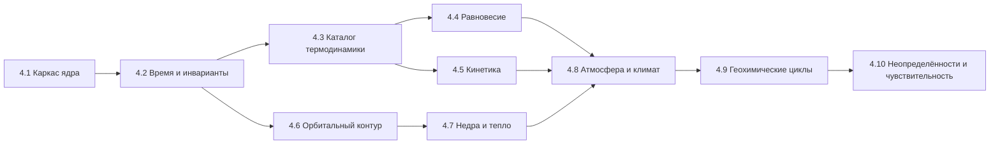
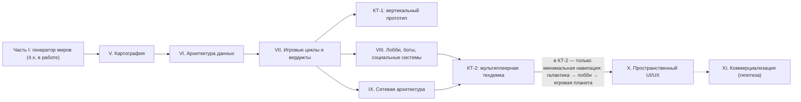

# IMPLEMENTATION_ROADMAP — Поэтапный план реализации

> Stage 4.0. Правила движения: (1) каждый этап заканчивается зелёным CI и
> сохранением всех тестов предыдущих уровней; (2) миграции сохранений —
> обязательная часть изменения схемы; (3) физика этапа не активируется в
> UI, пока не прошла валидацию; (4) неизвестное остаётся unknown.
> Ревизия Stage 4.0.1 (2026-10-30): критерии готовности согласованы с
> исправленной архитектурой (иерархия температур, интерфейс якобиана,
> JPL Evaluation No. 20, предел Роша, калибровка климата).
> Ревизия Stage 4.0.2 (2026-10-30): версия ATcT синхронизирована с
> DATA_PROVENANCE §2.3 — TN 1.228.
> Ревизия Stage 4.1 (2026-10-30): этап 4.1 исполнен как «Научное ядро»
> (контракты данных и инвариантов, `src/modules/Core/`, 171 тест, формат
> сохранений 1.2) — см. секцию 4.1 ниже и docs/science/
> CORE_SCIENTIFIC_ENGINE.md. Часть гигиенических позиций исходного плана
> 4.1 не выполнена и перенесена в 4.2 (перечислены явно).
> Ревизия Stage 4.1.1 (2026-10-30): в рамках этапа 4.1 исправлены 8
> дефектов научной целостности ядра, найденных независимым аудитом кода
> (детали: CURRENT_SYSTEM_AUDIT §1.16, контракты: CORE_SCIENTIFIC_ENGINE
> §2.4/2.5/2.9/2.10). Тесты: 517 (21 файл), ядро — 246; подсчёт CI #24 =
> 442 исправлен (в доках 4.1 ошибочно указывалось 438). Коммиты 4.1.1:
> f63c5be → af14dd8 → 25f813e (CI #27 зелёный).
> Ревизия Stage 4.1.1.2 (2026-10-30): корректирующая ревизия ядра —
> 4 остаточных дефекта полноты балансов и защиты хранилища (ISSUE A/B/C/D:
> неизвестный инвентарь ≠ ноль, пофазовый аудит всех резервуаров,
> untimed-исключения не маскируются как balanced, Storage не
> перезаписывает повреждённый корневой JSON) + обязательность
> properties в validateReservoirRecord. Тесты: 550 (21 файл), ядро —
> 279. Коммиты: 35e7b0e → bf3f677 (CI run #30 зелёный). Stage 4.2 НЕ
> начат — ядро зафиксировано на проверенном целостном состоянии.
> Ревизия Stage 4.1.1.3 (2026-10-30): корректирующая ревизия ядра —
> 2 остаточных дефекта (ISSUE A: явная неприменимость материи в
> пофазовом аудите — отсутствие material без materialApplicability
> 'not_applicable' есть неизвестный запас, маркер обязателен в обоих
> состояниях; ISSUE B: properties и material.entries — объекты-записи,
> массив не принимается за словарь). Тесты: 574 (21 файл), ядро —
> 303. Коммит: 00d9985 (CI run #32 зелёный). Stage 4.2 НЕ начат —
> ядро остаётся на проверенном целостном состоянии.
> Ревизия Stage 4.1.1.3.1 (2026-10-30): isPlainRecord строг к
> прототипам (Object.prototype/null; Map/Set/Date/RegExp/
> экземпляры классов — invalid, не «известная пустота»). Тесты:
> 597 (21 файл), ядро — 326. CI run #34 зелёный.
> Stage 4.2.1 (2026-10-30): подэтап «фундамент политики времени»
> выполнен — WorldClock поверх сегментированного SimulationClock
> (второго elapsed-поля нет; локальное время ≠ космологический
> возраст), реестр процессов с честными τ (unknown не превращается
> в число; dt ≤ τ/20 — только эвристика; легаси-процессы химии
> перенесены в честном disabled-состоянии), планировщик (Lie/
> Strang A(dt/2) → B(dt) → A(dt/2), sub-cycling, очередь событий),
> InvariantAuditor (9 секций, balanced только при полной границе),
> схема ядра 1.0.0 → 1.1.0, сохранения 1.2 → 1.3, golden baseline
> химии зафиксирован
> (877e17d346da3618ec5d15aced90c68da8a4bbb34ff18cb78023e756c1d85b20).
> Тесты: 672 (26 файлов), ядро — 401 (14
> файлов). Коммиты: 63375e9 → eba0a94 → 31f2298 → 8cb8ba3 →
> 2af6970 (CI runs #38–#42 зелёные). Stage 4.2 НЕ завершён:
> 4.2.2 (температурная иерархия), 4.2.3 (химия на Scheduler) и
> остальное 4.2 НЕ начаты.
> Stage 4.2.2 (2026-10-30): подэтап «температурная иерархия и
> provenance» выполнен — 6 раздельных температурных понятий в ядре
> (thermalState, resolver локальной температуры, адаптеры пресетов,
> схема CoreWorldState 1.2.0), WorldModel больше НЕ копирует пресетную
> температуру в surfaceTemperature. Тесты: 761 (27 файлов), ядро —
> 490. Статус 4.2.2 — см. §4.2 ниже.
> Stage 4.2.2.1 (2026-10-30): ревизия интеграции 4.2.2 по итогам
> независимого аудита — строгая валидация форм температур, orphan-
> защита resolver, provenance адаптеров, условная совместимость
> колыбели (отсутствие локальной температуры — не пройденная
> проверка, а предупреждение), диагностика пресет/T_eq подключена к
> генерации, location-aware фазовый скрининг. Golden-траектория
> стабильна. Тесты: 783 (27 файлов), ядро — 500. Статус — см. §4.2.
> Stage 4.2.2.2 (2026-10-31): семантика оценки и измерения — ошибка
> совместимости только для известного (known) значения локальной
> среды; оценочное расхождение с диапазоном колыбели — ЯВНОЕ
> предупреждение (новое правило cradle_temperature_estimate_outside_range),
> а не физическое противоречие; легаси surfaceTemperature без
> происхождения не считается измерением; presetSourceName — отдельное
> поле для реального источника (presetNotes — только пояснение);
> PhaseTemperatureBasis.location — структурированное место контекста.
> Golden-траектория стабильна. Тесты: 800 (27 файлов), ядро — 505.
> Stage 4.2.2.3 (2026-10-31): provenance gate — известное (known) без
> содержательного provenance — недоказанность
> (cradle_temperature_unproven), НЕ ошибка; раздельные источники
> surface/ocean (явная ссылка localReservoirId + resolver, без
> fallback на surface/T_eq/атмосферу/соседние резервуары);
> приоритет typed known над легаси-скаляром (легаси не
> перечитывается, предупреждение не дублируется). Golden-траектория
> стабильна. Тесты: 830 (27 файлов), ядро — 505. Статус — см. §4.2.
> Stage 4.2.2.4 (2026-10-31): корректирующая ревизия — проверка
> соответствия ReservoirRecord.kind локальной среде
> (несоответствие — недоказанность, не ошибка, без автоподбора
> другого резервуара); selectCradle экспортирован, принимает
> опциональный typed evidence и покрыт интеграционными тестами
> реального selector’а. Golden-траектория стабильна. Тесты: 848
> (27 файлов), ядро — 505. Статус — см. §4.2.
> Stage 4.2.2.5 (2026-10-31): корректирующая ревизия —
> candidate-specific локальные среды selector’а (карта
> cradleLocalEnvironmentsById по ID кандидата; без явной среды —
> per-candidate вычисление; перенос среды между кандидатами
> исключён); семантика видов: subsurface_reservoir — только kind
> ’crust’; runtime-неизвестный locationType — недоказанность без
> исключений. Golden-траектория стабильна. Тесты: 862
> (27 файлов), ядро — 505. Статус — см. §4.2.
> Stage 4.2.2.5.1 (2026-10-31): узкая корректирующая ревизия —
> защита kind-гейта от prototype pollution: список допустимых
> видов читается только по СОБСТВЕННОМУ ключу таблицы
> (hasOwnProperty); имена унаследованных свойств прототипа
> (’constructor’/’toString’/’hasOwnProperty’/’__proto__’) и
> произвольные строки — недоказанность без исключений и без
> автоподбора резервуара. Golden-траектория стабильна. Тесты: 863
> (27 файлов), ядро — 505. Статус — см. §4.2.
> Stage 4.2.3.1 (2026-10-31): подготовительный подэтап 4.2.3 —
> snapshot-изоляция macro-шага Scheduler: перед первым оператором
> создаётся глубокий рабочий снимок CoreWorldState (structuredClone;
> JSON-раунд-триппинг не используется); входной мир не мутируется
> при ошибке или отклонении шага; неклонируемое состояние —
> контролируемый отказ до операторов; контракты планировщика не
> изменены; перевод химии на расписание (4.2.3) НЕ начат;
> golden-траектория стабильна; итоговые количества тестов — по
> фактическому CI. Статус — см. §4.2.
> Stage 4.2.3.2 (2026-10-31): ReactionLedger — самостоятельный
> контракт реакционных транзакций и стехиометрический аудит
> (src/modules/Core/reactionLedger.ts, экспорт из Core/index.ts):
> журнал завершённых превращений, иммутабельная регистрация,
> элементный и зарядовый баланс с различимыми статусами balanced /
> imbalanced / not_verifiable / approximate; вымышленные ux:*
> компоненты с явным составом алгебраически проверяемы. ГРАНИЦЫ:
> ReactionLedger НЕ интегрирован — вне CoreWorldState, Scheduler и
> InvariantAuditor его не используют; FluxLedger не изменён; ни
> кинетика, ни solver, ни применение к инвентарям не реализованы.
> Следующий подэтап 4.2.3.3 — интеграция (CoreWorldState, версия
> схемы и сохранения, auditWorldTransition, Scheduler). Итоговые
> количества тестов — по фактическому CI. Статус — см. §4.2.
> Ревизия Stage 4.2.3.2.1 (2026-10-31): корректирующая ревизия
> ReactionLedger — 6 дефектов: обязательность time (undefined →
> invalid); прототип-безопасный учёт компонентов (Map +
> Object.fromEntries: 'constructor'/'toString'/'hasOwnProperty'/
> '__proto__' — данные, не прототип); строгая форма состава (только
> объектная запись; Map/Set/Date/RegExp/массив/класс →
> not_verifiable; численная пригодность — только known/estimated;
> пустой {} легитимен); NaN/Infinity в промежуточных итогах →
> not_verifiable (не balanced); tolerance — конечное неотрицательное
> (некорректное → invalid); note — непустая строка, пары участников
> кодируются однозначно (JSON.stringify). Границы прежние: интеграции
> нет (4.2.3.3 — следующий подэтап), защищённые контракты не
> изменены, golden не тронут. Статус — см. §4.2.

> Ревизия Stage 4.2.3.3 (2026-10-31): ReactionLedger интегрирован в
> CoreWorldState (опциональное поле, схема ядра 1.3.0, пустой журнал у
> новых миров), формат сохранений 1.3 → 1.4 (миграция создаёт пустой
> журнал у существующего ядра, существующий не перезаписывается; round-trip
> всех полей записи), секция 'reactions' в auditWorldTransition (отдельно
> от FluxLedger — без двойного счёта; пустой журнал balanced;
> not_verifiable ≠ balanced), Scheduler передаёт реакционные записи шага
> в аудит (правило отклонения прежнее — только imbalanced; шаг атомарен;
> записи не создаются автоматически). Кинетика, solver и применение
> реакций к инвентарям НЕ реализованы; перевод легаси-химии на
> расписание не начат; golden не тронут. Статус — см. §4.2.

> Ревизия Stage 4.2.3.3.1 (2026-10-31): корректирующая ревизия
> интеграции ReactionLedger — append-only контракт журнала в
> Scheduler (совпадающий id не доказывает неизменности: записи
> сравниваются по всему содержимому; изменение, удаление и
> перестановка старых записей, удаление журнала отклоняют шаг до
> аудита; новые записи требуют стехиометрического аудита до фиксации),
> проверка журнала при импорте/загрузке в Storage (некорректный
> журнал не возвращается как валидное состояние; повреждённая запись
> сохраняется как raw с причиной отказа), миграция 1.3 → 1.4 при
> неизвестной внутренней схеме ядра не модифицирует coreWorldState
> (незнание структуры не подменяется пустым журналом), семантика
> статусов аудита документирована (invalid — структурная
> некорректность; общий агрегатор по существующему правилу
> переводит invalid вместе с imbalanced в общий imbalanced; общий
> imbalanced сам по себе не доказывает физического нарушения).
> Добавлена долгосрочная дорожная карта за пределами генератора
> миров — часть II, этапы V–XI (план, не реализация). Статус — см.
> §4.2 и часть II.

> Ревизия Stage 4.2.3.3.2 (2026-10-31): корректирующая ревизия — три
> пограничных случая. (A1) при отсутствии прежнего журнала форма
> нового проверяется в полном объёме: records — обязательно массив;
> валидный пустой { records: [] } допустим; undefined после шага
> допустим только если журнала не было; явный null — контролируемое
> нарушение до или после шага (не исключение и не commit); некорректная форма нового журнала — reject Scheduler до аудита;
> контракт существующей истории не изменён. (A2) Storage и миграция
> различают отсутствие поля и явный null: null-журнал и null/
> не-объектное coreWorldState не маскируются под отсутствие,
> отклоняются с точной причиной, повреждённая raw-запись остаётся
> нетронутой, валидные соседние сохранения продолжают загружаться.
> (A3) deepJsonEqual различает сериализуемые виды объектов
> ({} и new Date(0) — разные данные) и защищает дополнительные поля
> записей от незаметного изменения; порядок ключей объектов не
> влияет, порядок массивов значим, undefined-ключ равносилен
> отсутствию (JSON-семантика сохранена); обнаружение изменений
> известных полей не ослаблено. Согласующая правка части II: КТ-2 —
> минимальная рабочая навигация галактика → лобби → игровая
> планета; полноценный пространственный UI/UX остаётся этапом X.
> Статус — см. §4.2 и часть II.

> Ревизия Stage 4.2.3.3.3 (2026-10-31): корректирующая ревизия —
> fail-closed сравнение и строгая валидация массивов ReactionLedger.
> (1) deepJsonEqual сравнивает каждый индекс массива явно: every и
> forEach пропускали отсутствующие индексы, из-за чего new Array(1)
> ошибочно считалась равной [new Date(0)], хотя JSON различает [null]
> и ISO-строку времени; порядок элементов значим, отсутствующий
> индекс равносилен явному undefined, сравнение симметрично; порядок
> ключей объектов не влияет, ключ со значением undefined равносилен
> отсутствующему, вложенные Date сравниваются по времени, прочие
> не-plain объекты остаются fail-closed. (2) обход обнаруживает
> циклы по активному рекурсивному пути: циклическое дополнительное
> поле записи даёт контролируемое нарушение append-only (fail-closed
> изменение), а не необработанный RangeError; повторное использование
> той же ссылки в независимых ветвях графа циклом не считается.
> (3) строгая форма: журнал, запись и участник — только настоящие
> plain records (прототип Object.prototype или null): массив и Date
> с дорисованными обязательными полями формой не проходят;
> допустимые дополнительные поля корректных записей не запрещаются
> (вложенная Date сравнивается по времени, как в 4.2.3.3.2).
> (4) дырки в records/reactants/products — структурная ошибка, а не
> отсутствие данных: каждый индекс обязан содержать существующую
> корректную запись/участника (forEach пропускал дырки, и undefined
> доходил до аудита с падением на обращении к speciesId); аудит
> таких входов — контролируемый invalid с диагностикой, а не
> исключение; правила стехиометрии, численные tolerance и статусы
> известных/неизвестных составов не менялись. (5) Scheduler: обычный
> macro-step при циклическом дополнительном поле существующей записи
> и при новой записи с разреженным массивом участников —
> контролируемый rejected (до аудита), исходный мир, журнал, часы и
> вложенные ссылки нетронуты. (6) регрессионный тест миграции старой
> внешней схемы 1.3 с coreWorldState: null: миграция не выбрасывает
> TypeError, null не превращается в отсутствие ядра или пустой
> объект, внешняя версия 1.4, Storage отклоняет некорректную форму с
> причиной, raw-запись нетронута, соседние корректные сохранения
> продолжают загружаться. Кинетика, solver и применение реакций к
> запасам НЕ реализованы и не заявляются; перевод химии на расписание
> (4.2.3 в целом) не завершён. Статус — см. §4.2 и часть II.

## Карта этапов

## 4.1 Научное ядро (контракты и инварианты) — Stage 4.1 исполнен

**Доставлено (HEAD 8c1a8e0, CI #23 зелёный; ревизия 4.1.1 — HEAD
25f813e, CI #27 зелёный)**:

- `src/modules/Core/` — 11 модулей: PhysicalQuantity (величины с
  размерностями, реестр ASCII-единиц, запрет NaN/±Inf), ScientificValue
  (6 статусов данных, uncertainty, provenance), ScientificSpecies (вид+фаза,
  элементный/зарядовый баланс), Reservoir (инвентарь с явным basis),
  FluxLedger (потоки с аудитами сохранения), SimulationClock
  (сегментированное время), CoreWorldState (каноническое состояние мира,
  гравитация ≠ излучение), SolverBackend (честный контракт решателей),
  migrations (1.0→1.1→1.2), adapters (мост из легаси), index.
- `GeneratedWorld.coreWorldState?` — опционально; отсутствие = «ядро
  не инициализировано», не нулевое состояние.
- Storage: формат 1.2, миграции делегированы ядру; секция «Научное ядро»
  в Markdown-экспорте. Легаси-семантика хранения и старые сохранения
  не ломаются (null не становится 0, значения не пересчитываются).
- 401 тест ядра (14 файлов core*.test.ts: 171 в 4.1 + 75 в 4.1.1 +
  33 в 4.1.1.2 + 24 в 4.1.1.3 + 23 в 4.1.1.3.1 + 4 golden baseline +
  7 scheduling/миграционных + 64 в 4.2.1), всего 672 (CI #24 этапа 4.1 = 442 — в ранних
  доках ошибочно 438); PRNG-регрессия детерминизма добавлена в
  corePersistence.test.
- Документация: docs/science/CORE_SCIENTIFIC_ENGINE.md; аудит и дорожная
  карта обновлены.
- Легаси-модули (Generator, ChemicalEvolution, Units, WorldModel,
  пресеты, реакции) не изменены.
- Ревизия 4.1.1: исправлены 8 дефектов научной целостности ядра —
  convert-корректные массаↆколичество (1000 г H2O / 0.018 кг/моль =
  55.5556 моль), статусная семантика аудитов (balanced | imbalanced |
  approximate | not_verifiable), РЕАЛЬНЫЕ энергетические переносы в
  applyFlux/revertFlux, временная область аудитов (FluxAuditScope),
  строгие версии схем (MigrationError), raw-изоляция Storage +
  getStorageHealth, масштабирование процентов (50% → 0.5), provenance
  у unknown-значений. Легаси-модули не тронуты.

**НЕ доставлено из исходного списка 4.1 — перенесено в 4.2** (по правилу
этапа не трогать легаси-потребителей и не пересчитывать старые данные):

- перенос форматтеров PhysValue из App.tsx в ядро и отключение прямых
  импортов физических модулей в UI (аудит §1.15);
- удаление легаси-ветки характеристик тела (проблема 2.6) — контракты
  и адаптер готовы, переключение и миграция дозаполнением bodyPhysics —
  4.2;
- устранение дублей вспомогательных функций (проблема 2.7) — фабрики
  ядра готовы, дубли в легаси-модулях сохранены до перевода потребителей;
- ревизия текстов-обещаний (проблема 2.9);
- обновление ярлыка констант до CODATA 2022.

**Готовность (критерий этапа)**: все 672 теста зелёные (после
4.2.1, CI run #42: tsc 0 ошибок, oxlint, build успех; после golden
baseline — 601, после 4.1.1.3.1 — 597, после 4.1.1.3 — 574, после
4.1.1.2 — 550, после 4.1.1 — 517, этап 4.1 заканчивался на 442 —
CI #24); контракты ядра покрыты 401 тестом; интерфейсы не выдаются за реализованные модели
(solver-бэкенд пуст и помечен not_implemented, planned ≠ available).
Исходные критерии «App.tsx без физических импортов» и «удалённая ветка
2.6» НЕ достигнуты в 4.1 и остаются критериями 4.2.

## 4.2 Политика времени и температуры (ядро симуляции)

- WorldClock, реестр процессов с τ, планировщик (Strang), аудитор инвариантов.
- Иерархия температурных величин (проблемы 2.2/2.3): РАЗДЕЛЬНЫЕ поля
  effectiveTemperature, equilibriumTemperature, surfaceTemperature,
  atmosphericTemperatureProfile, reservoirTemperature,
  localReactionTemperature (PHYSICS_ARCHITECTURE §5.1); правило
  совместимости «пресет vs T_eq».
- Химия переводится на расписание (поведение и числа шагов сохраняются).
- Перенесённые остатки 4.1: перевод UI на ядро (форматтеры, отключение
  прямых физических импортов в App.tsx), удаление легаси-ветки 2.6,
  устранение дублей 2.7, ревизия текстов 2.9, ярлык CODATA 2022.
- **Готовность**: golden-траектория (seed + 100 шагов химии) стабильна;
  тест запрета прямого изменения modelTime вне ядра; сценарии 3.1.2 зелёные.
- **Статус (30.10.2026, Stage 4.2.1 выполнен)**: WorldClock, реестр
  процессов с честными τ, планировщик (Lie/Strang A(dt/2) → B(dt) →
  A(dt/2), sub-cycling), очередь событий, InvariantAuditor,
  миграции (CoreWorldState 1.1.0, сохранения 1.3) — готово;
  golden-траектория химии зафиксирована и воспроизводится
  (877e17d346da3618ec5d15aced90c68da8a4bbb34ff18cb78023e756c1d85b20;
  обязательная регрессия перед 4.2.3). НЕ начато: температурная
  иерархия (4.2.2), перевод химии на расписание (4.2.3), перевод UI
  на ядро, удаление легаси-ветки 2.6, устранение дублей 2.7,
  ревизия текстов 2.9, ярлык CODATA 2022. НИ один процесс не
  получил выдуманное τ, скорость или решателя.
- **Статус (30.10.2026, Stage 4.2.2 выполнен)**: температурная иерархия
  реализована в ядре типизированно — `Core/thermalState.ts` (6 раздельных
  понятий §5.1: T_eff источника, T_eq, surfaceTemperature, профиль
  атмосферы, reservoirTemperature, локальная температура реакции),
  `WorldBody.thermalState` (схема CoreWorldState 1.2.0, миграция
  сохранений 1.3), `ReservoirRecord.reservoirTemperature` c provenance,
  `resolveLocalReactionTemperature` (только явно указанная область;
  T_eq/surfaceTemperature/соседние области — НЕ fallback),
  адаптеры пресетных температур с честным происхождением
  (historical_game → estimated «игровое допущение»,
  observational_reference → «справочное, НЕ измерение этого мира»),
  `diagnosePresetEquilibriumDivergence`, типизированный фазовый скрининг
  в генераторе (`analyzeAtmospherePhasesWithProvenance`), WorldModel
  больше НЕ копирует пресетную температуру в surfaceTemperature
  (проблема 2.3 закрыта в типизированной части). Тесты: 761 (27 файлов),
  ядро — 490 (76 новых); CI зелёный, golden-траектория химии
  стабильна (877e17d346da3618ec5d15aced90c68da8a4bbb34ff18cb78023e756c1d85b20).
  НЕ начато: перевод химии на расписание (4.2.3), перевод UI на ядро,
  удаление легаси-ветки 2.6, устранение дублей 2.7, ревизия текстов 2.9,
  ярлык CODATA 2022; RCM/вертикальный профиль — этап 4.8.
- **Статус (30.10.2026, Stage 4.2.2.1 выполнен)**: ревизия интеграции 4.2.2
  по итогам независимого аудита — без переписывания температурной модели:
  строгая валидация (estimated без метода непригоден; NaN/Infinity/
  отрицательные/неизвестная единица не проходят; temperatureValueOrNull
  наследует строгую проверку), resolver отклоняет пустые идентификаторы
  области, orphan-резервуары и слои unknown-профиля; provenance адаптеров
  исправлено (presetNotes → note, sourceName только для наблюдательного
  источника; teff-диапазон класса сохраняется в provenance и не
  схлопывается в среднее; T_eq с confidence estimated остаётся
  estimated и не повышается до known); Compatibility: известное число
  вне диапазона — по-прежнему ошибка, отсутствие локальной температуры —
  явное предупреждание conditionally_compatible (правило
  cradle_temperature_unproven), оценка не считается измерением, выбор
  колыбели не блокируется; диагностика пресет/T_eq подключена к
  реальной генерации (информационная запись, verdict noted/
  not_comparable, temperatures не изменяются); фазовый скрининг
  привязан к слою surface_boundary (общий типизированный контракт,
  без второй системы значений; численные корреляции не изменены).
  Golden-траектория химии стабильна
  (877e17d346da3618ec5d15aced90c68da8a4bbb34ff18cb78023e756c1d85b20).
  Тесты: 783 (27 файлов; +22 к 4.2.2: 8 compatibility.test,
  10 coreThermalState.test, 4 generator.test), ядро — 500.
  Фактические итоги Vitest «Test Files 27 passed (27) / Tests 783
  passed (783)» из CI; tsc, oxlint, build зелёные. НЕ начато:
  перевод химии на расписание
  (4.2.3), перевод UI на ядро, удаление легаси-ветки 2.6, устранение
  дублей 2.7, ревизия текстов 2.9, ярлык CODATA 2022; RCM/вертикальный
  профиль — этап 4.8.
- **Статус (31.10.2026, Stage 4.2.2.2 выполнен)**: семантика «оценка
  не является доказанным противоречием» — cradle_temperature_
  compatibility: ошибка (incompatible/error) только для известного
  (known) значения локальной среды вне диапазона (типизированная
  поверхность — из coreWorldState со статусом и provenance;
  адаптер пресета known не выдаёт); новое правило
  cradle_temperature_estimate_outside_range (conditionally_compatible,
  warning): оценочная температура (пресет или легаси-число без
  происхождения) вне диапазона — предупреждение об оценочном
  сценарии, НЕ физическая ошибка; selectCradle не отбрасывает такую
  колыбель (фильтр — только severity error); cradle_temperature_
  unproven: proof для поверхности/океана — только типизированная
  known-температура (легаси-скаляр surfaceTemperature без
  происхождения измерением не считается; миграция число сохраняет,
  provenance не выдумывает); provenance адаптеров: presetNotes —
  всегда пояснение в note, sourceName — только из нового поля
  AtmosphereState.presetSourceName при действительно известном
  источнике; PhaseTemperatureBasis.location — структурированное
  место контекста ({kind: 'atmosphere_layer', layerId}); измеренное
  системное следствие: КАЖДЫЙ мир реалистичного режима несёт
  cradle_temperature_unproven → physically_plausible недостижим,
  обычные миры — hypothetical (статус смешивает правдоподобность
  объектов и полноту знания о локальной среде; предупреждение не
  ослаблено; семантика scientificStatus не менялась). Golden-
  траектория химии стабильна
  (877e17d346da3618ec5d15aced90c68da8a4bbb34ff18cb78023e756c1d85b20).
  Тесты: 800 (27 файлов; +17 к 4.2.2.1: 10 compatibility.test,
  5 coreThermalState.test, 2 generator.test), ядро — 505.
  Фактические итоги Vitest «Test Files 27 passed (27) / Tests 800
  passed (800)» из CI (run 41172263279); tsc, oxlint, build зелёные.
  НЕ начато: перевод химии на расписание (4.2.3), перевод UI на
  ядро, удаление легаси-ветки 2.6, устранение дублей 2.7, ревизия
  текстов 2.9, ярлык CODATA 2022; RCM/вертикальный профиль — этап 4.8.
- **Статус (31.10.2026, Stage 4.2.2.3 выполнен)**: provenance gate и
  location-specific evidence — известная (known) температура
  подтверждает/опровергает совместимость ТОЛЬКО при содержательном
  provenance (непустое одно из sourceName/sourceId/datasetId/
  recordId/reference/method/modelVersion ИЛИ непустой rawInput;
  note/applicability/limitations/conditions/license/retrievedAt и
  пустой {} — НЕ происхождение; проверяемый расчёт (method/rawInput)
  библиографией не обременяется): known без происхождения —
  cradle_temperature_unproven (warning), НЕ incompatible/error;
  непригодные формы (invalid, не та единица, NaN, отрицательные)
  физическим доказательством не становятся; estimated до known не
  повышается; gate ограничен использованием known как доказательства
  совместимости колыбели (глобальная семантика ScientificValue не
  менялась). Поверхность ≠ океан: typedLocalTemperatureOfWorld —
  surface: типизированная surfaceTemperature тела 'planet'; ocean/
  subsurface_reservoir/deep_planetary_layers: резервуар по явной
  ссылке CradleLocalEnvironment.localReservoirId через
  resolveLocalReactionTemperature (пара id + bodyId 'planet'); без
  однозначного reservoir или пригодной температуры резервуара —
  недоказанность (warning, не физическая ошибка); произвольный
  резервуар по kind, чужие тела и несуществующие id не выбираются;
  surfaceTemperature/T_eq/атмосфера/соседние резервуары — НЕ
  fallback. Правило 6b: при пригодном typed known легаси-скаляр не
  читается (доказанное вне диапазона — ОДНА ошибка без
  дублирующего оценочного предупреждения; доказанное в диапазоне —
  без error/warning/unproven); легаси-скаляр — оценочный сценарий
  только поверхности и только без typed evidence (никогда error; для
  океана не используется даже как оценка).
  CradleLocalEnvironment.localReservoirId — необязательное поле;
  старые сохранения без миграций, автозаполнение запрещено,
  легаси-числа не становятся ScientificValue.
  isCradleSupportedOnWorld: контекст расширен опциональными
  coreWorldState/cradleLocalEnvironment (тесты реального пути
  автоматического выбора: доказанное known-нарушение исключает
  колыбель; оценка/unknown — нет; генерация не меняется — ядро
  строится после выбора колыбели). Golden-траектория стабильна
  (877e17d346da3618ec5d15aced90c68da8a4bbb34ff18cb78023e756c1d85b20). Тесты: 830 (27 файлов; +30 к 4.2.2.2: 26
  compatibility.test, 4 generator.test), ядро — 505. Фактические
  итоги Vitest «Test Files 27 passed (27) / Tests 830 passed (830)»
  из CI (run 41174155913); tsc, oxlint, build зелёные. НЕ начато:
  перевод химии на расписание (4.2.3), перевод UI на ядро,
  удаление легаси-ветки 2.6, устранение дублей 2.7, ревизия
  текстов 2.9, ярлык CODATA 2022; RCM/вертикальный профиль — этап 4.8.
- **Статус (31.10.2026, Stage 4.2.2.4 выполнен)**: корректирующая
  ревизия по итогам независимого аудита 4.2.2.3 — соответствие
  CradleLocationType ↔ ReservoirRecord.kind задано явной
  экспортированной таблицей LOCATION_TYPE_RESERVOIR_KINDS (ocean →
  ’ocean’; subsurface_reservoir → ’ocean’ | ’crust’;
  deep_planetary_layers → ’mantle’ | ’core’; surface/atmosphere/
  other → null; таксономия — только задокументированные значения
  ReservoirRecord.kind, без новых типов и переименований).
  typedLocalTemperatureOfWorld проверяет kind записи ДО признания
  known доказательством: несоответствие (kind ’atmosphere’/’ice’
  при locationType ’ocean’; kind ’ocean’ при
  deep_planetary_layers и т.п.) — температура не используется как
  доказательство, НЕ incompatible/error, а
  cradle_temperature_unproven (fail-closed); другой резервуар
  автоматически не выбирается; ’other’ и недокументируемые
  соответствия — недоказанность (природа резервуара из одного ID
  не выводится). selectCradle: экспортирован, принимает
  опциональные coreWorldState/cradleLocalEnvironment и передаёт их
  в isCradleSupportedOnWorld → checkCompatibility; без typed
  evidence селектор не выдумывает его и не исключает кандидата по
  температуре; фиктивное ядро ради выбора не создаётся.
  Границы реального контура: generateWorld evidence в selectCradle
  НЕ передаёт (ядро строится после выбора колыбели; переданная в
  тестах среда применяется ко всем кандидатам без пересчёта) —
  генерационный pipeline остаётся условным по температуре, ложных
  ошибок не создаёт. Тесты: интеграционные тесты САМОГО
  selectCradle (не только predicate): known в диапазоне —
  кандидат доступен; known-нарушение исключает кандидата при
  допустимой альтернативе; estimated вне диапазона — условный
  кандидат; unknown — не hard error; без typed evidence не
  выдумывается; fixedCategories.cradle — прежняя семантика
  (выбранная вручную колыбель остаётся, несовместимость —
  предупреждения/ошибки без автоматической подмены);
  детерминизм — фиксированная фикстура, нулевые веса, единственная
  допустимая альтернатива. Golden-траектория стабильна
  (877e17d346da3618ec5d15aced90c68da8a4bbb34ff18cb78023e756c1d85b20).
  Тесты: 848 (27 файлов; +18 к 4.2.2.3: 11 compatibility.test,
  7 generator.test), ядро — 505. Фактические итоги Vitest
  «Test Files 27 passed (27) / Tests 848 passed (848)» из CI
  (run 41189806931); tsc, oxlint, build зелёные. НЕ начато:
  перевод химии на расписание (4.2.3), перевод UI на ядро,
  удаление легаси-ветки 2.6, устранение дублей 2.7, ревизия
  текстов 2.9, ярлык CODATA 2022; RCM/вертикальный профиль —
  этап 4.8.
- **Статус (31.10.2026, Stage 4.2.2.5 выполнен)**: корректирующая
  ревизия по итогам независимой проверки 4.2.2.4 — локальные
  среды selector’а стали candidate-specific: singular-поле
  cradleLocalEnvironment контекста selectCradle заменено картой
  cradleLocalEnvironmentsById (ID кандидата → его среда);
  кандидат без явной среды проверяется по per-candidate
  вычислению determineCradleLocalEnvironment (тот же путь, что
  и в реальном контуре); coreWorldState общий; перенос
  locationType/состава/localReservoirId между кандидатами
  исключён; температура одной области не выводится из другой;
  fixedCategories.cradle — прежняя семантика. Семантика видов:
  kind ’ocean’ убран из subsurface_reservoir (схема
  ReservoirRecord не различает поверхностный/подземный океан,
  описание CRADLE_LOCATION_MAP не доказывает представительство,
  тестовая фикстура не обоснование; доказывается только kind
  ’crust’; новые виды не введены). Runtime-безопасность:
  неизвестный locationType (внешние данные) — lookup даёт
  undefined → недоказанность cradle_temperature_unproven, без
  исключения и без выбора другого резервуара (fail-closed).
  Интеграционные тесты selector’а: четыре локации в одном
  selector-вызове (ocean/atmosphere/subsurface_reservoir/
  deep_planetary_layers) с собственными средами;
  known-нарушение исключает только своего кандидата при
  допустимой альтернативе; атмосферная колыбель требует H₂/He;
  давление и matter_state — по расположению текущего
  кандидата; estimated/unknown — условные; без reservoir ID
  температура не подставляется; fallback, нулевые веса и
  ручная фиксация — прежние; детерминизм — фиксированная
  фикстура и повторный вызов. Границы production pipeline:
  generateWorld evidence в selectCradle НЕ передаёт (ядро
  строится после выбора колыбели) — selector-интеграционные
  тесты НЕ являются заявлением, что генератор использует typed
  evidence. Golden-траектория стабильна
  (877e17d346da3618ec5d15aced90c68da8a4bbb34ff18cb78023e756c1d85b20).
  Тесты: 862 (27 файлов; +14 к 4.2.2.4: 12 generator.test,
  2 compatibility.test), ядро — 505. Фактические итоги Vitest
  «Test Files 27 passed (27) / Tests 862 passed (862)» из CI
  (run 41192420708); tsc, oxlint, build зелёные. НЕ начато:
  перевод химии на расписание (4.2.3), перевод UI на ядро,
  удаление легаси-ветки 2.6, устранение дублей 2.7, ревизия
  текстов 2.9, ярлык CODATA 2022; RCM/вертикальный профиль —
  этап 4.8.
- **Статус (31.10.2026, Stage 4.2.2.5.1 выполнен)**: защита
  kind-гейта от prototype pollution — runtime lookup
  LOCATION_TYPE_RESERVOIR_KINDS[env.locationType] выполняется
  только по СОБСТВЕННОМУ ключу таблицы
  (Object.prototype.hasOwnProperty.call): имена унаследованных
  свойств прототипа (’constructor’, ’toString’, ’hasOwnProperty’,
  ’__proto__’) и произвольные строки (’hydrothermal_sinter’) —
  недоказанность cradle_temperature_unproven без исключения,
  без TypeError и без выбора другого резервуара (fail-closed);
  поведение корректных CradleLocationType и все контракты
  4.2.2.5 (candidate-specific среды, per-candidate вычисление,
  subsurface_reservoir = [’crust’], evidence gate 4.2.2.3,
  запрет fallback’ов) сохранены. Комментарий таксономии перед
  таблицей приведён к действующему контракту (kind —
  документированные семантические категории; таблица
  консервативна; subsurface_reservoir — только ’crust’;
  тесты/фикстуры таксономию не устанавливают; новые виды не
  вводятся). Регрессионные тесты — через реальный путь
  checkCompatibility с декой-резервуаром (доказанная
  неприемлемая 288 K) как наблюдаемым доказательством
  отсутствия автоподбора. Golden-траектория стабильна
  (877e17d346da3618ec5d15aced90c68da8a4bbb34ff18cb78023e756c1d85b20).
  Тесты: 863 (27 файлов; +1 к 4.2.2.5: compatibility.test),
  ядро — 505. Фактические итоги Vitest «Test Files 27 passed
  (27) / Tests 863 passed (863)» из CI (run 41207933807); tsc,
  oxlint, build зелёные.
- **Статус (31.10.2026, Stage 4.2.3.1 выполнен)**: подготовительный
  подэтап перевода химии на расписание — snapshot-изоляция
  macro-шага Scheduler (src/modules/Core/scheduler.ts): перед
  первым оператором создаётся глубокий рабочий снимок полного
  CoreWorldState через structuredClone (JSON-раунд-триппинг не
  используется); операторы работают с рабочим состоянием —
  ошибка оператора после на-место-мутаций вложенных объектов,
  самовольное продвижение часов, некорректное возвращённое
  состояние или отклонение аудита (imbalanced) → шаг rejected,
  входной мир остаётся без частичных изменений; при успехе
  фиксируется итоговое рабочее состояние; невозможность
  клонирования — контролируемый отказ ДО вызова операторов;
  WorldClock продвигается ровно один раз после успешных
  операторов и аудита. Контракты ProcessRegistry,
  ProcessOperator, Lie/Strang/sub-cycling, WorldClock, аудиты,
  Storage и схема CoreWorldState 1.2.0 НЕ изменены;
  ChemicalEvolution и его legacy API не тронуты. Перевод химии
  на расписание (4.2.3) НЕ начат. Golden-траектория стабильна
  (877e17d346da3618ec5d15aced90c68da8a4bbb34ff18cb78023e756c1d85b20).
  Регрессионные тесты snapshot-изоляции добавлены в
  coreScheduler.test.ts (мутация+исключение; частичный успех
  двух операторов; успешная фиксация; незаконное движение
  часов; отклонение аудита; повторяемость; отказ при
  неклонируемом состоянии); итоговые количества тестов — по
  фактическому CI.

- **Статус (31.10.2026, Stage 4.2.3.2 выполнен)**: ReactionLedger —
  типизированный журнал завершённых реакционных транзакций
  (src/modules/Core/reactionLedger.ts, экспорт из Core/index.ts):
  ReactionRecord { id, reactionId, reactants/products (явные
  резервуары + вид + положительный конечный коэффициент; дубль
  пары резервуар+вид на стороне отклоняется), extent > 0,
  extentBasis 'amount' | 'column_amount', time: FluxTime | null,
  processId? }; registerReaction иммутабельна (новый журнал);
  auditReactionStoichiometry / auditReactionLedger проверяют
  элементный и зарядовый баланс по числу частиц с различимыми
  статусами balanced / imbalanced / not_verifiable / approximate
  (+invalid формы): вид вне каталога или непроверяемый dataStatus →
  not_verifiable (пустые elements НЕ доказательство отсутствия
  атомов), estimated → approximate; вымышленные ux:*-компоненты с
  явно объявленным составом алгебраически проверяемы без молярной
  массы. Реакции НЕ применяются к инвентарям; ReactionLedger НЕ
  входит в CoreWorldState и пока не используется Scheduler и
  InvariantAuditor; FluxLedger, Storage, схема CoreWorldState и
  legacy-химия не изменены. Следующий подэтап 4.2.3.3 — включение
  ReactionLedger в CoreWorldState, корректное повышение версии
  схемы с обратной совместимостью сохранений, связь с
  auditWorldTransition и передача реакционных записей из
  Scheduler. Golden-траектория стабильна
  (877e17d346da3618ec5d15aced90c68da8a4bbb34ff18cb78023e756c1d85b20);
  итоговые количества тестов — по фактическому CI.

- **Статус (31.10.2026, Stage 4.2.3.2.1 выполнен)**: корректирующая
  ревизия ReactionLedger — 6 дефектов исправлены (коммит кода +
  коммит регрессионных тестов в coreReactionLedger.test.ts,
  существующие тесты не изменены): time обязательно (undefined →
  invalid), накопление состава прототип-безопасно (внутренний Map +
  Object.fromEntries; '__proto__', 'constructor', 'toString',
  'hasOwnProperty' — обычные данные, прототип отчёта не меняется,
  компонент не исчезает), строгая форма элементов (только объектная
  запись; Map/Set/Date/RegExp/массив/класс/null → not_verifiable;
  численная пригодность — только dataStatus known/estimated;
  пустой {} легитимен — электрон), NaN/Infinity в промежуточных
  итогах → not_verifiable с диагностикой (не balanced), tolerance —
  конечное неотрицательное (NaN/±Infinity/отрицательное → invalid;
  единая политика записи и журнала), note — непустая строка,
  пары резервуар+вид кодируются однозначно (JSON.stringify).
  Интеграционные границы прежние (4.2.3.3 — следующий подэтап):
  ReactionLedger НЕ входит в CoreWorldState, Scheduler и
  InvariantAuditor его не используют; ReactionRecord/extent/
  extentBasis, FluxLedger, SpeciesCatalog, CoreWorldState, Storage,
  InvariantAuditor, Scheduler, ChemicalEvolution, PRNG и UI не
  изменены; golden-траектория стабильна
  (877e17d346da3618ec5d15aced90c68da8a4bbb34ff18cb78023e756c1d85b20);
  итоговые количества тестов — по фактическому CI.

- **Статус (31.10.2026, Stage 4.2.3.3 выполнен)**: ReactionLedger
  интегрирован — опциональное поле в CoreWorldState (схема ядра 1.3.0,
  пустой журнал у новых миров, invalid_reaction_ledger для некорректных
  данных без молчаливой подмены), миграция сохранений 1.3 → 1.4 (пустой
  журнал у сохранённого ядра: распознанная схема поднимается до 1.3.0,
  нераспознанная не переписывается; существующий журнал не
  перезаписывается; round-trip всех полей ReactionRecord), секция
  'reactions' в auditWorldTransition (стехиометрия реакций отдельно от
  FluxLedger — двойной счёт исключён; записи не объясняют изменения
  инвентарей; пустой журнал balanced; неизвестный вид → not_verifiable,
  некорректная форма → invalid, оценочный состав → approximate;
  некорректный tolerance → invalid), Scheduler передаёт в аудит записи,
  добавленные шагом (reject-правило прежнее — только imbalanced; шаг
  атомарен: ошибка оператора или отклонение аудита оставляют мир и
  журнал на исходном снимке; записи не создаются автоматически;
  контракт ProcessOperator не менялся). Кинетика, solver и применение
  реакций к запасам НЕ реализованы; перевод химии на расписание (4.2.3 в
  целом) не завершён; FluxLedger, SpeciesCatalog, PRNG, planetary
  physics, legacy Chemistry и UI не изменены; golden-траектория стабильна
  (877e17d346da3618ec5d15aced90c68da8a4bbb34ff18cb78023e756c1d85b20);
  итоговые количества тестов — по фактическому CI.

- **Статус (31.10.2026, Stage 4.2.3.3.1 выполнен)**: корректирующая
  ревизия интеграции ReactionLedger. A1 — append-only контракт журнала
  в Scheduler: прежний и новый журналы шага сравниваются по всему
  содержимому записей (участники, коэффициенты, extent, extentBasis,
  time, processId, note — глубокое сравнение; одинаковый id не
  считается доказательством неизменности); изменение старой записи,
  её удаление, перестановка записей и удаление журнала отклоняют
  macro-step до аудита; разрешено только добавление новых записей в
  конец; новые записи проходят стехиометрический аудит до фиксации шага
  (шаг с новыми реакционными записями без запрошенного аудита
  инвариентов отклоняется); при отказе исходный мир, его журнал и часы
  остаются на исходном снимке. A2 — Storage: некорректный
  CoreWorldState.reactionLedger обнаруживается при импорте и загрузке;
  повреждённое сохранение не возвращается как валидный мир, причина
  попадает в диагностику, исходная запись сохраняется в хранилище как
  raw для диагностики и восстановления (не удаляется и не
  переписывается молча); остальные миры продолжают загружаться;
  getStorageHealth отличает такую запись от успешно загруженной. A3 —
  миграция 1.3 → 1.4: при неизвестной внутренней версии схемы ядра
  coreWorldState не модифицируется вообще (никакого пустого журнала
  «по умолчанию»: незнание структуры не подменяется утверждением об
  отсутствии транзакций); внешняя версия записи поднимается до 1.4 с
  диагностической пометкой о невозможности безопасной миграции ядра;
  известная схема без журнала получает пустой ReactionLedger;
  существующий валидный журнал не перезаписывается. A4 — семантика
  статусов аудита документирована без изменения правил: секция
  'reactions' может иметь статус invalid (структурная некорректность);
  общий агрегатор auditWorldTransition по существующему правилу
  переводит invalid вместе с imbalanced в общий imbalanced; общий
  imbalanced сам по себе не доказывает физического нарушения закона
  сохранения — конкретная причина определяется секциями и
  диагностикой; Scheduler сохраняет прежнюю политику отклонения
  шагов; not_verifiable и approximate не превращаются в balanced.
  Кинетика, solver и применение реакций к запасам по-прежнему НЕ
  реализованы; перевод химии на расписание (4.2.3 в целом) не
  завершён; golden-траектория стабильна
  (877e17d346da3618ec5d15aced90c68da8a4bbb34ff18cb78023e756c1d85b20);
  итоговые количества тестов — по фактическому CI.

- **Статус (31.10.2026, Stage 4.2.3.3.2 выполнен)**: корректирующая
  ревизия пограничных случаев append-only контракта. A1 — при
  отсутствии прежнего журнала форма нового проверяется полностью:
  records обязан быть массивом; валидный пустой { records: [] }
  допустим; undefined после шага допустим только если журнала не
  было; явный null — контролируемое нарушение до или после шага
  (не исключение, не commit); некорректная форма нового журнала —
  reject Scheduler до аудита; контракт существующей истории не
  изменён. A2 — Storage и миграция различают отсутствие поля и
  явный null: reactionLedger === null и null/не-объектное
  coreWorldState не маскируются под отсутствие, отклоняются с
  точной причиной, повреждённая raw-запись остаётся нетронутой,
  валидные соседние сохранения продолжают загружаться; проверка
  использует validateReactionLedger без дублирования правил.
  A3 — deepJsonEqual различает сериализуемые виды объектов ({} и
  new Date(0) — разные данные; Date сравнивается по времени),
  дополнительные поля записей защищены от незаметного изменения,
  порядок ключей объектов не влияет, порядок массивов значим,
  undefined-ключ равносилен отсутствию (JSON-семантика сохранена);
  обнаружение изменений известных полей не ослаблено. Согласующая
  правка части II: КТ-2 — минимальная рабочая навигация галактика →
  лобби → игровая планета; полноценный пространственный UI/UX
  остаётся этапом X (отражено в Mermaid-графе, описании КТ-2,
  зависимостях и разделе X; нумерация V–XI не изменена).
  Кинетика, solver и применение реакций к запасам НЕ реализованы;
  перевод химии на расписание (4.2.3 в целом) не завершён;
  golden-траектория стабильна
  (877e17d346da3618ec5d15aced90c68da8a4bbb34ff18cb78023e756c1d85b20);
  итоговые количества тестов — по фактическому CI.

- **Статус (31.10.2026, Stage 4.2.3.3.3 выполнен)**: корректирующая
  ревизия — fail-closed сравнение и строгая валидация массивов.
  deepJsonEqual сравнивает каждый индекс массива явно (every и
  forEach пропускали отсутствующие индексы: new Array(1) ошибочно
  равнялась [new Date(0)], хотя JSON различает [null] и ISO-строку
  времени); порядок элементов значим, отсутствующий индекс
  равносилен явному undefined, сравнение симметрично; циклы в
  дополнительных полях записей обнаруживаются по активному
  рекурсивному пути — контролируемое нарушение append-only
  (fail-closed изменение), а не необработанный RangeError; повторные
  ссылки в независимых ветвях графа циклом не считаются. Строгая
  plain-record форма журнала, записи и участника (прототип
  Object.prototype или null): массив и Date с дорисованными
  обязательными полями формой не проходят, прототип null допустим,
  допустимые дополнительные поля корректных записей не запрещаются
  (вложенная Date сравнивается по времени, как в 4.2.3.3.2). Дырки
  в records/reactants/products — структурная ошибка, а не отсутствие
  данных: валидация и аудит возвращают контролируемый invalid с
  диагностикой (undefined из дырки не доходит до speciesId);
  правила стехиометрии, численные tolerance и статусы известных/
  неизвестных составов не менялись. Scheduler: обычный macro-step
  при циклическом дополнительном поле существующей записи и при
  новой записи с разреженным массивом участников — контролируемый
  rejected до аудита; исходный мир, журнал, часы и вложенные ссылки
  нетронуты. Регрессионный тест миграции старой внешней схемы 1.3 с
  coreWorldState: null: миграция не выбрасывает TypeError, null не
  превращается в отсутствие ядра или пустой объект, внешняя версия
  1.4, Storage отклоняет некорректную форму с точной причиной,
  raw-запись нетронута, соседние корректные сохранения продолжают
  загружаться. Контракт существующей истории не ослаблен; append-only
  не ослаблен. Кинетика, solver и применение реакций к запасам НЕ
  реализованы и не заявляются; перевод химии на расписание (4.2.3 в
  целом) не завершён; golden-траектория стабильна
  (877e17d346da3618ec5d15aced90c68da8a4bbb34ff18cb78023e756c1d85b20);
  итоговые количества тестов — по фактическому CI.

## 4.3 Каталог веществ и термодинамики видов

- Схема `ProvenancedValue` (DATA_PROVENANCE §1); ≥20 видов с термодинамикой
  из NIST WebBook (SRD 69) / ATcT ver. TN 1.228 (синхронизировано с
  DATA_PROVENANCE §2.3; перекрёстная проверка, фиксация расхождений,
  per-record проверка покрытия); полиномы NASA-7 — параметризация поверх
  исходных табличных данных: математическая форма (Cp — полином 4-й
  степени; H°/S° — интегральные выражения с a5/T и a0·ln T; NASA-9 не
  смешивается с NASA-7 — CHEMISTRY §2), процедура аппроксимации,
  диапазоны, ошибка и ссылки на первоисточник фиксируются (CHEMISTRY §2);
  версии данных в сохранении.
- **Готовность**: тесты полиномов при 298/1000/3000 K против табличных
  значений; каждый вид имеет provenance-поля; неизвестные параметры — null.

## 4.4 Химическое равновесие

- Решатель минимизации G при ограничениях (элементы, заряд); нелинейный
  Ньютон; лог-переменные для неотрицательности.
- Скрининг фаз сохраняется и помечается; первый flash-уровень для
  двухфазных смесей (после валидации решателя).
- **Готовность**: известные K воспроизведены с допуском < 1% (сравнение по
  log10 K при фиксированном стандартном состоянии); элементы/заряд 1e-12;
  производительность: цели задаются при реализации с указанием
  оборудования, среды и состава сети (не универсальная цифра).

## 4.5 Химическая кинетика

- Движок скоростей (модиф. Аррениус, troe), данные из JPL Evaluation
  **No. 20 (JPL Publication 25-1, 2025, DOI 10.48577/jpl.KFQ0TZ**;
  per-record сверка с таблицами публикации) + KIDA для холодных сетей;
  ODE-решатель с интерфейсом якобиана (аналитический/разреженный/
  численный — выбор по механизму, диагональный не по умолчанию);
  политика «не рассчитано» при отсутствии данных.
- Стехиометрический игровой режим остаётся отдельным, помеченным.
- **Готовность**: Robertson-тест (устойчивость + сходимость при измельчении
  шага, сравнение с эталоном); k(T) на краях диапазонов JPL; реакция
  без данных → статус unknown (тест).

## 4.6 Орбитальный контур

- Сэмпл звезды из класса (проблема 2.1); сезонность (наклон, e) как данные
  тела; проверки Хилл/Рош/резонансы — предупреждения; Kepler-пропагатор;
  интерфейс Integrator + leapfrog; события затмений для спутников — после.
- **Готовность**: Луна 27.32 d ±0.5% (через массу родителя); энергия
  leapfrog < 1e-6 отн. на 1e4 периодов с проверкой сходимости по шагу
  (относительно периода); предел Роша — плотностная форма с тестом
  чувствительности к ρ_s (VALIDATION уровень 2); все орбиты каталога
  получают проверку устойчивости со статусом.

## 4.7 Недра и тепло

- Слоистая статика (гидростатика + EOS-таблицы с источниками);
  радиогенные мощности из изотопных данных (литература, provenance);
  приливный нагрев — только при k₂/Q из источников; уровни Geology —
  UI-проекция от Вт-значений (ADR-P8).
- **Готовность**: P центра Земли ±10% против PREM-порядка; без данных —
  unknown (тест); сохранение качественных выводов volcanism.

## 4.8 Атмосфера и климат

- Гидростатический профиль + масштабная высота; 1-D серый RCM с
  конвективной поправкой; связь с фотохимией (UV-потоки из спектральных
  таблиц); конденсация через фазовый решатель; утечка Джинса/
  energy-limited при наличии данных.
- **Готовность**: surfaceTemperature Земли 288±10 K; Венера: разрыв
  зафиксирован; Титан: S(CH₄) в допуске; парниковые эффекты не смешиваются
  с T_eq; калибровка RCM не по одной точке — независимая проверка профиля
  и потоков (VALIDATION уровень 3, ревизия 4.0.1).

## 4.9 Геохимические циклы

- Каркас потоков (моль/м²/год, ledger элементов); дегазация/выветривание/
  растворение как процессы с источниками или unknown; цикл C как первый;
  обобщение кислородного баланса (сохранение тестов 3.1.2).
- **Готовность**: замкнутый цикл C сохраняет элемент 1e-9 за 1000 шагов;
  каждый поток либо с источником, либо явно unknown.

## 4.10 Неопределённости и чувствительность

- Распространение неопределённостей (линейные — аналитика, нелинейные —
  Монте-Карло); форматтеры значащих цифр по неопределённости;
  тесты чувствительности (VALIDATION уровень 5).
- **Готовность**: отчёт чувствительности T_eq и K равновесий; golden-тесты
  с учётом версий данных.

## Порядок и правила приоритета

1. Сначала контракты и инварианты (4.1–4.2) — без них каждый следующий
   этап создаст новые скрытые связи.
2. Каталог данных (4.3) раньше решателей (4.4–4.5): решатель без данных —
   генератор unknown.
3. Физические контуры (4.6–4.8) после ядра, по возрастанию связности:
   орбиты → недра → атмосфера.
4. Циклы (4.9) и неопределённости (4.10) — последние, потому что зависят
   от всех предыдущих.

## Что НЕ делается (постоянные запреты)

- Не подменять unknown константами «для красоты».
- Не смешивать PRNG и физические решатели.
- Не подключать REBOUND/Cantera/PHREEQC/CoolProp-бэкенды к рантайму до
  лицензионного решения (DATA_PROVENANCE §2).
- Не обещать 3D GCM, N-body «по факту наличия орбит», surfaceTemperature до RCM.
- Не приписывать одну температурную величину другой (T_eq ≠ T_surface;
  пресет ≠ физика) и не сводить разные температуры к одному полю.
- Не менять генератор, пресеты и реакции каталога вне соответствующих
  этапов (Stage 4.0 — только документация).

---

# Часть II. Долгосрочная дорожная карта (за пределами генератора миров)

> **Статус этого раздела: ПЛАН, НЕ РЕАЛИЗАЦИЯ.** Ни один из этапов V–XI
> ниже не начат, не закодирован и не спроектирован в кодовой базе. В этом
> разделе нет ни одного коммита, SHA, теста, замера производительности
> или измеренной численной метрики будущих систем. Все числа ниже
> (6–12 часов, не более 20 игроков, от 0 до 10 дополнительных планет,
> лимиты подписки) — проектные ориентиры и продуктовые гипотезы, а не
> обещания и не измеренные величины. Выполнение Stage 4.2.3.3 /
> 4.2.3.3.1 не означает завершения 4.2 и тем более четвёртой стадии:
> научные этапы 4.3–4.10 (часть I) не удалены, не перенумерованы и
> остаются содержанием текущей разработки генератора миров.

Принятое здесь разделение ролей раздела:

- **Текущая реализация** — только часть I (этапы 4.x) и статус-блоки
  §4.2; всё, что ниже в части II, к реализации не относится.
- **Планируемые работы** — этапы V–XI с зависимостями и критериями
  готовности.
- **Продуктовые гипотезы** — этап XI и отдельные параметры других
  этапов; помечены явно и требуют проверки пользовательским
  тестированием и расчётом серверных расходов.
- **Открытые архитектурные решения** — сводный перечень в конце
  части II; ответ на каждый вопрос не выбирается до получения
  прототипа и измерений нагрузки.

## V. Планетарная картография

После завершения необходимой части генератора миров — построение карт
различных масштабов. Важнейший принцип: **карты строятся на данных и
состоянии мира, а не являются независимыми декоративными
изображениями.** Не показывать как физически рассчитанное то, что
фактически является игровым допущением или процедурной иллюстрацией.

Планируемые категории карт:

- географические карты: высоты, материки, острова, равнины;
- батиметрия и подводная география;
- геологические карты: тектоника, разломы, вулканические области;
- климатические карты и атмосферная циркуляция;
- океанические течения, температурные и иные океанологические слои;
- экологические карты и биомы;
- ресурсы, доступность веществ и источники энергии;
- пригодность местности для обитания.

Обязательное разделение слоёв ответственности:

1. **генерация картографических данных** (выборка/агрегация состояния
   мира в картографический слой);
2. **физические и геологические модели**, которые эти данные
   обеспечивают (рельеф, недра, климат, океаны — из соответствующих
   научных этапов части I);
3. **визуальное отображение карт в UI** (этап X);
4. **знания игрока об окружающей местности** — отдельная проекция:
   фактическая карта мира может быть подробнее карты, доступной
   конкретному игроку; неполнота знаний — штатный режим, а не
   исключение.

Не требовать полноценного климатического или океанологического
решателя до того, как такие модели действительно появятся (запреты
части I о 3D GCM и RCM сохраняются): отсутствие модели — честное
unknown, а не декоративная подмена.

Границы этапа: до появления соответствующих физических моделей
допустима только генерация картографических данных из уже
существующего состояния мира; не выдавать процедурную иллюстрацию за
расчёт.

## VI. Архитектура данных, сохранений и игровых миров

После картографии — проектирование базовой структуры хранения и
отношений между игровыми объектами. Три логических уровня:

**1. Вселенная / игровой сервер.** Логическая игровая вселенная
(realm) — например, Сон, Симуляция, Большой взрыв. Слово «сервер» здесь
описывает логическую игровую вселенную, а не конкретную физическую
машину: различение логической вселенной и физического вычислительного
сервера — обязательное понятие, чтобы не смешивать их в дальнейшей
архитектуре.

**2. Лобби.** Отдельная сгенерированная звёздная система для игры:

- центральный объект системы (звезда, компактный объект или другой
  научно обоснованный вариант);
- одна основная игровая планета;
- от 0 до 10 дополнительных планет — проектный ориентир, а не обещание,
  что каждая комбинация всегда физически допустима;
- возможные спутники;
- собственные орбиты, составы и физические характеристики тел.

Для каждого лобби должны сохраняться: seed, версия генератора,
версии используемых моделей и данных, исходное состояние,
идентификаторы тел и игроков, история событий и действий, состояние
видов и популяций, игровые циклы и вердикты.

**3. Хаб.** Логическая группа, объединяющая десятки лобби; в интерфейсе
представляется как галактический кластер. Функции: группировка лобби,
навигация между ними, логическая область межлобби-событий, возможность
адресовать события сразу нескольким лобби, социальное пространство
игроков. Хаб — **не** физическая «дефрагментация диска»: логическая
принадлежность лобби к хабу отделена от реального размещения его
данных и вычислений. Отдельные понятия: логический Hub, физический
Compute Cluster / Shard, система доставки событий.

Содержание этапа — проектирование: модель данных, идентификаторы,
границы транзакций, сохранение истории, миграции и восстановление.
Технологические решения (СУБД, брокер сообщений, облачный провайдер)
не выбираются без отдельного обоснования (см. открытые решения).

## VII. Игровые циклы и автоматическая система вердиктов

Один из центральных будущих этапов: Evolution Wars задумана как
асинхронная игра с периодической выдачей вердиктов.

### Общая продолжительность цикла

- Предполагаемый интервал — 6–12 часов реального времени между
  вердиктами; точная длина внутри диапазона — открытое решение.
- Все лобби привязаны к согласованному расписанию выдачи результатов.
- Не смешивать: реальные часы сервера и расписание игровых циклов;
  физические часы конкретного мира (`WorldClock`); внутриигровое время,
  прошедшее за один цикл. У каждого лобби остаются собственные часы
  симуляции — разные миры могут продвигаться на разные физические
  промежутки времени за один реальный цикл.

### Фиксация приказов (проектный порядок)

- За 60 минут до конца текущего хода уже отправленные приказы
  фиксируются; изменить их нельзя.
- Для игроков, ещё не отправивших приказ, поле ввода остаётся
  доступным в течение дополнительного времени.
- За 20 минут до конца хода — окончательный cutoff.
- Если к cutoff приказа нет, игрок проходит цикл без приказа.
  Отсутствие приказа не означает остановку развития его вида:
  выполняется предусмотренная базовая ветка симуляции — выживаемость
  вида и мутация. Дополнительные игровые последствия отсутствия
  приказа и конкретные вероятности выживания/мутации не выдумываются.
- В последний час должны быть подготовлены результаты всех лобби; в
  момент окончания хода подготовленные вердикты публикуются игрокам.
- Поздний приказ, отправленный в дополнительном окне (после фиксации
  уже отправленных, до отметки −20 минут), должен иметь однозначно
  зафиксированное состояние и попасть в расчёт, если отправлен до
  окончательного cutoff.

Технические требования к циклу:

- фиксация snapshot набора приказов;
- идемпотентность расчёта;
- защита от повторного применения одного хода;
- контролируемые повторы неудачных вычислительных задач;
- согласованная публикация результатов;
- защита от частичной или дублирующей выдачи вердиктов.

Не требовать, чтобы все вычисления физически выполнялись на одном
сервере или в одну миллисекунду: игроки должны получать результаты в
общем согласованном окне.

### Система автоматических вердиктов (проектная цепочка)

1. Получение намерения и приказа игрока.
2. Проверка допустимости приказа.
3. Проверка доступных организму условий и ресурсов.
4. Выполнение соответствующих игровых и физических процессов.
5. Оценка фактического результата по заранее определённым критериям.
6. Формирование структурированного вердикта.
7. Сохранение доказательств, случайных факторов, причинных связей и
   истории.
8. Представление результата игроку понятным языком.

Детерминированная система оценки и текстовое объяснение — разделённые
компоненты. Языковая модель, если будет использоваться, может помогать
объяснять вердикт, но не должна самостоятельно придумывать физические
результаты или решать исход симуляции. Предусматриваются разные исходы,
в том числе невозможность достоверно оценить действие при недостатке
данных.

Случайные факторы фиксируются прозрачно, включая будущие механики D20 и
D100: результаты случайных событий должны быть проверяемы и
воспроизводимы в пределах зафиксированной версии PRNG и состояния
игры.

## VIII. Многопользовательские лобби, боты и социальные системы

### Население лобби

- Планируемое ограничение — не более 20 реальных игроков в одном
  лобби; остальные участники мира — боты (числа — проектные
  ориентиры).
- Боты развиваются по тем же правилам симуляции, что и игроки: без
  скрытых преимуществ в физических правилах и без доступа к
  информации, недоступной игрокам.
- Общий формат приказов и общий путь исполнения действий — отдельной
  «физики ботов» не создаётся.
- Допустимы разные уровни сложности поведения ботов, но физические и
  биологические правила мира ради них не меняются.

### Подключение игроков

- случайное подключение к чужим лобби;
- ограничение человеческого населения;
- система друзей;
- возможность напрямую присоединиться к лобби друга;
- приглашение не обходит ограничение на максимальное количество
  реальных игроков;
- возможность кооперации и взаимодействия игроков в одном лобби.

### Чаты

Три области общения:

- **Lobby Chat** — общение участников конкретного лобби;
- **Hub Chat** — общение участников хаба;
- **Universe / Server Chat** — общение в пределах игровой вселенной.

Предусмотреть роли, блокировки, жалобы, модерацию, ограничение спама,
mute и хранение сообщений. Технология чатов не выбирается до
отдельного архитектурного этапа.

## IX. Сетевая и распределённая архитектура

- авторитетное состояние мира на стороне сервера;
- проверка приказов и действий на сервере;
- распределение лобби по вычислительным ресурсам;
- маршрутизация событий между лобби;
- межхабовые и межлоббовые события;
- восстановление после сбоев;
- повторное подключение клиентов;
- согласованность сохранений и журналов;
- защита от повторного выполнения команд и игровых ходов;
- масштабирование вычислений по нагрузке.

Логический Hub не требует физического размещения всех его лобби на
одном сервере. Архитектура должна учитывать, что игрок может
одновременно развивать несколько лобби, никак не связанных друг с
другом.

## X. Пространственный интерфейс и UI/UX

Основная идея UI — многоуровневое приближение и отдаление камеры:

1. **Галактика / хаб** — отображение лобби, в которых игрок участвует.
2. **Лобби / звёздная система** — центральный объект и все планеты
   системы.
3. **Игровая планета** — сама планета, её вращение и спутники.
4. **Спутники и другие тела** — получение информации о каждом объекте.
5. **Поверхность** — подробная географическая карта с переключением
   картографических слоёв.
6. **Ареалы** — маркер собственного вида и более сдержанные маркеры
   видов других игроков.
7. **Окно вида** — внешний вид, история, популяция, состояние,
   действия и другая информация.

При нажатии на собственный маркер открывается окно вида; та же функция
доступна отдельной кнопкой меню. Все объекты должны иметь согласованные
вращения и орбитальные движения в соответствии с состоянием симуляции;
камера и UI не меняют физику мира.

Альтернативные способы навигации (не заставлять игрока пользоваться
только камерой и масштабированием): хлебные крошки, возврат на
предыдущий уровень, поиск, список объектов, быстрый переход к
собственным лобби.

Требования: читаемость, производительность, доступность, адаптация под
разные разрешения и возможность использовать упрощённый интерфейс.

Граница с КТ-2: в контрольную точку входит только минимальная рабочая
навигация (галактический уровень → лобби → игровая планета);
перечисленное выше — финальная визуализация, управление камерой,
слои карт, маркеры видов, окно вида, производительность и
доступность — остаётся полноценным содержанием этапа X.

## XI. Коммерциализация

Планируемая модель — месячная премиум-подписка с минимальным влиянием
на физические и игровые правила. **Это продуктовая гипотеза, а не
утверждённый баланс** — она требует проверки на пользовательском
тестировании и расчёта серверных расходов.

| Возможность | Базовый доступ | Премиум |
|---|---:|---:|
| Создание лобби на одну вселенную | 2 | 5 |
| Одновременное развитие лобби | 5 | 10 |
| Подробные значения D20/D100 в истории | Ограниченное отображение | Расширенное отображение |

Границы, не подлежащие нарушению:

- премиум — не возможность покупать выживаемость, физические
  преимущества или право обходить правила симуляции;
- критически важные причины исхода действия не скрываются только ради
  подписки;
- граница проводится между базовой прозрачностью (доступно всем) и
  расширенной детализацией истории (премиум) — точный объём раскрытия
  D20/D100 в бесплатной истории — открытое решение.

## Контрольные точки технических демонстраций

Момент, когда можно получить первую работающую демонстрацию, обязан
быть виден в дорожной карте так же явно, как научные этапы. Два
контрольных перехода:

### КТ-1. Первый вертикальный прототип

- один сгенерированный мир;
- одна игровая планета;
- базовые карты;
- один вид;
- действия игрока;
- боты;
- период разрешения цикла;
- автоматический вердикт;
- история;
- сохранение и воспроизведение результата.

Предлагаемые измеримые критерии готовности (проверяемые, без
выдуманных показателей):

- полный путь «приказ → симуляция → вердикт → история» выполняется на
  фиксированном seed детерминированно и воспроизводится после
  сохранения/загрузки без расхождений;
- цикл завершается публикацией вердикта в пределах согласованного
  окна без ручного вмешательства;
- боты проходят тот же путь исполнения приказов, что и игрок, без
  отдельной ветки симуляции.

### КТ-2. Первая многопользовательская техническая демонстрация

- одна логическая вселенная;
- один хаб;
- несколько лобби;
- несколько реальных игроков;
- боты;
- цикл приказов и вердиктов;
- базовая социальная коммуникация;
- минимальная рабочая навигация между галактическим уровнем (хабом),
  лобби и игровой планетой; полноценный пространственный UI/UX —
  содержание этапа X, не часть КТ-2.

Предлагаемые измеримые критерии готовности:

- вердикты всех лобби хаба публикуются в одном согласованном окне без
  частичной или дублирующей выдачи;
- повторное применение одного хода и повторное выполнение команд
  исключаются конструкции (идемпотентность проверяема);
- состояние лобби после разрыва связи и переподключения клиента
  согласовано с авторитетным состоянием сервера.

Для обеих точек: не требовать промышленного масштабирования, полной
3D-картографии, максимального количества миров или всех будущих
физических решателей.

## Зависимости этапов и критерии готовности

- **V ← часть I.** Каждая категория карт требует соответствующей
  физической/геологической модели из научных этапов 4.x; карта не
  создаёт науку, а отображает её.
- **VI ← V.** Модель данных проектируется после картографии, чтобы
  картографические слои имели определённое место в структуре
  сохранений.
- **VII ← VI.** Циклы и вердикты требуют модель данных, границы
  транзакций и сохранение истории.
- **VIII ← VI, VII.** Лобби, боты и социальные системы строятся на
  циклах и общей модели данных.
- **IX ← VI, VII, VIII.** Сетевая архитектура распределяет и
  маршрутизирует то, что уже определено тремя предыдущими уровнями.
- **X ← V, VII, VIII/IX.** UI отображает состояние симуляции, карты,
  циклы и навигацию между лобби.
- **XI — параллельно (пунктир на графе).** Продуктовая гипотеза; её
  окончательные параметры не выбираются до прототипа и измерений
  нагрузки.
- **КТ-1** — минимальные V, VI, VII и простые боты (VIII в урезанном
  виде); **КТ-2** — VI, VII, VIII, IX в минимальном виде и минимальная
  рабочая навигация X (галактический уровень → лобби → игровая
  планета); полноценный пространственный UI/UX — этап X, не КТ-2.

Критерий перехода между этапами части II — не «код написан», а
выполненные и проверяемые критерии готовности соответствующей
контрольной точки или явного перечня этапа.

## Открытые решения (не выбираются до прототипа и измерений)

- точная длина игрового цикла внутри диапазона 6–12 часов;
- окончательное поведение приказов, отправленных в дополнительном
  окне;
- количество и стратегии ботов;
- правила замещения ботов игроками;
- точная политика хранения истории и вердиктов;
- конкретная СУБД;
- технология доставки межлоббовых событий;
- протокол сетевого обмена;
- физическое размещение хабов и лобби;
- конкретный графический движок или технология 3D-визуализации;
- окончательные лимиты бесплатной и премиум-версии;
- объём раскрытия D20/D100 в бесплатной истории.

Технологический стек не выбирается только потому, что он популярен:
каждый выбор из этого перечня откладывается до отдельного
архитектурного этапа с обоснованием, опирающимся на прототип и
измерения нагрузки.

