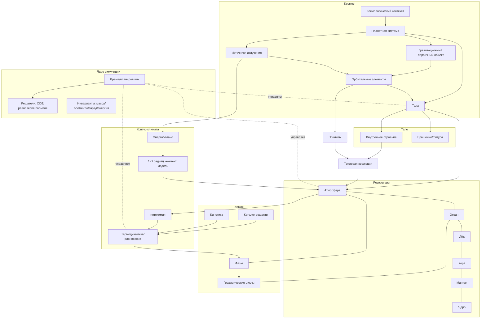

# PHYSICS_ARCHITECTURE — Целевая физическая архитектура

> Stage 4.0, проект. Диаграммы описывают ЦЕЛЕВОЕ состояние; различие с текущим —
> в матрице §9. Проблемы текущего кода нумеруются по CURRENT_SYSTEM_AUDIT §2.
> Ревизия Stage 4.0.1 (2026-10-30): исправлена формула предела Роша (§3.1),
> введена иерархия температурных величин (§5.1), обновлена версия HITRAN.
> Ревизия Stage 4.2.2 (2026-10-30): иерархия температур §5.1 реализована
> в научном ядре типизированно (thermalState, resolver локальной
> температуры, адаптеры provenance) — см. блок «Реализация Stage 4.2.2»
> в §5.1; RCM и вертикальный профиль остаются этапом 4.8.
> Ревизия Stage 4.2.2.1 (2026-10-30): ревизия интеграции 4.2.2 по итогам
> независимого аудита — строгая валидация форм температур, orphan-защита
> resolver, provenance адаптеров (presetNotes → note, sourceName — только
> для наблюдательного источника; teff-диапазон не схлопывается в среднее),
> условная совместимость колыбели (отсутствие локальной температуры — не
> пройденная проверка), подключение диагностики пресет/T_eq к генерации,
> location-aware фазовый скрининг (слой surface_boundary) — см. блок
> «Реализация Stage 4.2.2.1» в §5.1.
> Ревизия Stage 4.2.2.2 (2026-10-31): семантика доказанности в
> Compatibility — ошибка только для известного (known) значения;
> оценка и легаси-число без происхождения вне диапазона — ЯВНОЕ
> предупреждение, а не физическое противоречие; presetNotes не
> источник: sourceName — только из отдельного поля presetSourceName;
> PhaseTemperatureBasis.location — структурированное место
> температурного контекста — см. блок «Реализация Stage 4.2.2.2»
> в §5.1.
> Ревизия Stage 4.2.2.3 (2026-10-31): provenance gate и
> location-specific evidence — известное (known) без содержательного
> происхождения не является доказательством (недоказанность, НЕ
> ошибка); поверхность и резервуар — РАЗНЫЕ источники (явная ссылка
> localReservoirId, resolver без fallback); легаси-скаляр при
> пригодном typed known не читается — см. блок «Реализация
> Stage 4.2.2.3» в §5.1.
> Ревизия Stage 4.2.2.4 (2026-10-31): корректирующая ревизия после
> независимого аудита — проверка соответствия ReservoirRecord.kind
> локальной среде (таблица соответствия CradleLocationType ↔ kind;
> несоответствие — недоказанность, не ошибка, другой резервуар
> автоматически не выбирается); selectCradle экспортирован и принимает
> опциональный typed evidence (интеграционные тесты реального
> selector’а, не только predicate) — см. блок «Реализация
> Stage 4.2.2.4» в §5.1.
> Ревизия Stage 4.2.2.5 (2026-10-31): корректирующая ревизия после
> независимой проверки 4.2.2.4 — локальные среды selector’а стали
> candidate-specific (карта cradleLocalEnvironmentsById по ID
> кандидата; среда одного кандидата не применяется к другому,
> перенос locationType/localReservoirId/состава исключён);
> семантика видов: subsurface_reservoir доказывается только kind
> ’crust’; runtime-неизвестный locationType — недоказанность без
> исключений (fail-closed) — см. блок «Реализация Stage 4.2.2.5»
> в §5.1.
> Ревизия Stage 4.2.2.5.1 (2026-10-31): защита kind-гейта от
> prototype pollution — список допустимых видов читается только
> по СОБСТВЕННОМУ ключу таблицы (hasOwnProperty): имена
> унаследованных свойств (’constructor’, ’toString’,
> ’hasOwnProperty’, ’__proto__’) и произвольные строки —
> недоказанность без исключения и без выбора другого резервуара
> (fail-closed) — см. блок «Реализация Stage 4.2.2.5» в §5.1.
> Ревизия Stage 4.9a (2026-11-21): фундамент геохимических потоков —
> §7.4 (контракт mol/m²/yr, Flux/Reaction-разделение, исполнение через
> FluxLedger, адаптер существующего element conservation; численные
> скорости процессов НЕ готовы, геохимические циклы НЕ завершены).
> Ревизия Stage 4.9a.1 (2026-11-21): корректирующая ревизия фундамента —
> геохимические виды отдельным каталогом с фазовой идентичностью,
> типизированный справочник резервуаров без легаси-отождествлений,
> дискриминированные механизмы transport/reaction/coupled со статусами
> реализации, структурная атрибуция FluxGeochemicalContext в FluxRecord,
> миграция схемы сохранений 1.6 → 1.7 (CoreWorldState 1.4.0) —
> см. ревизию в §7.4.
> Ревизия Stage 4.9b (2026-11-21): исполнитель геохимических реакций —
> атомарное применение реакций к инвентарям через существующие
> ReactionLedger-контракты (validateGeochemicalReactionDefinition,
> planGeochemicalReaction, executeGeochemicalReaction), структурная
> атрибуция GeochemicalReactionContext в ReactionRecord, extent с
> provenance как явный внешний вход, правило c_org, coupled
> fail-closed, миграция 1.7 → 1.8 (CoreWorldState 1.5.0) —
> см. §7.4.1.

## 1. Разделение слоёв

```text
UI (React) ──► адаптеры/view-model ──► НАУЧНОЕ ЯДРО (чистый TS, без DOM)
                                        ├── sim/    время, планировщик, решатели
                                        ├── astro/  звёзды, орбиты, приливы
                                        ├── body/   тело, недра, EOS
                                        ├── atmos/  атмосфера, климат, фотохимия
                                        ├── chem/   термодинамика, равновесие, кинетика
                                        ├── geo/    резервуары, циклы, потоки
                                        └── data/   версионируемые каталоги (PhysValue)
```

Правила: ядро не импортирует React; UI не импортирует физические модули,
только адаптеры; каталоги не содержат кода расчётов; контракты между
подсистемами — через `sim/` (см. SIMULATION_ENGINE).

## 2. Космическая система (целевая иерархия)

```text
CosmicContext          эпоха, возраст Вселенной (существут: epochs)
PlanetarySystem        барицентр, система отсчёта
 ├─ GravitationalPrimary   звезда | компактный остаток | планета-родитель
 ├─ RadiationSource[]      светимость, спектр, T_eff, эволюция во времени
 ├─ OrbitingBody[]         планета | карликовая | спутник | малое тело | кольцо
 │   ├─ OrbitElements      (a, e, i, Ω, ω, ν) относительно родителя
 │   ├─ BodyModel          M, R, фигура, вращение, наклон, момент инерции
 │   ├─ InteriorModel      слои: ядро/мантия/кора (+EOS-таблицы)
 │   ├─ ReservoirSet       атмосфера, океан, лёд, кора, мантия, ядро, аэрозоли
 │   ├─ ThermalState       потоки, температуры, теплоёмкости
 │   └─ MagneticField?     только когда есть данные-основания
 └─ SmallBodyPopulation?   по мере необходимости
```

Разделения, обязательные на уровне типов:
- `GravitationalPrimary` (масса, гравитация) ≠ `RadiationSource` (светимость,
  спектр). Белый карлик может быть первичным объектом без собственного
  излучения; джет — источник излучения БЕЗ гравитационной роли (уже сделано
  в этапе 3 — `JetSystemModel`; принцип сохраняется).
- `parentBody` — отдельная сущность: у спутника родитель ≠ звезда.
- Свободно плавающая планета — `PlanetarySystem` без `RadiationSource`.
- Вложенность: спутник спутника — допустима типами (level в ID).

## 3. Небесная механика

### 3.1 Аналитический уровень (текущий + целевой фундамент)

| Модель | Формула | Применимость | Тест |
|---|---|---|---|
| Два тела | P = 2π√(a³/GM) | изолированная пара, M >> m | период Луны 27.32 сут ±0.5%; Земля 1 год ±0.1% |
| Поток | F = L/(4πa²) | точечный источник | солнечная постоянная 1361 Вт/м² ±1 |
| T_eq | [F(1−A)f/(4εσ)]^¼ | серое тело, f ∈ {1/2, 2/3, 1} | Земля: 254–256 K при A=0.3, f=1 |
| Сфера Хилла | r_H = a(1−e)(m/3M)^⅓ | m << M | r_H Земли ≈ 1.5e6 км ±2% |
| Предел Роша (жидкий) | d_R ≈ 2.44 R_p (ρ_p/ρ_s)^⅓ | идеализированный жидкий спутник (см. замечания ниже) | плотностная форма; системы Сатурна |
| Приливный захват | τ_sync ~ параметрическая модель | только при наличии k₂/Q — иначе статус | качественно (не число) |

**Замечания к пределу Роша (ревизия 4.0.1)**. Классическая жидкая форма

    d_R ≈ 2.44·R_p·(ρ_p/ρ_s)^(1/3)

следует из задачи Роша об идеализированной жидкой фигуре (Roche 1849;
Chandrasekhar 1969, Ellipsoidal Figures of Equilibrium; Murray & Dermott
1999, Solar System Dynamics). Ограничения:

- ρ_p и ρ_s — СРЕДНИЕ плотности родителя и спутника; форма через (m/M)^⅓,
  использованная в спецификации Stage 4.0, НЕ эквивалентна плотностной и
  давала неверную зависимость (исправлено, CURRENT_SYSTEM_AUDIT DA-1);
- модель предполагает: спутник — идеальная жидкость БЕЗ прочности
  материала, самогравитирующий, на круговой орбите, вращающийся синхронно;
- предел Роша НЕ является универсальной границей разрушения всех твёрдых
  тел: для малых тел с прочностью материала приливные напряжения могут не
  разрушить объект и внутри классического предела; для абсолютно твёрдого
  (rigid) спутника коэффициент иной (~1.26), и оба коэффициента —
  идеализации, а не физические константы;
- численные проверки — VALIDATION_PLAN уровень 2 (плотности ОБОИХ тел,
  чувствительность d_R к ρ_s).

Правила: любая величина вне применимости → `unknown`, а не «близкое число».
Орбитальные диапазоны каталога остаются game_assumption, но каждый сэмпл
орбиты получает проверку Хилла/Роша как предупреждение (Stage 4.6).

### 3.2 Численное интегрирование (интерфейс, реализация — этап 4.6+)

```typescript
// Контракт (проект; реализация не входит в Stage 4.0)
interface ForceModel { accelerations(state: SystemState): Vec3[]; }
interface Integrator {
  step(state: SystemState, dt: number): SystemState;
  readonly kind: 'leapfrog' | 'ias15-like' | 'dp853' | 'kepler-analytic';
}
```

- **Симплектический leapfrog (kick-drift-kick)**: долгосрочная орбитальная
  динамика; сохраняет энергию статистически; требует почти-Кеплеровых
  шагов; дешёв в TS.
- **Адаптивный Рунге–Кутта (DP853)**: пролёты, сближения, некритичные
  траектории; ошибка контролируется, но энергия дрейфует на длинных рядах.
- **IAS15-подобный (Radau 15-го порядка)**: эталон точности; реализация в TS
  дорогая; целевой вариант — внешняя WASM-библиотека (интерфейс уже
  спроектирован под неё).
- **Аналитический Кеплер**: пропагатор для одиночных орбит без возмущений —
  дешёво и точно; целевой default для «красивых» миров без N-body сценариев.

**Модель двух тел не выдаётся за N-body.** При подключении нескольких тел —
только через `Integrator` с проверками (энергия, момент) на каждом шаге.

**Реализация Stage 4.6.1-A (2026-11-15).** Симплектический leapfrog KDK
реализован как чистый детерминированный модуль
`src/modules/OrbitalMechanics/dynamics.ts` (`integrateNBodyLeapfrog`):
фиксированный timestep, без смягчения, без адаптивного шага, без
перенормировки энергии; все вычисления в каноническом порядке тел
(побитовый детерминизм и независимость от порядка входа). Контракт
результата — дискриминированное объединение `completed` /
`invalid_input` / `step_limit_exceeded` / `singular_configuration` /
`numerical_failure`; отчёт о сохранении энергии, импульса, момента
импульса и равномерности центра масс строится по контрольным снимкам.
Измерено (10⁴ периодов Солнце–Земля, плотный контроль 1001 состояние):
дрейф энергии 9.965e-8 / 1.007e-9 / 4.674e-12 для timestep P/250, P/500,
P/1000 — порог этапа 1e-6 выполнен, сходимость 2-го порядка. Луна:
27.4518 d по Кеплеру от массы родителя (+0.476%), 27.2846 d
интегрированием (−0.136%), допуск ±0.5% выполнен. Границы: успешное
завершение прогона НЕ является вердиктом устойчивости орбиты;
сближения/столкновения/выбросы не обрабатываются (порог сближения
1e-6 м → отказ `singular_configuration`); вердикты устойчивости из
интегратора не выдаются, и каталог продолжает использовать
`stabilityCheck: 'not_performed'`.

**Реализация Stage 4.6.1-B (2026-11-15).** Поверх того же KDK-движка
(общий внутренний код `runKdkCore`, без дублирования алгоритма
интегрирования) добавлено обнаружение тесных сближений и физических
столкновений во время интегрирования: публичный API
`integrateNBodyWithEvents`, событийный слой —
`src/modules/OrbitalMechanics/events.ts`. Проверка выполняется на
фактическом drift-отрезке каждого шага r(s) = r0 + s·(r1 − r0),
s ∈ [0, 1]: ближайшая точка s* = clamp(−r0·d/|d|², 0, 1),
d_min = |r(s*)|, t* = t_start + s*·Δt; пересечение контактной сферы
R_A + R_B и порогов ищется квадратично на всём отрезке, поэтому
fly-through (пересечение порога между соседними снимками или внутри
одного шага при внешних концах вне порога) обнаруживается. Три
условия различаются явно: физический контакт поверхностей (только
при обоих известных радиусах; `radiusM === null` — неизвестный
радиус, а не нулевой), пользовательский порог
`closeApproachDistanceM` (эпизоды с временем входа, минимумом и
выходом; незавершённый эпизод — `exitTimeS: null` +
`ongoingAtHorizon`) и численная сингулярность 1e-6 м (пересечение
внутри отрезка — структурированный отказ с парой, временем и
дистанцией). Столкновение терминально: прогон останавливается на
контактном шаге до второго kick, возвращаются последнее полностью
завершённое состояние и оценка момента контакта; слияние, отскок и
фрагментация не моделируются. Контракт результата: `completed` |
`collision_detected` | `integration_failed` (с сохранением уже
найденных событий); порядок событий детерминирован (время → тип →
канонические ID пары); метаданные фиксируют покрытие обнаружения
(пары с известными/неизвестными радиусами), и отсутствие
collision-события у пары с неизвестным радиусом не является
доказательством безопасности. Ограничение: обнаружение опирается на
геометрию численного drift-отрезка, а не на точное решение
непрерывной гравитационной траектории между шагами; ошибка времени
события зависит от timestep и проверяется сходимостью (ошибка оценки
времени контакта падает с ~5.8 с при dt = 1.2e6 с до ~0.08 с при
dt = 3e4 с для контрольного лобового сценария).

**Реализация Stage 4.6.1-C (2026-11-18).** Поверх того же KDK-движка
добавлены два независимых диагностических слоя с оценкой на
согласованном конце каждого шага (новый необязательный хук
`onAfterStepEnd` после второго kick; позиции и скорости оба на
t + dt — только в этом состоянии энергии и радиальные скорости
осмысленны).

- **Escape / ejection** — относительно ЯВНО заданного центрального
  тела `primaryBodyId` (автоподбор по массе запрещён) и ЯВНО заданных
  `escapeRadiusM` / `escapeConfirmationDurationS`; без полной
  конфигурации выключено и честно помечено в метаданных. Критерий
  кандидата: пересечение радиуса наружу на drift-отрезке (время —
  квадратичный корень на отрезке), v_r = (r⃗·v⃗)/|r⃗| > 0 и
  осциллирующая двухтельная удельная энергия
  ε = |v_rel|²/2 − G(m_p + m_i)/|r_rel| > допуска. Состояния
  разделены: `ejection_candidate` — НЕ подтверждённый выброс;
  `ejection_confirmed` — условия удержаны весь интервал подтверждения
  (проверка на каждом шаге); `ejection_cancelled` — возврат внутрь /
  радиальная скорость не наружу / энергия не выше допуска (явная
  причина); `ejection_pending_at_horizon` — горизонт закончился
  раньше подтверждения. Многотельные возмущения делают осциллирующую
  энергию осциллирующей (не монотонной), поэтому одного положительного
  значения недостаточно — отсюда интервал подтверждения.
- **Связность системы** — pairwise osculating-binding граф по явному
  допуску `bindingEnergyToleranceJPerKg`: ребро (i, j) при
  ε_ij = |v_i − v_j|²/2 − G(m_i + m_j)/|r_i − r_j| < −E_tol.
  ВАЖНОЕ ОГРАНИЧЕНИЕ: pairwise осциллирующие энергии НЕ включают
  влияние остальных тел в каждую пару; граф — диагностическое
  приближение, НЕ доказательство физической связанности N-body
  системы и НЕ вердикт устойчивости. Connected components —
  детерминированный BFS в каноническом порядке id; начальное
  разбиение фиксируется на t = 0 отдельно и событий не порождает.
  События `connectivity_lost` (1 → n), `connectivity_restored`
  (n → 1; предыдущая потеря сохраняется) и `connectivity_changed`
  (изменение разбиения при числе компонент > 1 с обеих сторон) несут
  канонические составы до/после, изменённые рёбра, допуск и модель
  критерия.
- **Контракт**: сортировка событий время → тип
  (collision → close_approach → ejection_candidate →
  ejection_cancelled → ejection_confirmed →
  ejection_pending_at_horizon → connectivity_changed →
  connectivity_lost → connectivity_restored) → канонические ID;
  метаданные фиксируют включённость и параметры обеих детекций и
  число вычислений графа. Отказ интегратора не смешивается с
  физическим выбросом: уже найденные события сохраняются, pending не
  синтезируется. Успешный `completed` и отсутствие
  ejection/connectivity событий по-прежнему НЕ являются вердиктом
  устойчивости; сходимость времени пересечения по шагу проверена
  тестом (ошибка ~7000 с при dt = 8e3 с → ~1000 с при dt = 1e3 с
  для контрольного гиперболического пролёта).

**Реализация Stage 4.6.1-D (2026-11-19).** Аналитический скрининг орбит
добавлен как чистый диагностический модуль
`src/modules/OrbitalMechanics/orbitScreening.ts` (`screenOrbitalStability`,
`computeOsculatingElements`; реэкспорт из OrbitalMechanics/index.ts;
20 сценариев в src/modules/Tests/orbitScreening.test.ts; CI run #402
зелёный). Модуль НИЧЕГО не интегрирует и из интегратора не вызывается:
поведение `integrateNBodyLeapfrog` / `integrateNBodyWithEvents` не
изменяется, входное состояние read-only, primary задаётся ЯВНО
(автоподбор по массе запрещён), невалидный ввод — `invalid_input`
с машинными кодами.

- Осциллирующие двухтельные элементы пары (тело, primary) на эпохе
  state.timeS: mu = G(M_p + m), eps = v^2/2 - mu/r, h = r x v,
  e = (v x h)/mu - r/|r|, a = -mu/(2 eps) и P = 2*pi*sqrt(a^3/mu) —
  ТОЛЬКО эллипс; параболическим и гиперболическим траекториям период
  и большая полуось эллипса НЕ присваиваются; радиальная (h ~ 0) и
  вырожденные коники — conicApplicable = false с машинной причиной.
- Геометрические пересечения орбит в 3D: для некомпланарных коник —
  обе точки линии узлов n1 x n2 с проверкой равенства радиусов в
  пределах ЯВНОГО orbitIntersectionToleranceM; для копланарных —
  аналитическое решение A + B*cos(theta) + C*sin(theta) = 0 (два
  пересечения / касание / совпадающие орбиты); угловая сетка НЕ
  используется. Результат — geometric_crossing / no_geometric_crossing /
  coincident_orbits / indeterminate; это НЕ временная встреча тел,
  НЕ collision-событие и НЕ связность.
- Хилл: индивидуальный R_H,i = a(1-e)*(m/(3*M_p))^(1/3) (только эллипс)
  и взаимный R_H,m = ((m_i+m_j)/(3*M_p))^(1/3)*(a_i+a_j)/2,
  Delta = |a_j - a_i| / R_H,m. Классический порог Delta > 2*sqrt(3)
  (CLASSIC_MUTUAL_HILL_THRESHOLD) возвращается ТОЛЬКО при проверенных
  допущениях — ЯВНЫЕ пределы эксцентриситета и взаимного наклонения
  в опциях; иначе criterion_not_applicable: Delta сохранён, порог и
  deltaExceedsClassicThreshold = null.
- Рош: d = C_model * R_p * (rho_p/rho_s)^(1/3) при ЯВНОМ выборе модели
  (fluid C = 2.44 / rigid C = 1.26; автоподбор модели запрещён);
  плотности ТОЛЬКО из заданных массы и радиуса — radiusM null даёт
  unknown + missing_physical_parameters, типичные плотности НЕ
  подставляются; полоса at_roche_boundary: |q/d - 1| <= 1e-9
  (ROCHE_BOUNDARY_RELATIVE_BAND).
- Соизмеримости периодов: P_out/P_in ↔ p/q по взаимно простым p:q
  (включая 1:1) при ЯВНЫХ resonanceRelativeTolerance и
  maxResonanceInteger; статус строго near_mean_motion_commensurability —
  близость периодов НЕ подтверждённый резонанс (либрация резонансных
  углов во времени не моделируется).
- Детерминизм: канонический лексикографический порядок тел, результаты
  инвариантны к порядку входа, входное состояние не мутируется;
  радиальные/вырожденные случаи дают not_evaluated/unknown/indeterminate
  с машинной причиной. ГРАНИЦЫ: Stage 4.6.1 и 4.6 остаются ЧАСТИЧНО
  РЕАЛИЗОВАНА; вердикты stable/unstable не выдаются; вне объёма:
  подтверждение резонансов либрацией, collision response, валидация
  против эталонных N-body конфигураций, многотельные возмущения в
  аналитических критериях, итоговая классификация стабильности на
  явном горизонте.
- Stage 4.6.2 (выполнен): интеграционный уровень
  `assessNBodyStabilityOverHorizon` (`stability.ts`) объединяет ядро A,
  событийный уровень B/C и скрининг D в единую конечногоризонтную оценку
  `stable | unstable | indeterminate` (+ `invalid_input`). Две независимые
  интеграции ОДНОГО KDK-движка (coarse h, refined h/2) на общих
  диагностических временах (`diagnosticIntervalS` общий,
  sampleEverySteps K и 2K); входные состояния не мутируются, фиксированный
  шаг, адаптивность не внедрена; все 15 порогов классификации — явные
  параметры `options`, скрытых универсальных констант нет. Оскулирующие
  элементы — через существующую `computeOsculatingElements` относительно
  явно указанного primary. Вердикт: `unstable` — только воспроизводимый
  терминальный критерий НА ОБОИХ разрешениях (столкновение той же пары с
  согласованным временем, подтверждённый выброс того же тела,
  операционное превышение предела тело/показатель/направление);
  `stable` — только при выполнении всех явных условий на заданном
  горизонте (оба прогона завершили горизонт; покрытие столкновений
  полное — неизвестные радиусы запрещают; escape-детекция с primary
  включена; нет столкновений/выбросов/кандидатов/pending; нет
  неразрешённых сближений; элементы вычислимы; дрейфы E/p/L и элементов
  в допусках; согласие coarse/refined в допусках) — НЕ является
  утверждением о бесконечной устойчивости; `indeterminate` — недостаток
  доказательства, включая асимметрию разрешений
  (`orbital_limit_on_single_resolution`), изменение графа связности без
  терминального события и отказ прогона. Сходимость: положения/скорости
  в primary-centered frame нормируются начальным расстоянием и
  характерной скоростью sqrt(2μ/r0); вырожденный масштаб даёт явную
  причину indeterminate. Измерено (реплика KDK, тесты подтверждают):
  Земля–Солнце (h = 3e3/1.5e3 с) — max |Δa/a| 4.3e-14/1.9e-14
  (coarse/refined), max |Δe| 1.8e-7/4.5e-8, дрейф E 4.3e-14;
  иерархическая система Солнце+планета+Луна — гелиоцентрические
  оскулирующие элементы Луны физически осциллируют на ±0.41 (a) и
  ±0.088 (e) ИДЕНТИЧНО на обоих разрешениях (физика, а не числа);
  масштабирование a-погрешности ~h² (3.2e-10 при h = 3e4 с → 5.5e-13 при
  h = 6e3 с). Ограничения: вердикт действует только на заданном
  горизонте; collision response и подтверждение резонансов либрацией вне
  объёма; Stage 4.6 остаётся ЧАСТИЧНО РЕАЛИЗОВАНА.

### 3.3 Устойчивость и возмущения

- Статические проверки: Хилл, Рош, пересечение орбит, резонансы (MMR по
  отношениям периодов) — предупреждения, не запреты.
- Долговременная устойчивость — только интегрированием (уровень 4.6+),
  до тех пор `stabilityCheck: 'not_performed'` остаётся честным.
- Динамические события (Stage 4.6.1-B/C): сближения, столкновения,
  выбросы (кандидат/подтверждение/отмена/pending) и потеря/восстановление
  связности — диагностика ВО ВРЕМЯ интегрирования, а не вердикты.
  Ни отсутствие событий, ни сам успешный прогон не эквивалентны
  `stable`; pairwise-binding связность — осциллирующее приближение
  (см. §3.2); итоговая классификация stable/unstable/indeterminate
  реализована в Stage 4.6.2 (конечногоризонтная операционная, см. конец
  §3.2).
- Аналитический скрининг орбит (Stage 4.6.1-D): осциллирующие
  двухтельные элементы, пересечения орбит, Хилл, Рош и соизмеримости
  периодов — диагностика НА ОДНОЙ ЭПОХЕ, вне интегратора; критерии
  зависят от выбора primary и не учитывают многотельные возмущения;
  ни один результат не является вердиктом stable/unstable;
  итоговая классификация стабильности реализована в Stage 4.6.2
  (конец §3.2); подтверждение резонансов либрацией резонансных углов
  остаётся будущей задачей.

### 3.4 Приливные модели (порядок внедрения)

1. Статус «possible» (текущее) — сохраняется.
2. Постоянно-временная модель (constant time lag): нуждается в k₂, Q, массы,
   a, e — все параметры должны иметь источники; без них — unknown.
3. Даарthy/cPL-модели — только как интерфейс + внешние данные.

## 4. Звёзды и излучение

- Текущее: классы с диапазонами (starPhysical) — сохраняются.
- Целевое: сэмпл конкретной звезды из класса (M, L, T_eff) с сохранением
  диапазона в PhysValue (исправление проблемы 2.1, Stage 4.6).
- Эволюция светимости: табличная (age → L) из эмпирических треков; данные —
  литературные модели (источник указывается в каталоге); первая версия —
  линейная интерполяция по опорным точкам, вне таблицы — unknown.
- Спектр:_chunks для фотохимии и парника — таблицы (UV/visible/IR buckets);
  источники: модели звёздных спектров (PHOENIX-подобные, с лицензионной
  проверкой) или параметризация; БЕЗ данных — фотохимия остаётся «не рассчитано».

## 5. Энергетический баланс и климат (уровни)

| Уровень | Модель | Статус | Данные |
|---|---|---|---|
| 0 | T_eq серого тела | реализовано | L, a, A (игровое 0.3) |
| 1 | Одномерная радиационно-конвективная модель (серый газ, N слоёв, конвективная поправка) | проектирование (этап 4.8) | теплоёмкости, серые коэфф. поглощения (источник обязателен) |
| 2 | Коррелированные k-распределения | цель (после 4.8) | HITRAN2024/ExoMol → предрассчитанные k-таблицы (версии фиксировать, базы не смешивать) |
| 3 | Интерфейс внешнего климатического решателя (ROCKE-3D-класс, LMD-класс) | интерфейс | не реализуется в TS |

### 5.1 Иерархия температурных величин (ревизия 4.0.1)

Физически разные температуры НЕ объединяются в одно поле с «разными
источниками». Каждая величина — отдельное поле со своим смыслом,
источником, применимостью, единицами и поведением при отсутствии данных:

| Поле | Физический смысл | Источник | Применимость | Единицы | Вычисление | Нет данных |
|---|---|---|---|---|---|---|
| effectiveTemperature | эффективная температура источника излучения (звезды) | наблюдения / сэмпл из класса (4.6) | звёзды, компактные объекты | K | входные данные | unknown |
| equilibriumTemperature | равновесная температура серого тела T_eq = [F(1−A)f/(4εσ)]^¼ | расчёт из L, a, A, f | радиационный баланс серого тела; НЕ температура поверхности | K | формула из потока | unknown (нет L или a) |
| surfaceTemperature | температура физической поверхности | RCM (уровень ≥1); наблюдательные пресеты — с явным происхождением | поверхность тела | K | только через климатический контур | unknown до RCM; явно оценочные — с пометкой |
| atmosphericTemperatureProfile | вертикальный профиль T(z) | RCM / гидростатика | атмосфера послойно | K (по слоям) | решатель профиля | unknown (1 слой — только оценка) |
| reservoirTemperature | температура резервуара, где идёт процесс | тепловой контур резервуара | океан, лёд, кора, мантия, ядро | K | модель резервуара | unknown |
| localReactionTemperature | температура области протекания реакции / фазового перехода | из reservoirTemperature / профиля области | локальная область | K | температура резервуара/области | unknown |

Правила:

- T_eq — радиационная оценка с допущениями (A, f, ε); она НИКОГДА не
  подменяет surfaceTemperature автоматически.
- Пресетная температура атмосферы — величина с явной пометкой
  происхождения (historical_game для игровых пресетов; справочная — с
  источником); наличие в каталоге не делает её физической температурой
  мира.
- Химические реакции и фазовые переходы используют localReactionTemperature
  — температуру того резервуара и области, где они происходят (контракт
  реализован в Stage 4.2.2: resolver читает только явно указанную область;
  численные решатели процессов по-прежнему Stage 4.2.3+).

**Реализация Stage 4.2.2 (сделано).** Иерархия §5.1 получила типизированный
носитель в ядре (`src/modules/Core/thermalState.ts`, схема CoreWorldState
1.2.0):

- `BodyThermalState` на теле (`WorldBody.thermalState?`): effective
  (T_eq из энергетического бюджета), surface (явно `unknown` до RCM),
  atmosphericTemperatureProfile;
- `AtmosphericTemperatureProfile` со статусами `unknown` /
  `single_layer_estimate` / `partial_profile` / `complete_profile`;
  одно число из пресета — `single_layer_estimate` с обязательным
  `limitations` («НЕ расчётный вертикальный профиль»), фиктивный профиль
  не создаётся;
- `ReservoirRecord.reservoirTemperature?: ScientificValue` — температура
  резервуара с происхождением (её отсутствие ≠ температуре поверхности);
- `resolveLocalReactionTemperature(state, {bodyId, reservoirId | layerId})`
  — локальная температура процесса: читает ТОЛЬКО явно указанную
  область (резервуар тела / слой профиля тела); T_eq, глобальная
  surfaceTemperature и соседние области НЕ являются fallback; отсутствие,
  чужая область или непригодные данные → синтезированный `unknown` с
  причиной; некорректное место (оба id / ни одного) → исключение
  `ThermalStateError('invalid_place')`;
- адаптеры пресетов (`Core/adapters`): пресетная температура →
  `ScientificValue` с provenance (historical_game → estimated
  «игровое допущение», observational_reference → estimated «справочное,
  НЕ измерение этого мира»); `planetThermalStateFromLegacy`: T_eq отдельно,
  surface — `unknown`, effective — `not_applicable` (планета — получатель
  излучения); центральные объекты: T_eff звезды / компактного остатка /
  субзвёздого — known или unknown (среднее по классу НЕ подставляется);
- `diagnosePresetEquilibriumDivergence` — честная диагностика расхождения
  пресетной температуры с T_eq (noted / threshold_exceeded /
  not_comparable); температуры при этом НЕ изменяются;
- генератор передаёт в фазовый скрининг типизированную температуру
  (`analyzeAtmospherePhasesWithProvenance`), а WorldModel больше НЕ
  копирует пресетную температуру в `surfaceTemperature` (проблема 2.3
  закрыта в типизированной части; легаси-путь — см. аудит §2.2/§2.3).

**Реализация Stage 4.2.2.1 (сделано; ревизия интеграции).** По итогам
независимого аудита интеграция 4.2.2 усилена без переписывания модели:

- `hasUsableTemperature` требует корректную ФОРМУ `ScientificValue`
  (делегирует `validateThermalScientificValue`): estimated без метода
  непригоден; неизвестная единица, NaN/Infinity, отрицательные и
  искажённая форма не используются; `temperatureValueOrNull` наследует
  строгую проверку;
- resolver: пустые/пробельные идентификаторы области — `invalid_place`;
  orphan-резервуар (тело отсутствует) не читается как область мира;
  профиль со статусом `unknown` не читается по слоям — заявленная
  неизвестность не изображается данными; соседние области и T_eq
  по-прежнему не подставляются;
- адаптеры provenance: `presetNotes` — пояснение пресета, живёт в
  `provenance.note`; `sourceName` — только для заявленного наблюдательного
  источника (observational_reference); выдуманная библиография запрещена;
  диапазон класса при неизвестном T_eff сохраняется в provenance
  (границы + note) и НЕ схлопывается в среднее;
- T_eq из энергетического бюджета переносится со СВОИМ статусом:
  репрезентативная светимость класса → confidence estimated →
  результат остаётся estimated, оценка не повышается до known;
- Compatibility: известное число локальной среды вне диапазона —
  по-прежнему ошибка; ОТСУТСТВИЕ локальной температуры больше не
  считается пройденной проверкой — новое правило
  `cradle_temperature_unproven` (conditionally_compatible/warning)
  создаёт явное диагностическое предупреждение; оценка (пресет,
  включая game_assumption) участвует в проверке диапазона, но не
  считается измерением; выбор колыбели не блокируется;
- диагностика `diagnosePresetEquilibriumDivergence` подключена к
  реальному генерационному контуру (шаг 10e): сохраняются обе исходные
  величины и абсолютная разница, формируется информационная запись
  (ruleId `preset_equilibrium_divergence`, severity info) в warnings
  мира; без порога — noted; непригодная величина — not_comparable;
  температуры не изменяются;
- фазовый скрининг привязан к явно обозначенной локальной области —
  слою `surface_boundary` из AtmosphericTemperatureProfile через общий
  типизированный контракт `PhaseScreeningTemperatureContext`
  (ScientificValue | AtmosphereTemperatureLayer): вторая параллельная
  система значений не создаётся; без пригодной пресетной температуры
  скрининг остаётся unknown; численные корреляции Антуана не изменены.

**Реализация Stage 4.2.2.2 (сделано; семантика оценки и измерения).**
По итогам независимого аудита контракт достоверности доведён до
семантики «оценка не является доказанным противоречием»:

- Compatibility `cradle_temperature_compatibility`: ошибка
  (incompatible/error) — ТОЛЬКО известное (known) значение локальной
  среды вне требуемого диапазона; типизированная температура
  поверхности читается из научного ядра (coreWorldState → тело
  'planet' → thermalState.surfaceTemperature) со статусом и
  provenance; адаптер пресета никогда не выдаёт known
  (observational_reference — справочный ориентир, НЕ измерение
  конкретного мира);
- новое правило `cradle_temperature_estimate_outside_range`
  (conditionally_compatible/warning): оценочная температура (пресет
  или легаси-число без происхождения) вне диапазона — ЯВНОЕ
  предупреждение об оценочном сценарии, НЕ физическая ошибка;
  selectCradle не отбрасывает такую колыбель (фильтрация кандидатов —
  только по severity error): венусоподобный сценарий 737 K при
  диапазоне колыбели 50–500 K остаётся кандидатом с предупреждением;
- `cradle_temperature_unproven`: proof для поверхности/океана — только
  типизированная known-температура; легаси-скаляр
  physicalCharacteristics.surfaceTemperature (число без статуса,
  метода и происхождения; в старых сохранениях мог быть скопирован
  из пресета атмосферы) измерением не считается; миграция сохранений
  исходное число сохраняет, provenance/метод/статус не выдумывает;
- provenance адаптеров: presetNotes — ВСЕГДА пояснение в
  provenance.note (включая observational_reference); sourceName —
  только из нового явного поля AtmosphereState.presetSourceName,
  когда реальный источник действительно известен; выдумывание
  библиографии по-прежнему запрещено;
- `PhaseTemperatureBasis.location` — структурированное место
  температурного контекста ({kind: 'atmosphere_layer', layerId:
  'surface_boundary'}): машиночитаемый аналог пояснения, вторая
  система температур не создаётся; ScientificValue-контекст без
  конкретного слоя — location отсутствует (обратная совместимость
  API сохранена); unknown остаётся unknown, T_eq не используется
  как fallback;
- интеграционные тести: РЕАЛЬНЫЙ computeEnergyBudget → адаптер
  планеты (estimated сохраняется, метод/provenance/uncertainty не
  теряются, surfaceTemperature не заполняется T_eq); строгий
  unknown-скрининг (customAtmosphere с temperature: null — все
  компоненты unknown);
- измеренное системное следствие (зафиксировано тестом; семантика
  scientificStatus НЕ менялась): КАЖДЫЙ мир реалистичного режима
  несёт предупреждение cradle_temperature_unproven (генератор не
  создаёт known-значений локальной среды), поэтому статус
  physically_plausible недостижим — обычные миры получают
  hypothetical (или impossible_in_model при доказанных ошибках).
  Архитектурное следствие: текущий scientificStatus смешивает
  физическую правдоподобность выбранных объектов и полноту знания
  о локальной среде; предупреждение НЕ ослабляется ради статуса.

**Реализация Stage 4.2.2.3 (сделано; provenance gate и location-specific
evidence).** По итогам независимого аудита ревизии 4.2.2.2 доказательная
семантика температурной совместимости доведена до строгого evidence gate:

- evidence gate для known: известная температура считается
  доказательством физической совместимости колыбели ТОЛЬКО при
  содержательном provenance — непустое одно из sourceName/sourceId/
  datasetId/recordId/reference/method/modelVersion ИЛИ непустой
  rawInput (проверяемый расчёт не требует библиографии);
  note/applicability/limitations/conditions/license/retrievedAt и
  пустой объект {} происхождением НЕ считаются; статус known сам по
  себе доказательством не является; known без содержательного
  provenance — cradle_temperature_unproven (warning), НЕ
  incompatible/error; estimated до known не повышается; глобальная
  семантика knownValue не менялась — gate применяется только к
  использованию значения как доказательства температурной
  совместимости колыбели;
- раздельные источники surface/ocean: локальная среда колыбели
  читается через typedLocalTemperatureOfWorld — surface:
  типизированная surfaceTemperature тела 'planet';
  ocean/subsurface_reservoir/deep_planetary_layers: температура
  конкретного резервуара по явной ссылке
  CradleLocalEnvironment.localReservoirId через
  resolveLocalReactionTemperature (пара reservoirId + bodyId
  'planet'); без однозначного reservoir ID, у чужого тела, при
  несуществующем ID или без пригодной температуры резервуара —
  недоказанность (warning, НЕ физическая ошибка); произвольный
  резервуар по совпадению kind НЕ выбирается; surfaceTemperature,
  T_eq, температура атмосферы и соседних резервуаров fallback'ом НЕ
  являются; океанская колыбель не подтверждается и не опровергается
  температурой поверхности;
- правило 6b (приоритет typed): при пригодном typed known
  легаси-скаляр physicalCharacteristics.surfaceTemperature не
  читается — доказанное значение вне диапазона порождает ОДНУ ошибку
  cradle_temperature_compatibility без дублирующего оценочного
  предупреждения; доказанное в диапазоне — без error/warning/
  unproven; при typed estimated используется именно она;
  легаси-скаляр — оценочный сценарий ТОЛЬКО поверхности и ТОЛЬКО без
  typed evidence (вне диапазона — warning
  cradle_temperature_estimate_outside_range, никогда error; для
  океана не используется даже как оценка);
- старые сохранения: CradleLocalEnvironment.localReservoirId —
  необязательное поле, миграции его не заполняют, автозаполнение
  запрещено; легаси-числа локальной среды не становятся
  ScientificValue автоматически;
- regression coverage: 30 новых тестов (26 compatibility.test,
  4 generator.test), всего 830 (27 файлов), ядро — 505; проверен
  РЕАЛЬНЫЙ путь isCradleSupportedOnWorld (доказанное known-нарушение
  исключает колыбель из автоматического выбора; оценочное
  расхождение и unknown — нет); CI зелёный, golden baseline
  совпадает.

Вывод Stage 4.2.2.2 о 25 seed (каждый мир реалистичного режима несёт
cradle_temperature_unproven — physically_plausible недостижим;
scientificStatus смешивает правдоподобность объектов и полноту знания о
локальной среде) сохранён без изменений; предупреждение не ослаблено.
RCM, вертикальный профиль и термодинамика океанов НЕ реализованы и не
выдаются за реализованные (этап 4.8).

**Реализация Stage 4.2.2.4 (сделано; проверка вида резервуара и
интеграция selector’а).** Корректирующая ревизия по итогам
независимого аудита ревизии 4.2.2.3:

- соответствие CradleLocationType ↔ ReservoirRecord.kind задано
  явной экспортированной таблицей LOCATION_TYPE_RESERVOIR_KINDS:
  ocean → kind ’ocean’; subsurface_reservoir → ’ocean’ | ’crust’;
  deep_planetary_layers → ’mantle’ | ’core’; surface/atmosphere/
  other → null (допустимые виды не определены). Таксономия берётся
  только из задокументированных значений ReservoirRecord.kind
  (’atmosphere’ | ’ocean’ | ’ice’ | ’crust’ | ’mantle’ | ’core’ | …);
  новых физических типов не введено, существующие резервуары не
  переименованы;
- проверка вида ДО признания known доказательством:
  typedLocalTemperatureOfWorld читает запись резервуара по
  (bodyId ’planet’, localReservoirId) и проверяет её kind против
  допустимых для locationType; несоответствие (например, kind
  ’atmosphere’ или ’ice’ при locationType ’ocean’, kind ’ocean’ при
  deep_planetary_layers) — температура НЕ используется как
  доказательство и НЕ даёт incompatible/error, а формирует
  cradle_temperature_unproven (fail-closed); другой резервуар
  автоматически не подставляется; для locationType ’other’
  физическая природа резервуара из одного ID не выводится —
  доказательство недоступно (недоказанность);
- интеграция selector’а: selectCradle экспортирован и принимает
  опциональный typed context (coreWorldState,
  cradleLocalEnvironment), который передаётся в
  isCradleSupportedOnWorld → checkCompatibility; без typed
  evidence селектор не выдумывает его и не исключает кандидата по
  температуре (условный результат); фиктивное CoreWorldState ради
  выбора не создаётся; estimated до known не повышается;
- границы реального контура: generateWorld по-прежнему НЕ
  передаёт typed evidence в selectCradle (ядро строится ПОСЛЕ
  выбора колыбели); переданная в тестах среда применяется ко всем
  кандидатам без пересчёта;
- regression coverage: 18 новых тестов (11 compatibility.test —
  типовые mismatch-случаи и совпадающие виды; 7 generator.test —
  интеграционные тесты самого selectCradle, отличающиеся от тестов
  predicate: проверяется фактический выбор, а не только булев
  результат isCradleSupportedOnWorld; детерминизм — фиксированная
  фикстура и управляемые веса: нулевые веса исключают кандидата из
  взвешенного выбора), всего 848 (27 файлов), ядро — 505; CI
  зелёный, golden baseline совпадает.

**Реализация Stage 4.2.2.5 (сделано; candidate-specific локальные
среды selector’а).** Корректирующая ревизия по итогам независимой
проверки ревизии 4.2.2.4 (одна среда для всех кандидатов была
ошибкой области действия):

- контекст selector’а: singular-поле cradleLocalEnvironment
  заменено картой cradleLocalEnvironmentsById:
  Partial<Record<ID, CradleLocalEnvironment>>; при фильтрации
  КАЖДОГО кандидата в isCradleSupportedOnWorld →
  checkCompatibility передаётся именно его среда: явная по ID
  кандидата, иначе вычисленная per-candidate через
  determineCradleLocalEnvironment (тот же путь, что и в реальном
  контуре); coreWorldState остаётся общим для всех кандидатов;
  перенос locationType, состава и localReservoirId с одного
  кандидата на другой исключён; температура одной области
  (океан/атмосфера/недра) не выводится из другой;
  fixedCategories.cradle — прежняя семантика (ручная фиксация
  не фильтруется);
- семантика видов: kind ’ocean’ убран из subsurface_reservoir —
  схема ReservoirRecord не различает поверхностный и подземный
  океан, а описание CRADLE_LOCATION_MAP само по себе не доказывает,
  что резервуар kind ’ocean’ представляет подземную область;
  subsurface_reservoir доказывается только kind ’crust’;
  тестовая фикстура физическим обоснованием таксономии не служит;
  новые виды резервуаров не введены;
- runtime-безопасность kind-гейта: lookup
  LOCATION_TYPE_RESERVOIR_KINDS[env.locationType] при неизвестном
  runtime-значении (внешние данные/сохранения) возвращает
  undefined — без исключения, без использования температуры как
  доказательства, без выбора другого резервуара:
  cradle_temperature_unproven (fail-closed);
- границы реального контура сохранены: generateWorld evidence
  в selectCradle НЕ передаёт (ядро строится ПОСЛЕ выбора
  колыбели) — генератор НЕ использует typed evidence до
  фактического появления подходящих данных; selector не
  выдумывает доказательств и не создаёт фиктивного
  CoreWorldState — температурная совместимость остаётся условной;
- regression coverage: интеграционные тесты САМОГО selectCradle:
  в одном selector-вызове кандидаты четырёх локаций (ocean /
  atmosphere / subsurface_reservoir / deep_planetary_layers),
  каждый по собственной среде; known-нарушение океанической
  колыбели исключает только её; атмосферная колыбель требует
  H₂/He по собственному составу; давление и matter_state
  проверяются по расположению текущего кандидата; estimated
  вне диапазона и unknown — условные кандидаты; без reservoir ID
  температура не подставляется; fallback и ручная фиксация —
  прежние; детерминизм — фиксированная фикстура, нулевые веса,
  повторный вызов с тем же seed даёт тот же результат; +14
  тестов (12 generator.test, 2 compatibility.test), всего 862
  (27 файлов), ядро — 505; CI зелёный, golden baseline совпадает.

**Реализация Stage 4.2.2.5.1 (сделано; prototype safety kind-гейта).**
Узкая корректирующая ревизия после независимой проверки 4.2.2.5:

- runtime lookup LOCATION_TYPE_RESERVOIR_KINDS[env.locationType]
  защищён от prototype pollution: таблица — обычный объект,
  наследующий свойства Object.prototype, поэтому имена
  ’constructor’/’toString’/’hasOwnProperty’/’__proto__’ при
  обычном lookup вернули бы унаследованные значения (функции,
  Object.prototype), а последующий .includes() — TypeError;
  теперь список допустимых видов читается ТОЛЬКО по
  СОБСТВЕННОМУ ключу таблицы (Object.prototype.hasOwnProperty.
  call): несобственный ключ (включая имена унаследованных
  свойств и произвольные строки вроде ’hydrothermal_sinter’) —
  недоказанность cradle_temperature_unproven без исключения,
  без TypeError и без выбора другого резервуара (fail-closed);
  поведение для всех корректных CradleLocationType не изменилось;
- комментарий таксономии перед таблицей приведён к действующему
  контракту: ReservoirRecord.kind — документированные
  семантические категории, таблица намеренно консервативна и
  зависит от типа локальной среды, subsurface_reservoir
  принимает только ’crust’, вид ’ocean’ подземное расположение
  не доказывает, тесты и фикстуры сами по себе научную
  таксономию не устанавливают, новые виды не вводятся,
  соответствия не расширяются;
- регрессионные тесты через РЕАЛЬНЫЙ путь checkCompatibility:
  5 некорректных runtime-значений (’hydrothermal_sinter’,
  ’constructor’, ’toString’, ’hasOwnProperty’, ’__proto__’;
  приведение типа — только на границе фикстуры) с резервуаром
  допустимого вида ’crust’ (known 700 K + содержательный
  provenance) и декой-резервуаром с доказанной неприемлемой
  температурой 288 K как наблюдаемым доказательством
  отсутствия автоподбора; +1 тест (compatibility.test), всего
  863 (27 файлов), ядро — 505; CI зелёный, golden baseline
  совпадает.

Контракты 4.2.2.5 (candidate-specific среды selector’а, per-candidate
вычисление, evidence gate 4.2.2.3, subsurface_reservoir = [’crust’],
запрет fallback’ов, семантика estimated/unknown, детерминизм PRNG)
сохранены без изменений; generateWorld evidence по-прежнему
не передаёт.

Прежние контракты 4.2.2.3 (evidence gate, приоритет typed над
легаси-скаляром, запрет surface/T_eq/атмосферного fallback,
необязательность localReservoirId) сохранены без изменений.

Что осталось до RCM (уровень ≥1, этап 4.8): вертикальный профиль,
гидростатика, парниковый эффект, вычисление surfaceTemperature — всё это
НЕ реализовано и не выдаётся за реализованное; все температуры —
строго в кельвинах, размерность проверяется валидатором ядра.

- До появления RCM surfaceTemperature остаётся `unknown` или явно оценочной
  (estimated + источник), но не подменяется T_eq. Проблема 2.2 закрывается
  на 4.2 — введением этих полей, а не на 4.8.

Связи: орбита (поток, сезонность через наклон/эксцентриситет), атмосфера
(состав), фотохимия (UV), поверхностные резервуары (альбедо, теплота
фазовых переходов).

## 6. Планетарное тело и недра

### 6.1 Статическая структура (этап 4.7, целевое)

- Уравнения: dP/dr = −ρ(P,T)·g(r); dM/dr = 4πr²ρ; слойные EOS.
- Данные: уравнения состояния материалов — только из проверенных таблиц
  (литература по внутреннему строению); без данных слой → unknown.
- Валидация: профиль PREM Земли (P_core ≈ 360 ГПа ±10%), g(R) монотонность.
- Разделение: **статическая оценка** (снимок) ≠ **термическая эволюция** (во
  времени) — разные решатели, разные шаги, связаны через состояние.

#### Реализация Stage 4.7.1 (изотермические EOS конденсированных материалов)

- Ядро BM3 (`Core/condensedMatterEos.ts`): P(η) = 1.5·K₀·(η^(7/3) − η^(5/3))·
  (1 + 0.75·(K₀′ − 4)·(η^(2/3) − 1)) + P₀ при η = ρ/ρ₀ ∈ [1, 1000];
  P(ρ₀) = P₀ и dP/dlnρ|_{ρ₀} = K₀ проверены тестами; прямая и обратная
  задачи возвращают дискриминированные объединения {completed |
  invalid_input | out_of_applicability | numerical_failure} без
  экстраполяции за подтверждённые диапазоны (fail-closed).
- **Жёсткий контракт применимости (hardening 4.7.1)**: физический допуск
  ±10 K удалён; температура обязана лежать в подтверждённом
  temperatureRangeK записи (обе записи: {300, 300} K — только 300 K),
  допускается лишь машинный epsilon сравнения max(1e-9 K, 1e-12·|T₀|),
  который НЕ расширяет применимость. Давление: прямая задача после
  вычисления проверяет давление против подтверждённого pressureRangePa
  записи; обратная — до построения bracket (неизвестный диапазон →
  out_of_applicability даже с явным densityBracketKgM3: bracket — численный
  инструмент поиска корня, а не доказательство применимости). Границы
  диапазонов включительны. Для бриджманита Table 3 первоисточника
  (Myhill 2018) подтверждает параметры {V₀, K₀, K₀′}, но НЕ задаёт явного
  интервала давлений; графический диапазон Figure 7 (~150 ГПа) не является
  экспериментально подтверждённой границей — pressureRangeKnown = false,
  обе задачи отказывают (fail-closed), значения ядра при этом стендируются
  синтетическими положительными контролами.
- Каталог материалов (`Data/planetaryEos.ts`, отдельный от газового
  PR-каталога 4.4.4.1): hcp-Fe (Fei et al. 2016, GRL 43:6837, DOI
  10.1002/2016GL069456; ρ₀ = 8269.5 кг/м³, K₀ = 172.7 ± 1.4 ГПа, K₀′ =
  4.79 ± 0.05, подтверждённый барический диапазон 0–280 ГПа) и бриджманит
  MgSiO₃ (Myhill 2018, «The elastic solid solution model for minerals at
  high pressures and temperatures», CMP 173(2), Article 12, DOI
  10.1007/s00410-017-1436-z; V₀ = 24.45 см³/моль, ρ₀ из весов CIAAW 2024,
  K₀ = 253 ± 2 ГПа, K₀′ = 3.90 ± 0.10, барический диапазон не подтверждён
  первоисточником) — только изотерма 300 K;
  по-параметровый provenance; отсутствие неопределённости — unknown, не ноль.
- **Границы**: изотерма 300 K НЕ описывает горячие недра планет (для этого
  нужны тепловые поправки типа Mie–Grüneisen–Debye); EOS-driven
  гидростатический профиль, фазовые переходы и смеси НЕ реализованы —
  статусы этапа 4.7 ниже остаются без изменений (частичная реализация).

#### Реализация Stage 4.7.2 (гидростатическая структура + справочная модель PREM)

- **Уравнения** (`Core/hydrostaticInterior.ts`): dm/dr = 4πr²ρ(r),
  dP/dr = −G·m(r)·ρ(r)/r², g(r) = G·m(r)/r². Регулярный центр r = 0
  (m ∝ r³ → G·m/r² → 0, деления на ноль нет); скачки плотности на границах
  слоёв допустимы, m и P непрерывны.
- **Метод**: двухпроходный детерминированный RK4 с фиксированным шагом —
  (m, I) наружу от центра (m(0) = 0), P внутрь от поверхности
  (P(R) = P_surface, по умолчанию 0), правая часть барического прохода
  использует m(r) прямого прохода (общая сетка узлов и середин шагов;
  масса середины шага уточняется двумя полушагами RK4 — иначе P-проход
  деградирует до 2-го порядка сходимости);
  стрельба не требуется. Границы слоёв — обязательные точки разрыва сетки:
  шаги никогда не пересекают границу слоя. Критичный аспект корректности,
  отловленный верификацией: масса слоя накапливается от массы на его
  ВНУТРЕННЕЙ границе (интегрирование слоя «с нуля» даёт ~467 ГПа в центре
  вместо ~364). Сходимость проверяется измельчением шага
  (refinementFactor, tolerance 1e-6 по умолчанию) и рапортуется в
  результате. G = 6.6743e-11 м³·кг⁻¹·с⁻² (CODATA 2018) определена
  единожды (`GRAVITATIONAL_CONSTANT_M3_KG_S2`), без дублирования.
- **API**: `solveHydrostaticInterior(layers, options?, source?)` — слоистый
  callback-профиль плотности; `solvePremHydrostaticInterior(options?)` —
  готовый PREM-профиль; статусы completed | invalid_input |
  out_of_applicability | numerical_failure; узел результата несёт radius,
  density, m(r), g, P, идентификатор слоя, флаг границы слоя; completed
  несёт centralPressurePa, totalMassKg, momentOfInertiaFactor, блок
  convergence и блок source.
- **Данные PREM** (`Data/premReference.ts`): Dziewonski & Anderson (1981),
  «Preliminary reference Earth model», PEPI 25:297–356, DOI
  10.1016/0031-9201(81)90046-7; Table I перенесена строго: кусочно-
  полиномиальная плотность (г/см³) при x = r/a, a = 6371 км, 12 слоёв от
  внутреннего ядра (13.0885 − 8.8381x²) до океана (1.020); без
  округлённых средних и собственных аппроксимаций; валидатор каталога
  проверяет покрытие [0, a] без зазоров и положительность плотности.
- **Независимые benchmark-числа (тесты, без подгонки)**: собственная
  интеграция — масса 5.97318e24 кг (аналитический пересчёт полиномиальных
  примитивов: 5.97317695e24), I/(MR²) = 0.33079949, центральное давление
  364.0900 ГПа. Опубликованные ориентиры первоисточника: масса 5.974e24 кг,
  I/(MR²) = 0.3308 (раздел 3 — исходные ограничения модели), центральное
  давление 3638.521 kbar = 363.8521 ГПа (Table II). Отклонение собственного
  интегрирования от опубликованного ≈ 0.065% < 1% (минимум дорожной карты
  ±10%). Опубликованное и интегрированное значения сравниваются, но не
  отождествляются: интеграция использует G = 6.6743e-11 (CODATA 2018) и
  объявленную численную точность; подгонка коэффициентов/алгоритма под
  363.8521 ГПа исключена. Дополнительные сверки: прирост давления внешнего
  ядра 193.23 ГПа (опубликовано 193.25), внутреннего 35.02 ГПа
  (опубликовано 35.0); однородная сфера против Pc = (2π/3)·G·ρ²·R² с
  относительной ошибкой < 1e-8 (RK4, 2048 шагов).
- **Границы и ограничения**: PREM — гидростатическая реконструкция по
  ЗАДАННОМУ профилю плотности, а не EOS-предсказание; записи
  fe_hcp_300k/mgso3_bridgmanite_300k описывают изотермические 300 K фазы и
  НЕ описывают горячую Землю. EOS-driven слоистый solver (свой EOS на слой,
  согласование ρ(P,T)) — архитектурное расширение, ещё НЕ реализован;
  тепловые поправки, вращение и нестационарность вне рамок этапа; Stage 4.7
  остаётся ЧАСТИЧНО РЕАЛИЗОВАНА.

### 6.2 Термическая эволюция — РЕАЛИЗОВАНА в пределах подтверждённых параметров (Stage 4.7.3, 2026-11-21)

- **Радиогенная мощность** (`Core/radiogenicHeating` + `Data/radiogenicNuclides`):
  Q_i(t) = N_i(t)·λ_i·E_{heat,i}, N = (m/M)·N_A, m(t) = m₀·exp(−λ(t−t₀)).
  Ядерные данные: полураспады и изотопные доли — Korenaga (2008) (DOI
  10.1029/2007RG000241: 238U 4.468e9 л, 235U 7.038e8 л, 232Th 1.405e10 л,
  40K 1.277e9 л; 238U/U = 0.9928, 235U/U = 0.0072, 40K = 0.0128% K); E_H и
  молярные массы — Ruedas (2017) Table 4 (DOI 10.1002/2017GC006997).
  E_H — тепловая энергия, остающаяся в веществе, БЕЗ энергии нейтрино;
  полная Q цепочек приведена только для контроля и для мощности не
  используется. У/Th: правило «полная цепочка при secular equilibrium»
  (оговорка удержания радона); 40K: средневзвешенное β⁻/EC. Построчные 1σ
  T½/E_H публикациями не приводятся — неопределённости хранятся как
  stated: false. Базы масс разведены: мощность считается от массы
  РОДИТЕЛЬСКОГО нуклида; масса природного элемента конвертируется в
  изотопы только по явным подтверждённым долям; опубликованные удельные H
  (W/kg изотопа; W/kg природного элемента для U, K) хранятся с пометкой
  базы и не смешиваются с путём энергии распада. Отсутствие параметра —
  unknown/invalid_input, а не ноль; неполный список нуклидов помечает
  бюджет неполным. Контроль масштаба (тест, не подгонка): BSE
  (U 20 ppb, Th 80 ppb, K 240 ppm) на 4.0e24 кг → 19.73 TW ≈ 20 TW
  ориентира Korenaga (2008).
- **Приливная диссипация** (`Core/tidalHeating`): Ė = (3/2)·(n⁵R⁵/G)·(k₂/Q)
  ·(7e² + sin²θ) — Ćuk et al. (2024), Space Sci. Rev. 220, 20, DOI
  10.1007/s11214-024-01049-2. Предположения модели: синхронный спин
  (проверка периода, tolerance 1%), малые возмущения e ≤ 0.1, θ ≤ 0.5 rad,
  0 < k₂ ≤ 1.5, e ∈ [0,1), θ ∈ [0,π]; n = √(GM_p/a³) через G из `Units`
  (6.67430e-11), либо явно (согласование 1e-6). Без подтверждённых k₂/Q/e/
  спина — структурированный out_of_applicability (значения других тел не
  подставляются). Snapshot не утверждает постоянства во времени;
  constant_parameters_over_interval требует обоснования (E = P·Δt).
  k₂/Q(T) и обратная связь — вне этапа.
- **Многорезервуарная тепловая эволюция** (`Core/interiorThermalEvolution`):
  C_i dT_i/dt = Q_rad,i(t) + Q_tidal,i + Σ_j K_ij(T_j − T_i) − Q_loss,i −
  P_extLoss,i; C_i = M_i·c_p,i (постоянная cp в объявленном диапазоне;
  cp(T) и фазовые переходы не реализованы). Решатель — существующий Radau
  IIA (`Core/odeSolver`): расширенное состояние = температуры + аккумуляторы
  интегрированных энергий (радиогенных/приливных/парных/граничных/внешних),
  аналитический якобиан линейной системы, неотрицательность температур,
  лимит 64 компоненты. Время в секундах; годы только через
  `Units.yearsToSeconds` (юлианский год). Внутренние pairing-связи
  консервативны (сокращаются в балансе); потери — только явные (линейная
  связь K(T − T_s) к границе или постоянная внешняя мощность с
  provenance); K не выводятся из PREM без данных о теплопроводности.
  ПЕРВИЧНОЕ (аккреционное) тепло — в начальном состоянии, постоянный
  Q_primordial не добавляется. Баланс: ΔU = Σ C_iΔT_i против интегрированных
  подач/потерь; остаток сверх допуска => numerical_failure, коррекция
  температур запрещена. Статусы completed | invalid_input |
  out_of_applicability (значения сохраняются) | numerical_failure.
  Тесты: аналитика ΔT = P·dt/C и экспоненциального обмена, сохранение при
  внутреннем переносе, радиогенный спад против аналитического интеграла,
  сходимость при ужесточении допусков (rtol 1e-4→1e-12), детерминизм,
  fail-closed.
- **UI-классификация** (`Core/heatBudgetClassification`): аддитивный
  адаптер; уровни только по явно переданным порогам с provenance и
  нормировкой W/kg или W/m³; без порогов/базы => not_classified;
  абсолютные ватты разноразмерных тел единой шкалой не являются;
  analyzeGeology() сохранён как качественная модель.
- **Вне реализации (Stage 4.7 не закрыт)**: EOS-driven горячее слоистое
  недро, тепловые поправки EOS, фазовые переходы, cp(T), k₂/Q(T),
  планетные составы без источников; вулканизм/дегазация — эмпирические
  диапазоны отдельно.
- Без данных → unknown (текущее поведение Geology сохраняется как
  UI-проекция).

## 7. Атмосфера (целевая структура)

### 7.1 Вертикальная гидростатическая структура — РЕАЛИЗОВАНА (Stage 4.8.1, 2026-11-21)

- **Модули**: `Core/hydrostaticAtmosphere.ts` (расчёт), `Data/atmosphericReferenceProfiles.ts`
  (референсы), `Tests/hydrostaticAtmosphere.test.ts` (28 сценариев). Существующий
  `computeAtmospherePhysicalModel()` и легаси-пресеты не изменялись.
- **Уравнения колонки**: dP/dz = −ρ(z)·g(z); идеальный газ ρ = P·M̄/(R_u·T);
  M̄(z) = Σ x_i(z)·M_i; H(z) = R_u·T/(M̄·g); сферическая гравитация
  g(z) = G·M/(R+z)² — G из `Units` (6.67430e-11), вторых определений констант нет;
  постоянная g — только отдельный ЯВНЫЙ режим `constant-gravity`.
  Единицы: метры/K/Па; время в подсистеме не используется.
- **Средняя молярная масса**: каталог `Data/gases.ts` хранит M_i в г/моль
  (`GasSpecies.molarMass: number | null`); конвертация в кг/моль выполняется
  РОВНО один раз, в `hydrostaticAtmosphere.ts` (×1e-3). Неизвестный газ/
  unidentified НЕ превращается в компонент с нулевой массой: расчёт плотности
  блокируется со статусом out_of_applicability (unknown ≠ ноль), перечень
  отсутствующих параметров возвращается явно. Доли не нормализуются молча.
- **Слойная структура**: уникальные layerId; непрерывное покрытие без
  пересечений/разрывов; температурные модели — изотермический слой, знаковый
  lapse rate (dT/dz = −rate), измеренные узлы с документированной линейной
  интерполяцией (узлы обязаны покрывать слой, T > 0 на всём интервале,
  пересечение 0 K внутри lapse-слоя — invalid_input); состав кусочно-постоянен
  внутри слоя, свой на каждый слой (постоянство по всей высоте НЕ предполагается).
- **Численный метод**: послойное интегрирование существующим Radau IIA
  (порядок 5, L-stable, `solveOdeWithRadauIia`), новая решательная машина не
  создавалась. Состояние [P, Σ, Nmol]: давление + массовый столб Σ(z)=∫ρ dz
  (kg/m²) + молярный столб Nmol(z)=∫ρ/M̄ dz (mol/m²); аналитический якобиан по
  P; nonNegativeIndices; границы слоёв — точная передача состояния (P
  непрерывно, скачок ρ на границе физичен), контрольные высоты — через tEval
  (строго возрастающие, в [t0, tEnd]) — один шаг НЕ перескакивает смену
  T/состава. Публикуется диагностика построчного баланса столба (при
  постоянном M̄ слоя ΔΣ − M̄·ΔNmol = 0 точно; численный дрейф < 1e-6
  относительного) и статистика решателя; результаты детерминированы.
- **Аналитические эталоны (тесты, не универсальный метод)**: изотерма при
  постоянной g: P = P0·e^(−z/H); изотерма со сферической g:
  P(z) = P0·exp[−(G·M·M̄)/(R_u·T)·(1/(R+z0) − 1/(R+z))] — оба проверены
  независимо.
- **Референсные данные** (разделение геопотенциальной и геометрической высоты:
  z = r0·h/(r0−h), r0 = 6 356 766 м — исходное определение USSA; обе величины
  хранятся с исходными единицами):
  - Земля: U.S. Standard Atmosphere 1976 — 7 слоёв до 84.852 km
    геопотенциальной; 8 опубликованных узлов (поверхность 288.15 K /
    101325 Па / 1.2250 kg/m³) воспроизводятся гидростатическим интегрированием
    до ≤ 4.2e-3 относительного по P (ограничение точности: молярные массы
    каталога дают M̄ = 28.9711 г/моль против 28.9644 в документе; R_u CODATA
    против R* = 8.31432 документа).
  - Венера: VIRA 1985 / Seiff et al. 1979 — только ЯВНЫЕ ориентиры
    (поверхность ~737 K / ~9.2 МПа; ~47.5–49 км ~360 K; ~100 км ~175–180 K);
    табличные узлы не подтверждены → помечено
    `orientation_anchors_only_not_verifiable`, таблицы не фабриковались;
    сравнение по P(z) только как порядок величины.
  - Титан: Huygens HASI (Fulchignoni et al. 2005, DOI 10.1038/nature04314;
    PDS v1.1) — подтверждён якорь поверхности 93.65 ± 0.25 K, 1467 ± 1 гПа
    (проверка масштабной высоты ~2.1e4 м); полный цифровой профиль HASI не
    подключён → `surface_anchor_verified_profile_not_verifiable`; нижние 60 км
    НЕ объявляются полным профилем атмосферы.
- **Явные допущения (assumptions результата)**: гидростатическое равновесие;
  идеальный газ (неидеальность Z≠1 НЕ моделируется и НЕ компенсируется);
  пренебрежимость массы атмосферы/вращения/самогравитации столба;
  кусочно-постоянный состав без диффузии и гомопаузы. При P0 > 1 МПа
  (пример: Венера) результат несёт диагностику `idealGasHighPressure` —
  completed НЕ маскирует неидеальность. Выход за слойный профиль НЕ
  экстраполируется (out_of_applicability).
- **НЕ реализовано (не выдавать за реализованное)**: радиационно-конвективный
  перенос и парниковая модель; спектральные коэффициенты поглощения (частично
  закрыты 4.8.2.1, см. §7.2); облака, аэрозоли, конденсация; химия/фотохимия;
  молекулярная и турбулентная диффузия, гомопауза, диффузионная сепарация;
  escape/экзосфера; вращательная/центробежная поправка; самогравитация столба;
  неидеальный EOS. Stage 4.8 в целом НЕ завершён.

### 7.2 Спектральная непрозрачность (line-by-line ядро) — РЕАЛИЗОВАНА в пределах подтверждённых параметров (Stage 4.8.2.1, 2026-11-21)

- **Модули**: `Core/spectralOpacity.ts` (ядро), `Data/spectralOpacityReferenceData.ts`
  (подтверждённые справочные данные), `Tests/spectralOpacity.test.ts`
  (28 сценариев). Компонент 4.8.2 для будущей РК-модели; сам перенос/потоки/
  климат НЕ реализованы. Легаси-модули атмосферы не изменялись.
- **Физика** (HITRAN, definitions-and-units): температурная поправка
  S(T) = S(296 K)·Q(296)/Q(T)·exp[−c2·E''·(1/T − 1/296)]·(1−exp(−c2·ν̃/T))/
  (1−exp(−c2·ν̃/296)), c2 = 1.4387769 cm·K; доплеровский HWHM
  α_D = ν̃/c·√(2·R_u·T·ln2·1000/M) (R_u — UNIVERSAL_GAS_CONSTANT_J_PER_MOL_K из
  thermoFunctions, дублирования констант нет); лоренцев HWHM смеси
  γ_L = Σ_b γ_b(296)·(p_b/1 atm)·(296/T)^{n_b} по парциальным давлениям
  фактических уширителей; сдвиг центра ν̃* = ν̃0 + Σ_b δ_b·(p_b/1 atm) только
  при подтверждённых δ_b (отсутствие сдвига фиксируется в diagnostics).
- **Единицы**: спектральные внутренности — конвенции HITRAN cgs
  (S — cm/molecule при 296 K, γ/δ — cm⁻¹/atm, сетка — cm⁻¹); публичный
  результат — σ в m²/molecule (конверсия cm²→m² множителем 1e-4 ровно один
  раз, задокументирована в результат-поле unitConversions), α в m⁻¹,
  n_total = P/(k_B·T), n_i = x_i·n_total (k_B = 1.380649e-23 J/K, CODATA-2019).
- **Профиль Фойгта**: настоящий алгоритм Humlicek (JQSRT 27, 437; 1982) в
  редакции Wells (JQSRT 62, 29; 1999) — вариант ROOT TMath/voigt.c; рабочая
  относительная точность не хуже 1e-4; в тестах воспроизводятся доплеровский
  (≤6.1e-7) и лоренцев (≤1.1e-7) пределы, средний режим проверяется
  независимой квадратурой ядра K(x,y) (≤4.3e-6). Псевдо-Фойгт НЕ
  использовался; speed-dependent narrowing, Dicke, сверхдалёкие крылья
  («sub-Lorentzian») НЕ моделируются — явное ограничение.
- **Данные и честность источника**: только подтверждённые загрузкой данные
  попадают в Data-файл: константы HITRAN (c2; kB/NA — фиксированные значения
  CODATA-2019) и верифицированный фрагмент molparam.txt (распространённость,
  Q(296 K), gj, молярная масса; H2O/161, CO2/626/636/628, CH4/211/311,
  CO/26/36; retrievedAt 2026-11-21). Записи линий .par HITRAN/HITEMP НЕ
  подтверждены → HITRAN_LINE_LIST_STATUS = not_verifiable; все линии тестов —
  синтетические фикстуры с ЯВНОЙ маркировкой «NOT HITRAN», синтетика НЕ
  подменяет референсный уровень. Q(T) интерполируется линейно СТРОГО внутри
  диапазона набора; вне диапазона — out_of_applicability (не экстраполируется).
- **Уширители**: 'self', 'air' и газ-конкретные коэффициенты (n2, o2, co2,
  h2, he — по составу линии) НЕ взаимозаменяемы; автоподстановка
  air-broadening запрещена; существенный ушитель (доля ≥ 0.01 по умолчанию)
  без подтверждённого коэффициента → out_of_applicability с перечнем
  отсутствующих параметров. 'self' как gasId уширителя вручную запрещён:
  self-вклад выводится из молярной доли самого поглощающего газа.
- **Изотопный масштаб** режимами 'terrestrial-assumption' (масштаб 1 + ЯВНОЕ
  допущение в assumptions: земная распространённость HITRAN применена к
  чужой планете) и 'explicit-ratio' (нужны фактическая распространённость
  И опорная земная из molparam; иначе out_of_applicability).
- **Fail-closed**: дискриминированный результат completed | invalid_input |
  out_of_applicability | numerical_failure; сумма молярных долей НЕ
  нормализуется молча; NaN/Inf, отрицательные давления/температуры/доли,
  нулевые/отрицательные интенсивности — отклонение на входе; сетка
  ограничена 20001 узлами (превышение — invalid_input); неизвестный газ —
  invalid_input (в составе) / out_of_applicability (поглотитель);
  высокая плотность/давление (P > 50 atm) и неполнота списка линий видны в
  applicabilityDiagnostics; повторный расчёт детерминирован (проверено).
- **НЕ реализовано (границы 4.8.2.1)**: РК-перенос, потоки, температура
  поверхности, климат; CIA-континуум (N2-N2, N2-CH4, CO2-CO2 — контракт-заглушка
  HITRAN_CIA_CONTRACT без коэффициентов, двойной учёт с крыльями исключён
  только контрактом, не расчётом); MT_CKD водяной континуум (MT_CKD_CONTRACT,
  без коэффициентов); аэрозоли/облака/рассеяние; фотохимия. Stage 4.8.2 и
  Stage 4.8 в целом НЕ завершены.

### 7.3 Целевые подсистемы переноса (план)

- Состав: многокомпонентный (уже есть), + ионы/радикалы в каталоге веществ
  (CHEMISTRY_ARCHITECTURE §2).
- Перенос: 1-D вертикальная диффузия (молекулярная + турбулентная, eddy K
  — параметр с источником или unknown).
- Конденсация/облака: через фазовый решатель (CHEMISTRY §5); облачность —
  доля с достоверностью.
- Утечка: уровни — (a) Джинс (нужна T экзосферы — обычно unknown),
  (b) energy-limited (нужен EUV поток звезды — параметрическая оценка с
  источником), (c) гидродинамическая — только через внешние модели.
  Без данных — unknown, а не «нет утечки».
- Связь с поверхностью/океаном: потоки через геохимический каркас
  (CHEMISTRY §6) — единые единицы (моль/м²/год).

### 7.4 Геохимические потоки и element ledger — фундамент Stage 4.9a — РЕАЛИЗОВАНА (только фундамент, 2026-11-21)

- **Модули**: `Core/geochemicalFluxes.ts` (контракт, конверсии, исполнение,
  адаптер аудита), `Data/geochemicalProcessCatalog.ts` (данные-описания
  процессов углеродного цикла, БЕЗ расчётной логики),
  `Tests/geochemicalFluxes.test.ts` (29 сценариев). Это ТОЛЬКО фундамент
  Stage 4.9: физические уравнения и численные скорости процессов
  (выветривание, дегазация, растворение, захоронение, ...) НЕ реализованы;
  геохимические циклы НЕ завершены.
- **Разделение Flux и Reaction**: перенос вещества между резервуарами (и
  через явную внешнюю границу) описывается ТОЛЬКО `FluxLedger` (registerFlux
  → integrateSubstanceRate → applyFlux); химическое превращение — ТОЛЬКО
  `ReactionLedger` (registerReaction + auditReactionStoichiometry).
  Химическая реакция не изображается набором фиктивных потоков, перенос —
  не реакция. Геохимический модуль не вводит вторую систему учёта:
  инвентари — `ReservoirRecord`, состояние — `CoreWorldState`, сохранение
  элементов — существующий `auditElementConservation()`.
- **Единицы**: внешняя геохимическая конвенция — скорость
  F = mol·m⁻²·yr⁻¹ на основании `column_amount` (mol/m²); внутреннее
  представление FluxLedger — `ratePerSecond` в mol·m⁻²·s⁻¹. Конверсия года:
  1 yr = 365.25 × 86400 s = 31 557 600 s (ровно, `GEOCHEMICAL_YEAR_S`;
  совпадает с `Units.YEAR_S`, тест сверяет оба источника, двойного
  определения нет). Преобразования — ТОЛЬКО именованные функции
  `molPerM2YearToPerSecond` (÷31 557 600) и `molPerM2SecondToPerYear`
  (×31 557 600) с runtime-проверками конечности/знака. Смешение
  mol/yr, mol/m²/yr, mol/s, mol/m²/s, интегрированных mol и mol/m²
  исключено: конверсия допустима только между mol/m²/yr и mol/m²/s;
  перевод полного запаса (basis `amount`) в столбовой НЕ выполняется
  автоматически (нужна явная площадь, которой располагает вызывающий код).
- **Направление**: семантика FluxLedger сохранена — скорость всегда
  положительна, направление задаётся явными from/to. Запрещено: обратное
  направление отрицательной скоростью (обратный процесс — отдельное
  описание), маскировка внешнего источника под внутренний перенос,
  автосоздание резервуаров. Внешние потоки (`external_input` /
  `external_output` через `EXTERNAL`) допускаются только при явной
  границе с физическим обоснованием пересечения; внутренние переносы
  сохраняют суммарное количество вещества.
- **Provenance и unknown**: вторая шкала научной достоверности НЕ
  вводится — семантика `DataProvenance`/`ScientificValue`. Известная
  скорость — конечное неотрицательное число в mol·m⁻²·yr⁻¹ с
  идентифицированным источником (`sourceName`/`sourceId`); числовая
  скорость без provenance отклоняется. Неизвестная скорость —
  `status: 'unknown'` с ОБЯЗАТЕЛЬНОЙ причиной и без числового значения;
  такой процесс не исполняется и не создаёт фиктивной записи потока
  (исполнение возвращает `not_applied`, журнал и резервуары не меняются).
  Каталог Stage 4.9a описывает 10 процессов углеродного цикла
  (volcanic/metamorphic degassing, silicate/carbonate weathering,
  dissolution, precipitation, ocean-atmosphere exchange, organic carbon
  burial, oxidation, subduction) ВСЕ со скоростью unknown — характерные
  скорости не придумываются.
- **Исполнение**: `createGeochemicalFluxPlan` (валидация описания,
  известность вещества и резервуаров, совместимость basis `column_amount`,
  конечность/единицы/provenance скорости) → `integrateGeochemicalProcess`
  (штатный `integrateSubstanceRate`) → `executeGeochemicalProcess`
  (штатные `registerFlux` + `applyFlux`). rate к инвентарю напрямую не
  применяется (защита ядра `rate_not_applicable` воспроизводится
  тестами); состояние мира не меняется при неуспешной валидации или
  неполном выполнении.
- **Element ledger**: геохимический адаптер `auditGeochemicalElements`
  вызывает СУЩЕСТВУЮЩИЙ `auditElementConservation()` и возвращает ЕГО
  вердикт (`balanced`/`imbalanced`/`approximate`/`not_verifiable`) без
  перекрытия; поверх строится повэлементная диагностика
  residual = (запас до) + (чистый внешний перенос) − (запас после) для
  приоритетных элементов C, O, H, Ca, Mg, Si (по наличию видов).
  Неизвестный состав вида, неизвестный запас или непроверяемый внешний
  поток не дают ложного `balanced` (сценарии not_verifiable/imbalanced
  зафиксированы тестами: внешний ввод без журнала → `imbalanced`).

#### Ревизия 4.9a.1 (2026-11-21): корректирующая ревизия геохимического фундамента

Ревизия не меняет разделение слоёв и не вводит вторых систем учёта;
исправляются контракты фундамента 4.9a.

- **Виды (`Core/geochemicalSpecies.ts`, `Data/geochemicalSpeciesCatalog.ts`).**
  Геохимические определения веществ (`GeochemicalSpeciesDefinition`) —
  отдельная структура, совместимая с `ScientificSpecies`/`SpeciesCatalog`;
  `Data/gases.ts` остаётся каталогом газов. Фазовая идентичность: газ,
  водный раствор, жидкость и твёрдое вещество — разные виды (сначала
  применяется `co2` фазы gas, затем `co2_aq` фазы aqueous). Слияние с
  производственным каталогом — аддитивное и fail-closed: дубликаты ID
  отклоняются, совместимые определения пропускаются, расходящиеся дают
  конфликт; базовый каталог не мутируется. Молярная масса — либо
  известная с обязательным provenance-recordId, либо явное `null`; автоматическое
  назначение запрещено. Подтверждённые формула и состав участвуют в
  элементном аудите и стехиометрии при неизвестной массе; перевод в кг
  при неизвестной массе блокируется. Органический углерод `c_org` —
  bookkeeping-компонент «моль атомов углерода в органическом пуле»
  (формула `C`, фаза `other`), НЕ универсальная молекула органики;
  непредставленность H/O — явное ограничение.
- **Резервуары (`Core/geochemicalReservoirs.ts`).** Типизированный
  словарь `atmosphere/ocean/crust/mantle` со стабильными ID и физическими
  ролями; легаси-резервуары `liquid-surface`, `solid-deposits`,
  `subsurface-liquid` НЕ отождествляются с геохимическими автоматически:
  соответствие принимается только по явному отображению с обоснованием
  (`buildExplicitReservoirMapping`); резервуары создаются ТОЛЬКО из
  явных непустых инвентарей (`createGeochemicalReservoirs`), запасы
  CoreWorldState не копируются без правила преобразования, при отсутствии
  физического основания — диагностика и `not_verifiable`/неисполнимость.
  Базис столбовых количеств — `column_amount` (mol/m²) только для
  действительно столбовых величин.
- **Механизмы процессов (`Core/geochemicalFluxes.ts`).** В
  `GeochemicalProcessSpec` обязателен дискриминированный механизм
  (`transport | reaction | coupled`) и статус реализации
  (`executable | reaction_required | not_implemented`); для `coupled` —
  явная атомарная последовательность «реакция, затем перенос».
  FluxLedger исполняет ТОЛЬКО transport-процессы (перенос того же
  вещества между резервуарами или через внешнюю границу); химические и
  фазовые превращения — юрисдикция ReactionLedger и не применяются
  через FluxLedger ни под каким видом (`unsupported_mechanism` /
  `not_applied` с диагностикой). Отсутствие реализации не изображается
  нулевой скоростью. В каталоге исполняемы только перенос-без-изменения
  формы: захоронение `c_org` и субдукция `caco3`; дегазации и все
  превращения имеют `reaction`/`coupled` со статусами
  `reaction_required`/`not_implemented`.
- **Структурная атрибуция (`Core/geochemicalFluxContext.ts`).** Каждая
  применённая геохимическая запись потока несёт сериализуемый
  fail-closed контекст `FluxGeochemicalContext`: processId, тип
  процесса, механизм, вид, basis, единицы (mol_m2_yr внешняя,
  mol_m2_s внутренняя), скорость с provenance, период интегрирования,
  внешняя граница с физическим обоснованием, assumptions/applicability.
  Поле `FluxRecord.geochemical` опционально: записи без контекста —
  легаси, происхождение для них НЕ синтезируется. Схема CoreWorldState
  `1.4.0`, версия сохранений `1.7` (миграция `migrate16to17`
  детерминирована и идемпотентна, записи не переписывает); валидация
  контекста включена в Storage.
- **Численные и контрактные гарантии.** Обратная конверсия
  `molPerM2SecondToPerYear` защищена от переполнения; ноль сохраняется,
  отрицательные скорости отклоняются; provenance проверяется в runtime
  (типы и непустые идентификаторы); исполнение атомарно (при ошибке
  резервуары, FluxLedger и CoreWorldState не мутируются); повторный
  `fluxId` отклоняется без двойного учёта; дубликаты ID процессов,
  веществ, резервуаров и потоков отклоняются.

### 7.4.1 Реакционный исполнитель и атомарное применение — Stage 4.9b — РЕАЛИЗОВАНА (2026-11-21)

> Закрыт фундаментальный пробел 4.2.3.2: `ReactionLedger` валидировал
> и агрегировал вклады, но не менял инвентари. Новое: явный оператор
> процесса Core/geochemicalReactionExecution.ts, БЕЗ второй системы
> единиц, второго журнала или собственного элементного аудита.

- **Отличие ReactionLedger от FluxLedger.** Перенос (transport,
  FluxLedger) перемещает СУЩЕСТВУЮЩИЙ вид между резервуарами без
  превращения; реакция (ReactionLedger + исполнитель) превращает
  виды по ЯВНОЙ стехиометрии (определение реакции: участники с
  reservoirId/speciesId/coefficient, provenance определения
  ОБЯЗАТЕЛЕН; автовывод стехиометрии из названия/описания/порядка
  запрещён). Обе ветви не смешиваются: фазовые превращения не идут
  через FluxLedger, а превращения не имитируются переносами.
- **Атомарное применение** (`executeGeochemicalReaction`):
  validateGeochemicalReactionDefinition → форма входа → правило
  c_org → candidate-запись (validateReactionRecord, включая
  контекст) → auditReactionStoichiometry (для применения требуется
  РОВНО `balanced`; invalid/imbalanced/not_verifiable/approximate
  физическое применение не дают) → вклады ТОЛЬКО новой транзакции
  (reactionInventoryDeltas по одиночной записи; история журнала
  повторно НЕ применяется — двойного учёта нет) → достаточность
  реагентов (отсутствующий ключ инвентаря — неизвестное количество,
  НЕ ноль) → иммутабельные addMaterial/removeMaterial → каноническая
  валидация кандидатов → registerReaction → validateReactionLedger
  результата. Любая ошибка — `not_applied` (причина: not_executable
  / not_verifiable / out_of_applicability); входные объекты не
  мутируются.
- **Степень протекания.** Различаются: стехиометрический
  коэффициент (число частиц в уравнении), extent (завершённая
  величина, mol/m², column_amount — подаётся вызывающим кодом ЯВНО с
  идентифицированным provenance), rate (скорость во времени — НЕ
  реализуется этим исполнителем). Отсутствие extent/п provenance —
  отказ; NaN/Infinity/переполнение произведения coefficient×extent и
  суммирования дельт — контролируемый отказ. `gameSpeedCoefficient`
  множителем extent НЕ является.
- **Требование extent-provenance**: у каждой применённой записи есть
  идентифицированный источник значения extent (ReactionRecord.geochemical.extentProvenance,
  аналогично definitionProvenance). Неизвестный provenance блокирует
  применение; нулевая подача extent не «схлопывается» в нулевую
  реакцию.
- **Ограничения c_org**: c_org — bookkeeping-компонент «моли атомов
  углерода в органическом пуле», H/O состава НЕТ. Он пригоден для
  переноса углерода через FluxLedger, но НЕ для стехиометрически
  точного окисления/превращения без заданного состава органики:
  такие определения возвращают `out_of_applicability` (состав не
  выдумывается).
- **Фазовая реакция CO₂(g) ⇌ CO₂(aq)**: тестовый (ограниченный)
  механизм исполнителя — 1:1 переход между co2 (gas) и co2_aq
  (aqueous) как РАЗНЫМИ записями SpeciesCatalog с сохранением C и O.
  Это НЕ утверждение о равновесии или скорости растворения: extent
  фикстуры — synthetic test fixture, в научный каталог не вводится.
- **Coupled-процессы**: fail-closed. Объявлен типизированный КОНТРАКТ
  будущей атомарной транзакции (GeochemicalCoupledTransactionContract:
  общий transactionId, единый временной интервал, единый снимок
  исходных инвентарей, общий rollback), но исполнение coupled НЕТ
  реализовано и НЕ имитируется двумя независимыми успешными вызовами;
  атомарность coupled не заявляется (проверена и заявлена только
  атомарность одиночной реакции).
- **Версии и совместимость**: CoreWorldState `1.5.0`, сохранения
  `1.8` (миграция `migrate17to18` детерминирована и идемпотентна,
  легаси-записи реакций не переписывает, provenance не синтезирует,
  инвентари не трогает); легаси ReactionRecord без
  `geochemical` валидируются как раньше.

## 8. Диаграммы

### 8.1 Целевая архитектура подсистем



### 8.2 Зависимости (текущие и целевые)

```mermaid
graph LR
  subgraph Текущее (этап 3)
    U[Units] --> OM[OrbitalMechanics]
    D[Data] --> OM
    D --> PE[PhaseEquilibrium]
    D --> CE[ChemicalEvolution]
    AT[Atmosphere] --> PE
    CE --> PE
    OM --> EB[EnergyBalance]
    D --> GEO[Geology]
    GEO --> EB
    GEN[Generator] --> OM & AT & EB & GEO & CE & WM[WorldModel]
    APP[App.tsx] --> GEN & CE & AT & WM
  end
```

Текущий граф ацикличен (проверено, аудит §2.8). Целевое правило: новые
подсистемы связываются ТОЛЬКО через контракты `sim/` (состояние + время),
не напрямую, иначе появятся циклы (риск R-4, §11).

## 9. Матрица возможностей: текущее → целевое

| Способность | Сейчас | Цель | Этап |
|---|---|---|---|
| Орбита: период/полуось/e | сэмпл из диапазона, Кеплер | + сэмпл звезды, проверки Хилл/Рош/резонансы | 4.6 |
| Орбита: динамика во времени | нет | пропагатор + N-body интерфейс | 4.6+ |
| Приливы | качеств. статус | CTL-модель с параметрами-данными | 4.7+ |
| Поток/T_eq | да (одна точка) | + сезонность (наклон, e) | 4.8 |
| T поверхности | нет (unknown) | RCM 1-D | 4.8 |
| Недра: структура | нет | слоистая модель + EOS | 4.7 |
| Тепло недр: Вт | нет | радиогены/приливы при данных | 4.7 |
| Атмосфера: профиль | 1 слой | гидростатика (4.8.1 — реализована: Radau IIA, USSA/VENUS-ориентиры/HASI) + диффузия (план) | 4.8 |
| Спектральное поглощение | нет | line-by-line ядро (4.8.2.1 — реализована: S(T), Doppler/Lorentz, Voigt Humlicek/Wells; линии not_verifiable, CIA/MT_CKD — контракты без коэффициентов) → РК-перенос (план) | 4.8 |
| Геохимические циклы | нет | фундамент потоков (4.9a — реализована: контракт процесса mol/m²/yr, конверсия года, Flux/Reaction-разделение, element-audit адаптер; все скорости unknown, каталог без численных скоростей; 4.9a.1 — реализована: отдельный каталог видов с фазами, справочник резервуаров, механизмы transport/reaction/coupled, структурная атрибуция контекстом, миграция сохранений 1.7; 4.9b — реализована: атомарное применение одиночных реакций к инвентарям с аудитом balanced и provenance-extent, атрибуция ReactionRecord.geochemical, миграция сохранений 1.8; coupled fail-closed) → численные скорости, coupled-транзакции и превращения углеродного цикла (план) | 4.9 |
| Фотохимия | нет | сеть реакций + фотолиз (JPL) | 4.5/4.8 |
| Утечка | нет | Джинс/energy-limited при данных | 4.8+ |
| Облака/аэрозоли | нет | через фазовый решатель | 4.4+ |
| Вращение/наклон | нет | параметры тела + сезонность | 4.6/4.8 |
| Магнитное поле | нет | только при данных | вне roadmap до данных |

## 10. Архитектурные решения (ADR, к принятию)

- **ADR-P1**: SI строго внутри; конвертация только на границе UI (принято,
  сохраняется).
- **ADR-P2**: орбиты — аналитический Кеплер по умолчанию; интеграторы —
  подключаемые; N-body не обещается раньше реализации (принять).
- **ADR-P3**: surfaceTemperature — самостоятельная величина иерархии
  температур (§5.1), не подменяется T_eq; вычисляется только с RCM
  (уровень ≥1) (принять).
- **ADR-P4**: одна звезда = один сэмпл из диапазона класса (исправление 2.1).
- **ADR-P5**: недра: сначала статика (4.7), потом динамика; смешение —
  запрещено (принять).
- **ADR-P6**: к-таблицы поглощения — предрассчитанные артефакты с версией
  данных; line-by-line в рантайме не делается (принять).
- **ADR-P7**: WASM-бэкенд для тяжёлых решателей — только через интерфейс
  `Integrator`/`SolverBackend`, в TS не переписывать научные решатели
  «ради единого языка» (принять).
- **ADR-P8**: существующие количественные уровни Geology сохраняются как
  UI-проекция после появления Вт-модели (обратная совместимость).

## 11. Риски и несовместимости

| # | Риск | Митигация |
|---|---|---|
| R-1 | Смешение T_eq и T_surface в будущих UI | политика температуры в sim/ (4.2) + тесты на запрет поля |
| R-2 | Пресетные данные воспринимаются как физика | provenance-поля каталогов (4.3) |
| R-3 | Превышение бюджета TS для ODE-жёстких систем | интерфейс SolverBackend + WASM-план (ADR-P7) |
| R-4 | Циклы зависимостей при росте | правило «связь только через sim/», линт-правило импортов |
| R-5 | Разрыв сохранений при смене схемы | миграции Storage обязательны в каждом этапе |
| R-6 | Данные с ограниченными лицензиями | реестр лицензий в DATA_PROVENANCE; проверка до включения |
| R-7 | Вычислительный drift воспроизводимости | детерминированные решатели, фиксированные параметры, golden-тесты |
| R-8 | Ложная точность (больше цифр, чем данных) | форматтеры значащих цифр по неопределённости (4.10) |

## 12. Критерии готовности физических подсистем

- **4.6 (орбиты)**: сэмпл звезды; проверки Хилл/Рош; тесты: Луна 27.32 d,
  Земля 365.25 d, r_H Земли ±2%; сохранение энергии leapfrog на 10⁴ шагов < 1e-6 относительной ошибки.
- **4.7 (недра)**: слоистый профиль Земли воспроизводит P центра ≈ 360 ГПа
  ±10% при заданных массе/радиусе/составе; без данных — unknown.
- **4.8 (климат)**: RCM воспроизводит T_surface Земли ≈ 288 K ±10 K при
  справочном составе; Титан — CH₄-насыщение в тропосфере по скринингу.


