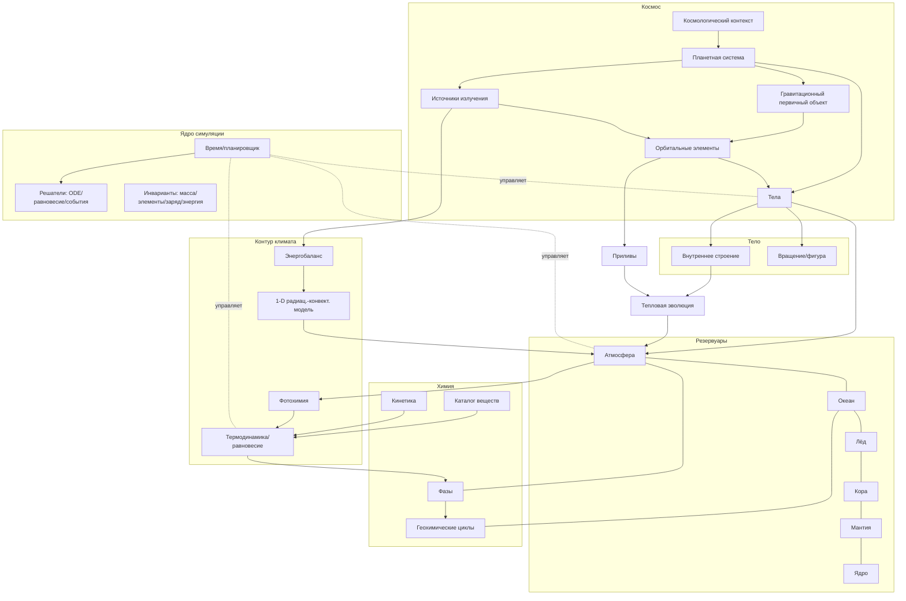

# PHYSICS_ARCHITECTURE — Целевая физическая архитектура

> Stage 4.0, проект. Диаграммы описывают ЦЕЛЕВОЕ состояние; различие с текущим —
> в матрице §9. Проблемы текущего кода нумеруются по CURRENT_SYSTEM_AUDIT §2.
> Ревизия Stage 4.0.1 (2026-10-30): исправлена формула предела Роша (§3.1),
> введена иерархия температурных величин (§5.1), обновлена версия HITRAN.
> Ревизия Stage 4.2.2 (2026-10-30): иерархия температур §5.1 реализована
> в научном ядре типизированно (thermalState, resolver локальной
> температуры, адаптеры provenance) — см. блок «Реализация Stage 4.2.2»
> в §5.1; RCM и вертикальный профиль остаются этапом 4.8.

## 1. Разделение слоёв

```text
UI (React) ──► адаптеры/view-model ──► НАУЧНОЕ ЯДРО (чистый TS, без DOM)
                                        ├── sim/    время, планировщик, решатели
                                        ├── astro/  звёзды, орбиты, приливы
                                        ├── body/   тело, недра, EOS
                                        ├── atmos/  атмосфера, климат, фотохимия
                                        ├── chem/   термодинамика, равновесие, кинетика
                                        ├── geo/    резервуары, циклы, потоки
                                        └── data/   версионируемые каталоги (PhysValue)
```

Правила: ядро не импортирует React; UI не импортирует физические модули,
только адаптеры; каталоги не содержат кода расчётов; контракты между
подсистемами — через `sim/` (см. SIMULATION_ENGINE).

## 2. Космическая система (целевая иерархия)

```text
CosmicContext          эпоха, возраст Вселенной (существут: epochs)
PlanetarySystem        барицентр, система отсчёта
 ├─ GravitationalPrimary   звезда | компактный остаток | планета-родитель
 ├─ RadiationSource[]      светимость, спектр, T_eff, эволюция во времени
 ├─ OrbitingBody[]         планета | карликовая | спутник | малое тело | кольцо
 │   ├─ OrbitElements      (a, e, i, Ω, ω, ν) относительно родителя
 │   ├─ BodyModel          M, R, фигура, вращение, наклон, момент инерции
 │   ├─ InteriorModel      слои: ядро/мантия/кора (+EOS-таблицы)
 │   ├─ ReservoirSet       атмосфера, океан, лёд, кора, мантия, ядро, аэрозоли
 │   ├─ ThermalState       потоки, температуры, теплоёмкости
 │   └─ MagneticField?     только когда есть данные-основания
 └─ SmallBodyPopulation?   по мере необходимости
```

Разделения, обязательные на уровне типов:
- `GravitationalPrimary` (масса, гравитация) ≠ `RadiationSource` (светимость,
  спектр). Белый карлик может быть первичным объектом без собственного
  излучения; джет — источник излучения БЕЗ гравитационной роли (уже сделано
  в этапе 3 — `JetSystemModel`; принцип сохраняется).
- `parentBody` — отдельная сущность: у спутника родитель ≠ звезда.
- Свободно плавающая планета — `PlanetarySystem` без `RadiationSource`.
- Вложенность: спутник спутника — допустима типами (level в ID).

## 3. Небесная механика

### 3.1 Аналитический уровень (текущий + целевой фундамент)

| Модель | Формула | Применимость | Тест |
|---|---|---|---|
| Два тела | P = 2π√(a³/GM) | изолированная пара, M >> m | период Луны 27.32 сут ±0.5%; Земля 1 год ±0.1% |
| Поток | F = L/(4πa²) | точечный источник | солнечная постоянная 1361 Вт/м² ±1 |
| T_eq | [F(1−A)f/(4εσ)]^¼ | серое тело, f ∈ {1/2, 2/3, 1} | Земля: 254–256 K при A=0.3, f=1 |
| Сфера Хилла | r_H = a(1−e)(m/3M)^⅓ | m << M | r_H Земли ≈ 1.5e6 км ±2% |
| Предел Роша (жидкий) | d_R ≈ 2.44 R_p (ρ_p/ρ_s)^⅓ | идеализированный жидкий спутник (см. замечания ниже) | плотностная форма; системы Сатурна |
| Приливный захват | τ_sync ~ параметрическая модель | только при наличии k₂/Q — иначе статус | качественно (не число) |

**Замечания к пределу Роша (ревизия 4.0.1)**. Классическая жидкая форма

    d_R ≈ 2.44·R_p·(ρ_p/ρ_s)^(1/3)

следует из задачи Роша об идеализированной жидкой фигуре (Roche 1849;
Chandrasekhar 1969, Ellipsoidal Figures of Equilibrium; Murray & Dermott
1999, Solar System Dynamics). Ограничения:

- ρ_p и ρ_s — СРЕДНИЕ плотности родителя и спутника; форма через (m/M)^⅓,
  использованная в спецификации Stage 4.0, НЕ эквивалентна плотностной и
  давала неверную зависимость (исправлено, CURRENT_SYSTEM_AUDIT DA-1);
- модель предполагает: спутник — идеальная жидкость БЕЗ прочности
  материала, самогравитирующий, на круговой орбите, вращающийся синхронно;
- предел Роша НЕ является универсальной границей разрушения всех твёрдых
  тел: для малых тел с прочностью материала приливные напряжения могут не
  разрушить объект и внутри классического предела; для абсолютно твёрдого
  (rigid) спутника коэффициент иной (~1.26), и оба коэффициента —
  идеализации, а не физические константы;
- численные проверки — VALIDATION_PLAN уровень 2 (плотности ОБОИХ тел,
  чувствительность d_R к ρ_s).

Правила: любая величина вне применимости → `unknown`, а не «близкое число».
Орбитальные диапазоны каталога остаются game_assumption, но каждый сэмпл
орбиты получает проверку Хилла/Роша как предупреждение (Stage 4.6).

### 3.2 Численное интегрирование (интерфейс, реализация — этап 4.6+)

```typescript
// Контракт (проект; реализация не входит в Stage 4.0)
interface ForceModel { accelerations(state: SystemState): Vec3[]; }
interface Integrator {
  step(state: SystemState, dt: number): SystemState;
  readonly kind: 'leapfrog' | 'ias15-like' | 'dp853' | 'kepler-analytic';
}
```

- **Симплектический leapfrog (kick-drift-kick)**: долгосрочная орбитальная
  динамика; сохраняет энергию статистически; требует почти-Кеплеровых
  шагов; дешёв в TS.
- **Адаптивный Рунге–Кутта (DP853)**: пролёты, сближения, некритичные
  траектории; ошибка контролируется, но энергия дрейфует на длинных рядах.
- **IAS15-подобный (Radau 15-го порядка)**: эталон точности; реализация в TS
  дорогая; целевой вариант — внешняя WASM-библиотека (интерфейс уже
  спроектирован под неё).
- **Аналитический Кеплер**: пропагатор для одиночных орбит без возмущений —
  дешёво и точно; целевой default для «красивых» миров без N-body сценариев.

**Модель двух тел не выдаётся за N-body.** При подключении нескольких тел —
только через `Integrator` с проверками (энергия, момент) на каждом шаге.

### 3.3 Устойчивость и возмущения

- Статические проверки: Хилл, Рош, пересечение орбит, резонансы (MMR по
  отношениям периодов) — предупреждения, не запреты.
- Долговременная устойчивость — только интегрированием (уровень 4.6+),
  до тех пор `stabilityCheck: 'not_performed'` остаётся честным.

### 3.4 Приливные модели (порядок внедрения)

1. Статус «possible» (текущее) — сохраняется.
2. Постоянно-временная модель (constant time lag): нуждается в k₂, Q, массы,
   a, e — все параметры должны иметь источники; без них — unknown.
3. Даарthy/cPL-модели — только как интерфейс + внешние данные.

## 4. Звёзды и излучение

- Текущее: классы с диапазонами (starPhysical) — сохраняются.
- Целевое: сэмпл конкретной звезды из класса (M, L, T_eff) с сохранением
  диапазона в PhysValue (исправление проблемы 2.1, Stage 4.6).
- Эволюция светимости: табличная (age → L) из эмпирических треков; данные —
  литературные модели (источник указывается в каталоге); первая версия —
  линейная интерполяция по опорным точкам, вне таблицы — unknown.
- Спектр:_chunks для фотохимии и парника — таблицы (UV/visible/IR buckets);
  источники: модели звёздных спектров (PHOENIX-подобные, с лицензионной
  проверкой) или параметризация; БЕЗ данных — фотохимия остаётся «не рассчитано».

## 5. Энергетический баланс и климат (уровни)

| Уровень | Модель | Статус | Данные |
|---|---|---|---|
| 0 | T_eq серого тела | реализовано | L, a, A (игровое 0.3) |
| 1 | Одномерная радиационно-конвективная модель (серый газ, N слоёв, конвективная поправка) | проектирование (этап 4.8) | теплоёмкости, серые коэфф. поглощения (источник обязателен) |
| 2 | Коррелированные k-распределения | цель (после 4.8) | HITRAN2024/ExoMol → предрассчитанные k-таблицы (версии фиксировать, базы не смешивать) |
| 3 | Интерфейс внешнего климатического решателя (ROCKE-3D-класс, LMD-класс) | интерфейс | не реализуется в TS |

### 5.1 Иерархия температурных величин (ревизия 4.0.1)

Физически разные температуры НЕ объединяются в одно поле с «разными
источниками». Каждая величина — отдельное поле со своим смыслом,
источником, применимостью, единицами и поведением при отсутствии данных:

| Поле | Физический смысл | Источник | Применимость | Единицы | Вычисление | Нет данных |
|---|---|---|---|---|---|---|
| effectiveTemperature | эффективная температура источника излучения (звезды) | наблюдения / сэмпл из класса (4.6) | звёзды, компактные объекты | K | входные данные | unknown |
| equilibriumTemperature | равновесная температура серого тела T_eq = [F(1−A)f/(4εσ)]^¼ | расчёт из L, a, A, f | радиационный баланс серого тела; НЕ температура поверхности | K | формула из потока | unknown (нет L или a) |
| surfaceTemperature | температура физической поверхности | RCM (уровень ≥1); наблюдательные пресеты — с явным происхождением | поверхность тела | K | только через климатический контур | unknown до RCM; явно оценочные — с пометкой |
| atmosphericTemperatureProfile | вертикальный профиль T(z) | RCM / гидростатика | атмосфера послойно | K (по слоям) | решатель профиля | unknown (1 слой — только оценка) |
| reservoirTemperature | температура резервуара, где идёт процесс | тепловой контур резервуара | океан, лёд, кора, мантия, ядро | K | модель резервуара | unknown |
| localReactionTemperature | температура области протекания реакции / фазового перехода | из reservoirTemperature / профиля области | локальная область | K | температура резервуара/области | unknown |

Правила:

- T_eq — радиационная оценка с допущениями (A, f, ε); она НИКОГДА не
  подменяет surfaceTemperature автоматически.
- Пресетная температура атмосферы — величина с явной пометкой
  происхождения (historical_game для игровых пресетов; справочная — с
  источником); наличие в каталоге не делает её физической температурой
  мира.
- Химические реакции и фазовые переходы используют localReactionTemperature
  — температуру того резервуара и области, где они происходят (контракт
  реализован в Stage 4.2.2: resolver читает только явно указанную область;
  численные решатели процессов по-прежнему Stage 4.2.3+).

**Реализация Stage 4.2.2 (сделано).** Иерархия §5.1 получила типизированный
носитель в ядре (`src/modules/Core/thermalState.ts`, схема CoreWorldState
1.2.0):

- `BodyThermalState` на теле (`WorldBody.thermalState?`): effective
  (T_eq из энергетического бюджета), surface (явно `unknown` до RCM),
  atmosphericTemperatureProfile;
- `AtmosphericTemperatureProfile` со статусами `unknown` /
  `single_layer_estimate` / `partial_profile` / `complete_profile`;
  одно число из пресета — `single_layer_estimate` с обязательным
  `limitations` («НЕ расчётный вертикальный профиль»), фиктивный профиль
  не создаётся;
- `ReservoirRecord.reservoirTemperature?: ScientificValue` — температура
  резервуара с происхождением (её отсутствие ≠ температуре поверхности);
- `resolveLocalReactionTemperature(state, {bodyId, reservoirId | layerId})`
  — локальная температура процесса: читает ТОЛЬКО явно указанную
  область (резервуар тела / слой профиля тела); T_eq, глобальная
  surfaceTemperature и соседние области НЕ являются fallback; отсутствие,
  чужая область или непригодные данные → синтезированный `unknown` с
  причиной; некорректное место (оба id / ни одного) → исключение
  `ThermalStateError('invalid_place')`;
- адаптеры пресетов (`Core/adapters`): пресетная температура →
  `ScientificValue` с provenance (historical_game → estimated
  «игровое допущение», observational_reference → estimated «справочное,
  НЕ измерение этого мира»); `planetThermalStateFromLegacy`: T_eq отдельно,
  surface — `unknown`, effective — `not_applicable` (планета — получатель
  излучения); центральные объекты: T_eff звезды / компактного остатка /
  субзвёздого — known или unknown (среднее по классу НЕ подставляется);
- `diagnosePresetEquilibriumDivergence` — честная диагностика расхождения
  пресетной температуры с T_eq (noted / threshold_exceeded /
  not_comparable); температуры при этом НЕ изменяются;
- генератор передаёт в фазовый скрининг типизированную температуру
  (`analyzeAtmospherePhasesWithProvenance`), а WorldModel больше НЕ
  копирует пресетную температуру в `surfaceTemperature` (проблема 2.3
  закрыта в типизированной части; легаси-путь — см. аудит §2.2/§2.3).

Что осталось до RCM (уровень ≥1, этап 4.8): вертикальный профиль,
гидростатика, парниковый эффект, вычисление surfaceTemperature — всё это
НЕ реализовано и не выдаётся за реализованное; все температуры —
строго в кельвинах, размерность проверяется валидатором ядра.

- До появления RCM surfaceTemperature остаётся `unknown` или явно оценочной
  (estimated + источник), но не подменяется T_eq. Проблема 2.2 закрывается
  на 4.2 — введением этих полей, а не на 4.8.

Связи: орбита (поток, сезонность через наклон/эксцентриситет), атмосфера
(состав), фотохимия (UV), поверхностные резервуары (альбедо, теплота
фазовых переходов).

## 6. Планетарное тело и недра

### 6.1 Статическая структура (этап 4.7, целевое)

- Уравнения: dP/dr = −ρ(P,T)·g(r); dM/dr = 4πr²ρ; слойные EOS.
- Данные: уравнения состояния материалов — только из проверенных таблиц
  (литература по внутреннему строению); без данных слой → unknown.
- Валидация: профиль PREM Земли (P_core ≈ 360 ГПа ±10%), g(R) монотонность.
- Разделение: **статическая оценка** (снимок) ≠ **термическая эволюция** (во
  времени) — разные решатели, разные шаги, связаны через состояние.

### 6.2 Термическая эволюция (этап 4.7+, минимально)

- Энергобаланс: C dT/dt = Q_radiogenic(t) + Q_tidal − Q_convect − Q_conduct.
- Радиогенные мощности: из изотопных содержимостей (K-40, U-238, U-235,
  Th-232) и констант распада — только с источниками (литература); без
  данных → unknown (текущее поведение Geology сохраняется как UI-проекция).
- Приливный нагрев: см. §3.4 — без k₂/Q не вычисляется.
- Вулканизм/дегазация: эмпирические закономерости с явными диапазонами
  неопределённости; первый шаг — поток газов как параметрический диапазон.

## 7. Атмосфера (целевая структура)

- Профиль: гидростатика dp/dz = −ρg, слои от поверхности до экзосферы;
  масштабная высота H = kT/(mg) как первый аналитический тест.
- Состав: многокомпонентный (уже есть), + ионы/радикалы в каталоге веществ
  (CHEMISTRY_ARCHITECTURE §2).
- Перенос: 1-D вертикальная диффузия (молекулярная + турбулентная, eddy K
  — параметр с источником или unknown).
- Конденсация/облака: через фазовый решатель (CHEMISTRY §5); облачность —
  доля с достоверностью.
- Утечка: уровни — (a) Джинс (нужна T экзосферы — обычно unknown),
  (b) energy-limited (нужен EUV поток звезды — параметрическая оценка с
  источником), (c) гидродинамическая — только через внешние модели.
  Без данных — unknown, а не «нет утечки».
- Связь с поверхностью/океаном: потоки через геохимический каркас
  (CHEMISTRY §6) — единые единицы (моль/м²/год).

## 8. Диаграммы

### 8.1 Целевая архитектура подсистем



### 8.2 Зависимости (текущие и целевые)

```mermaid
graph LR
  subgraph Текущее (этап 3)
    U[Units] --> OM[OrbitalMechanics]
    D[Data] --> OM
    D --> PE[PhaseEquilibrium]
    D --> CE[ChemicalEvolution]
    AT[Atmosphere] --> PE
    CE --> PE
    OM --> EB[EnergyBalance]
    D --> GEO[Geology]
    GEO --> EB
    GEN[Generator] --> OM & AT & EB & GEO & CE & WM[WorldModel]
    APP[App.tsx] --> GEN & CE & AT & WM
  end
```

Текущий граф ацикличен (проверено, аудит §2.8). Целевое правило: новые
подсистемы связываются ТОЛЬКО через контракты `sim/` (состояние + время),
не напрямую, иначе появятся циклы (риск R-4, §11).

## 9. Матрица возможностей: текущее → целевое

| Способность | Сейчас | Цель | Этап |
|---|---|---|---|
| Орбита: период/полуось/e | сэмпл из диапазона, Кеплер | + сэмпл звезды, проверки Хилл/Рош/резонансы | 4.6 |
| Орбита: динамика во времени | нет | пропагатор + N-body интерфейс | 4.6+ |
| Приливы | качеств. статус | CTL-модель с параметрами-данными | 4.7+ |
| Поток/T_eq | да (одна точка) | + сезонность (наклон, e) | 4.8 |
| T поверхности | нет (unknown) | RCM 1-D | 4.8 |
| Недра: структура | нет | слоистая модель + EOS | 4.7 |
| Тепло недр: Вт | нет | радиогены/приливы при данных | 4.7 |
| Атмосфера: профиль | 1 слой | гидростатика + диффузия | 4.8 |
| Фотохимия | нет | сеть реакций + фотолиз (JPL) | 4.5/4.8 |
| Утечка | нет | Джинс/energy-limited при данных | 4.8+ |
| Облака/аэрозоли | нет | через фазовый решатель | 4.4+ |
| Вращение/наклон | нет | параметры тела + сезонность | 4.6/4.8 |
| Магнитное поле | нет | только при данных | вне roadmap до данных |

## 10. Архитектурные решения (ADR, к принятию)

- **ADR-P1**: SI строго внутри; конвертация только на границе UI (принято,
  сохраняется).
- **ADR-P2**: орбиты — аналитический Кеплер по умолчанию; интеграторы —
  подключаемые; N-body не обещается раньше реализации (принять).
- **ADR-P3**: surfaceTemperature — самостоятельная величина иерархии
  температур (§5.1), не подменяется T_eq; вычисляется только с RCM
  (уровень ≥1) (принять).
- **ADR-P4**: одна звезда = один сэмпл из диапазона класса (исправление 2.1).
- **ADR-P5**: недра: сначала статика (4.7), потом динамика; смешение —
  запрещено (принять).
- **ADR-P6**: к-таблицы поглощения — предрассчитанные артефакты с версией
  данных; line-by-line в рантайме не делается (принять).
- **ADR-P7**: WASM-бэкенд для тяжёлых решателей — только через интерфейс
  `Integrator`/`SolverBackend`, в TS не переписывать научные решатели
  «ради единого языка» (принять).
- **ADR-P8**: существующие количественные уровни Geology сохраняются как
  UI-проекция после появления Вт-модели (обратная совместимость).

## 11. Риски и несовместимости

| # | Риск | Митигация |
|---|---|---|
| R-1 | Смешение T_eq и T_surface в будущих UI | политика температуры в sim/ (4.2) + тесты на запрет поля |
| R-2 | Пресетные данные воспринимаются как физика | provenance-поля каталогов (4.3) |
| R-3 | Превышение бюджета TS для ODE-жёстких систем | интерфейс SolverBackend + WASM-план (ADR-P7) |
| R-4 | Циклы зависимостей при росте | правило «связь только через sim/», линт-правило импортов |
| R-5 | Разрыв сохранений при смене схемы | миграции Storage обязательны в каждом этапе |
| R-6 | Данные с ограниченными лицензиями | реестр лицензий в DATA_PROVENANCE; проверка до включения |
| R-7 | Вычислительный drift воспроизводимости | детерминированные решатели, фиксированные параметры, golden-тесты |
| R-8 | Ложная точность (больше цифр, чем данных) | форматтеры значащих цифр по неопределённости (4.10) |

## 12. Критерии готовности физических подсистем

- **4.6 (орбиты)**: сэмпл звезды; проверки Хилл/Рош; тесты: Луна 27.32 d,
  Земля 365.25 d, r_H Земли ±2%; сохранение энергии leapfrog на 10⁴ шагов < 1e-6 относительной ошибки.
- **4.7 (недра)**: слоистый профиль Земли воспроизводит P центра ≈ 360 ГПа
  ±10% при заданных массе/радиусе/составе; без данных — unknown.
- **4.8 (климат)**: RCM воспроизводит T_surface Земли ≈ 288 K ±10 K при
  справочном составе; Титан — CH₄-насыщение в тропосфере по скринингу.
